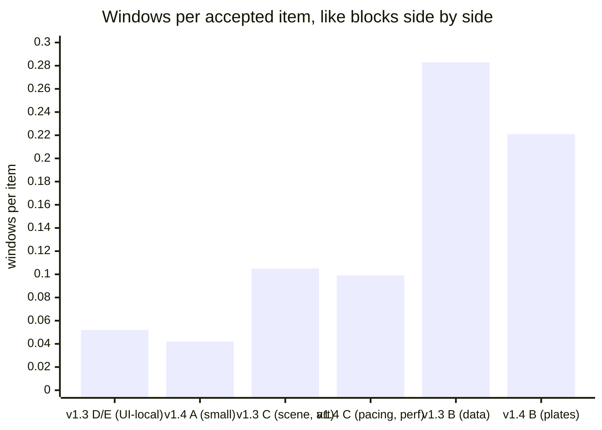
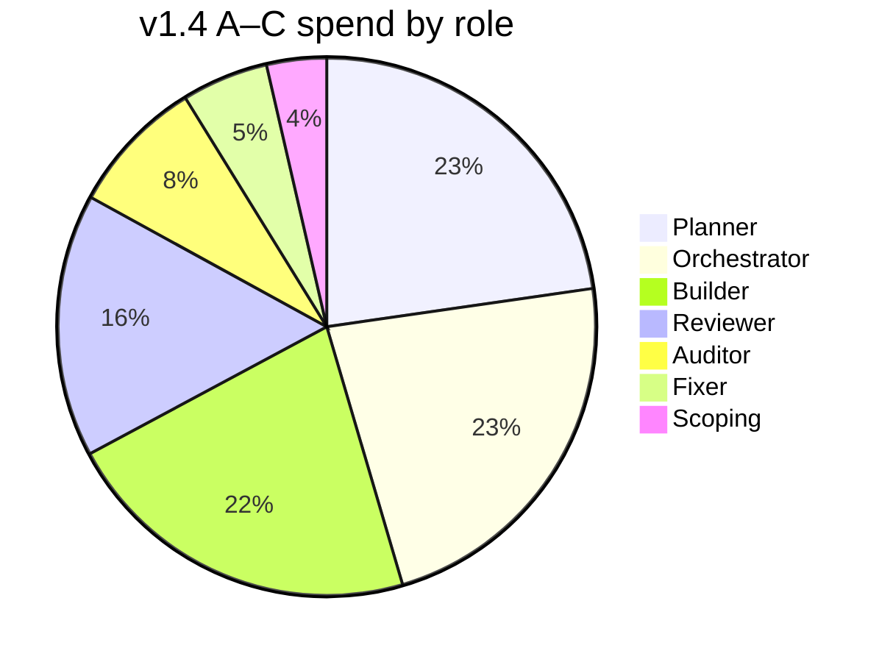

# 28 — v1.4 A–C retrospective: did the sluice pay for itself?

**Status:** written 2026-11-01, after blocks A, B and C of v1.4 were accepted and their gates (HG-A, HG-B,
HG-C) signed. These are the first three blocks run through the sluice (`sluice/`, installed in `.claude/`).
This doc compares them with v1.3's hand-built pipeline ([25](25-v1.3-retrospective.md)) and, through
25, with v0–v1.2 ([24](24-session-retrospective.md)). It asks five questions: how efficiently tokens became
accepted items, what was wasted, what the sluice measurably improved, whether that can be *proven*, and
whether a rigid process is worth having at all. §9 then judges each roadmap entry in
[sluice/docs/roadmap.md](../sluice/docs/roadmap.md) against the new data.

Cost is shown as **windows** (one five-hour usage allowance, about 27 list-price-equivalent units of
spend, as in 25) and as shares. The sluice's own instruments turned out to mis-measure (§6), so every
number here is recomputed from the transcripts. The method and its limits are in §11.

## 1. The short answer

| Question | Answer |
|---|---|
| **Is the sluice cheaper per accepted item?** | **Slightly, not clearly.** 0.128 windows per item against v1.3's 0.145 (−12%). But v1.4's items were about 40% smaller, and block for block, against v1.3 blocks of the same kind, the cost is the same within noise (§3) |
| **Is it better quality?** | **Not provably.** Escapes the user found at the gates: 0 in v1.3, 0 in v1.4. One Major got past item review in v1.4 and was caught by the sluice's own block audit (§5) |
| **Did the parts it changed get better?** | **Yes, clearly.** Rework fell from 46% to 19% of build-and-fix spend. Builder context per call fell from 152k to 84k. Duplicate-notice turns fell from 32 to 0. No audit was lost to a cap, and no state was lost overnight (§4) |
| **Where did those savings go?** | **Into planning and orchestration.** Planners took 22.7% of spend and the orchestrator 22.7%. On Opus, B's planners cost more than its builders (§3, §5) |
| **Is the sluice verifiably superior?** | **No, not yet.** n = 16, with item size, model choices ("lean") and the budget all changing at once. Only a controlled replay can show it (§8) |
| **Is the rigidity unnecessary?** | **In planning and orchestration, mostly yes, for now. In verification, no.** The one escape happened exactly where verification was relaxed: a Sonnet reviewer, and a block with its audit skipped (§7) |

## 2. v1.4 A–C in numbers

| What | v1.3 (25, recomputed) | v1.4 A–C |
|---|---|---|
| Items accepted | 45 | 16 (A 4, B 4, C 8: C4 ran as C4a–c) |
| Spend | **6.54 windows** (incl. the C–E audits re-run on 29 Oct) | **2.05 windows** (the scoreboard says 2.34, §6) |
| Windows per item | 0.145 | **0.128** |
| Code changed (src + tests, lines added + deleted) | ≈13.1k, ≈290 per item | ≈2.7k, ≈170 per item |
| Windows per 100 changed lines | 0.050 | 0.076 (worse, but lines are a weak proxy here: C1 and C2 are mostly generated ledgers, C3 is a measured perf trade) |
| First-pass acceptance | 7 of 24 reviews (29%) | **9 of 13 (69%)** |
| Fix rounds per item | 1.0 | 0.33 (A), 0.4 (B), 0.5 (C) |
| Rework (fix ÷ build + fix) | 46% | **19%** |
| Agent-active hours | 15.0 (0.33 per item) | 6.0 (0.37 per item) |
| Calendar time | 38.7 h | 72.8 h (29 Oct 15:37 → 1 Nov 16:24 UTC), 48.5 h of it waiting for the weekly allowance |
| Usage caps hit | 5 five-hour caps | 2 five-hour caps, plus the weekly allowance (92% used on 29 Oct) |
| Escapes found by the user at the gate | 0 | 0 |
| Escapes past item review | n/a (not recorded) | 1 Major (B2), caught by the A/B audit; its fix caused one regression, fixed in 9937d20 |
| Human prompts during block runs | 15 typed, plus 27 triage rounds | about 9 typed, plus 11 rounds of questions (mostly the gate decisions) |

**Spend by role:**

| Role | v1.3 | v1.4 A–C | Change |
|---|---|---|---|
| Plan (planner) | — | **22.7%** | new |
| Build (first pass) | 27.6% | 21.7% | −6 |
| Fix (rework) | 23.9% | **5.2%** | **−19** |
| Verify (review + audit) | 25.3% | 24.0% | flat |
| Orchestrate | 19.3% | **22.7%** (+3.6 scoping) | **+7** |

**By block:**

| Block | Items | Planner | Builder | Reviewer | Fixer | Auditor | Orchestrator | **Windows** | **Per item** |
|---|---|---|---|---|---|---|---|---|---|
| A (Sonnet planners and reviewers; budget-limited) | 4 | 11% | 25% | 11% | 0% | — | **53%** | 0.17 | 0.042 |
| B (Opus planners, mixed reviewers; no audit) | 4 | **37%** | 21% | 20% | 4% | — | 18% | 0.89 | 0.221 |
| C (lean: Sonnet planners, mostly Sonnet reviewers) | 8 | 15% | 28% | 16% | 6% | 11% | 24% | 0.79 | 0.099 |
| A/B audit (late, 1 Nov) | — | — | — | — | 17% | 61% | 22% | 0.13 | — |
| Scoping (`/sluice scope`) | — | | | | | | | 0.07 | — |

## 3. How efficiently did tokens become accepted items?

**Per call, much better.** The packet worked as intended: builders read a 2,000-word brief, not the doc
set. Here is the average context per call by role, and each call's cost relative to v1.3's builder call:

| Role | v1.3 context | v1.4 context | v1.4 cost per call (v1.3 builder = 1.0) |
|---|---|---|---|
| Builder | 152k | **84k** | 0.60 |
| Fixer | 87k (fresh audit fixers only; most fixes were resumed builders at ~200k) | 61k | 0.38 |
| Reviewer | 61k | 52k | 0.65 |
| Planner | — | 78k | 1.05 |
| Auditor | 84k | 136k | 1.48 |
| Orchestrator (main session) | 209k | 140k | 1.38 |

**Per item, about the same.** The chain that produces an accepted item (plan, build, fix) cost 1.72 units
per item in v1.4 against 1.90 in v1.3 (−10%). Every saving in build and fix was matched by the new planner
step. Add orchestration, which rose, and verification, which was flat, and the whole comes to −12% per
item, on smaller items.

**Per block of the same kind, no difference you could defend.** The chart in §1 pairs blocks by the kind
of work:
- Small, UI-local items cost 0.042 windows (v1.4 A) against 0.043–0.062 (v1.3 D/E), which ran with no
  planner at all.
- Scene and perf work cost 0.099 (v1.4 C) against 0.105 (v1.3 C).
- B looks 22% cheaper (0.221 against 0.283), but v1.3 B was ADO failure semantics and cache migrations,
  and v1.4 B was plate and light visuals. The difference in difficulty is likely larger than 22%.

**The sluice build itself** cost **1.43 windows**: 1.08 for the design and package on 29 Oct (one main
session averaging a 369k context, peaking at 635k) and 0.35 for the views on 1 Nov. Doc 25's analysis
(0.18) and CI/CD setup (0.12) are counted separately. At the −12% measured so far (0.017 windows per item),
the build pays back after about 85 items, or roughly five more blocks like these. That payback is real only
if the −12% is.

## 4. Signs of success: what the sluice measurably fixed

Each of 25's eight wastes, and what happened to it:

| 25's waste | v1.3 | v1.4 | Verdict |
|---|---|---|---|
| 1. Fixes resumed a cold implementer | 9.3% in re-writes | Fresh fixers: 2.87 units in all, contexts of 46–107k, 0.38× a v1.3 builder call | **Fixed** |
| 2. Orientation carried in every call | Builders at 152k | Builders at 84k | **Fixed** (but see §5.1: part of it moved to the planner) |
| 3. Orchestrator context before compaction | 360k average in Block B | 134k average in the B/C session; but Block A's orchestrator ran at 250k, carrying v1.3's close and the scoping | **Mostly fixed** |
| 4. Duplicate completion notices | 32 turns, ~2% | 0 turns | **Fixed** |
| 5. Work cut off at the cap | 2.3% in lost audits, four resumes | No audit lost. One builder cut (C3, 1.76 units), recovered from its partial commit | **Mostly fixed** |
| 6. Design settled by review loops | B5's loop, 7.2% | Largest item: C3, 3 reviews, 0.19 windows. Its blocker was "measure all the options", not a design dispute | **Fixed so far** (no B-type item has been tested yet) |
| 7. Repeated checks | 187 typechecks | The gate blocked 3 finishes in all; e2e locked behind `with-lock.sh` | **Better; unmeasured** (the gate has no timing, §6) |
| 8. State in `/tmp` | Lost overnight | Every packet, review and verdict in `docs/progress/v1.4/work/`; two overnight stops and two caps lost nothing | **Fixed** |

Other signs of success:
- **First-pass acceptance went from 29% to 69%,** and rework from 46% to 19% of build-and-fix spend. The
  first is confounded (§5.2); the second isn't, because a fix round costs the same whoever ordered it.
- **The block audit earned its keep.** The late A/B audit found B2's Major, which an item review had passed,
  before the user's gate. The audit cost 0.13 windows with its fixes.
- **Decisions reached the user as decisions.** HG-A, HG-B and HG-C were signed in one sitting. The 11
  question rounds were product choices (the 5-minute pacing cap, which levers to pull), not status checks.
- **The run became legible.** The ledger, scoreboard and views exist, and this retrospective was assembled
  from them in a fraction of 25's time. They needed correcting first, though (§6).

## 5. Signs of failure, and where tokens were wasted

### 5.1 Waste, ranked

| # | Waste | Cost | Evidence |
|---|---|---|---|
| 1 | **Opus planners on medium items.** B's four planners averaged 2.2 units each (45–52 calls, ~90k context), more than the builders they briefed (1.25 each). C's Sonnet planners averaged 0.82, and C's first-pass rate and rework were no worse | ≈5.5 units, **0.2 windows**: about 10% of v1.4 | Ledger. Planners were 37% of Block B |
| 2. | **The orchestrator didn't get leaner.** About 15 main-session calls per item, against v1.3's 7. Of 120 Bash calls, 88 were reading files and state. The sluice made the orchestrator's work more mechanical without making it cheaper | 22.7% of spend; at v1.3's 7 calls per item, about 6 units | Tool tally of the three run sessions |
| 3 | **Block A's tiny batch through the full pipeline.** Four items scored 1–2, with an orchestrator carrying v1.3's close and the scoping (250k context) | Orchestration was 53% of A | §2 |
| 4 | **The one-hour cache for builders.** The premium cost 1.82 units, about 15% of builder spend. Builders never paused for 5–60 minutes, so it saved nothing | **1.82 units, all waste** | Gap analysis of 13 builders (§9, H4) |
| 5 | **The sluice build ran in one huge main session.** 196 calls averaged 369k context, the same main-session context tax that 24 and 25 named, applied to meta-work | Plausibly a third to a half of its 1.08 windows | Session c352ed79 |
| 6 | **Skipping verification to save budget.** "Lean" moved B and C to Sonnet reviewers, and B ran with no audit. The B2 defect passed review, was found a day later, and its fix broke a cast-plate test, which needed a second fixer | Small in tokens (≈0.6 units); large in risk | §5.2 |
| 7 | **The weekly allowance.** v1.3, 25's analysis and the sluice build used the week. v1.4 waited 48.5 hours after Block A | 67% of v1.4's calendar time | The user's `/usage` note at 16:39 on 29 Oct: 92% of the week used |
| 8 | **A builder killed at the cap** (C3, 1.76 units), invisible to the ledger | 1.76 units, mostly re-paid on resume | §6 |

### 5.2 The escape, and what it says about "lean"

**B2's reviewer saw the defect and called it Minor.** Its review reads: "the walk enters the pod (which
selects the star) and never calls `select(null)`, so the list is open in both stills… The code is right;
only the walk and its stills mislead." The audit looked at the same behaviour from the user's side, as the
first view of every pod, with the list covering Quasar's plates, and graded it Major. B2's reviewer ran on
Sonnet, under "lean", and Block B skipped its audit, so it took the late A/B audit to catch it.

**First-pass acceptance depends on who reviews.** In v1.4, Sonnet reviewers passed 8 of 10 first reviews.
Opus reviewers passed 1 of 3 (B1, B3, C3: the riskiest items, so this is confounded both ways). In v1.3,
Opus reviewers passed 4 of 21 Sonnet builds. **The jump from 29% to 69% is at least partly a cheaper
reviewer saying yes more often,** and can't be credited to packets and planners alone.

### 5.3 Other failures

- **The routing rule was overridden.** The planner scored B1 at 6 (large: Opus builder) and it was built on
  Sonnet. It was the B item that needed a fix round.
- **The gate was green and the reviewer red, once.** C1's determinism test passed the builder's gate but
  timed out under the reviewer's parallel load: a flake, not a gate bug, but it cost a round.
- **The known hotspot got worse.** The worst function's complexity (label placement in `labels.ts`) rose
  from 209 at Block A to 225 at Block C. That is the hotspot the roadmap's L-section names.

## 6. The sluice's instruments mis-measured

The scoreboard is what the sluice judges itself by, so these matter more than their size suggests:

| Defect | Effect | Fix |
|---|---|---|
| `summary.mjs` prices the orchestrator as **every main-session call in any session** during the block's span, ±30 minutes | Block C's orchestrator was reported as 54%; it was 24%. The views-building session (9.42 units) was charged to Block C. B and C overlapped on 31 Oct, so their main loops were **counted twice**. Block A picked up scoping. Total overstated by 14% (2.34 against 2.05 windows) | Attribute by session ID and by the run's own turns, not by time; split shared turns by item |
| **Agents killed at a cap never reach the ledger** (the hook runs on a normal stop) | C3's first builder (1.76 units) is missing | Reconcile the ledger against `subagents/*.meta.json` at summary time |
| **Review findings come in two shapes** (objects or strings) | Severity counts from `review-*.json` are unreliable | D3: validate records when an agent finishes |
| **The gate records no time** | H5 can't be judged | Write each check's seconds into the ledger line |
| **Reviews rarely name the lens they used** | H6 can't be judged: 1 of 18 reviews and audits (C3's first) cites the project notes | A `lens` field on each finding |
| **Escapes don't say where they were found** | B2 "escaped" item review but not the sluice, and only free text says so | P3: `found_by: review / audit / human` |

**Fixed with this doc:** the first two rows. `summary.mjs` now prices the orchestrator from the
sessions that launched the block's agents (±10 minutes, with shared turns split) and recovers cap-killed
agents. Re-run without `--write`, it gives A 0.21, B 0.90, C 0.73 and the A/B audit 0.15: 1.99 windows,
against 1.98 by this doc's hand attribution for the same scope. The old figure was 2.34. The scoreboard's
v1.4 rows still hold the old figures: re-writing them would also re-stamp each block's health snapshot at
today's commit. The rest of the table is open on the roadmap.

## 7. Is a rigid process worth it?

**The case against, from this data:**
- Small items cost the same with or without the sluice (v1.4 A 0.042, v1.3 D 0.043). At scores of 1–2 the
  planner, packet and orchestration added steps and no measurable quality.
- The process was bent within two blocks: lean models, a skipped audit, a routing override. A process
  that can't be afforded as designed under a weekly allowance isn't the process that's being tested.
- The sluice build cost 1.43 windows, about 70% of what A–C itself cost. It pays back only at scale.

**The case for:**
- The parts that cost the most in v1.3 (resumed fixers, duplicate notices, cold resumes, lost audits,
  state in `/tmp`) are gone, and they stay gone because they're code and files, not habits.
- The one quality failure happened exactly where the process was relaxed, and the one rigid step that
  remained (a block audit, if late) caught it.
- v1.4's runs needed fewer prompts per item, and every pause was a gate or a cap, as in v1.3, with nothing
  rebuilt from a transcript.

**Verdict:** the rigidity that is **verification and state** (fresh reviewers, audits, the gate, files as
the interface) has earned its place. The rigidity that is **ceremony around small items** (a planner and
a full orchestrator loop for a score-1 change, an Opus planner on a medium item) has not, so far.

## 8. Can the sluice be proven superior?

Not from these runs. Five things changed at once between v1.3 and v1.4 A–C:
1. the process;
2. item size (−40%) and kind;
3. the models per role (A and C lean, B mixed);
4. the budget regime (weekly-allowance pressure from 29 Oct);
5. the reviewers' leniency (§5.2).

With 16 items there's no statistical way to separate them.

**What is proven** is mechanism-level: context per call, rework share, duplicate turns, lost audits and
lost state, each measured the same way in both tranches. **What isn't proven** is the outcome:
windows per accepted item at equal escapes.

**The replay trial (proposed, not run).** This is pre-registered here so the result can't move the
goalposts:
- **Items:** three already-accepted v1.4 items spanning the risk scores: A4 (score 2), C4a (5, passed
  first time) and B2 (5, the escape). Each is rebuilt from its recorded start commit, in a worktree.
- **Arms:**
  - (a) **v1.3 mode:** one Sonnet implementer with a brief, an Opus review, and fixes by resuming the
    implementer.
  - (b) **The sluice as designed:** a Sonnet planner, the builder tier its score picks, and an Opus reviewer.
- **Judge:** one blind Opus reviewer grades both final diffs against the packet's acceptance and the
  B2 audit finding.
- **Measures:** windows per accepted item; Blocker and Major findings the judge raises on the final diff.
- **Signal:** the sluice wins if (b) costs ≤ (a) on at least two of three items with no more Majors. The
  sluice loses if (a) is cheaper on two of three at equal findings; then the planner becomes opt-in by
  score. Anything else counts as inconclusive, and gets reported as such.
- **Cost:** about 0.5–0.8 windows, run at the start of a fresh week.

## 9. The roadmap, judged against this data

Statuses refer to [sluice/docs/roadmap.md](../sluice/docs/roadmap.md). These verdicts were applied there on
2026-11-01: H4 moved to *Settled* as S3 (the builder's long cache is removed), each other row's evidence
was recorded, and H12–H14 were added. The H1 (planner tier) and H3 (threshold) changes are proposals for
v1.4 D, not yet made in the agent files or heuristics.

| Entry | What the data says | Recommendation |
|---|---|---|
| **H4** (long cache for builders) | No builder paused 5–60 min; the premium was 15% of builder spend, all waste | **Settle: reverted.** Short cache for every role |
| **H1** (the planner pays for itself) | On H1's own test, rework fell 27 points (46 → 19%) against a planner share of 22.7%: met, narrowly. In spend, fix fell 18.7 points while planning added 22.7. Opus planners didn't pay; Sonnet planners roughly did | **Keep on trial**, with two changes: planner on Sonnet by default, and a sub-trial where score ≤ 2 skips the planner (see H12) |
| **H2** (medium builders reach 60%) | 69%, but Sonnet reviewers passed 8 of 10 and Opus 1 of 3 | **Unsettled**: the reviewer model must be held fixed before it can be judged. Re-run with Opus reviewers on score ≥ 4 |
| **H3** (risk thresholds) | Every item scored ≥ 5 except C4 had a fix round or an escape (B1, B2, C3); 2 of 7 at ≤ 4 did (A1–A3, C1) | **Move the large threshold from 6 to 5,** as a trial. Large means an Opus builder and an Opus reviewer |
| **H5** (gate cost) | Unmeasured: the gate logs no time | **Instrument first** (§6) |
| **H6** (project notes sharpen reviews) | One review cites a lens (C3: "the effect where it's meant"). B2's escape is in the class "the effect where it's meant" | **Instrument first**: a `lens` field. Add a lens: *reach the state the way the user does* |
| **H7 / D1** (`next.mjs`, the loop as code) | The orchestrator was 22.7% at 15 calls per item; 88 of 120 Bash calls were reads | **Justified now. The top build item.** Signal unchanged: under 3 calls per item and under 8% of spend |
| **D3** (records validated in the gate) | Findings came in two shapes; severity counts broke | **Justified**: cheap, and it protects every metric |
| **D5** (checkpoints as code) | Commits were clean, but git and state were part of those 88 reads | Fold into D1 |
| **D6** (compressed test output) | Builder context already fell 45% with packets | **Lower priority** |
| **D8 / H10** (forecasts, window calibration) | 16 items of ledger data now exist; $27 per window still reproduces v1.3 and v1.4; but the **week**, not the window, stopped v1.4 | **Extend H10 to the weekly allowance**: `budget.mjs` should know the week |
| **H8** (worktrees) | The budget, not wall clock, is the bottleneck | **Keep deferred** |
| **H9** (refutation pass) | The failure here was a finding *under*-graded, not a false positive | **Not justified.** Replace with H13 |
| **H11** (views) | Built 1 Nov; already used to watch C's close | **On trial from D**, as planned |
| **P2** (scoreboard) | Overstated spend by 14%, orchestrator share by 2× in C | **Reopen**: the attribution fixes in §6 |
| **P3** (escapes record) | B2's "where it was found" lives only in prose | **Justified**: add `found_by` |
| **L1 / L3** (health; ratchet) | The worst function rose 209 → 225 in three blocks, in the known hotspot | **Start L3 as a warning** in the summary for touched files whose worst complexity rises |
| L2, L4–L10 | No new evidence | Unchanged |

**New hypotheses this data suggests:**

- **H12. Small items skip the planner.** At score ≤ 2, the scope doc's acceptance goes straight into a
  builder's packet, written by the orchestrator (or by D1's script). *Signal:* first-pass rate holds and
  windows per small item fall below 0.035.
- **H13. Verification never goes lean.** "Lean" may downgrade planners and builders, but not reviewers on
  score ≥ 4, and never skips the block audit. A reviewer that marks a user-visible behaviour Minor must say
  why the user won't see it. *Signal:* no escapes past item review at score ≥ 4 over two blocks.
- **H14. The sluice's own work runs as sluice-sized sessions.** Meta-work (designing, documenting and
  packaging the sluice) is split across fresh sessions or compacted at each milestone, so no main session
  passes about 200k. *Signal:* the next sluice-improvement session costs under half a window per feature
  shipped.

## 10. The questions worth asking next

> **Holding the reviewer fixed, does a planner plus packet produce an accepted item for fewer windows
> than a brief plus a resumed implementer?**

That is §8's replay. Everything else in this doc is either mechanism (proven) or correlation (not).

Behind it:
- **What is the smallest sluice for a score-1 item?** If H12 holds, the sluice becomes risk-proportional
  instead of uniform.
- **Can the orchestrator cost less than its builders?** D1 is the test.
- **What is one week worth?** v1.3, the sluice build and v1.4 A together used about 8 windows before the
  weekly stop. Planning in weeks (with D8) may matter more now than planning in windows.

## 11. How the numbers were measured, and what they can't show

- **Sources:** every transcript under `~/.claude/projects/` for this repo from 27 Oct on (12 main sessions
  besides this one, 120 subagents), the v1.4 ledger, the scoreboard, the work folders' `plan-`, `review-` and `audit-`
  records, the block notes, and `git log --numstat`. The demo project used to test the sluice cost almost
  nothing (0.03 units).
- **Prices:** `config.json`'s list prices, which are 25's index (Sonnet input = 1; one index unit = 2
  price units). They reproduce 25's v1.3 total: 166.4 units = 6.16 windows at 27 per window. v1.3's
  total here adds the C–E audits and their fixer (lost to the cap on 28 Oct, re-run on 29 Oct) and the
  orchestration around them.
- **Tokens:** each API response's usage, de-duplicated by message ID, keeping the largest value per field.
- **Attribution:** subagents by the ledger (item, role, model), plus the one cap-killed builder found in
  the transcripts. Main-session spend is split by session and time: the B/C session's turns before
  23:18 on 31 Oct went to B. Its later turns, and the 1 Nov run session's, were split by the subagent spend
  of each block in that period. The sluice build (c352ed79 after 03:31, and 6588904f), 25's analysis and the
  CI/CD sessions are excluded from v1.4 and reported separately.
- **Like-for-like blocks:** pairs of blocks by kind of work, the author's judgment. v1.3's per-item figures
  come from 25's per-item shares.
- **Lines changed:** src and tests, added plus deleted, from each item's commits (including audit fixes and
  C3's partial commit). That's a weak proxy for difficulty: art and perf items change few lines for their
  cost.
- **First-pass by reviewer model:** from the ledger's reviewer model and `review-1.json`'s verdict.
- **Not visible:** the user's time outside the conversation; the size of the weekly allowance (inferred
  only from the 92% note); whether v1.4's later blocks keep C's numbers; and whether the user would have
  seen B2's defect in the demo.

**Source:** transcripts, ledger and `git` as of 2026-11-01 (9f6cf83) · **Update when:** the replay trial
(§8) runs, or v1.4 closes and `/sluice retro` writes its own numbers. At that point, check them against
§6's corrections.
