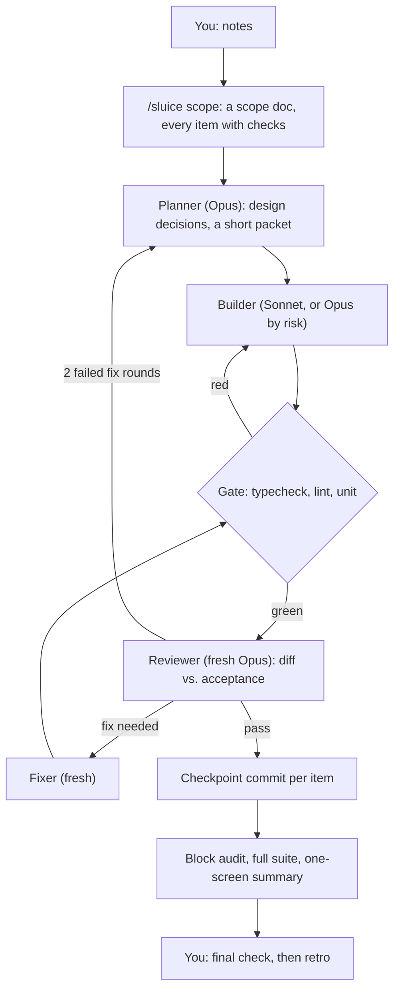
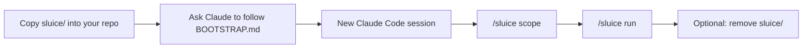
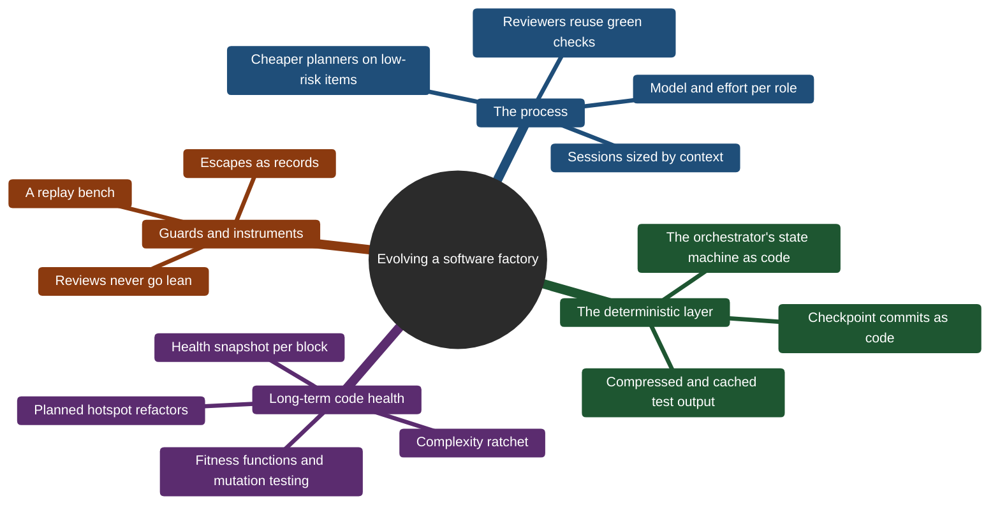
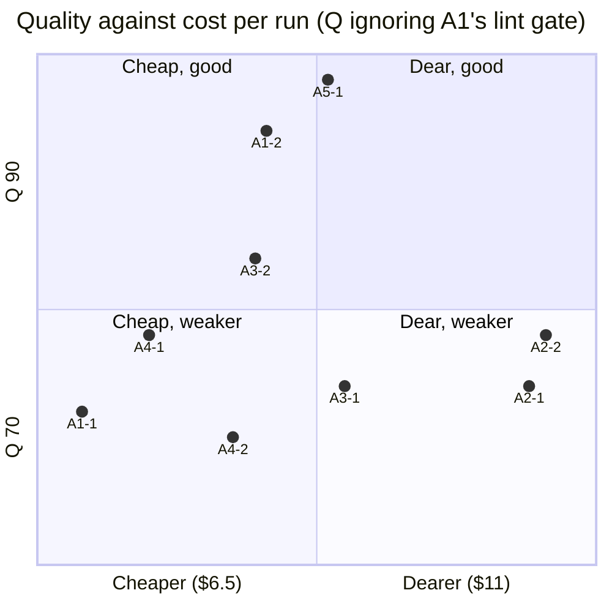

# Sluice: a cost-efficient software factory for Claude Code

By [Erik Ralston](https://www.linkedin.com/in/erikralston/)

**Sluice** is a small, observable workflow that has Claude Code agents scope, plan, build, review and measure
software changes one item at a time. It aims for the most finished, trusted work per dollar. This repository holds
the workflow itself and a benchmark that tested it against other ways of working with Claude.

| Folder / file                                                                                            | What it is                                                                                                                                     |
| -------------------------------------------------------------------------------------------------------- | ---------------------------------------------------------------------------------------------------------------------------------------------- |
| [sluice/](sluice/)                                                                                       | The workflow: agent roles, the `/sluice` skill, hooks and dependency-free Node scripts, plus its design, manifesto, roadmap and research notes |
| [sluice-bench/](sluice-bench/)                                                                           | The raw benchmark data: nine replay runs of one item, blind-judge output, health tables and per-run reports                                    |
| [results.md](results.md)                                                                                 | The full benchmark write-up and its conclusions                                                                                                |
| [28-v1.4-sluice-retrospective.md](28-v1.4-sluice-retrospective.md)                                       | The retrospective that showed the sluice needed a controlled test                                                                              |
| [30-whole-strategies.md](30-whole-strategies.md), [31-whole-strategies-f2.md](31-whole-strategies-f2.md) | The benchmark's design, and its first stage (item F2)                                                                                          |

**Read this before you rely on it:**

- **When and with what.** Written and benchmarked in **November 2026** (bench runs 2026-11-09 to 11-11) with
  **Claude Opus 5.5** and **Sonnet 5.5** (Haiku for clerical work), using **Claude Code** as the harness: subagents,
  skills, hooks and the statusline. Model names, prices and harness behaviour change. Expect to re-tune.
- **Where it came from.** It was distilled from building one project, _Star Chart_ (a macOS app), by one person over
  about a month. The benchmark replays that project's work, so the numbers come from one codebase.
- **What it assumes:** a Claude subscription (the budget plans in five-hour usage windows; on an API key it still
  works, but can't see the window), Node.js 18+, git, and **tests you trust**. The gate is only as good as your
  checks.
- **What it is:** a research project and a reference implementation, not a product. See the
  [Conclusion](#conclusion).

**Going deeper:** the [sluice/docs/](sluice/docs/) folder explains the design and the evidence behind it.

| Document | What it's about |
|---|---|
| [design.md](sluice/docs/design.md) | The full design: roles, file formats, model and risk rules, budgets, context, metrics, and how to tell whether each choice is working. Installed agents cite it as their reference |
| [adopting.md](sluice/docs/adopting.md) | The practical guide: install, every `config.json` setting, your first tranche, day-to-day use, upgrades, troubleshooting and uninstalling |
| [evolution.md](sluice/docs/evolution.md) | The origin story: the six ways of working tried while building Star Chart, and what each one taught |
| [case-study.md](sluice/docs/case-study.md) | One pre-sluice tranche (45 changes, 62 subagents) measured from its transcripts: where the time and tokens went |
| [research.md](sluice/docs/research.md) | The published evidence behind the design: separate judges, reviewer prompting, multi-agent costs, spec formats, and code health |
| [roadmap.md](sluice/docs/roadmap.md) | Every planned improvement written as a hypothesis with success and failure signals, ranked by expected savings |

---

## What is a software factory?

A **software factory** treats software delivery as a production line rather than a craft workshop: standard inputs,
a defined path, quality checks between stations, and a record of what happened at each one. The idea goes back
decades, but it rarely worked, because the hard part of software is judgment and judgment was hard to automate.
In an **agentic** software factory, AI agents do much of the planning, coding, testing and review. People set the
intent, the acceptance criteria and the approval rules.

| Source                                                                                                                                                         | What it adds                                                                                                               |
| -------------------------------------------------------------------------------------------------------------------------------------------------------------- | -------------------------------------------------------------------------------------------------------------------------- |
| [Greenfield & Short, _Moving to Software Factories_ (Microsoft, 2004)](https://learn.microsoft.com/en-us/archive/blogs/askburton/moving-to-software-factories) | The original idea: move software from craft to manufacturing through product lines, reuse and automation                   |
| [Sonar, _What Is an Agentic Software Factory?_](https://www.sonarsource.com/resources/library/what-is-an-agentic-software-factory/)                            | A modern definition: a ticket or spec goes in, verified, releasable changes come out. Traces the idea back to Bemer (1968) |
| [Augment Code, _What Is a Software Factory?_](https://www.augmentcode.com/guides/what-is-a-software-factory)                                                   | The factory as an operating model: stages, human gates at spec and merge, and planned review capacity                      |
| [Anthropic, _Harness design for long-running apps_](https://www.anthropic.com/engineering/harness-design-long-running-apps)                                    | Why splitting the generator from the evaluator is "a strong lever"                                                         |
| [Anthropic, _How we built our multi-agent research system_](https://www.anthropic.com/research/multiagent-systems)                                             | What multiple agents buy, and what they cost in tokens                                                                     |
| [Claude Code best practices](https://code.claude.com/docs/en/best-practices)                                                                                   | Fresh-context review, verification, and keeping context small                                                              |

**Where Sluice fits:** it's meant to be a **cost-efficient, easy-to-understand reference implementation** of an
agentic software factory. It has six roles, one gate and one loop, and every decision lands as a Markdown or JSON
file in your repo. It's small enough to read in an afternoon, and to fork when your needs differ. The evidence
behind each design choice is in [sluice/docs/research.md](sluice/docs/research.md), and its twelve tenets are in
[sluice/MANIFESTO.md](sluice/MANIFESTO.md).

---

## How Sluice works



| Principle                                 | How it shows up                                                                                                                                                                  |
| ----------------------------------------- | -------------------------------------------------------------------------------------------------------------------------------------------------------------------------------- |
| **Separate the author from the judge**    | A fresh reviewer sees only the diff and the acceptance checks, never the builder's reasoning                                                                                     |
| **Design once, with the strongest model** | An Opus planner settles decisions up front, so cheaper builders don't guess                                                                                                      |
| **Match the model to the risk**           | A five-factor risk score picks the builder's tier (`tier.mjs`)                                                                                                                   |
| **Let machines check what machines can**  | A `SubagentStop` hook won't let a builder finish while the gate is red                                                                                                           |
| **Context is the bill**                   | Fresh agents with short packets, not one long, growing conversation                                                                                                              |
| **Instrument lightly, and read it**       | A ledger of tokens and time per agent, block notes, a scoreboard across tranches, and live Mermaid views (`now.md`, `board.md`, `timeline.md`) redrawn by hooks at no token cost |

| Command                             | What it does                                                                     |
| ----------------------------------- | -------------------------------------------------------------------------------- |
| `/sluice scope <notes>`             | Turns notes into a scope doc, through rounds of multiple-choice questions        |
| `/sluice run <scope doc> [block]`   | Builds a block on a `sluice/<tranche>` branch, with one commit per accepted item |
| `/sluice summary <tranche> [block]` | First-pass rate, fix rounds, spend by role, code health                          |
| `/sluice retro <tranche>`           | Compares this tranche with earlier ones, and proposes the one change to try next |
| `/sluice status` · `/sluice views`  | The budget and each item's state · where the live views are                      |

---

## Getting started



1. **Copy** the [sluice/](sluice/) folder to the root of your project, as `sluice/`.
2. **Install.** Open Claude Code in your project and paste:
   ```text
   Read sluice/install/BOOTSTRAP.md and follow it to install the sluice into this project.
   ```
   Claude surveys your stack and asks a few multiple-choice questions: your gate and full-suite commands, where
   files should live, and which models your plan offers. It then copies `sluice/template/claude/` into `.claude/`,
   merging with anything already there, fills in `.claude/sluice/config.json`, drafts your project notes, adds a
   short section to `CLAUDE.md` and runs the self-test.
3. **Start a new session** so the agents, skills and hooks load. Accept the folder-trust prompt if it appears.
4. **Scope and run.** Paste a prompt from [sluice/install/FIRST-SESSION.md](sluice/install/FIRST-SESSION.md),
   then run `/sluice run <scope doc> A`. Keep `<progressDir>/<tranche>/views/now.md` open in a Markdown
   preview to watch it work.
5. **Optional: remove `sluice/`.** If you aren't going to evolve the process itself, the installed `.claude/` is
   all you need day to day. **One catch:** the agents cite the design doc through `designDoc` in
   `.claude/sluice/config.json`, which defaults to `sluice/docs/design.md`. Before you delete the folder, move
   that file (for example, to `docs/sluice-design.md`) and update `designDoc`. Then run
   `node .claude/sluice/selftest.mjs`. Keep `sluice/` instead if you plan to change the process, since the
   self-test's drift check compares `.claude/` against `sluice/template/claude/`.

More detail: [sluice/docs/adopting.md](sluice/docs/adopting.md) (configuration, day-to-day use, upgrades,
uninstalling).

---

## Roadmap

Sluice is the **sixth** way of working tried on Star Chart. Each of the first five was measured from its
transcripts, and each fed the next ([evolution](sluice/docs/evolution.md)). It changes **by experiment, not by
opinion**. Each idea in [sluice/docs/roadmap.md](sluice/docs/roadmap.md) is written as a hypothesis with a
success signal, a failure signal and a quality guard, and is trialled one change at a time. Ideas are ranked by
expected dollars saved per block, net of what they cost to build.



| Theme                                   | The question it asks                                                     | Examples                                                                                                                  |
| --------------------------------------- | ------------------------------------------------------------------------ | ------------------------------------------------------------------------------------------------------------------------- |
| **The process** (H-entries)             | Which model, effort and session shape does each role need?               | H24 role tuning, H1 Sonnet planners at low risk, H17 reviewers reuse green checks, H25 hand-offs instead of long contexts |
| **The deterministic layer** (D-entries) | What does a model do today that code could do for free?                  | D1 `next.mjs` (orchestration as a state machine), D5 checkpoint commits, D6/D10 compressed and cached checks              |
| **Long-term health** (L-entries)        | Does the codebase stay easy for agents to change, tranche after tranche? | L1 health snapshot (built), L3 a complexity ratchet, L4 refactoring hotspots, L7 mutation testing                         |
| **Guards and instruments**              | What must never get cheaper, and how do we see it?                       | H13 reviews never go lean, P3 escapes as a record, H26 the replay bench                                                   |

> **Sluice optimises for dollars, not minutes.** Its principles (fresh agents, bounded Opus, independent review,
> one writer at a time) trade wall-clock time for lower spend and an auditable record. A factory built for the
> **least wall-clock time** would make different choices: one long context, parallel builders in worktrees,
> fewer hand-offs, and review only where the risk demands it. The benchmark below shows that trade-off.

---

## Sluice benchmark

**The question:** does Sluice's planner-builder-reviewer pipeline pay for itself, or does a simpler strategy get
the same result for less? **The method:** one finished, signed-off item from Star Chart (F2, a medium-risk
schedule change) was rebuilt from its start commit by five strategies, nine runs in all. Every arm had the same
tree, scope text, rules, models and checks. Each result was scored blind, out of 100 (acceptance 40, regressions 20,
judged defects 20, rules and docs 10, a human's blind look at stills 10). Q is 0 if a hard gate fails. The runs and
judging cost about $107. Details: [results.md](results.md).

| Arm    | Strategy                                 | Mean cost | Mean time to commit | Flow time¹ | Q as scored   | Q ignoring the lint gate² |
| ------ | ---------------------------------------- | --------- | ------------------- | ---------- | ------------- | ------------------------- |
| **A1** | Sluice, as it built the item (control)   | **$7.62** | 89 min              | 25 min     | 0 (lint gate) | 81.5                      |
| **A2** | One conversation, no subagents or review | $10.53    | **60 min**          | **17 min** | 78            | 78                        |
| **A3** | Ultracode workflow                       | $8.61     | 96 min              | 33 min     | 79.5          | 79.5                      |
| **A4** | Tests first, then build to green         | $7.73     | 123 min             | 26 min     | 77            | 77                        |
| **A5** | Today's sluice (A1 + the retro's fixes)  | $8.86     | 97 min              | 34 min     | **89**        | **89**                    |

<sub>¹ Wall clock minus test, build and polling waits: the time the strategy itself spends working and handing off.
² Both A1 runs failed only because the reviewer's scratch scripts were committed. The product code passed every
check. Each arm ran twice, except A5, which ran once.</sub>



**Why this supports using Sluice day to day:**

- **It's the cheapest.** No strategy saved the 25% the test required to replace it. Tests-first tied it, and the
  others cost more.
- **The current version scored best.** A5 (Q 89) costs within noise of the control, with no Major left and every
  doc rule met.
- **Independent review catches real problems.** The only arm without review (A2) shipped one unreviewed Major in
  each run. It also added the most complexity and wrote the fewest tests.
- **Its cost comes from bounded Opus:** Opus only plans and reviews, Sonnet does the volume work, and every agent
  starts with a small context (62–133k tokens a call, against 184–204k for one conversation).
- **Its one gap is cheap to fix:** a final typecheck, lint and unit gate just before each commit.

**What it doesn't show:** it's one medium-risk item with two runs per arm, so differences under about 20% are noise.
F2 had no seeded defects, so whether review catches hidden Blockers is still open. That's the next stage (F3).

---

## Conclusion

On F2, every strategy delivered the feature. Eight of nine runs met every acceptance line, none regressed, and to a
human's eye the results looked almost the same. The strategies differ in **cost, time, and what they leave behind**:
tests, complexity, and a record the next reader can follow.

| Strategy                              | Use it when…                                                                                                                        | Avoid it when…                                                                                     |
| ------------------------------------- | ----------------------------------------------------------------------------------------------------------------------------------- | -------------------------------------------------------------------------------------------------- |
| **Sluice**                            | It's your everyday default for medium-risk work or above, or when the next person needs the record (packet, build and review files) | The change is trivial: planning and review are about 70% of its spend                              |
| **One conversation**                  | A deadline is close and time matters more than about 40% more spend. Ask for one fresh review before shipping anything users see    | The work is high-risk, or the context would grow past about 200k tokens a call                     |
| **Hill Climb workflow (Tests First)** | The acceptance is crisp and testable, and you want the strongest test net left behind                                               | Time is short (it was the slowest arm), or the scope involves judgement calls tests can't pin down |
| **Ultracode workflow**                | The work needs a custom, branching plan of agents that no fixed process fits                                                        | It's an ordinary item: on F2 it had no edge on cost, time or quality                               |

**Sluice is one option among many.** It's a research project built around a single codebase and a single model
generation, with some evidence that it's a sensible, cost-efficient default. It isn't a permanent winner or a
claim to be the best factory in all cases. Models, prices and harnesses will change, and so should this. Take what's useful,
measure it on your own work, and change one thing at a time. Most of all, consider its observability and accounting of time and money to be a necessary feature of any process - if only asking Claude itself in retrospectives over time so your own process, and cost-time structure, improves over time.
