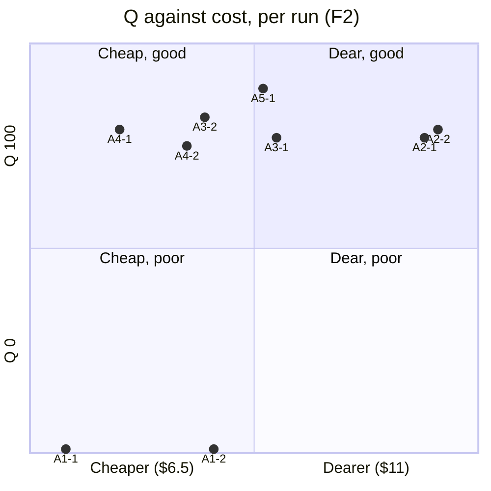
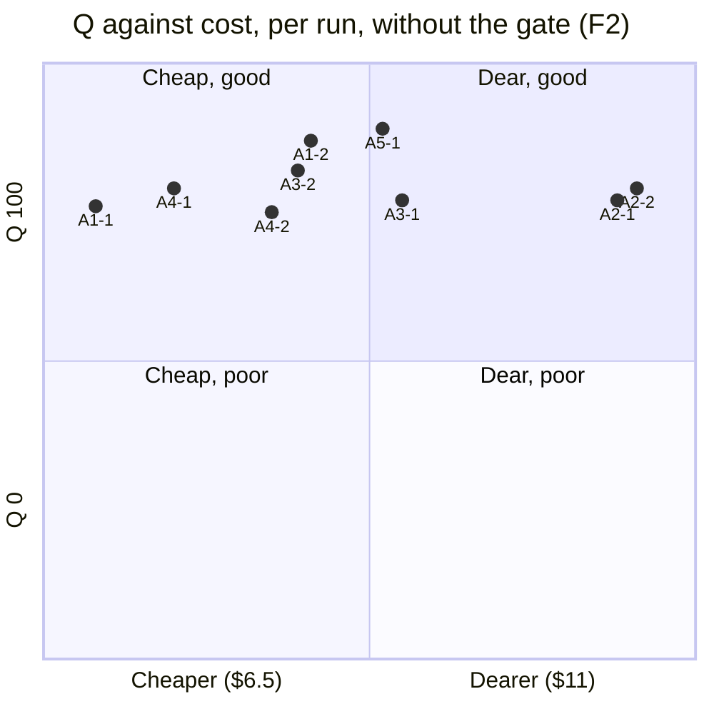

# F2 whole strategies: results

**Status:** run 2026-11-09 to 2026-11-11 on branch `bench/v1.4-F2`. This is the result of [doc 31](../../../31-whole-strategies-f2.md),
the first stage of [doc 30](../../../30-whole-strategies.md): item F2 (*Summon on the fly*), rebuilt from its start commit
61e4958 by five strategies (arms), nine runs in all, and scored blind. The bench and its check are in
[check.md](check.md) and `bench/`. The per-run data (cost, score, judged findings, health, and the effort and timeline
report) is in [runs/](runs/).

## The conclusions

### Least wall clock: A2, one conversation

**One Claude Code session builds the item itself: no subagents, no planner, no independent review.**

| | A2 run 1 | A2 run 2 | Next fastest (A1, mean) | The real F2 |
|---|---|---|---|---|
| Time to the commit | **56 min** | **64 min** | 90 min | 64 min |
| Cost | $10.46 | $10.59 | $7.62 | $10.13 |
| Q (of 100) | 77 | 79 | 0 (gate) | — |

A2 was the fastest in both runs, and its two runs agree within 8 minutes. That makes it the steadiest arm on time.
Its lead is about 1.5× over the sluice. Doc 30 §8 rule 3 counts a time difference only at 2×, so by the rules this
is a lead, not a decisive result.

**What made it fast:**
- **No hand-offs.** In every other arm, each agent starts fresh and reads its way back in. In the sluice, the
  planner alone took 11–14 minutes, and its reviewer 40 minutes, all in series behind the builder. A2 reads the
  docs once and keeps them.
- **No review or fix round.** A2 never waits on a second reader. The sluice arms spent 40 minutes reviewing, and
  A3 to A5 also had fix rounds.
- **Less waiting on long commands:** 33–38 minutes of tool calls over 60 s, against 54–92 minutes for the other
  arms. Its e2e waits were also the shortest (15–26 minutes, against 36–46 for the sluice). It ran the mapped
  specs, not more.

**What it costs:**
- **Money.** A2 was the dearest arm, about 38% over A1. One long context is re-read on every call: a mean of
  184–204k tokens a call, and peaks of 274–300k, every call at Opus. Output was 15–17% of its spend against 4–8%
  elsewhere: it writes more.
- **Some quality.** Each A2 run kept one Major: the summoner's plate is lost when the next sortie takes the ship
  over at the pass. A2 was the only arm to build that hand-off, which Decided asks for, and it broke the plate
  doing it. A2 added the most complexity (+55, +76), wrote the fewest tests per src line (0.5–0.7), and was the
  only arm whose coverage of the touched files fell (68.0% → 65.1% in run 1). With no independent review, nobody
  caught any of it.

### Time with the build and test waits factored out

Wall clock mixes the strategy with the machine: **e2e alone was 24–60% of every run's time to the commit**. So each
run's time is split (`bench/timesplit.mjs`) into:
- **e2e wait:** Playwright running.
- **Other build and check wait:** unit tests, typecheck, lint, builds, the pacing ledger.
- **Waiting:** sleeps and polls on background work, which go to the kind of work they wait on whenever the bench can
  tell. Background e2e polled with `sleep …; tail <log>` counts as e2e.
- **Other tool time:** every other tool call.
- **Flow time:** the rest. That's the models working, the hand-offs between agents, and the orchestration.

Waits that overlap across agents count once (the union of intervals), clipped to the run's start and its commit.

| Run | Wall to commit | e2e wait | Other build and check wait | Waiting (unattributed) | Other tool time | **Flow time** | **Wall less e2e** | e2e share |
|---|---|---|---|---|---|---|---|---|
| A1-1 | 84.7 min | 37.3 | 22.9 | 0 | 0.1 | **24.4** | **47.3** | 44% |
| A1-2 | 94.2 min | 46.3 | 22.3 | 0 | 0.6 | **25** | **47.9** | 49% |
| A2-1 | 56.3 min | 27.4 | 11.6 | 0 | 0.1 | **17.3** | **28.9** | 49% |
| A2-2 | 63.5 min | 36 | 11.3 | 0 | 0.1 | **16.1** | **27.5** | 57% |
| A3-1 | 98.2 min | 23.6 | 36 | 0 | 0.2 | **38.3** | **74.5** | 24% |
| A3-2 | 93.4 min | 45 | 20.5 | 0 | 0.1 | **27.9** | **48.5** | 48% |
| A4-1 | 106.6 min | 63.5 | 16.8 | 1.7 | 0.7 | **23.9** | **43.1** | 60% |
| A4-2 | 139.6 min | 57.3 | 55 | 0 | 0.1 | **27.2** | **82.3** | 41% |
| A5-1 | 96.9 min | 45.9 | 16.7 | 0 | 0.3 | **34** | **51** | 47% |

| Arm | Wall to commit (mean) | Flow time (mean) | Wall less e2e (mean) | Flow time against A1 |
|---|---|---|---|---|
| A1 · F's sluice (2 runs) | 89 min | **25 min** | 48 min | — |
| A2 · One conversation (2 runs) | 60 min | **17 min** | 28 min | -32% (1.48×) |
| A3 · Ultracode (2 runs) | 96 min | **33 min** | 62 min | +34% (0.75×) |
| A4 · Tests first (2 runs) | 123 min | **26 min** | 63 min | +3% (0.97×) |
| A5 · Today's sluice (1 run) | 97 min | **34 min** | 51 min | +38% (0.73×) |

**How to read it:**
- **Flow time is the relative measure of the strategies themselves:** their thinking, writing and hand-offs, free
  of the machine's test speed.
- **The e2e wait is a cost of each arm's test policy as well as of the machine.** How often an arm runs the suite
  is its choice: A4-1 spent 64 minutes waiting on e2e, A3-1 24. So it's reported beside flow time, never folded
  into it.

**Least wall clock holds with the waits factored out.** A2 is the fastest on flow time, 16–17 minutes against
A1's 24–25 (1.48×), and on wall less e2e, 28 minutes against 48 (1.7×). It's still under doc 30's 2× bar.

**A4's flow time matches A1's** (26 against 25 minutes). A4's long wall clock is waiting on tests, not working:
e2e 57–64 minutes, and in run 2 another 55 on checks.

**A3 and A5 spend the most flow time** (33–34 minutes): the most agents and the most rounds. A3-1 also lost a
whole planning round.

### Least dollar spend: A1, F's sluice, but it failed its own gate. Among arms that pass, A4, tests first

| | A1 run 1 | A1 run 2 | A4 run 1 | A4 run 2 | The real F2 |
|---|---|---|---|---|---|
| Cost | **$6.88** | $8.36 | **$7.39** | $8.06 | $10.13 |
| Mean | **$7.62** | | **$7.73** | | |
| Time to the commit | 85 min | 94 min | 107 min | 140 min | 64 min |
| Gates | **lint fails** | **lint fails** | pass | pass | pass |
| Q (of 100) | 0 (parts 76) | 0 (parts 87) | 79 | 75 | — |

**A1, the sluice as block F ran it, spent the least, but both its runs failed the lint gate, so both score Q 0.**
Its reviewer wrote scratch probe scripts into the work folder, and the orchestrator committed them unchecked. The
sluice's gate runs for builders, clerks and fixers, never between the reviewer and the commit, so nothing caught
them. CI runs lint on every push to main, so this would have failed CI. Apart from that gate, A1's work was sound:
acceptance 40/40, no regressions, no Major.

**A4 (tests first) is the cheapest arm that passes, at $7.73 mean.** That's within 1.5% of A1, a tie by doc 30's
noise rule.

**What kept them cheap** (both arms share the shape):
- **Bounded Opus.** Opus does only the short, judgement-heavy roles: the planner or the test writer, and the
  reviewer. The volume work, the builder's 41–72 calls, runs on Sonnet at about half the price.
- **Smaller contexts.** Each agent starts fresh, so contexts stay at a mean of 62–133k tokens a call, against A2's
  184–204k.
- **Spend is mostly cache writes** (53–64%), which a fresh agent pays once to load its context. The roles don't
  carry one long, growing context.

**What it cost them:**
- **Time.** A1 and A4 are the two slowest arms: agents in series, each reading in, and in A4 a long fix pass of
  62–74 minutes.
- **Churn, for A4.** A4 wrote the most tests by far (3.4–3.6 test lines per src line, up to 16 unit and 3 e2e
  tests). It also had the biggest diffs (+588, +825 lines), and its run 2 added 3 new functions over 15 and kept the
  300 ms tell, so Comet didn't play any shorter (P4 partial).

### In one line

On F2, **no strategy saves 25% against the sluice, and none is twice as fast.** The cheapest arm (A1) failed its
own gate, and the fastest (A2) pays about 38% more and ships an unreviewed Major. Today's sluice (A5) scored best on
quality at near-sluice cost.

## Every run

Q = acceptance (40) + regressions (20) + defects (20) + rules and docs (10) + the human's look (10), and 0 if a hard
gate fails (doc 30 §6). U = Q − 2·$ − 0.1·minutes (doc 30 §8 rule 5, for tuning only).

| Run | Arm | $ | Calls | Time to commit | Context per call (mean · peak) | Gates | Acc | Reg | Def | Rules | Look | **Q** | U |
|---|---|---|---|---|---|---|---|---|---|---|---|---|---|
| A1-1 | F's sluice | 6.88 | 170 | 85 min | 79k · 178k | lint fails | 40 | 20 | 2 | 4 | 10.0 | **0** (76) | −22 |
| A1-2 | F's sluice | 8.36 | 166 | 94 min | 87k · 231k | lint fails | 40 | 20 | 11 | 6 | 10.0 | **0** (87) | −26 |
| A2-1 | One conversation | 10.46 | 108 | 56 min | 204k · 300k | pass | 40 | 20 | 0 | 8 | 8.9 | 77 | 50 |
| A2-2 | One conversation | 10.59 | 103 | 64 min | 184k · 274k | pass | 40 | 20 | 4 | 6 | 8.9 | 79 | 51 |
| A3-1 | Ultracode | 8.97 | 214 | 98 min | — | pass | 40 | 20 | 5 | 4 | 7.8 | 77 | 49 |
| A3-2 | Ultracode | 8.25 | 209 | 93 min | — | pass | 40 | 20 | 8 | 4 | 10.0 | 82 | 56 |
| A4-1 | Tests first | 7.39 | 189 | 107 min | 101k · 211k | pass | 40 | 20 | 5 | 6 | 7.8 | 79 | 53 |
| A4-2 | Tests first | 8.06 | 224 | 140 min | 103k · 200k | pass | 35 | 20 | 8 | 4 | 7.8 | 75 | 45 |
| A5-1 | Today's sluice | 8.86 | 226 | 97 min | — | pass | 40 | 20 | 11 | 10 | 8.3 | **89** | **62** |

Context per call is from the per-run reports (`runs/<run>/report.md`), which give it per role. The `—` rows mix
many agents; their reports have the breakdown. Human questions: 0 in every run (no arm asked). Fix rounds: A1-1 0,
A1-2 0, A3-1 one wasted round (no plan), A3-2 1, A4 1 each (by design), A5-1 1.

**Per arm, the two runs side by side:**

| Arm | $ (run 1 · run 2 · spread) | Minutes (1 · 2 · spread) | Q (1 · 2) |
|---|---|---|---|
| A1, F's sluice | 6.88 · 8.36 · 19% | 85 · 94 · 10% | 0 · 0 (gate) |
| A2, one conversation | 10.46 · 10.59 · **1%** | 56 · 64 · 13% | 77 · 79 |
| A3, Ultracode | 8.97 · 8.25 · 8% | 98 · 93 · 5% | 77 · 82 |
| A4, tests first | 7.39 · 8.06 · 9% | 107 · 140 · **27%** | 79 · 75 |
| A5, today's sluice | 8.86 (one run) | 97 | 89 |

**Q against $** (one point per run). A1's points sit at 0, where the gate put them:

The Pareto front, the runs no other run beats on both Q and $: **A4-1** ($7.39, Q 79), **A3-2** ($8.25, Q 82) and
**A5-1** ($8.86, Q 89).

## The calibration (A1 against the real F2)

The bench is calibrated: both A1 runs land within 30% of the real $8.15, and both passed their own review at round 1.

| | A1 run 1 | A1 run 2 | Real F2 |
|---|---|---|---|
| Agents only (planner, builder, reviewer) | $5.93 | $7.47 | $8.18 (ledger $8.155) |
| With the orchestrator | $6.88 (−16% on $8.15) | $8.36 (+3%) | $10.13 |
| Review | pass r1 (0 Major, 3 Minor) | pass r1 (0 Major, 2 Minor) | pass r1 (0 Major, 2 Minor) |
| Time to the commit | 85 min | 94 min | about 64 min |

`cost.mjs` reproduces the ledger from the real run's own transcripts ($8.18 against $8.155). The real orchestrator's
share ($1.95) was never in the ledger. A1 took longer than the real run, 85–94 minutes against about 64, and
nearly half of that was waiting on e2e (36–38 minutes): the machine and its e2e under load, not the strategy.

## The verdict by doc 30 §8

1. **Quality is a floor.** Each arm must be within 5 Q of the control (A1) on every run, with no seeded defect
   surviving (F2 has none) and no escape probe failing that A1's doesn't.
   - **As written, every arm clears it, because the control scored 0.** That's degenerate: the floor is met only
     because the control failed its own gate.
   - **Against A1's work without the gate** (Q 76 and 87), A3-1 (77), A4-1 (79) and A2 (77, 79) are within 5 of
     A1-1. Only A5-1 (89) is within 5 of A1-2 (87). A4-2 (75) misses both.
   - In the gate-free view, no arm falls clearly below the control.
2. **Then cost, at a 25% threshold.** No arm saves 25% against A1 ($7.62 mean). A4 is level ($7.73, +1.5%). A3
   ($8.61) and A5 ($8.86) are dearer, within noise, and A2 ($10.53, +38%) is dearer by more than noise. **No arm
   qualifies on cost.**
3. **Then wall clock, then attention, each needing 2×.** A2 is 1.5× faster than A1, under 2×. No human questions
   were asked by any arm. **Nothing qualifies here either.**
4. **The Pareto front** is A4-1, A3-2 and A5-1 (above).
5. **U** (for tuning only): A5-1 62, A3-2 56, A4-1 53, A2 50–51, A3-1 49, A4-2 45. A1 is negative because of the gate.
6. **Route by kind.** F2 is one medium, schedule-risk item. It can rule an arm *out* for this kind of item, but not
   *in* for high-risk work (doc 31 §9). None was ruled out on quality.

**Ruled out on cost:** A2 for medium items, unless wall clock matters more than about 38% more spend. **Not ruled
out:** A3, A4 and A5, all within noise of the control's cost, and all passing the gates the control failed.

## Without the gate (a sensitivity view)

The official score keeps doc 30 §6's rule as written: a failed hard gate makes Q 0, and the rule was fixed before
the runs. Both A1 runs failed only on lint, and only because the reviewer's scratch probe scripts in the work folder
were committed. Their product code passed every check. This view scores those two runs as if the lint gate had held,
and leaves every other part and every other run unchanged, the human's look included.

| Run | $ | Time to commit | Q as scored | **Q without the gate** | U without the gate |
|---|---|---|---|---|---|
| A1-1 · F's sluice | 6.88 | 85 min | 0 | **76** | 54 |
| A1-2 · F's sluice | 8.36 | 94 min | 0 | **87** | 61 |
| A2-1 · One conversation | 10.46 | 56 min | 77 | 77 | 50 |
| A2-2 · One conversation | 10.59 | 64 min | 79 | 79 | 51 |
| A3-1 · Ultracode | 8.97 | 98 min | 77 | 77 | 49 |
| A3-2 · Ultracode | 8.25 | 93 min | 82 | 82 | 56 |
| A4-1 · Tests first | 7.39 | 107 min | 79 | 79 | 53 |
| A4-2 · Tests first | 8.06 | 140 min | 75 | 75 | 45 |
| A5-1 · Today's sluice | 8.86 | 97 min | 89 | 89 | 62 |

**Mean Q per arm:** A5 89 (one run) · **A1 81.5** · A3 79.5 · A2 78 · A4 77.

**Q against cost, per run, without the gate:**

**What changes:**
- **The Pareto front grows** to A1-1 ($6.88, Q 76), A4-1 ($7.39, 79), A3-2 ($8.25, 82), A1-2 ($8.36, 87) and A5-1
  ($8.86, 89). The sluice holds both ends of it: the cheapest point, and with A5, the best.
- **The quality floor starts to bite.** With the control's mean (81.5) as the line, the floor is 76.5. **A4-2 falls
  below it** (75: it kept the tell, so Comet didn't play any shorter). A2-1 and A3-1 clear it by half a point.
- **U ranking:** A5 62 · **A1-2 61** · A3-2 56 · **A1-1 54** · A4-1 53 · A2 50–51 · A3-1 49 · A4-2 45.
- **The sluice becomes the best value:** the cheapest arm outright ($7.62 mean), and second on quality only to
  today's sluice, which is the same process with the retro's changes.

**What doesn't change:**
- No arm saves 25% on A1.
- A2 is still the fastest, but under 2×.
- It's still no-go for the full grid, more firmly: the control is the cheapest arm, so a grid has no saving to find.

**Is the lint failure a fluke?** No. It happened in both A1 runs, in the same way, so in F's sluice it's
systematic. But it's narrow:
- It lives in the process records, not the product.
- One deterministic change catches it: a final gate (typecheck, lint, unit) just before each item's commit.
- Neither the real F2 nor today's sluice (A5), whose reviewer checks with stills rather than scripts, hit it.

That's why both views are reported. The official one scores what was committed. This one scores the work.

## What A5 shows about the retro's changes

A5 (today's sluice) is A1 plus the v1.4 retro's changes: the reviewer looks at stills at the smallest window (H13),
names the lens behind each finding (H6), and the tree guard (D12).
- **Best Q of the trial (89):** no Major, every doc rule met (03, 05, 13, 15 all amended), and the gates passed.
  The cost was $8.86, +16% on A1, which is noise.
- **It avoided A1's lint failure, and H13 is the likely reason, not D12.** D12 only refuses git commands for
  sluice agents, so it can't stop a lint failure. H13 changed the reviewer's method: to check a change the user
  sees, it shoots a still at the smallest window and looks at it. A5's reviewer did exactly that, and its work
  folder holds only records and stills. A1's reviewers wrote probe scripts into the work folder instead, and those
  failed lint.
- **Its review cost a fix round** (1 Major found at review-1, fixed, passed at review-2). A1 passed at round 1 in
  both runs. The judge found no Major left in A5. Its reviewer had found one that A1's reviewers, on similar code,
  never raised.
- **This is one run.** It's a signal for H13 (the visual check), not proof. By doc 30 §8, "if A5 beats A1 on Q at
  equal cost, the retro's changes are confirmed". As written, it does (89 against 0, cost within noise). Without
  the gate, it also beats A1's better run, by 2 points.

**The gap that A1 exposed, whatever the strategy:** the sluice gates builders, clerks and fixers, never the tree
the orchestrator commits. A final gate (typecheck, lint, unit) just before each item's commit would have caught
both A1 failures. That's a small, deterministic change.

## The go/no-go for the full grid

Doc 31 §8: go if the bench is calibrated **and** (an arm saves 25% or more at the quality floor, **or** an arm
falls below the floor in a way that would matter at F3 to F5's risk).
- **Calibrated: yes.** A1 is −16% and +3% against the real cost, and both runs passed their review.
- **A 25% saving: no.** No arm comes close; the spread across the four passing arms is $7.73 to $10.53.
- **A fall below the floor that matters at F3 to F5: only the control's**, and that's a commit-gate gap in the
  sluice, fixed by a final gate rather than by a grid. No other arm fell below the control.

**Recommendation: no-go for the full grid as designed** (about $700–900 to look for a saving F2 shows no sign of).
Instead:
1. **Add a final gate to the sluice** before each item's commit, and log it in the roadmap as a guard.
2. **Keep the bench for H24** (each role's model and effort), as doc 31 planned. It's calibrated, and the
   planner (30–36% of A1's spend) and the reviewer (35–37%) are where a saving would be.
3. **If defect-catching is still the open question**, run one targeted stage: F3 (four seeded defects), with A5
   against A2. A5 is today's best, and A2 is the fastest arm with no independent review. That's about $40–60,
   and it tests the one thing F2 couldn't: does an arm without a review miss F3's Blockers?

## What F2 couldn't tell us (doc 31 §9)

- **Defect-catching.** F2 has no seeded defects, so A2's lack of a review shows only as the plate Major the judge
  found afterwards.
- **Small differences.** With two runs, the cost gaps between A1, A3, A4 and A5 (under 20%) are noise.
- **The human's look didn't discriminate.** All 54 stills scored 2 or 3, and the rater's note says the results
  looked almost identical, with only small details (ships' orientation, the shape of the effect) separating a 2
  from a 3. On what the user sees, every run delivered F2.

## How the scoring was adjusted, and why

Every adjustment was applied to every run alike, and each is recorded in that run's `judged.json` or `score.json`.
- **One behaviour, one severity (decided by the user, 2026-11-10).** All nine runs, and the real, signed-off F2,
  let the pass glide to the ship's rest when a next sortie waits. The judge called it a Major in 8 of 10 diffs, a
  Minor in 1, and missed it in 1. It's the item's accepted reading (the real F2's packet chose it, and its review
  and the human's sign-off accepted it), so it's scored a Minor wherever it occurs. The A2 runs don't have it,
  because they hand off at the pass, and they keep their own, different Major.
- **P1 corrected to met for A2-1, A2-2 and A3-2,** checked by eye from their path traces (`p1-path.json`). The ship
  flies one continuous pass and rests; the probe's still-window counted the demo's settling glide afterwards.
- **The judge's findings were verified.** The blind verifiers kept all 44 findings, too uniformly to trust, so the
  findings that move the most points were checked by hand against the code and against a calibration judge run on
  the real F2 (which raised the same Major, and a Minor matching the real review's Nit).
- **The judge didn't see the scope doc.** `docs/27-v1.4.md`'s State lines and new Decisions rows named the method
  ("built inline without subagents", "accepted at review-1"), so they were left out of every diff.

## The runs that didn't count

Each was set aside and re-run from a fresh clone. Their cost counts in the spend.
- **A1-1, first attempt:** killed mid-review when VS Code restarted ($5.21). Launches are now detached (`setsid`).
- **A3-1, three attempts:** a headless `claude -p` ends when its turn ends, so the background workflow was aborted
  twice. The fix is `bench/session.py`, which keeps the session open the way the editor does, with the prompt
  unchanged. One relaunch was also stopped at 30 s, for being under the 10-minute gap between runs of one arm.
- **Shared `/tmp`** let runs leave scratch files where later runs could see them. No run read another's work, and
  `launch.sh` now clears them before each run.

## Spend

| | $ |
|---|---|
| Bench build (this session, at the check) | 11.86 of 15 |
| The nine counted runs | 77.73 |
| Set-aside runs | 10.71 |
| The judge (nine diffs) and the calibration judge | 15.70 |
| The verifiers | about 3 |
| **Runs and judging** | **about 107 of the raised $120 cap** |

## The line proposed for the roadmap's H27

> **F2 (2026-11-11, [results](../../docs/progress/bench/F2/results.md)):** the bench is calibrated (A1 −16% and +3% on
> the real cost). No arm saved 25% on the sluice ($7.62 mean): tests-first tied it ($7.73), Ultracode and today's
> sluice were within noise, and one conversation was the fastest (60 min against 90, 1.5×) but the dearest (+38%), with
> an unreviewed Major. The control failed its own lint gate in both runs: its reviewer's scratch probes were committed
> unchecked. Today's sluice scored best (Q 89), plausibly from H13's visual check. No-go for the full grid; add a final
> gate before each commit, keep the bench for H24, and test defect-catching on F3 (A5 against A2) if it's still wanted.

## Conclusion

On one medium-risk item (F2, a schedule change with a summon on the fly), every strategy delivered the feature: eight
of nine runs met every acceptance line, no run regressed, and to the human's eye the stills looked almost identical.
The strategies differ in what they cost, how long they take, and what they leave behind them: tests, complexity, and a
record the next reader can follow.

- **The sluice is the least dollars while maintaining quality, so use it daily.** It was the cheapest arm, $7.62 an
  item (F's sluice, A1). Today's version (A5) is within noise of that ($8.86) and scored the best of all nine runs
  (Q 89). Add a final gate before each commit; that's the one gap it showed.
- **One conversation is the least time while maintaining quality, so use that when facing a pressing deadline.** It
  was the fastest in both runs (56 and 64 minutes, against 85–107 for every other arm), and still the fastest with
  the test waits taken out (17 minutes of flow time against 25). It costs about 38% more. Nothing reviews it, so for
  anything the user will see, ask for one fresh review before you ship.

| Strategy | Use it when… | Avoid it when… | On F2 |
|---|---|---|---|
| **The sluice** (A1 as F ran it; A5 as it is today) | It's the everyday default for anything medium-risk or above: schedule, layout, labels, goldens, or anything a reviewer must look at the user's way. It's also the choice when the next person needs the record (packet, build and review files) to pick up the work | The item is trivial: its planning and review (67–71% of its spend) buys little on a one-line change | Cheapest ($7.62); Q 76–89; 85–97 min. Its one escape was the reviewer's scratch files committed unchecked, so a final gate fixes it |
| **One conversation** (A2) | A deadline is close and time matters more than about 40% more spend. Or the item is small or well understood. Follow it with a fresh review when users will see the change | The work is high-risk (F3–F5 aren't tested yet), or one long session would hold more than about 200k tokens of context a call | Fastest (60 min mean; 17 min flow); dearest ($10.53); one unreviewed Major in each run; the most complexity added and the fewest tests |
| **Tests first** (A4) | The acceptance is crisp and testable, and you want the strongest test net left behind (3.4–3.6 test lines per src line, up to 16 unit and 3 e2e tests) | Time is short (the slowest arm: 107–140 min, mostly test waits), or the scope has judgement calls the tests can't pin down (run 2 met its tests and still missed Comet's saving) | Level with the sluice on cost ($7.73); Q 75–79; the biggest diffs |
| **Ultracode workflow** (A3) | The work itself needs a custom, branching plan of agents, which no fixed process fits. Run it in a session that stays open until the workflow finishes | It's an ordinary item: on F2 it had no edge on cost, time or quality, and it was the least predictable (one run lost a whole planning round) | $8.61 mean; Q 77–82; 93–98 min; the most flow time spent |

**The limits of this answer:**
- It's one item, with two runs per arm and one for today's sluice, so small differences are noise.
- F2 has no seeded defects, so it can't show which strategy catches a hidden Blocker. That's F3's question.
- The routing above is a working rule for medium items, to be revisited if a high-risk item is ever run on the
  bench.
