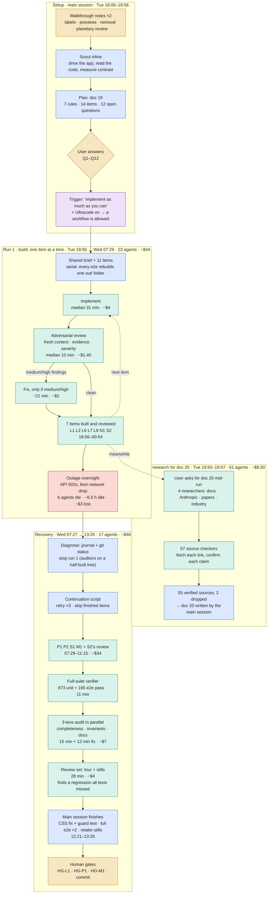

# 21 — The first Ultracode run: what happened, who did what, what it cost

**Status:** written 2026-10-14 from the run's own transcripts. A one-page explainer of Star Chart's
v1.1 build (13–14 Oct 2026), the first practical use of Claude Code's Ultracode mode. The method
behind it is in [20](20-agent-workflows.md); the plan it built is [19](archive/19-v1.1.md). Times are
Pacific; costs are estimates (see *How the numbers were measured*).

**Legend:** gold, the user · blue, the main session (the orchestrating Claude) · green, workflow
subagents · red, failure · purple, the opt-in that made a workflow possible.

| Run | Agents | Wall clock | Agent time | Tokens processed | Estimated cost |
|---|---|---|---|---|---|
| Main session (planning, orchestration, final fixes) | 1 | Tue 18:06 → Wed 13:26 | — | 32M | ~$27 |
| Run 1, build | 23 | 12.5 h (about 6.5 h of it stalled) | 12.6 h | 139M | ~$44 |
| Side run, research | 61 | 7 min | 0.6 h | 7M | ~$8.50 |
| Run 2, continuation | 17 | 4.9 h | 5.2 h | 155M | ~$46 |
| **Total** | **102** | **~19.3 h, ~12 h of it productive** | **18.4 h** | **~332M** | **~$126, likely $130–$180** |

## Commentary

**What happened, and why.** The user walked through the app twice and wrote feedback. The main
Claude session didn't start building. It drove the app, read the code each note touched, and wrote a
plan ([19](archive/19-v1.1.md)) with seven rules, fourteen items and twelve open questions, each with a
recommendation, and the user answered them. Then the user asked it to "implement as much of this plan
as you can independently" while the session's **Ultracode** mode was on. That mode is what permitted a
multi-agent workflow at all: without it, the session would have built items one at a time in the
conversation, or described a workflow and its cost and asked first. Ultracode decided *that* a
workflow ran; the requirements decided *how*. The plan's eleven separable items, the project's rule
of checks per slice, and the user's habit of signing off from stills shaped the script.

**The shape of the build.** Every e2e test and every drive rebuilds the same `out/` folder, so
agents that test in parallel would have broken each other's builds. The build therefore ran one item
at a time. Each item went through three roles:
- an **implementer**, given a shared brief: the plan, the rules, the checks to run and what to
  report;
- an **adversarial reviewer**, in a fresh context, given the criteria but not the author's reasoning.
  It had to show evidence and grade each finding by severity;
- a **fixer**, spawned only when the review found a medium or high problem.

The reviews earned their place. One found seven issues in the hover-only labels (L7). Another found
that P1's preview planets moved as history loaded, breaking the plan's own rule. Most came back
clean, so the severity gate kept the run from gold-plating.

**The outage, and the recovery.** Overnight, three API gateway 502 errors and then a network drop
killed six agents. The script treated each empty result as "move on", so items were skipped silently,
and by morning the final auditors were checking a half-built tree. The fix was ordinary operations
work. The main session read the run's journal and `git status`, stopped the run, and wrote a
continuation script. That script retries a dead agent up to three times, tells the retry that partial
edits may exist, and skips the seven items already done. A plain resume would have rerun everything
after the first failure. About 6.5 hours of wall clock were lost, but only about $3 of tokens.

**The end of the run, where looking mattered.** After the last item came:
- one verifier, which ran the whole suite (873 unit and 165 e2e tests);
- three auditors in parallel, each reading the whole change through a different lens: completeness,
  invariants, docs;
- a final agent that assembled the human review set.

That last agent actually looked at the stills, and it found a regression every test had missed:
labels in their title-only state still drew their subtitle. The tests checked a state attribute, not
what was drawn. The main session fixed it with one CSS rule, added a test that checks what's
rendered, chased down a test that the fix had exposed, ran the full suite twice, and retook every
still. The work stops at the human gates by design: the label tiers, the pod previews and station
standby are the user's call.

**Time and money.** About 19 hours passed between the first note and the review set. About 12 of
them were productive, and the user's own time went into notes, answers and review. In all, 102 agents
ran for about 18 agent-hours and processed about 332 million tokens. Over 90% were cache reads, the
cheapest kind, because every agent rereads the files it works on. At list prices that is roughly
$126 measured, and probably $130–$180 once unrecorded thinking is counted. The biggest single item, the
station standby (M1), cost about $12. A typical item with its review cost about $5–7. The research run
for doc 20 was the clearest overkill: 61 agents where a handful of searches would have covered most
of it. The lesson for coworkers: Ultracode buys independent checking at every step and a trail you
can audit, and it charges in tokens and hours. Use it where a second opinion pays for itself:
multi-item builds, audits and cross-checked research. A one-file fix doesn't need it.

## How the numbers were measured
- **Source:** the session's transcripts under `~/.claude/projects/<project>/<session>/`. These are the
  main session's `.jsonl`, each workflow's `journal.jsonl`, and one `agent-*.jsonl` per subagent.
  Wall clock comes from each agent's first and last timestamp. Agent time is the sum of those spans,
  including the hours dead agents spent hanging.
- **Tokens:** each API response's usage, de-duplicated by message ID: uncached input, cache writes,
  cache reads, output. Input-side counts are exact. **Output is understated**: the transcript keeps
  the usage from the start of each streamed response, and thinking, which is hidden by default, isn't
  stored at all. The visible output, the text and tool calls agents wrote, comes to about 0.5M tokens
  across the run, about $10. Unrecorded thinking is the reason for the upper end of the range.
- **Prices:** Claude Opus 5.5 at Anthropic's list rates per million tokens: $4 input, $20 output,
  $0.20 cache read, and cache writes at 1.25× input ($5). This session ran through an enterprise cloud
  gateway, whose billing may differ, so treat the dollars as estimates.
