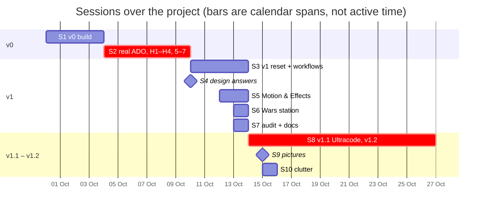

# 24 — Session retrospective: what each conversation processed, cost and produced

**Status:** written 2026-10-26, at the close of v1.2, from every Claude Code transcript of this project
(30 Sep to 26 Oct 2026). It covers ten sessions, their subagents and eight workflow runs. Cost is shown
only as **shares of the project's total** and as **tiers**, never in currency. [21](21-ultracode-run.md)
is the close-up of one workflow run; this doc is the whole project at a glance. The method and its
limits are in §6.

## 1. The project in numbers

| What | Amount |
|---|---|
| Calendar time | 27 days (30 Sep → 26 Oct); about 97 hours of active conversation, plus about 28 hours of workflows running on their own |
| Sessions | 10 with real work (and two stubs: a login and a duplicate copy made when the repo moved) |
| Human prompts | About 190, plus about 80 rounds of multiple-choice questions |
| API calls | About 15,800: 7,400 in the main conversations, 8,400 in subagents |
| Tokens read | About 4.0 billion (context re-read on every call, almost all of it from the cache) |
| Tokens written | At least 9 million (a floor: see §6) |
| Subagents | About 310, of which about 240 ran inside 8 workflow runs |
| Result | 52k lines of TypeScript in `src/`, 21k in `tests/`, 141k words of live docs; v0, v1, v1.1 and v1.2 shipped |

**Where the spend went:** 79% in the main conversations, 13% in workflow runs, 8% in ad-hoc
subagents. By model: Opus 5.5 about 84%, Opus 5 about 9%, Sonnet 5.5 about 7%.

**What the spend was made of** (the main conversations; §6 explains why output is a floor):

| Part of each call | Share of main-conversation cost |
|---|---|
| Reading the conversation back from the cache | 45% |
| Writing the conversation into the cache | 45%, of which **38 points** were rewrites after a pause longer than the cache's five-minute life, 2 after a model switch |
| Output (the model's text and tool calls) | 10% |
| Uncached input | under 1% |

The model's actual writing was the smallest cost. The biggest were the size of the conversation and how
often it had to be re-cached.

## 2. Each session

Cost tiers by share of the project's total: **XL** ≥ 20%, **L** 10–20%, **M** 3–10%, **S** 1–3%,
**XS** < 1%. *Active* is time with the conversation moving (gaps under 15 minutes). *Context* is the
average size of the conversation each main-loop call read. *Per call* compares a main-loop call's cost
with the average workflow subagent call's (1.0×).

| # | Session (dates) | Active | Prompts | Models (main, by cost) | Calls | Read / written | Context | Per call | Spend | Tier |
|---|---|---|---|---|---|---|---|---|---|---|
| S1 | v0 build: the spec to slice 3a (30 Sep – 3 Oct) | 16.9 h | 55 | Opus 5.5 | 1,180 | 0.46 B / 1.6 M | 405k | 4.8× | 12.6% | L |
| S2 | v0 on real ADO: 3b, 4, H1–H4, 5–7 (4 – 10 Oct) | 32.9 h | 40 | Opus 5.5 64%, **Opus 5 29%**, Sonnet 7% | 2,421 | 1.02 B / 2.3 M | 459k | 6.2× | 31.3% | XL |
| S3 | v1 reset and build, then *Look & Feel* (10 – 13 Oct) | 12.3 h + 11 h of workflows | 33 | Opus 5.5 72%, Sonnet 28% | 4,471 | 0.71 B / 1.5 M | 384k | 4.6× | 18.1% | L |
| S4 | Thirteen design answers into 13 (10 Oct) | 0.2 h | 1 | Opus 5.5 | 16 | 0.003 B / 0.04 M | 62k | 2.0× | 0.1% | XS |
| S5 | *Motion & Effects*: ships, station forms, the merge (12 – 13 Oct) | 5.4 h | 14 | Opus 5.5 86%, Sonnet 14% | 445 | 0.20 B / 0.45 M | 444k | 4.7× | 4.7% | M |
| S6 | The Wars station and its transformation bug (13 Oct) | 2.2 h | 4 | Opus 5.5 | 188 | 0.06 B / 0.27 M | 339k | 3.4× | 1.5% | S |
| S7 | v1 audit against the code, and the doc overhaul (13 – 14 Oct) | 2.0 h | 3 | Opus 5.5 (17 subagents) | 1,213 | 0.19 B / 0.15 M | 169k | 3.0× | 3.6% | M |
| S8 | v1.1 by Ultracode, then v1.2 Blocks A–D and the close (14 – 26 Oct) | 21.9 h + 17.5 h of workflows | 36 | Opus 5.5 89%, Sonnet 11% | 5,332 | 1.29 B / 2.2 M | 421k | 3.7× | 25.3% | XL |
| S9 | Pictures: the 401, then bulk upload (15 Oct) | 0.8 h | 4 | Sonnet 5.5 | 97 | 0.02 B / 0.12 M | 157k | 1.4× | 0.3% | XS |
| S10 | Clutter: captains' rests and jump-outs (15 – 16 Oct) | 2.8 h | 3 | Opus 5.5 | 426 | 0.09 B / 0.26 M | 314k | 3.8× | 2.5% | S |

### What each produced
| # | Deliverables | Code (lines added, from the commits in its window) |
|---|---|---|
| S1 | The spec turned into docs 01–09; slices 0, 1, 2 and 3a; the painterly look, the signal ladder, the gallery | ≈12.6k src, 2.4k tests |
| S2 | Eleven slices: 3b (follow mode, History), 4 (ADO ingestion, cache, Connect), the real-org pass (188 projects, loading by level), **H1–H4 (the Sprints paradigm, time to first look, playback in the scene)**, 5 (offline, coverage), 6 (polish), 7 (tiered failures, logging) | ≈16.0k src, 5.2k tests, 33k fixture and golden lines |
| S3, S5, S6 | v1: a three-architect design panel (14, 17), build waves W0–W4 (23 task notes); the Solar art direction (layout v4–v6, holo labels, asteroids), ship silhouettes, station forms, the merge as teamwork, idle life, entrances. These ran in parallel and share their commits | ≈21.3k src, 6.3k tests, 9.1k doc lines |
| S4 | Thirteen answers into 13's open questions | Docs only |
| S7 | v1 audited task by task against the code; the doc overhaul (15 and its guard, the archive) | Docs, small fixes |
| S8 | **v1.1** by workflow: 11 items, each implemented, adversarially reviewed and fixed; docs 20 and 21. **v1.2** inline: 41 items over four blocks (A 13, B 9, C 12, D 7); the token notice and Retry; the close-out | v1.1 ≈2.9k src, 2.7k tests; v1.2 ≈5.2k src, 3.5k tests |
| S9 | Why pictures answer 401; bulk picture upload and the Captain Avatars tab | ≈0.9k src, 0.3k tests |
| S10 | Captains resting by their work and jumping out when done (fed Block C's rules) | In S8's Block C commits |

## 3. By technique

The same project used four ways of working. Here they are side by side. Lines added are a rough
measure of progress, and a poor one for refinement work (see the last column's note).

| Phase | Technique | Spend | Delivered | Spend per 1k lines |
|---|---|---|---|---|
| v0 (S1) | One long inline conversation, greenfield, fixtures | 12.6% | Slices 0–3a; 15.0k lines | 0.8 |
| Real data (S2) | One long inline conversation (six days), discovery against the real org, models switched mid-stream | 31.3% | 11 slices; 21.2k lines | 1.5 |
| v1 (S3, S5, S6) | A design-panel workflow and three build-wave workflows; two art conversations alongside | 24.3% | v1 whole; 27.6k lines | 0.9 |
| v1.1 (part of S8) | **Ultracode:** one workflow, each item implemented, then reviewed adversarially, then fixed | 8.5% | 11 items; 5.5k lines | 1.5 |
| v1.2 (rest of S8, S9, S10) | Inline, one block at a time, one fresh reviewer per block | 19.7% | 41 items plus 2 features; 9.8k lines | 2.0 |
| Audit and docs (S4, S7) | Subagent fan-out (17 auditors) | 3.7% | v1 audit, the doc overhaul | — |

**Workflows were the cheapest work per call, not the most expensive.** A workflow subagent's call cost
on average a quarter to a sixth of a main-loop call. It read about 110k tokens of context, against
380–460k for the long conversations, and it wrote less. Ultracode *felt* expensive because the spend
arrived in a few hours. Measured per item or per line it was in line with inline work. v1.1 cost about
0.8% of the project per item and v1.2 about 0.5%, but v1.2's items were smaller. Per line, v1.1 was
the cheaper of the two.

**Cost per line rises as the work moves from building to refining.** Greenfield work (S1, v1) ran at
about 0.9 per thousand lines. Refining against real data and taste (S2, v1.1, v1.2) ran at 1.5–2.0.
That is expected: refinement is mostly reading, judging and small exact edits.

**The eight workflow runs:**

| Run | When | Agents | Wall clock | Spend | Notes |
|---|---|---|---|---|---|
| v1-architecture (twice) | 10 Oct | 10 | 1.8 h | 0.7% | Scouts, three architects, a judge, a synthesis: docs 14 and 17. The first attempt was a no-op restart |
| v1-build-waves ×3 | 10 – 12 Oct | 28, 29, 38 | 1.7, 2.7, 4.9 h | 1.3%, 1.8%, 3.8% | Implement → two-lens verify → fix → wave gate. Most of v1's code |
| workflow-practices-research | 13 Oct | 61 | 7 min | 0.5% | Sources for doc 20, each URL fetched and checked |
| v1.1-build | 13 – 14 Oct | 23 | 12.5 h | 2.4% | **Killed:** overnight API errors, then a network drop; about 6.5 h stalled |
| v1.1-continue | 14 Oct | 17 | 4.9 h | 2.6% | Finished the plan, the three-lens audit and the review set |

## 4. How quality, model choice and scope interacted

**Scope set the bill more than anything else.** The most expensive session, S2 (31%), was the one
where the product met real data and changed direction. 188 projects broke the layout. Loading was too
slow. The Backlog view proved the wrong lens, so H1–H4 built the Sprints paradigm. Four days later the
v1 reset (S3) replaced the v0 views with Solar. Much of what S1 and S2 built for the v0 views is now
behind a developer toggle. That was a reasonable prototype path, and the user's note on day one called
it "a toy project to understand Claude's prototyping ability". But the largest saving available was an
earlier look at the real org's *shape* (counts only, INV-18), before the views were built on fixtures.

**Conversation length was the cost multiplier.** Every tool call re-reads the whole conversation.
Sessions ran for days: S2 for six, S8 for twelve, spanning v1.1 and all of v1.2. Their average context
sat at 400–460k tokens, so each call cost four to six times a workflow subagent's. Compactions (6, 8,
4 and 10 in S1, S2, S3 and S8) kept them alive, but each kept a long tail of context. The cheapest
productive session per call was S9: fresh, focused, on Sonnet, at 157k of context.

**Pauses cost more than the model's writing.** When the conversation sits longer than the cache's five
minutes, the next call writes the whole context back into the cache, at 1.25× the input rate. Across
the project that happened about 250 times, and it came to **38% of main-conversation spend**. This is
the price of the way the user reviews: watch the app, take stills, think, then write a block of notes.
It's a good way to review. It's only expensive because the context was large when it happened.

**Model choice mattered less than expected, with one exception.**
- **Opus 5 (S2, 8–9 Oct) was about 9% of the whole project** for 346 calls. Opus 5.5 is its
  successor and cheaper per token. Nothing in the transcript says the older model was chosen
  on purpose.
- **Sonnet 5.5 saved less than it seems in long conversations.** It reads the cache at the same rate
  as Opus 5.5, and reading the cache was nearly half the bill. So on a 400k context a Sonnet call
  costs only about 20–30% less than an Opus call, not half. Each switch also rewrites the cache, because caches
  belong to one model. Switches cost about 2%.
- **Quality by model can't be separated in this data.** Both models produced defects that review
  caught. In v1.2 each block's fresh reviewer found 9 or 10 defects on Opus. The one Sonnet stretch of
  v1.2 (22–26 Oct) shipped one regression the user found: planet names wrapping in play. It also
  needed one redesign after the user's insight: the token notice's false alarm. The quality jumps came
  from the user's reviews on real data, whatever the model. Those reviews produced the mandala, the
  station rings, and the "deeper" token problem.

**Where quality came from.** Three sources, in order of effect:
1. The user's own reviews of real data, in blocks.
2. Fresh-context adversarial reviewers. They found defects that the authoring context and the tests
   didn't: v1.1's review set found a regression that every test missed (21).
3. The tests. Unit, e2e and keystone are fast and cheap to repeat, and `docTables` keeps 15 honest.

The docs (141k words) were the memory that made fresh starts possible. S2 began cleanly from
`handoff.md`, which is the enabler for the first lever below.

## 5. Better, faster, cheaper: the levers, ranked

Savings are estimates of the share of *this project's* spend, from the measurements above.

| # | Lever | Likely saving | Quality risk | Why |
|---|---|---|---|---|
| 1 | **A fresh conversation per block or slice**, started from `handoff.md` and the active plan, instead of one that runs for days | About a third | Low: the handoffs and slice notes already carry what matters | 90% of main-loop cost scales with context size. Halving the average context halves it, and makes every pause cheaper too |
| 2 | **Stop the idle tax**: clear or compact before a long review, or give notes in one block (as v1.2 did) | Most of the 38-point rewrite share, once contexts are smaller (overlaps with 1) | None | A pause over five minutes re-caches the whole context |
| 3 | **Never run Opus 5 when Opus 5.5 is on offer** | 4–5 points | None | The Opus 5 stretch was 9% of everything |
| 4 | **Sonnet for small, mechanical contexts**: doc audits, research checkers, wave gates, a focused fix (S9 is the model) | A few points | Low there; keep Opus for design, implementation and adversarial review | Sonnet's saving is largest where output and cache writes dominate, which means small contexts |
| 5 | **A real-data shape probe on day one**: counts, projects, sprints, team sizes; no content (INV-18) | Hard to price; the largest *time* saving | None | S2 was the most expensive phase, and much of it was rediscovering the product's shape |
| 6 | **Test output out of the main context**: run full suites in the background or a subagent, and return pass or fail with the failing names | A few points | None | S1, S2 and S8 issued 457, 515 and 380 e2e commands. Each result stays in context and is re-read on every later call. The "mapped specs and keystone" rule helped |
| 7 | **Workflows for well-specified scope; inline for taste.** Start long runs when the first hour can be watched, and design them to resume | Time more than tokens | Low: the per-item adversarial review is the quality gain | v1 and v1.1 ran about 28 hours unattended. The one overnight failure lost about 6.5 hours of wall clock but little spend |

**Faster.** The human was the bottleneck: about 97 active hours of conversation against about 28 of
unattended workflows. Speed came from three things:
- the work arriving in **blocks** of notes, answered in one round of questions;
- **workflows** running overnight on specified work;
- **parallel conversations** on separate concerns. S5 and S6 did the art while S3 built v1.

More of all three is the fastest path. It is also cheaper, provided each conversation starts fresh.

**What wouldn't have helped.** Cutting the reviews, the adversarial reviewers or the docs. They are
where the quality came from, and together they are a small share of the spend.

## 6. How the numbers were measured, and what they can't show

- **Source:** every transcript under `~/.claude/projects/` for this repo and its earlier path. That is
  each session's main `.jsonl`, each subagent's `agent-*.jsonl`, and each workflow's record. One
  session was copied when the repo moved, and the copy was counted once. One resumed session contains
  its predecessor, and the two were merged into S1.
- **Tokens:** each API response's usage, de-duplicated by message ID, split into uncached input,
  cache writes, cache reads and output. **Input-side counts are exact. Output is understated**, as in
  21: transcripts keep the usage from the start of each streamed response, and hidden thinking isn't
  stored. Output's true share is larger than 10%. The ranking of the levers doesn't change: output
  would need to be three times larger to matter as much as context size does.
- **Cost index:** list-rate ratios, not currency, normalised to one Sonnet 5.5 input token:

  | Model | Input | Cache write | Cache read | Output |
  |---|---|---|---|---|
  | Opus 5.5 | 2 | 2.5 | 0.1 | 10 |
  | Opus 5 | 2.5 | 3.1 | 0.25 | 12.5 |
  | Sonnet 5.5 | 1 | 1.25 | 0.1 | 5 |

  These are assumptions: cache writes at 1.25× input (the five-minute cache), and Opus 5's cache read at
  a tenth of its input. The sessions ran through an enterprise gateway whose billing may differ. Shares
  are robust to a uniform discount, not to a different rate structure.
- **Rewrite causes:** a call that wrote 100k or more tokens to the cache, classed by what came before
  it: a different model, a gap of more than five minutes, or neither (a compaction or other cause).
- **Active time:** the sum of gaps under 15 minutes between transcript entries. It includes the model's
  working time and the user's typing. It doesn't include time spent watching the app between prompts.
- **Progress:** lines added per commit, split into `src`, `tests`, docs and data, and attributed to the
  session working in that window. Sessions overlapped (S3, S5 and S6 on 12–13 Oct; S8, S9 and S10 on
  15–16 Oct), so those share their commits. Lines are a crude measure; items and slice notes are given
  beside them.
- **Not visible:** currency; the effort setting; hidden thinking; the user's time outside the
  conversation; and anything from before the transcripts (the original spec was written by hand).

**Source:** the transcripts and `git log` as of 2026-10-26 · **Update when:** a version closes, if a
retrospective is wanted again.
