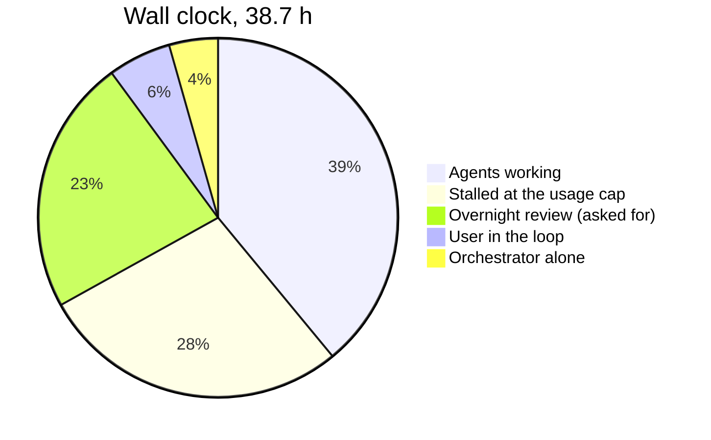
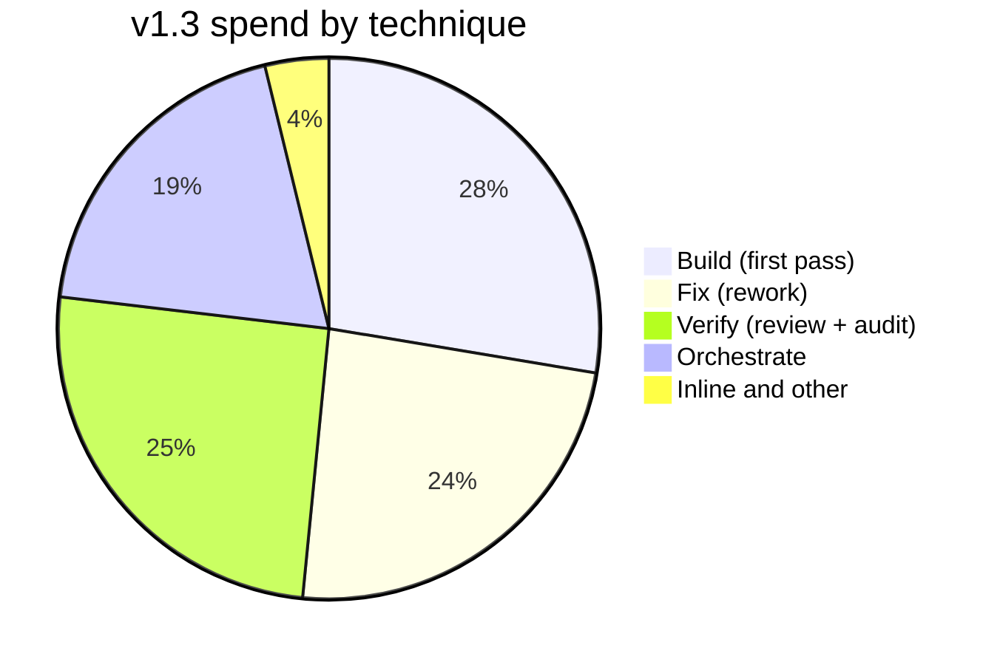
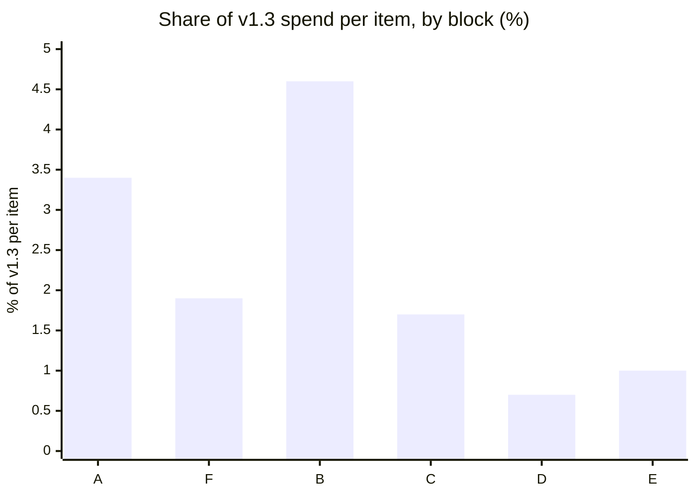
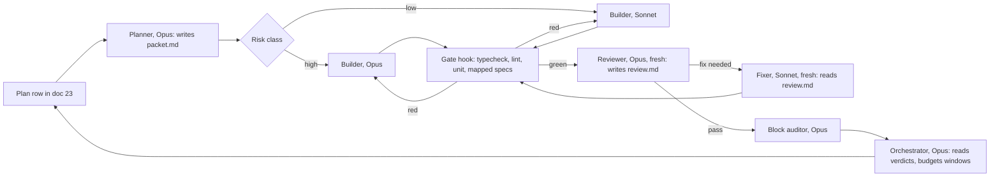

# 25 — v1.3 retrospective: the agent pipeline, what it cost, and what to change next

**Status:** written 2026-10-28, with every v1.3 item built and the close still to come. It is drawn from
every Claude Code transcript of 27–28 Oct: four sessions and their 62 subagents. Like
[24](24-session-retrospective.md), cost is shown only as **shares of v1.3's total**, never in currency. This
doc adds a second unit, the **window**. That is the account's five-hour usage allowance, which v1.3 used
up five times; one window held about 17% of v1.3's spend (§2). Doc 24 covers v0 to v1.2, and this doc
picks up from there. The method and its limits are in §10.

**Corrected 2026-10-28:** the first version priced cache reads at twice their real rate. Every share
below has been recomputed with rates that reproduce Claude Code's own cost record exactly (§10). The
conclusions didn't change; most shares moved by a point or two.

## 1. v1.3 in numbers

| What | Amount |
|---|---|
| Calendar time | 38.7 h (27 Oct 04:15 → 28 Oct 18:56). Agents were running for 15.1 h of it |
| Sessions | S11: the `npm run dev` fix, then A1 inline on Sonnet. S12 and S13: stubs (a README, a remote-control check). **S14: the v1.3 orchestrator**, which ran everything else |
| Human input | 15 typed prompts in S14, plus 27 rounds of multiple-choice questions (about 100 questions) in the backlog triage |
| API calls | 3,771: 431 in main conversations and 3,340 in subagents |
| Subagents | 62: 26 implementers (23 Sonnet, 3 Opus), 24 reviewers (Opus), 6 auditors (Opus), 4 audit fixers (Sonnet), 2 explorers (Sonnet) |
| Tokens | 476 M read from the cache, 18 M written to it, 2.7 M output |
| Spend by model | **Opus 5.5 54%, Sonnet 5.5 46%**, Haiku under 0.1% |
| Usage windows | About six. Five ended at the cap (08:44, 14:01 and 18:38 on the 27th; 12:36 and 15:00 on the 28th) |
| Result | 45 items built (A1 and B–F's 44), one closed by a check (C11). +16.5k lines: 5.6k `src`, 7.1k `tests`, 2.8k docs, 1.0k fixtures. Unit tests 1,085 → 1,411; parallel e2e 188 → 206 |
| Escapes | None found by the user yet: "Block A and B look good" (28 Oct, 08:26). The final check of C–E is still to come |

**What the spend was made of:**

| Part of each call | Main conversations | Subagents |
|---|---|---|
| Reading the context from the cache | 42% | 37% |
| Writing the context into the cache | 43% | 39% |
| Output | 15% | 24% |

Context size still sets the bill, as it did in 24. The difference in v1.3 is that most of the context
now lives in subagents (about 77% of spend) instead of one long conversation.

## 2. Where the wall clock went

```mermaid
gantt
  title v1.3, 27–28 Oct (red = stalled at the usage cap)
  dateFormat YYYY-MM-DD HH:mm
  axisFormat %H:%M
  section 27 Oct
  S11 dev fix + A1 (Sonnet, inline)  :a1, 2026-10-27 04:20, 65m
  Backlog triage (27 rounds)         :t, 2026-10-27 06:04, 63m
  Block F                            :f1, 2026-10-27 07:21, 83m
  Cap                                :crit, 2026-10-27 08:44, 118m
  Block F (cont.)                    :f2, 2026-10-27 10:42, 136m
  Block B                            :b1, 2026-10-27 13:04, 57m
  Cap                                :crit, 2026-10-27 14:01, 90m
  Block B (cont.)                    :b2, 2026-10-27 15:31, 187m
  Cap                                :crit, 2026-10-27 18:38, 159m
  Block B (cont.) and close          :b3, 2026-10-27 21:17, 132m
  section 28 Oct
  Overnight: the user's review       :done, 2026-10-27 23:29, 533m
  Block C (serial)                   :c, 2026-10-28 08:22, 254m
  Cap                                :crit, 2026-10-28 12:36, 57m
  C7, C11, D, E (parallel)           :p, 2026-10-28 13:33, 87m
  Cap                                :crit, 2026-10-28 15:00, 224m
  Close: suite, review page          :z, 2026-10-28 18:44, 12m
```

| Where the 38.7 h went | Hours | Share |
|---|---|---|
| At least one subagent working | 15.1 | 39% |
| **Stalled at the usage cap** (8.0 h waiting for the reset, 2.8 h more before the next prompt) | 10.8 | 28% |
| Overnight stop for the user's review (asked for) | 8.9 | 23% |
| The user in the loop: triage, and A1 in S11 | 2.2 | 6% |
| The orchestrator alone: full suites, stills, docs | 1.7 | 4% |



**Inside the 15.1 agent hours, half was spent waiting on checks.** Across all agents, Bash time came
to about 10.4 hours. Most of it went to e2e mapped specs (215 runs, 4.9 h), keystone (94 runs, 2.3 h),
typecheck (187 runs averaging 27 s, 1.4 h), unit tests (285 runs, 1.0 h) and drives (78 runs, 0.8 h). Claude
Code's own record for S14 through Block B agrees: 6.1 h of tool time against 4.0 h of model time.

**The usage window is now the bottleneck.** In 24, the human was. Each window held a similar spend,
which is what makes the window a usable unit:

| Window | Ended | Share of v1.3 spend | What it built |
|---|---|---|---|
| W1 | Cap, 08:44 | 13.8% | A1 (S11), the triage, F1–F5 |
| W2 | Cap, 14:01 | 16.7% | F6–F10, Block F's close, the start of B1 |
| W3 | Cap, 18:38 | 17.0% | B1–B4 (B1 took three review rounds) |
| W4 | Stopped at 23:29 when asked | 17.7% | B5 (three rounds, redesigned), B6–B9, Block B's close |
| W5 | Cap, 12:36 | 15.7% | C1–C6, C8–C10 (9 items, serial) |
| W6 | Cap, 15:00, 87 min in | 17.5% | **C7, C11, D1–D6, E1–E8 (16 items, up to 5 agents at once)** |
| W7 | — | 1.7% | The full suite and the review page |

Running agents in parallel didn't make a window go further. It used the window up faster, in 87
minutes instead of four or five hours. W6 built more because its items were **cheaper**: smaller,
UI-local work, each with one fix round, and an orchestrator with a small context (§3). Parallelism
saved wall clock, and wall clock only matters while there's budget left in the window.

## 3. Where the spend went

### By technique

| Technique | Share | What it is |
|---|---|---|
| **Build:** first implementation pass | 27.6% | Sonnet implementers 23.2%, Opus implementers 4.4% (F1–F5) |
| **Fix:** rework after review | 23.9% | Fix rounds in the same implementer 21.7%; fresh audit fixers 2.2% |
| **Verify:** review and audit | 25.3% | Per-batch Opus reviews 15.3%, re-reviews 3.6%, block audits 6.4% (2.3 points of which were lost to the cap, §5) |
| **Orchestrate:** S14's main loop | 19.3% | Triage, briefs, relaying findings, decisions, the review page |
| Inline and other | 3.8% | S11 (A1 on Sonnet, 2.8%), its explorers, the stubs |



### By block

The orchestrator's spend is allocated to the block it was running at the time. Its parallel-phase spend
is split across C7, C11, D and E by item count.

| Block | Items | Build | Fix | Review | Re-review | Audit + fixes | Orchestrator | **Total** | **Per item** | Wall clock (excluding stalls) |
|---|---|---|---|---|---|---|---|---|---|---|
| Triage | — | — | — | — | — | — | 2.0 | 2.0 | — | 1.1 h |
| A (S11, inline) | 1 | 2.8 (S11) + 0.6 (explorers) | — | — | — | — | — | 3.4 | 3.4 | 1.1 h |
| F: hygiene and tests | 10 | 5.9 | 4.2 | 2.5 | — | 2.4 | 3.6 | **18.5** | 1.9 | 3.6 h |
| B: data and plates | 9 | 12.0 | 9.7 | 4.9 | 2.7 | 3.9 | 7.7 | **41.0** | **4.6** | 6.3 h |
| C: scene and art | 11 | 5.4 | 5.5 | 4.3 | 0.9 | — | 2.2 | **18.3** | 1.7 | 4.2 h, plus C7 in the parallel window |
| D: playback and packs | 6 | 1.5 | 0.7 | 1.2 | — | — | 1.0 | **4.4** | 0.7 | in the 87 min |
| E: settings and onboarding | 8 | 2.8 | 1.7 | 2.4 | — | — | 1.3 | **8.2** | 1.0 | in the 87 min |
| C–E audits (lost) | — | — | — | — | — | 2.3 | — | 2.3 | — | — |
| Close | — | — | — | — | — | — | 1.7 | 1.7 | — | 0.2 h |



**Block B was 41% of v1.3** for 9 of its 45 items. Its items met real ADO semantics: which 401
means a dead token and which means a missing scope, the reporting feed's paging, and migrations of
users' caches. Those are design problems, and the design was settled in review loops: B1 took three
rounds, and B5 was redesigned twice before the orchestrator dictated a simpler design. The B5 loop
alone, its implementer and reviewer, came to 7.2% of v1.3.

### The six most expensive agents

| Agent | Model | Share | Why |
|---|---|---|---|
| B1 implementer (PR stat line) | Sonnet | 5.9% (2.7 build, 3.3 fix) | Two fix rounds; context averaged 248k |
| B5 implementer (revisions feed) | Sonnet | 4.3% | Two redesigns; a cap restart; context 219k |
| F5 implementer (test gaps) | Opus | 4.3% | A cap restart; flake hunting under load |
| B4 implementer (board columns) | Sonnet | 3.5% | Context 229k; the migration was too broad |
| B2 implementer (pipeline status) | Sonnet | 3.1% | The 401 rule, which reached back into B1 |
| B5 reviewer | Opus | 3.0% | Three rounds, with scratch probes it wrote itself |

## 4. Was the adversarial split worth it?

**Yes.** Verification cost 25% of v1.3. Every batch then passed its own checks, and the reviewers
still caught these, before the user saw them:

| Found by | Severity | What would have shipped |
|---|---|---|
| E1–E3 review | Blocker | Closing the ship preview destroyed textures shared with the chart, freezing it. The reviewer bisected a failing relaunch test to it |
| E8 review | Major, security | Dropping a file anywhere off the chart navigated the whole app to `file://` (an older hole that E8 made easy to hit) |
| E6–E7 review | Major | Cmd-Q mid-tour left an ADO user stuck on the fixture and lost an Azure CLI sign-in |
| E4–E5 review | Major | After a mid-sync token refresh, queued requests kept the old token and failed as if it were dead |
| D1–D3 review | Blocker | The All events chip did nothing on the busy pods: a cap still cut the beats |
| C1 re-review | Blocker | The new keyline cost Pulsar about 20 fps |
| C7 review | Blocker | Typecheck failed (the e2e tsconfig couldn't see the PNG import) |
| B5 reviews | Blocker ×2 | A capped crawl never resumed; then the fix emptied a scope's chart on alternate syncs while it reported itself complete |
| B1, B2 reviews | Major | One 503 failed a whole sync. Stat reads were unthrottled. A 401 from a missing scope was treated as a dead token |
| B4 review | Major | The migration wiped every user's cached history and team lists, not just the checkpoints |
| Block B audit | Major ×4 | Interactions no single-item review could see: B4's migration with B5's feed left a silent gap, among others |

Without the reviewers, these would have reached the user's final check. Each would then cost a new
loop, run from a larger context, and there are at least four the user would hit in the demo. In
24, the one Sonnet stretch of v1.2 shipped a regression that the user found.

**Reviews were cheap. The price was the rework they triggered.** An Opus review averaged 0.8%
of v1.3 (re-reviews included), at a context of about 55k. The fix rounds after it cost 24%, nearly as much as the first
builds. 17 of the 21 first reviews of Sonnet-built batches said *fix needed*. All 3 Opus-built
batches (F1, F2–F4, F5) passed first time, with minor findings. Those were hygiene items, so the
comparison is confounded, but the pattern matches the failures' types:

- **Misreading the contract:** C1 read "against its planet" as the piece's own body.
- **Not checking the effect:** D1 never looked at the busy pods it was meant for.
- **Framework lifecycle:** E1 used Pixi 8's `destroy(true)` on shared textures.
- **Design under real-world semantics:** B1, B2 and B5.

**Sonnet implementers didn't save money per item.** A Sonnet subagent call cost about the same as an
Opus one (0.94× against 1.1× the average subagent call). Sonnet's contexts averaged 151k against
Opus's 73k, which cancelled out the half-price rate. Per accepted item, Sonnet implementers came to
about 1.1% of v1.3 and Opus ones 1.4%. That's within the noise, given the confound. The switch to Sonnet
implementers on 27 Oct moved spend from build to rework; it didn't remove it.

**Verdict:** keep the fresh-context reviewer, which is the cheapest quality in the pipeline. Change
what feeds it: the implementer's model by risk, a design step before the build, and mechanical gates,
so that Opus review tokens go to judgment and not to typecheck failures (§6).

## 5. Waste: what cost tokens or time without buying quality

| # | Waste | Cost | Evidence |
|---|---|---|---|
| 1 | **Fix rounds resumed an implementer whose cache had expired.** Reviews took 5–12 minutes, and subagents use the five-minute cache, so every resume re-wrote a 150–250k context before fixing anything | 9.3% in re-writes alone (31 resumes); then each fix call re-read that context | The fresh Block B audit fixer made 11 fixes for 1.1%, working from a 118k context |
| 2 | **Context carried by implementers.** Each read about 12k tokens of docs and 18k of code before its first edit, and carried that and every test log on every later call | Re-reading the opening context came to about 19% of v1.3 (6 points the harness prompt, 13 the orientation) | B1, B4 and B5 averaged 219–248k per call; D and E implementers averaged 94–135k |
| 3 | **The orchestrator's context before compaction.** Block B ran at an average of 360k and peaked at 445k | Block B's orchestration was 7.7% for 78 calls; Block C's, after the compaction, 1.9% for 59 | About three times cheaper per call after compacting to 11k, with no loss: Block C ran cleanly from the summary |
| 4 | **Duplicate completion notices.** Each finished agent arrived twice (a hand-back message and a task notification). S14 answered 32 of them with "That notice was … which I've already handled" | About 2% (32 calls at 200–400k) | Count of those messages in S14 |
| 5 | **Work cut off at the cap.** F5, B1's re-review, B5 and C7 were killed mid-task and resumed; **both C–E audits were lost** | 2.3% for audits that never reported, plus four resume re-writes | The orchestrator can't read `/usage`, so it started two Opus audits at 14:57, three minutes before the cap |
| 6 | **Loops that settled design by review.** B5's second fix introduced a new blocker; the loop ended when the orchestrator chose the design | About 4 points of B5's 7.2 | "This is going in circles because the design has too many moving parts, so I'm settling it myself" (27 Oct, 22:06) |
| 7 | **Repeated checks.** 187 typechecks at 27 s each, keystone after every fix round, and in W6 an `out/` lock serialising five agents' e2e runs | 1.4 h of typecheck alone; queueing for the lock in W6 | Bash timings (§2) |
| 8 | **State kept in `/tmp`.** The shared brief and ledger lived in the scratchpad, which was cleared overnight; S14 rebuilt them from its own transcript | Small in tokens; a real fragility | "The scratchpad was cleared overnight, so I'm getting the build briefs back from the session transcript" (28 Oct, 08:27) |

**What worked better than in v1.2** (24's levers):
- The main loop ran on the **one-hour cache**. Pauses for review cost 4 re-writes, all after gaps longer
  than an hour (the caps and the night), against 24's 38 points of idle tax.
- **Compaction at a block boundary**, which the user ran at 08:22, was free in quality.
- No Opus 5.
- Test output stayed in the subagents, piped through `tail`.

## 6. Faster and cheaper: the levers, ranked

Savings are estimates of v1.3's spend, from the measurements above. Because the window is the
bottleneck, every token saved is also wall clock saved.

| # | Lever | Likely saving | Quality risk | Evidence |
|---|---|---|---|---|
| 1 | **A fresh fixer with a findings file, not a resumed implementer.** The reviewer writes `review.md`, and a new Sonnet agent gets the item packet (lever 3), `review.md` and the diff | 8–12 points (most of waste 1, and fix calls at about 80k instead of about 200k) | Low: the fixer has the findings, the diff and the contract; the reasoning it lacks is what the review faulted | Block B's audit fixer: 11 fixes, 1.1%, suite green |
| 2 | **Route the implementer by risk.** Opus for data, ingestion, auth and framework lifecycle (B, E1, E4–E5, C6); Sonnet for copy, fixtures, docs and UI-local items (C2, D5–D6, E2–E3, E6, F9) | Hard to price; mostly fewer fix rounds on the B-type items, where rework was 45% of implementer spend | Lowers it | 17 of 21 Sonnet batches needed fixes; Sonnet calls cost the same as Opus calls (§4) |
| 3 | **An item packet written once per item** by a short Opus planning step: the item row, the doc excerpts it touches (15 rows, 03 sections), the files and line ranges, and **the acceptance checks** | 5–10 points of orientation (waste 2), and fewer misreadings | Low, if the packet links to the full docs for anything it leaves out | Implementers read about 30k tokens before the first edit, and 23 was read 59 times; C1 and D1 failed on intent, not code |
| 4 | **Mechanical gates before hand-back:** typecheck, lint, unit tests and the mapped specs must pass (a `SubagentStop` hook or the brief's final step), so no review starts on red | 1–2 points of review, and a round trip each time | None | C7's blocker was a typecheck failure; D1–D3's keystone "never finished" on the implementer's side |
| 5 | **Plan in windows.** One batch costs 10–15% of a window. Don't start an Opus audit in a window's last 15%. Checkpoint to repo files | The 2.3% of lost audits, and resume re-writes | None | Waste 5 |
| 6 | **Restart or compact the orchestrator at each block**, and give it verdict lines, not full reports: reviewers write findings to files | 4–6 points of the 19.3 | Low: the 08:22 compaction lost nothing | Waste 3 and 4; the orchestrator rewrote findings into fix messages, as output |
| 7 | **Worktrees per implementer** (`isolation: "worktree"`), so each has its own `out/` and the lock goes away. Shared tables (15, 23, tests/README) merge as small patches the orchestrator applies | Wall clock: W6's lock queue; true parallel e2e | Medium: merge conflicts in the shared docs | The lock and the "keep edits to shared files surgical" rule in the parallel brief |
| 8 | **The one-hour cache for subagents, if the harness offers it.** It costs more per write (2× input instead of 1.25×), but stops the idle re-writes | Up to 4 points (13 re-writes after long test runs or lock waits), more if resumes stay | None | Waste 1 and 7 |
| 9 | **Incremental typecheck** (`tsc -b` with build info) | Part of 1.4 h | None | 187 runs averaging 27 s |

**What wouldn't help:** cutting the reviewers or the block audits. They are about a quarter of the
spend, found every blocker in §4, and the B audit found four majors that only appear across items.
Cutting docs wouldn't help either: they were about 5% of spend, through orientation reading.

## 7. The next step: from a pipeline to a factory

What ran in v1.3 is a primitive factory: an orchestrator, two agent types (`.claude/agents/v13-*.md`)
that point at a shared brief in `/tmp`, and a contract (23 §3). It got 45 items built across six windows,
with no escapes found yet. Here is what it lacks, with the evidence for each gap:

| Gap | Evidence | Next form |
|---|---|---|
| **No design step.** Design was settled in review loops | B5 (three rounds), B4's migration and C6's slot rule were all decided by the orchestrator after review | A **planner** role (Opus, short) writes the item packet: approach, acceptance checks, risk class. The reviewer can check the packet before any code exists |
| **Handoffs through messages.** Reports pass through the orchestrator's context and get rewritten | 32 duplicate turns; the orchestrator rewrote findings into fix messages | **Files as the interface:** `work/<id>/packet.md`, `review.md`, `verdict` (gitignored). Agents read them; the orchestrator reads only verdicts |
| **One model per role, not per risk** | §4 | The planner sets `risk: high` or `risk: low` in the packet, and the orchestrator picks the builder's model from it |
| **Briefs in `/tmp`** | Lost overnight | Move the brief and the agent definitions into a **project skill** (`.claude/skills/block-pipeline/`) or into the agent files' bodies, versioned with the repo |
| **No budget sense** | Five caps; lost audits | A budget ledger: spend per batch, estimated from this doc's table, checked before each launch; audits scheduled first in a fresh window |
| **One working tree** | The `out/` lock | Worktrees per builder (lever 7) |
| **No metrics** | This doc was assembled by hand from transcripts | §8 |



**Can the agents be evaluated?** Yes, with what's already in the transcripts. For each role, at each
block's end:

| Metric | v1.3's value | What it would tell us |
|---|---|---|
| First-pass acceptance (reviews with verdict *pass*) | Sonnet builders 4 of 21; Opus builders 3 of 3 | Whether a builder's model or packet is good enough |
| Fix rounds per batch | Mean 1.0 (27 over 26 batches); B1, B5, F6–F8, C1 and C6 two each | Where design should have come first |
| Rework share (fix ÷ all implementer spend) | B 45%, C 50%, D 30%, E 38%, F 42% | The cost of first-pass misses |
| Reviewer precision (findings acted on ÷ findings raised) | Not tracked; the orchestrator rejected few | Whether reviews are noise or signal |
| Escapes (bugs the user finds at the gate) | 0 so far | The pipeline's real quality, and the only number that matters to the user |
| Spend per accepted item, in windows | B 0.27; C 0.10; D 0.04; E 0.06 | Throughput per five hours |

A small script that computes these from `~/.claude/projects/` at each block's end would make the next
retrospective automatic. It would also allow **replay trials**: build the same two or three v1.4 items
twice in worktrees, once with a Sonnet builder and once with Opus, or with and without a packet, and
compare acceptance and spend. That is the only way to remove §4's confound. It costs about one window.

## 8. What v1.3 showed about running unattended for five hours

1. **A run stops for two reasons: the cap and the gates.** No agent crashed, and no check left the
   tree broken. Every stall was a cap or a gate the user asked for. Once the user carried every gate to
   one final check (28 Oct, 08:32), the user's only prompts were restarts after a cap. One of
   them also asked for parallel agents and a finished demo by the window's end.
2. **Deciding and recording beats stopping to ask.** The orchestrator made about ten calls on the
   user's behalf, each written into 23 §5 or a §4 question with a recommendation, for the user to
   overturn later. Among them: B4's narrow migration, B5's design, C6's slot promotion, C1's keyline,
   and R4 against R9 for B3. That kept the run moving without hiding anything.
3. **The plan row is the contract, and its *Decided* clause sets the rework.** Items whose *Decided*
   named an observable result went through in one round, like C2's coverage test or C6's invariant
   across fixtures. Items whose clause could be met without the intended effect needed rework or
   turned out to be no-ops: D1's "a larger budget", D6's range that was already whole, and C1's
   ambiguous "its planet".
4. **Tests: enough of them, but some of the wrong kind.** 1,411 unit and 206 e2e tests passed while the
   §4 blockers existed. They missed **effects** (D1), **lifecycles** (E1's shared textures) and
   **real-API semantics** (the 401 rules). Flakes under load cost time in F5, B and E. The best new
   tests were invariants across every fixture: C6's "drawn = true count" and C2's coverage guard.
   Write more of those, and fewer fixed waits.
5. **Docs: about the right amount.** At 156k words, docs were cheap to use (about 5% of spend, through
   orientation) and did their job: the 08:22 compaction lost nothing, because Block C ran from the summary, 23,
   the handoff and the notes. What was missing was content, not volume: ADO's 401 behaviour wasn't in 04
   until a reviewer wrote it. One more plan isn't needed; executable acceptance checks per item are.
6. **Parallelism saves wall clock, not budget.** W6 built the most in the least time, but its window
   lasted 87 minutes. Without a budget model, parallel runs reach the cap sooner and lose work in
   flight (the C–E audits).
7. **The usage window is the unit to plan in.** One window holds 11–15 index units of spend (§10), and
   on v1.3's mix that bought 4 to 16 items. Planning v1.4 in windows ("Block X ≈ 1.5 windows") would
   let the orchestrator schedule audits and stop points itself.

## 9. The questions worth asking

The main one:

> **What does an accepted item cost, in windows, once it has survived my final check, and which single
> change to the roles moves that number the most?**

It joins the two things v1.3 can measure (spend per item, rework, first-pass acceptance) with the
one it can't yet (escapes). It also forces each role change to be judged by a trial, not by intuition.

Behind it:
- **Which of my judgments could become checks that run without me?** The user's eye was the main
  source of quality in 24, and the reviewers stood in for it in v1.3. Each new invariant test or
  acceptance check moves some of that judgment into the gate.
- **Where should design happen?** B5 shows the cost of designing by review. Is a planning step
  cheaper than the loops it prevents, on the next block with real-world semantics?
- **What is the smallest context that still gives a correct build?** The packet experiment answers it,
  for each risk class.
- **How should the factory spend a window it can't see?** Does it get `/usage`, or a ledger estimated from
  this doc's tables?

## 10. How the numbers were measured, and what they can't show

- **Source:** the five transcripts under `~/.claude/projects/` for this repo dated 27–28 Oct (this
  retrospective's own session excluded) and the 62 `subagents/agent-*.jsonl` files with their
  `.meta.json`, plus `git show` of `9949dcd` and `7fa80f2`, and `git diff` of the working tree for C–E.
  The v0–v1.2 transcripts behind 24 are no longer on disk, so v1.3 can't be put on 24's scale. The
  comparisons with 24 are structural: context sizes, the share of idle re-writes, and failure modes.
- **Tokens:** each API response's usage, de-duplicated by message ID, keeping the largest value of
  each field. v1.3's transcripts record output and thinking tokens, so output is more complete than in
  24.
- **Cost index:** list-rate ratios, normalised to one Sonnet 5.5 input token: Sonnet input 1, five-minute
  cache write 1.25, one-hour cache write 2, cache read 0.05, output 5; Opus 5.5 is 2× each. These rates
  reproduce Claude Code's own `cost-state` record for S14 through Block B to the cent, for both models.
  Shares hold under a uniform discount.
- **Windows:** spend summed between the reset times the harness reported. W4 was stopped by the user,
  not the cap. The other project on this machine used nothing in those windows. A window's capacity is
  inferred from the spend before each cap (11–15 index units), not read from `/usage`.
- **Roles and rework:** roles come from each agent's description. *Rework* is an agent's spend after the
  orchestrator's first fix or re-review message to it (resume messages after a cap excluded). Fix work
  that the orchestrator did itself (a few nits) is counted as orchestration.
- **Verdicts:** read from each reviewer's report (*pass* or *fix needed*, with severities).
- **Re-reading the opening context:** for each subagent call, the smaller of its context and the
  context at its first edit (implementers) or tenth call (reviewers), at the cache-read rate.
- **Wall clock:** agent time is minutes with at least one subagent making calls less than 10 minutes
  apart. Stalls run from the cap message to the next prompt.
- **Not visible:** currency; the user's time outside the conversation; whether the C–E work survives the
  final check; and how much the parallel phase's "be economical" instruction, rather than item size,
  made W6 cheaper.

**Source:** the transcripts and `git` as of 2026-10-28 · **Update when:** v1.3 closes, to record escapes
from the final check; or after a replay trial (§7).
