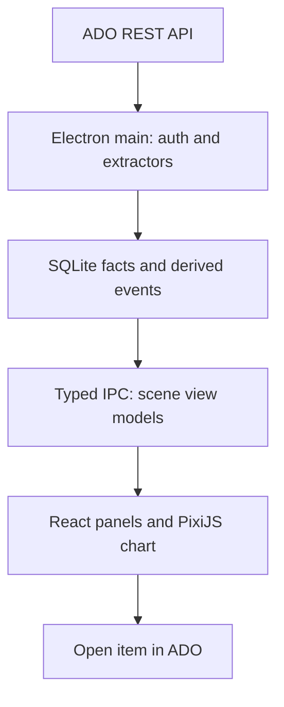

# Star Chart: Azure DevOps as an explorable project universe

**Status:** Product and technical specification, first pass
**Audience:** Engineering team and coding agent implementing an Electron prototype
**Date:** 2026-09-29
**Source of truth:** Azure DevOps (ADO) for work and code; local SQLite for an offline, replayable projection

## 1. Product in one page

Star Chart turns an organization's ADO work items, people, repositories, and pull requests into a navigable retrofuturist space chart. A user opens a project galaxy, enters either an Epic sector or a saved Area Path sector, selects a Feature star, and explores Story planets and Bug anomalies. Mission points (Tasks), assigned captains, repository supply stations, and PR cargo flights explain how the business work connects to engineering work. A timeline replays recorded changes, and every visual claim can be inspected in a side panel and opened in ADO.

The main question is: **What happened to this Feature, who was assigned to its work, and which repositories changed as a result?** A product owner should be able to begin with a Feature; an engineer should be able to follow its trace to Tasks, PRs, and repos. The team's two commonly visited galaxies are **Federation Core** and **Federation Support**. Most people will first choose a project and their saved Area Path (for example, **Comet Pod**) to see that area's Feature stars, then follow a Feature into Stories, Tasks, PRs, and repos. An Epic sector remains a second way to group Features by business initiative. [ADO projects and teams](https://learn.microsoft.com/en-us/azure/devops/organizations/projects/about-projects?view=azure-devops) are separate concepts: the Area Path view uses each item's `System.AreaPath`, without treating a team name as a new ADO parent.

The visual experience is an **interactive, realistically painted space-age vision**: vivid celestial environments, illuminated ships and stations, visible painterly texture, and an optimistic sense of scale. The user is an omniscient mission observer looking _into_ a living painting, with precise annotations from a distant mission-control outpost. The interface does not simulate standing on the bridge of a particular captain's ship. Text and shape must still convey state when color or animation is unavailable. The UI is a map for understanding work, not a competition or a substitute for ADO.

### Outcomes and boundaries

- **Prototype outcomes:** select an allowed organization and either of the two project galaxies; save favorite Area Paths per project; cache the Features in a chosen Area Path or Epic and their descendants; inspect cross-repo PR links; replay at least two weeks of work-item and PR milestones; open ADO items from a detail panel; refresh incrementally; work from the local cache when offline.
- **First pilot scope:** one organization, Federation Core and Federation Support in the galaxy selector, with bounded on-demand ingestion of one saved Area Path (such as Comet Pod) and an Epic sector for comparison. The repositories and PRs relevant to loaded Features come along with either view. Selecting a galaxy need not backfill its whole project; cross-project work-item links remain a distinct follow-up capability.
- **First release is read-only:** board navigation and playback do not mutate ADO. A later phase can offer comments and state changes after implementing permissions, conflict handling, an explicit submit action, and an audit trail.
- **Out of scope in the first prototype:** deployment claims, inference of who is actively coding, AI-generated work states, organization-wide analytics, person rankings, arbitrary source-code ingestion, and automatic gameplay that changes work-item states.

## 2. Canonical glossary and relationships

| ADO entity or relationship                                                                                                                           | Star Chart name                      | Meaning and rendering rule                                                                                                                                                                                                                                                                                                                            |
| ---------------------------------------------------------------------------------------------------------------------------------------------------- | ------------------------------------ | ----------------------------------------------------------------------------------------------------------------------------------------------------------------------------------------------------------------------------------------------------------------------------------------------------------------------------------------------------- |
| [Organization](https://learn.microsoft.com/en-us/azure/devops/organizations/accounts/organization-management?view=azure-devops)                      | Observatory                          | Connection boundary and authenticated account; may contain many project galaxies.                                                                                                                                                                                                                                                                     |
| [Project](https://learn.microsoft.com/en-us/rest/api/azure/devops/core/projects/list?view=azure-devops-rest-7.1)                                     | Galaxy                               | Top-level named navigation destination. No aggregate productivity score.                                                                                                                                                                                                                                                                              |
| [Area Path / `System.AreaPath`](https://learn.microsoft.com/en-us/azure/devops/boards/queries/query-by-area-iteration-path?view=azure-devops)        | Saved Area Path sector               | Favorite, project-scoped entry into Feature stars whose own Area Path is at or beneath the selected path. A view, not a parent link or exclusively one team's ownership. A Feature can appear here and in its Epic sector.                                                                                                                            |
| [Epic](https://learn.microsoft.com/en-us/azure/devops/boards/backlogs/define-features-epics?view=azure-devops)                                       | Epic sector                          | A navigable region of Features linked beneath that Epic; its recent recorded activity produces a short pulse and a dated event label.                                                                                                                                                                                                                 |
| [Feature](https://learn.microsoft.com/en-us/azure/devops/boards/backlogs/define-features-epics?view=azure-devops)                                    | Star                                 | The anchor of a system. It forms from a faint point as child work is added; a closed Feature settles into a small white dwarf. Its own ADO state controls its core state.                                                                                                                                                                             |
| [User Story](https://learn.microsoft.com/en-us/azure/devops/boards/work-items/guidance/agile-process-workflow?view=azure-devops)                     | Planet                               | A distinct business outcome orbiting a Feature; its own ADO state determines its terraforming stage. Active Story glints draw attention to the parent star. Other processes may name the requirement PBI or Requirement.                                                                                                                              |
| [Bug](https://learn.microsoft.com/en-us/azure/devops/boards/backlogs/manage-bugs?view=azure-devops)                                                  | Anomaly                              | **For the pilot team's process, a direct child of a Feature.** Resolved contracts; closed becomes a quiet remnant. Actual parent links remain authoritative.                                                                                                                                                                                          |
| [Task](https://learn.microsoft.com/en-us/azure/devops/boards/backlogs/backlogs-overview?view=azure-devops)                                           | Mission point                        | Tiny orbiting marker or shuttle berth under its actual Story or Feature-child Bug. Usually the work-item connector from parent to PR, with its own ADO identity, state, and assignee available on selection. Its closure never automatically marks its parent done. Cluster or hide markers at distant zoom; do not render every Task as a full moon. |
| [`System.AssignedTo`](https://learn.microsoft.com/en-us/rest/api/azure/devops/wit/fields/get?view=azure-devops-rest-7.1)                             | Captain and personal ship            | Identity field on a work item; retrieve its definition using `fieldNameOrRefName=System.AssignedTo`. One person has one identity and visual profile; several assignment markers may appear across their items. Assignment is not proof of live activity.                                                                                              |
| [Git repository](https://learn.microsoft.com/en-us/rest/api/azure/devops/git/repositories/list?view=azure-devops-rest-7.1)                           | Supply station                       | Stable reusable resource projected into a Feature system's orbital belt when linked to its work. Multiple linked Stories may have routes to one repo; one repo ID remains one repository in the data model.                                                                                                                                           |
| [Pull request](https://learn.microsoft.com/en-us/rest/api/azure/devops/git/pull-requests/get-pull-requests-by-project?view=azure-devops-rest-7.1)    | Cargo flight                         | Main visible unit of code change, with its own author, timestamps, status, repository, and linked work. Team convention requires a PR for changes merged into a protected main branch and a linked work item on PRs; a PR may link to Task (usual), Story, or Bug. One PR remains one flight even with multiple links.                                |
| [Parent/child link](https://learn.microsoft.com/en-us/rest/api/azure/devops/wit/work-item-relation-types/list?view=azure-devops-rest-7.1)            | Orbit                                | A hierarchy edge, usually `System.LinkTypes.Hierarchy-Forward` / `Hierarchy-Reverse`, with a recorded effective interval if [work-item updates](https://learn.microsoft.com/en-us/rest/api/azure/devops/wit/updates/list?view=azure-devops-rest-7.1) permit.                                                                                          |
| [PR-to-work-item artifact link](https://learn.microsoft.com/en-us/rest/api/azure/devops/git/pull-request-work-items/list?view=azure-devops-rest-7.1) | Flight route                         | Direct PR → Task, PR → Story, or PR → Bug link. A Task route visually continues to its actual Story/Bug parent; an ancestor route is a **derived rollup**, shown separately with its evidence chain.                                                                                                                                                  |
| [Predecessor/successor link](https://learn.microsoft.com/en-us/azure/devops/boards/plans/track-dependencies?view=azure-devops)                       | Navigation hazard or dependency lane | Render only explicit linked dependencies; a silent item is not automatically blocked.                                                                                                                                                                                                                                                                 |
| Peer-given recognition                                                                                                                               | Mission commendation                 | Optional local-only, consent-based note with giver, recipient, context, and text; not an ADO metric or leaderboard.                                                                                                                                                                                                                                   |

**Hierarchy for the pilot team:** Project galaxy → Epic sector → Feature star → Story planet **or Bug anomaly** → Task (mission point) describes actual parent links. **Navigation adds a parallel route:** Project galaxy → saved Area Path sector → Feature star → the same descendants. Area membership comes from the Feature's own `System.AreaPath` (including nested paths), not from its Epic, Story, or Task's path. A Story or Task with a different Area Path remains visible under its actual Feature, with its own path in the inspector. Area sectors may include Features with no Epic, and the same Feature may be projected into multiple saved ancestor Area Path sectors. Never create a second Feature or duplicate its events. The team's Bugs are always direct children of Features. ADO can [configure Bug behavior differently](https://learn.microsoft.com/en-us/azure/devops/boards/backlogs/manage-bugs?view=azure-devops), so store actual parent links and keep an **Uncharted** tray for missing or unexpected parentage. Cross-project relationships appear as routes between galaxies when enabled. Repo stations are independent entities; their visual placement is a projection of links, not ownership.

**Object identity:** `organization_id + project_id` for galaxies; `organization_id + work_item_id` for work items (including ancestors and bugs); `organization_id + project_id + repository_id` for repos; `organization_id + project_id + repository_id + pull_request_id` for PRs. A saved Area Path sector has a local view key combining organization, project ID, and ADO classification-node ID when available; store the latest full path for WIQL and display, and reconcile it after node renames/moves. Epic sector keys use work-item IDs. Use ADO GUIDs where available. Display names and URLs can change and are not keys. For assignees, use a stable identity ID from identity refs rather than a display name; the [revision API](https://learn.microsoft.com/en-us/rest/api/azure/devops/wit/revisions/list?view=azure-devops-rest-7.1) shows identity-reference field values.

**Team source convention:** repository main branches reject direct commits, so work merged into main flows through PRs. PRs are expected to link a work item, most commonly a Task and sometimes a Story or Bug. This is team-provided process knowledge, not a guarantee from the REST API about any particular record. Do not add a separate commit ship to the pilot: a PR flight gives the intended code-change unit. If an actual PR has no readable work-item link, retain it in the repo's unlinked tray and report the gap. If a branch or commit never enters main, the main-branch convention does not imply it has a PR or belongs to a Story.

## 3. User journeys

1. **Monday playback:** An engineer opens Federation Core or Federation Support, chooses their favorite Area Path sector (for example, Comet Pod), sets last Monday as the start, and presses Play. A moderate week takes roughly 20–30 seconds at 1×. They can stay on sector view or click into a Feature while the playhead runs, watching its Stories change, Task points flicker, and PR flights appear and dock. They can pause, switch to ½× or ¼× midweek, follow an engineer's ship in one click, inspect Task and PR evidence, or open the ADO item. The [work-item revision list](https://learn.microsoft.com/en-us/rest/api/azure/devops/wit/revisions/list?view=azure-devops-rest-7.1) and [updates](https://learn.microsoft.com/en-us/rest/api/azure/devops/wit/updates/list?view=azure-devops-rest-7.1) supply distinct parts of this history.
2. **Product status review:** A product owner scans either a saved Area Path sector or an Epic sector's Feature stars. Active Story glints identify current work; a white dwarf identifies a closed Feature. They select a star, see recorded Story states and outstanding anomalies, and inspect the affected repositories without needing to know repo names first.
3. **Component impact:** A tech lead selects a supply station and sees the Stories, Bugs, Features, and cargo flights connected to the repository, grouped by direct links and inherited relationships. One repository can connect to several systems.
4. **Management navigation:** A manager switches between Federation Core and Federation Support galaxies, opens saved Area Path sectors or Epic sectors in each, and views recent events. The galaxy overview names projects and indicates recent activity, without implying that unlike projects share a comparable score.
5. **Offline revisit:** A user opens cached history without a current ADO connection. The header reports the last successful sync time. Deep links remain available if ADO can be reached.
6. **Free playback:** Someone sets a source date/time and presses Play while viewing a saved Area Path sector. Without stopping the clock, they zoom into a Feature, select a planet to inspect its PR, then zoom back to the sector; every scene reflects the _same advancing playhead_. A manager may stay at sector level to see which stars pulse without navigating to each Story.
7. **Follow an engineer:** An engineer clicks a captain ship once to select and follow it. The camera follows that identity's _recorded_ assignment and authored PR events between Feature systems, without declaring one simultaneous assignment their sole real-world focus. Manual panning/zooming temporarily suspends camera follow while the captain remains highlighted; **Resume Follow** recenters at the current playhead.

## 4. Mechanics and visual state rules

The board uses **exploration** to reveal hierarchy on zoom, **worker placement as a representation of explicit assignments**, **pick-up and delivery as the PR flight metaphor**, **network building** to expose cross-repo connections, and **cooperative recognition** through optional peer commendations. On a Story or Bug, the planet/anomaly and its connected PR flights carry the visual weight; the Task is a tiny connector or orbiting mission point when the PR links to a Task. A PR linked directly to a Story or Bug connects to that parent with no fabricated Task. The board does not award points for commits, line counts, or tickets closed. No exclusivity or capacity constraint is inferred from assignment alone; literal worker placement and ADO writes would require a later, separately designed interaction.

### State rule table

| Trigger from ADO or local event                                  | Persistent visual state                                                                                 | Brief playback event                                                                                          |
| ---------------------------------------------------------------- | ------------------------------------------------------------------------------------------------------- | ------------------------------------------------------------------------------------------------------------- | ---------------------------------------------------------------------------------------- |
| Project discovered                                               | Named galaxy appears                                                                                    | None                                                                                                          |
| Epic created / descendant changes                                | Sector and dated recent-event label                                                                     | Short sector pulse                                                                                            |
| Area Path saved / Feature enters or leaves its subtree           | Saved Area Path sector and current member stars                                                         | Local favorite change has no ADO event; source-timed Feature area change may briefly move its star projection |
| Feature created                                                  | Faint point                                                                                             | Point appears                                                                                                 |
| First child added to Feature                                     | Formed star, glint for each Story                                                                       | Star blooms; new orbit forms                                                                                  |
| Story created / starts                                           | Uncharted / scanned planet                                                                              | Orbit arrival / scanning sweep                                                                                |
| Task created / assigned / completes                              | Tiny mission point or clustered marker; assignment marker on close zoom                                 | Point appears / a recorded reassignment triggers a short ship jump / point signal changes                     |
| Story resolves / closes / reopens                                | Atmosphere clearing / lush world / recovery work on the existing world                                  | One-time transition; no loss of prior history                                                                 |
| Bug created / active / resolved / closed / reopened              | Visible anomaly at its actual parent / disturbance / contracted anomaly / remnant / renewed disturbance | One-time change appropriate to the state                                                                      |
| PR created / timestamped review comment / completed / abandoned  | Open flight / review signal / docked route / terminated route                                           | Launch / signal / arrival / withdrawal                                                                        |
| PR reviewer vote observed / precisely timestamped vote available | Current approval or review-needed badge / historical vote signal where supported                        | No invented past arrival; short approval flash only at a verified vote-event timestamp                        |
| PR author acts at a source-timed event                           | Same captain identity and PR author identity when IDs match                                             | Brief ship-to-flight beam on PR opening/push, linked route lights toward Story/Bug                            | An animation of a recorded action, not a claim that the captain was coding continuously. |
| Repo first linked in this system                                 | Shared station on orbital belt                                                                          | Station signal lights up                                                                                      |
| Feature closes / reopens                                         | Small white dwarf / active star again                                                                   | Settling / ignition                                                                                           |

Fetch each project's [work item types](https://learn.microsoft.com/en-us/rest/api/azure/devops/wit/work-item-types/list?view=azure-devops-rest-7.1) and [state names and categories](https://learn.microsoft.com/en-us/rest/api/azure/devops/wit/work-item-type-states/list?view=azure-devops-rest-7.1). For the selected team, use the explicit process mapping below; the user reported these values directly from organization settings on 2026-09-29. Preserve **ADO category**, **raw state name**, and **visual stage** as three separate fields, keyed by project and work item type. The ADO category is authoritative for reporting; the visual stage is a local metaphor. Unknown states get a neutral treatment plus the raw name; do not guess. Feature, Story, Bug, and Task states remain independent. Closed PR ≠ closed Story; merged PR ≠ deployed code. A Feature becomes a white dwarf only when its own state is `Closed`.

### Pilot process: exact state inventory and initial art mapping

| ADO type   | ADO category | Raw state name   | Initial visual stage / label                                                  |
| ---------- | ------------ | ---------------- | ----------------------------------------------------------------------------- |
| Feature    | Proposed     | New              | Faint core; New                                                               |
| Feature    | Proposed     | Draft            | Faint core with drafting grid; Draft                                          |
| Feature    | Proposed     | Ready for Review | Quiet core with review reticle; Ready for Review                              |
| Feature    | Proposed     | Ready            | Quiet core; Ready                                                             |
| Feature    | Proposed     | Deferred         | Dimmed, paused core; Deferred                                                 |
| Feature    | In Progress  | Active           | Bright active star; Active                                                    |
| Feature    | In Progress  | Ready to Accept  | Steady star with acceptance signal; Ready to Accept                           |
| Feature    | Completed    | Closed           | Small, happy white dwarf; Closed                                              |
| Feature    | Removed      | Removed          | Archived/removed ghost, **not** a white dwarf; Removed                        |
| User Story | Proposed     | New              | Uncharted planet; New                                                         |
| User Story | Proposed     | Ready            | Surveyed planet; Ready                                                        |
| User Story | Proposed     | Deferred         | Surveyed but dormant planet; Deferred                                         |
| User Story | Proposed     | Ready for Review | Surveyed planet with review reticle; Ready for Review                         |
| User Story | In Progress  | Active           | Visible terraforming; Active                                                  |
| User Story | In Progress  | Resolved         | Developed planet awaiting confirmation; **still In Progress**                 |
| User Story | In Progress  | Ready to Accept  | Developed planet with acceptance signal; **still In Progress**                |
| User Story | Completed    | Closed           | Lush, settled world; Closed                                                   |
| User Story | Removed      | Removed          | Historical ghost, **not** a completed world; Removed                          |
| Bug        | Proposed     | New              | Newly detected anomaly; New                                                   |
| Bug        | Proposed     | Ready            | Stable anomaly awaiting work; Ready                                           |
| Bug        | Proposed     | Ready for Review | Anomaly with review reticle; Ready for Review                                 |
| Bug        | In Progress  | Active           | Active disturbance; Active                                                    |
| Bug        | Resolved     | Resolved         | Contracted disturbance, still visible; Resolved                               |
| Bug        | Resolved     | Ready to Accept  | Contracted disturbance with acceptance signal; Ready to Accept                |
| Bug        | Completed    | Closed           | Quiet remnant; Closed                                                         |
| Bug        | Removed      | Removed          | Historical removed ghost; Removed                                             |
| Bug        | Removed      | Rejected         | Dismissed anomaly with a distinct Rejected label; **not** a fix or completion |
| Task       | Proposed     | New              | Unstarted mission point; New                                                  |
| Task       | In Progress  | Active           | Illuminated mission point; Active                                             |
| Task       | Completed    | Closed           | Settled mission point; Closed                                                 |
| Task       | Removed      | Removed          | Faint historical mission point; Removed                                       |

Feature **formation geometry** comes from creation and child orbits; its **core brightness, reticle, and closed appearance** come from its own state. This keeps a New Feature with five Stories from looking childless, and a Ready Feature with no Stories from claiming it already has planets. These are _known team configuration_, not a declaration about every project in the organization. `Resolved` is **disabled for Feature**, is **In Progress for User Story**, and is **Resolved for Bug**. `Ready to Accept` is **In Progress for Feature and User Story** but **Resolved for Bug**. `Rejected` is **Removed for Bug**. There is no `Resolved` or `Ready to Accept` state for Task in this template. Keep an Epic's own state mapping neutral until its actual states are supplied or discovered; sector activity can still come from child events. Fetch the runtime state API at connection and surface a configuration mismatch before applying a default mapping to newly encountered states.

### Playback event catalog: arrivals, movement, and departures

The catalog below is the implementation-level contract behind the quick event summary. **Source event** means an ADO work-item [revision](https://learn.microsoft.com/en-us/rest/api/azure/devops/wit/revisions/list?view=azure-devops-rest-7.1), [relation update](https://learn.microsoft.com/en-us/rest/api/azure/devops/wit/updates/list?view=azure-devops-rest-7.1), [PR record](https://learn.microsoft.com/en-us/rest/api/azure/devops/git/pull-requests/get-pull-requests-by-project?view=azure-devops-rest-7.1), [PR work-item association](https://learn.microsoft.com/en-us/rest/api/azure/devops/git/pull-request-work-items/list?view=azure-devops-rest-7.1), or timestamped [PR iteration](https://learn.microsoft.com/en-us/rest/api/azure/devops/git/pull-request-iterations/list?view=azure-devops-rest-7.1)/[review comment](https://learn.microsoft.com/en-us/rest/api/azure/devops/git/pull-request-threads/list?view=azure-devops-rest-7.1). The rendered event gets an evidence key, source time if known, and an optional `observed_at` time. **A first sync never produces an apparent burst of arrivals “today”; it reconstructs historical creation, assignment, and link times when available.**

#### Places and work

| Source event / condition                         | Persistent state at playhead                                          | One-time animation on forward playback                                             | Boundary rule                                                                                                                  |
| ------------------------------------------------ | --------------------------------------------------------------------- | ---------------------------------------------------------------------------------- | ------------------------------------------------------------------------------------------------------------------------------ |
| Project first enters the chosen scope            | Galaxy glyph in selector                                              | No historical creation animation unless a creation timestamp is actually available | Discovering a project during sync is an observation, not the date it came into being.                                          |
| User saves or removes an Area Path favorite      | Area Path sector appears or leaves their local navigation             | Brief chart reveal, not an ADO history event                                       | The path existed before it was favorited. Do not portray the save time as a team event.                                        |
| Feature's own `System.AreaPath` changes          | Membership in saved Area Path sectors at playhead                     | Projection fades from old sector and lights in new sector on forward playback      | Derive path from that Feature's revisions; preserve historical membership. Its actual Epic parent is unchanged.                |
| Epic work item created                           | Sector region and name                                                | Small outline draws in                                                             | Epic state visuals remain neutral until its process mapping is known.                                                          |
| Descendant event recorded under Epic             | Sector recent-event label                                             | Sector briefly pulses                                                              | Pulse represents one traceable event; suppress repeated pulses when many fields change in one revision.                        |
| Feature work item created                        | Faint core in its Epic sector                                         | Point ignites gently                                                               | Creation does not imply any Stories or progress.                                                                               |
| First Story or Bug parent link added to Feature  | Star structure and first orbit                                        | Corona forms and orbit draws in                                                    | Use historical parent-link addition time when available; otherwise show the current structure without a dated formation event. |
| Further Story/Bug linked to Feature              | Additional planet orbit or anomaly                                    | Glint joins the star system                                                        | Position is a stable slot keyed by work-item ID; do not shuffle existing orbits.                                               |
| Child link removed / child reparented            | Old and new system reflect their current children                     | Orbit fades in old system and draws in new system at recorded update               | Work item itself is unchanged; preserve its earlier orbit for replay.                                                          |
| Feature changes among proposed states            | Same system, with new core badge/brightness from exact mapping above  | Brief reticle or dimming change                                                    | `Ready for Review` and `Ready` remain **Proposed**; `Deferred` is paused, not done.                                            |
| Feature enters Active or Ready to Accept         | Core brightens or gains acceptance signal                             | Controlled star pulse                                                              | `Ready to Accept` remains **In Progress**.                                                                                     |
| Feature enters Closed                            | White dwarf retains system/history                                    | Gentle settling animation                                                          | Only its own `Closed` state closes the star; child or PR completion does not.                                                  |
| Feature enters Removed / leaves Closed           | Ghosted archive / restored state from new raw state                   | Archive fade / re-ignition                                                         | Removed is not the successful white dwarf.                                                                                     |
| Story created and linked to Feature              | Uncharted planet at stable orbit                                      | Planet emerges as orbit sweeps in                                                  | If created before being linked, show it in Uncharted until relation addition time.                                             |
| Story changes Proposed → Active                  | Terraform stage advances                                              | Scan resolves into first equipment and atmosphere work                             | Use Story state, not number of Tasks or PRs.                                                                                   |
| Story enters Resolved or Ready to Accept         | Developed world awaiting confirmation                                 | Atmosphere clears and acceptance signal appears                                    | Both raw states are **In Progress** in this team.                                                                              |
| Story enters Closed / Removed / reopens          | Lush world / historical ghost / earlier-stage world with repair marks | One short settle / archive / repair accent                                         | Reopen preserves prior `Closed` event and existing history.                                                                    |
| Feature-child Bug created or linked              | Anomaly in Feature system                                             | Disturbance appears in a free orbital slot                                         | Bug orbits Feature for this pilot. Missing link is Uncharted, not an invented orbit.                                           |
| Bug enters Active, Resolved, Ready to Accept     | Disturbance expands / contracts / gains acceptance ring               | Brief change in field intensity                                                    | `Resolved` and `Ready to Accept` are the Bug's **Resolved** category; remain visible.                                          |
| Bug enters Closed, Rejected, Removed, or reopens | Quiet remnant / rejected or removed ghost / revived anomaly           | Settle / distinct dismissal / renewed pulse                                        | Rejected is **Removed**; never show a successful-fix reward.                                                                   |
| Task created / linked / reparented               | Tiny mission point beside its actual Story/Bug parent                 | Point appears / repositions at recorded link time                                  | Use relation update time, never the current parent for an earlier scene; keep its ID selectable.                               |
| Task moves New → Active → Closed / Removed       | Point signal changes / settles / becomes faint                        | Brief activation / completion / archive                                            | Task `Closed` does not close its Story or Bug; Task motion is decorative, not evidence of time spent.                          |

#### Captains and other contributors

| Source event / condition                                 | Persistent state at playhead                                                                        | One-time animation on forward playback                                                                                             | Boundary rule                                                                                                                                                                     |
| -------------------------------------------------------- | --------------------------------------------------------------------------------------------------- | ---------------------------------------------------------------------------------------------------------------------------------- | --------------------------------------------------------------------------------------------------------------------------------------------------------------------------------- |
| Identity first encountered as assignee                   | Stable ship design, nameplate, and captain profile                                                  | Arrival glint reveals ship at the _assignment event time_                                                                          | A newly discovered identity during sync is not a historical arrival event by itself.                                                                                              |
| `System.AssignedTo` changes empty → captain              | Captain's ship at that work item                                                                    | Glint at unassigned berth, jump-out flash, jump-in arrival pulse at site                                                           | Means **assigned** only; no inference about typing code or being online.                                                                                                          |
| Assignment changes A → B on one work item                | B's ship/marker now present; A's marker removed                                                     | A jump-out then B jump-in at the site; log the handoff                                                                             | If A owns other items, their other assignment beacons remain. These are separate captains, not one shared vessel.                                                                 |
| Same captain assigned a second simultaneous item         | One selected ship plus assignment beacons on all their items                                        | New beacon lights in Free view; Follow mode may reframe to this new evidence anchor without removing prior beacons                 | A new assignment does not establish sole focus. Camera reframing is perspective, not proof that other work stopped.                                                               |
| Assignment removed with no replacement                   | No assignment marker on that item                                                                   | Ship jumps out; optional berth arrival appears if no other selected assignment                                                     | Do not leave an unassigned Task looking staffed.                                                                                                                                  |
| Captain selected in people filter                        | Their assignments and relevant flights are highlighted                                              | Camera pans between selected sites only at user request                                                                            | This is a navigation animation, **not** an ADO activity event.                                                                                                                    |
| PR author ID matches a known ship identity               | Author's same persistent ship design appears at the PR event (or glows in place if already visible) | Source-timed author → PR beam at creation or attributed push; linked work route briefly illuminates only if valid at that playhead | ADO PR `createdBy`/iteration author is the evidence. Author identity need not equal the Story/Task assignee; this is a contribution cue, not an assignment change or a ship jump. |
| PR author/reviewer differs from the work item's assignee | Author ship or reviewer crew badge remains distinct from assignee ship                              | No reassignment or travel inferred                                                                                                 | Reviewer vote/comment belongs to reviewer, PR creation to author, and `System.AssignedTo` to assignee. Do not claim all actions were done by one person.                          |
| Optional peer commendation added locally                 | Badge on profile with giver, recipient, and context                                                 | Brief award card, optionally muted                                                                                                 | Separate local interaction with its own timestamp; no automatic XP or person ranking.                                                                                             |

#### Repository stations, routes, and PR flights

| Source event / condition                                                                                                                                                            | Persistent state at playhead                                                             | One-time animation on forward playback                                                                      | Boundary rule                                                                                                                                                                                          |
| ----------------------------------------------------------------------------------------------------------------------------------------------------------------------------------- | ---------------------------------------------------------------------------------------- | ----------------------------------------------------------------------------------------------------------- | ------------------------------------------------------------------------------------------------------------------------------------------------------------------------------------------------------ |
| Repository enumerated by API                                                                                                                                                        | Repo exists in component lookup                                                          | No flight and no automatic station in every star system                                                     | The [repository list](https://learn.microsoft.com/en-us/rest/api/azure/devops/git/repositories/list?view=azure-devops-rest-7.1) proves identity, not a Story relationship or repository creation time. |
| First PR-to-work-item link connects a repo to this Feature                                                                                                                          | Station projection appears in its orbital belt; evidence route appears                   | Station lights up; route draws from linked Story/Bug/Task                                                   | Use link-addition timestamp if available; otherwise reveal as a current connection without a historical arrival.                                                                                       |
| Second Story/Task uses same repo                                                                                                                                                    | Same station with another route                                                          | A new line joins the existing station                                                                       | One repo identity, one station _per displayed system_, any number of linked work items.                                                                                                                |
| Same repo appears in another Feature or galaxy                                                                                                                                      | Another visual projection of the same repo ID                                            | Station lights up in the other scene when user opens it                                                     | Projections are many; repository record stays singular in SQLite.                                                                                                                                      |
| Repo renamed / link removed                                                                                                                                                         | New label / fewer current routes, with past routes in replay                             | Label swap / line retracts if link removal has a source time                                                | Repo rename does not rewrite historical work-item titles or links.                                                                                                                                     |
| PR created with direct work-item link established by source-timed evidence                                                                                                          | One open cargo flight between work item and target repo                                  | Vessel launches at PR creation time; author ship briefly beams toward flight, then linked work route lights | A link found only during today's sync cannot prove it existed at PR creation; flight duration is cinematic, not elapsed review time. Author beam requires reliable identity match.                     |
| PR created with no readable work-item link                                                                                                                                          | PR exists in repo station's unlinked arrivals tray with missing-link indicator           | Small unlinked vessel appears at the station                                                                | Team convention expects a link, but a missing/inaccessible link must not invent the originating planet; show PR ID and author.                                                                         |
| PR links directly to a Story or Bug                                                                                                                                                 | One flight reaches that planet or anomaly and its repo station                           | Route lights up at recorded link time                                                                       | No Task point is inserted. A direct Story/Bug link is first-class evidence, not an exceptional route.                                                                                                  |
| PR links to a Task under a Story or Bug                                                                                                                                             | One flight joins repo station to tiny Task point; continuation reaches its actual parent | The point briefly glints when a source-timed route appears                                                  | The PR → Task edge is direct evidence; Task → parent is an actual hierarchy link. If parent link is absent, stop route at Task and label it uncharted.                                                 |
| Link added after PR opened                                                                                                                                                          | Current flight gains route to newly linked work                                          | Route draws at _link-addition_ time                                                                         | Do not replay a launch from this Story on the earlier PR creation date.                                                                                                                                |
| PR linked to multiple Tasks or Stories                                                                                                                                              | One flight with multiple destination/origin spokes                                       | Brief fan-out to those recorded endpoints                                                                   | One PR ID and one vessel; rollups count it once per ancestor Feature.                                                                                                                                  |
| PR iteration/push with reliable timestamp                                                                                                                                           | Flight shows a newly loaded cargo segment                                                | Small cargo arrival or thruster accent                                                                      | Changed-file bands mean **change volume**, not complexity or merit.                                                                                                                                    |
| Review comment published with timestamp                                                                                                                                             | Review signal on flight                                                                  | Brief incoming radio ping                                                                                   | Do not infer a review-state transition from `active` alone or animate vote history without evidence.                                                                                                   |
| Reviewer vote currently reads `10` or `5` from [reviewers list](https://learn.microsoft.com/en-us/rest/api/azure/devops/git/pull-request-reviewers/list?view=azure-devops-rest-7.1) | Approved / approved-with-suggestions badge on the PR at current observation              | No historical approval arrival flash from a present vote alone                                              | Reviewer response has no vote-change timestamp in that REST response. Preserve `observed_at` and distinguish the two vote values.                                                                      |
| Vote-change event captured with a trustworthy source timestamp (future [service hook](https://learn.microsoft.com/en-us/azure/devops/service-hooks/events?view=azure-devops))       | Historical approval badge changes at that instant                                        | Clean two-beat approval arrival pulse and a short relay to the PR                                           | Supported only for captured events; an offline local client cannot backfill missed hooks. Do not synthesize an old vote from a newer poll.                                                             |
| PR completed/merged                                                                                                                                                                 | Historical docked flight and completed PR status                                         | Vessel docks at repo station; route stays traceable                                                         | It means merged into its target branch, not Story closed, released, or deployed.                                                                                                                       |
| PR abandoned                                                                                                                                                                        | Historical withdrawn flight and abandoned PR status                                      | Vessel turns away and route dims                                                                            | Abandonment is not completed implementation.                                                                                                                                                           |
| PR status found changed during poll but no event time                                                                                                                               | Current status and `observed_at` notice                                                  | **No dated flight transition**                                                                              | Poll time is not proof of when the status changed; source-timed create/close milestones can still animate.                                                                                             |
| PR/link inaccessible or missing from a later read                                                                                                                                   | Last known fact plus stale/unknown badge                                                 | No departure animation                                                                                      | Permissions, deletion, and transient API failures must not create fictional historical events.                                                                                                         |

**Replay ordering:** within the same source revision, create the work item before applying its state/assignment and add the parent link before drawing its orbit. At the same timestamp, apply parent/link changes before constructing routes, then PR state changes, then decoration. Use stable event keys to break ties. A source-timed event may change persistent state with animation disabled during scrubbing. An `observed_only` change updates the inspector or current view, but cannot be placed on an exact historical frame. Deduplicate identical source facts and derive one transient accent per meaningful transition so batch sync cannot produce repeated ship launches. The [animation director](#73-two-clocks-history-and-cinematic-motion) handles only accents, captain jumps, and PR flights; it does not decide what ADO means.

Use the Story's raw state and its ADO category to determine the main terraforming stage. Story `Resolved` and `Ready to Accept` are near-complete art states **inside In Progress**; neither is the lush `Closed` world. Child Task states add local detail and an exact tally in the panel; they do not roll up into an invented percentage. A Bug's `Resolved` or `Ready to Accept` state leaves the anomaly visible; `Closed` leaves a subdued remnant; `Rejected` is removed work, not a repaired Bug. Reparenting moves the orbit at the event's time. Removed or deleted work remains available as a historical ghost when the source permits. As-of presentation defaults to **known then**: a link added later must not appear earlier in playback. A separate **current connections** lens may re-interpret past activity using today's links, visibly marked as retrospective.

### Attention, motion, and scale

Sector color encodes _recent recorded activity within the selected time window_, not health or velocity. Distinguish saved Area Path sectors from Epic sectors with a small path/initiative glyph and a text label, rather than relying on color. Each saved path shows Feature stars whose own current or playhead-time Area Path is within its subtree; Epic sectors show their linked Features. A Feature appearing through both routes has the same state, glints, and evidence, with a view-specific stable layout slot. Stars show active Story glints and a subdued core for closed Features. At planet zoom, prioritize the Story planet or Bug anomaly, linked PR flights, and repository stations; show Tasks as tiny orbiting points that light up the evidence path when a flight links through them. Captain ships remain identifiable at selected assignments. At galaxy zoom, aggregate without drawing every line. Use stable deterministic positions per view key and entity ID, grouping via recorded hierarchy or path membership and a bounded number of visible routes; layout must not reshuffle on refresh or timeline scrubbing. Provide labels on selection and in an always-readable DOM panel. Honor reduced-motion preferences: transitions become brief highlights; playback is still navigable by keyboard and event list.

**Flight load:** if useful, show `small / medium / large change set` using a configurable bucket of changed-file count, with raw count and timestamp in the inspector. This is not a complexity or merit score. Prefer [PR iteration changes](https://learn.microsoft.com/en-us/rest/api/azure/devops/git/pull-request-iteration-changes/get?view=azure-devops-rest-7.1) for push evidence, and use their documented pagination when counting files; when unavailable, show opening and completion milestones without fabricating intermediate flight events.

## 5. Data ingestion from Azure DevOps

The Electron **main process** owns authentication, HTTP, SQLite, and sync. The renderer receives narrow, validated view models over a preload IPC bridge. For this local prototype, create a **short-lived PAT scoped to the team's one organization** with the read permissions in the table below. Microsoft says global PATs stop working **December 1, 2026**. The user can select read scopes in ADO; the app accepts the resulting PAT, checks its access with read calls, and displays any missing capability. It cannot silently mint or upgrade a PAT from a string. Do not paste the secret into a coding agent prompt, log it, save it in SQLite, or expose it to renderer JavaScript. Store it using the OS credential store or Electron safeStorage after checking availability; use an in-memory session fallback if secure storage is unavailable. For wider deployment, prefer Microsoft Entra authentication. ADO is a work data source, not a source-code download target for the pilot. [ADO authentication guidance](https://learn.microsoft.com/en-us/azure/devops/organizations/security/authentication-guidance?view=azure-devops) · [PAT guidance](https://learn.microsoft.com/en-us/azure/devops/organizations/accounts/use-personal-access-tokens-to-authenticate?view=azure-devops) · [Electron security](https://www.electronjs.org/docs/latest/tutorial/security)

### PAT read scopes and capability check (ADO REST 7.1)

| Capability and representative API                                                                                                                                                                                                                                                                                                                                                                                                                                                                                                                                                                                                                                                | PAT UI choice / scope                                                                                                  | Required for pilot?              | What a successful call establishes                                                                                                                                                                                |
| -------------------------------------------------------------------------------------------------------------------------------------------------------------------------------------------------------------------------------------------------------------------------------------------------------------------------------------------------------------------------------------------------------------------------------------------------------------------------------------------------------------------------------------------------------------------------------------------------------------------------------------------------------------------------------- | ---------------------------------------------------------------------------------------------------------------------- | -------------------------------- | ----------------------------------------------------------------------------------------------------------------------------------------------------------------------------------------------------------------- |
| [List projects](https://learn.microsoft.com/en-us/rest/api/azure/devops/core/projects/list?view=azure-devops-rest-7.1)                                                                                                                                                                                                                                                                                                                                                                                                                                                                                                                                                           | **Project and team (read)** `vso.project`; API also lists `vso.profile`                                                | Yes for project-galaxy discovery | User can enumerate accessible project IDs such as Federation Core and Federation Support; it does not prove work-item/repo access in each.                                                                       |
| [WIQL queries](https://learn.microsoft.com/en-us/rest/api/azure/devops/wit/wiql/query-by-wiql?view=azure-devops-rest-7.1), [area nodes](https://learn.microsoft.com/en-us/rest/api/azure/devops/wit/classification-nodes/get?view=azure-devops-rest-7.1), [work-item revisions](https://learn.microsoft.com/en-us/rest/api/azure/devops/wit/revisions/list?view=azure-devops-rest-7.1), [updates](https://learn.microsoft.com/en-us/rest/api/azure/devops/wit/updates/list?view=azure-devops-rest-7.1), [reporting revisions](https://learn.microsoft.com/en-us/rest/api/azure/devops/wit/reporting-work-item-revisions/read-reporting-revisions-get?view=azure-devops-rest-7.1) | **Work items (read)** `vso.work`                                                                                       | Yes; reporting feed optional     | Can read the permitted items' current fields, revision history, assignment/state changes, area paths, and relation deltas. Revisions are paged; updates can report relation `added`/`removed` with `revisedDate`. |
| [List repositories](https://learn.microsoft.com/en-us/rest/api/azure/devops/git/repositories/list?view=azure-devops-rest-7.1), [project PRs](https://learn.microsoft.com/en-us/rest/api/azure/devops/git/pull-requests/get-pull-requests-by-project?view=azure-devops-rest-7.1), [PR work-item links](https://learn.microsoft.com/en-us/rest/api/azure/devops/git/pull-request-work-items/list?view=azure-devops-rest-7.1), [PR iterations](https://learn.microsoft.com/en-us/rest/api/azure/devops/git/pull-request-iterations/list?view=azure-devops-rest-7.1)                                                                                                                 | **Code (read)** `vso.code`                                                                                             | Yes                              | Can inspect readable repo metadata, PR lifecycle records, associated work-item IDs, and iteration records. Scope permits source-code reads too, but pilot endpoints do not fetch source files.                    |
| [PR comment threads](https://learn.microsoft.com/en-us/rest/api/azure/devops/git/pull-request-threads/list?view=azure-devops-rest-7.1)                                                                                                                                                                                                                                                                                                                                                                                                                                                                                                                                           | Endpoint lists `vso.code` **and** `vso.threads_full` (PR threads, read/write); check effective access with a real read | No; optional review pings        | Can fetch timestamped review threads if allowed. Do not request a read/write thread scope solely to meet the read-only pilot; disable the ping if Code (read) does not suffice.                                   |

**Choose Project and team (read), Work items (read), and Code (read)** in the PAT UI for the initial pilot, if offered for this organization. Work items (read and write), Work items (full), Code (read and write), Code (manage/full), Notifications, and PR-thread write access are not required for the core visualization. The endpoint security tables describe OAuth scopes, which correspond to named PAT choices; the scope alone does not override the PAT owner's project, Area Path, or repository permissions. Use a dedicated token for the app, scoped to the one organization rather than all accessible organizations. [Microsoft scope list](https://learn.microsoft.com/en-us/azure/devops/integrate/get-started/authentication/oauth?view=azure-devops) · [Effective permissions](https://learn.microsoft.com/en-us/azure/devops/organizations/security/view-permissions?view=azure-devops)

**First-connection probe:** after the user supplies the PAT to the app, try projects list; for **each** selected galaxy, one small WIQL Feature query, area-node read, a known permitted Feature's revision list and update list, repositories list, a small PR search, and that PR's linked work-item list. Probe [PR iterations](https://learn.microsoft.com/en-us/rest/api/azure/devops/git/pull-request-iterations/list?view=azure-devops-rest-7.1) and [reviewers](https://learn.microsoft.com/en-us/rest/api/azure/devops/git/pull-request-reviewers/list?view=azure-devops-rest-7.1) for the contributor/approval display; probe threads separately if review-comment pings are enabled. Report a capability matrix with success/401/403/404, empty result, last checked time, and the exact endpoint family; an empty relation set is not proof that the PAT lacks permission, and an expired token is different from a denied repo. Do not echo authorization headers, token values, or response bodies containing unrelated work. No PAT has been supplied for this document, so these are **documentation-confirmed scopes, not a verified result for this user's credentials**.

### Extractor plan and source fidelity

| Source                                                                                                                                                                                                                                                                                                                                                                                                                  | Fetch strategy                                                                                                                                                                                                                                           | What it can prove                                                                                                                |
| ----------------------------------------------------------------------------------------------------------------------------------------------------------------------------------------------------------------------------------------------------------------------------------------------------------------------------------------------------------------------------------------------------------------------- | -------------------------------------------------------------------------------------------------------------------------------------------------------------------------------------------------------------------------------------------------------- | -------------------------------------------------------------------------------------------------------------------------------- |
| [Projects](https://learn.microsoft.com/en-us/rest/api/azure/devops/core/projects/list?view=azure-devops-rest-7.1) and [repositories](https://learn.microsoft.com/en-us/rest/api/azure/devops/git/repositories/list?view=azure-devops-rest-7.1)                                                                                                                                                                          | Enumerate configured scope; refresh metadata.                                                                                                                                                                                                            | Project and repository identity, names, and URLs.                                                                                |
| [Area classification nodes](https://learn.microsoft.com/en-us/rest/api/azure/devops/wit/classification-nodes/get?view=azure-devops-rest-7.1)                                                                                                                                                                                                                                                                            | Load the chosen project's area tree with bounded depth; let a user save project-specific node favorites; re-resolve ID and full path on refresh.                                                                                                         | Stable area-node identity, current path, and descendant choices; a saved favorite is local UI data.                              |
| [WIQL query](https://learn.microsoft.com/en-us/rest/api/azure/devops/wit/wiql/query-by-wiql?view=azure-devops-rest-7.1), [batch work items](https://learn.microsoft.com/en-us/rest/api/azure/devops/wit/work-items/get-work-items-batch?view=azure-devops-rest-7.1), and [current item with relations](https://learn.microsoft.com/en-us/rest/api/azure/devops/wit/work-items/get-work-item?view=azure-devops-rest-7.1) | Discover selected Epics/Features and their descendants; hydrate IDs in batches of at most 200, then traverse actual parent links.                                                                                                                        | Present scope, type, title, state, assignee, and parent/child graph.                                                             |
| [Per-item revisions](https://learn.microsoft.com/en-us/rest/api/azure/devops/wit/revisions/list?view=azure-devops-rest-7.1) and [updates](https://learn.microsoft.com/en-us/rest/api/azure/devops/wit/updates/list?view=azure-devops-rest-7.1)                                                                                                                                                                          | **Pilot default:** page only selected descendants, recording a per-item last revision and update number. Request identity refs and relation deltas as available.                                                                                         | Revision-by-revision fields and assignment changes; exact relation addition/removal time from update `revisedDate`.              |
| [Reporting work-item revisions](https://learn.microsoft.com/en-us/rest/api/azure/devops/wit/reporting-work-item-revisions/read-reporting-revisions-get?view=azure-devops-rest-7.1)                                                                                                                                                                                                                                      | **Scale-up option:** project-scoped warehouse feed with `nextLink`, `isLastBatch`, and a persisted watermark; filter locally to selected IDs. It supports type and time filters but **no work-item-ID filter**.                                          | Efficient project-wide history feed, including deleted items if requested/permitted; not a narrow per-Feature backfill endpoint. |
| [Project PR search](https://learn.microsoft.com/en-us/rest/api/azure/devops/git/pull-requests/get-pull-requests-by-project?view=azure-devops-rest-7.1) and [PR work items](https://learn.microsoft.com/en-us/rest/api/azure/devops/git/pull-request-work-items/list?view=azure-devops-rest-7.1)                                                                                                                         | Page `status=all` with explicit `queryTimeRangeType=Created` and, when needed, a second pass for `Closed`; also check relevant open/previously linked PRs that span the window. Pull each relevant PR's linked work items; reconcile changed/recent PRs. | PR creation, author, repo, target branch, present status, close time, currently linked items.                                    |
| [PR iterations](https://learn.microsoft.com/en-us/rest/api/azure/devops/git/pull-request-iterations/list?view=azure-devops-rest-7.1) and [iteration changes](https://learn.microsoft.com/en-us/rest/api/azure/devops/git/pull-request-iteration-changes/get?view=azure-devops-rest-7.1)                                                                                                                                 | Fetch for scoped PRs in contributor playback; include iteration `author` and `createdDate`, or `push.pushedBy` and `push.date` where present.                                                                                                            | Dated PR activity that can light the contributing captain's ship and route without fetching source files.                        |
| [PR reviewers](https://learn.microsoft.com/en-us/rest/api/azure/devops/git/pull-request-reviewers/list?view=azure-devops-rest-7.1) and optional [threads](https://learn.microsoft.com/en-us/rest/api/azure/devops/git/pull-request-threads/list?view=azure-devops-rest-7.1)                                                                                                                                             | Read present reviewer votes for scoped PRs; only fetch threads if the capability probe allows it.                                                                                                                                                        | Current approval badge and optional timestamped review comments; present votes do **not** provide a dated approval transition.   |

The reporting revision feed supports warehouse-style continuation; per-item **updates** expose field and relation deltas. Do not assume a PR list returns a complete sequence of status or reviewer-vote transitions. A PR has an `active` status, but “in review” is not a separate guaranteed PR status: show a review signal only when a timestamped review comment or other explicitly supported evidence is fetched. Current [reviewer votes](https://learn.microsoft.com/en-us/rest/api/azure/devops/git/pull-request-reviewers/list?view=azure-devops-rest-7.1) can show approved (`10`) or approved with suggestions (`5`) but do not date the vote. If a historical transition has no durable timestamp, report the current state and an `observed_at` time instead of inventing its occurrence time. Optional later service hooks can improve future precision for vote changes, but a local Electron client may be offline and cannot rely on receiving them. [Reporting revisions workflow](https://learn.microsoft.com/en-us/rest/api/azure/devops/wit/reporting-work-item-revisions?view=azure-devops-rest-7.1) · [PR fields and status](https://learn.microsoft.com/en-us/rest/api/azure/devops/git/pull-requests/get-pull-requests-by-project?view=azure-devops-rest-7.1) · [Service hook events](https://learn.microsoft.com/en-us/azure/devops/service-hooks/events?view=azure-devops)

**Backfill and refresh sequence:** (1) choose Federation Core or Federation Support, then a saved Area Path sector or Epic sector and playback range; (2) for an Area Path view, discover Features in that project with WIQL `[System.TeamProject] = ... AND [System.WorkItemType] = 'Feature' AND [System.AreaPath] UNDER '<full project\\path>'`, using the [WIQL `UNDER` operator](https://learn.microsoft.com/en-us/azure/devops/boards/queries/wiql-syntax?view=azure-devops); for an Epic view, discover actual child links; hydrate the resulting IDs and traverse the Feature descendants and relevant repos; (3) fetch each selected item's revisions **back to creation**, or seed an as-of snapshot before the playback start and fetch all subsequent revisions; otherwise the map cannot know its starting state; (4) fetch update/link deltas and implicated PRs, including PRs already open when the range begins; (5) save source facts in small transactions; (6) derive idempotent events and current projections; (7) persist each item's last revision/update number only after the transaction commits; (8) periodically resume per-item revisions/updates, **rerun the scoped Feature query to detect newly included and moved-out Features**, requery hierarchy for new children, and reconcile recent/open/previously linked PRs. A future project-wide feed uses its own independent watermark. Periodically perform a bounded overlap scan to catch late links and corrections. Paginate explicitly, obey throttling and `Retry-After`, use exponential backoff with jitter, surface partial-sync status, and let users cancel without losing the committed cursor. ADO project moves and work item type changes can affect scoped reporting revisions; run reconciliation by stable work-item ID and offer a bounded repair scan.

**Scope and cache policy:** the user reports no known organization restriction on locally caching ADO work data; that report is not an independent policy verification. Local SQLite caching is an intended pilot capability, with no added approval gate assumed. Initial backfill should not crawl the whole organization by default. Use Feature IDs found from the selected Area Path or Epic and their linked descendants, an explicit playback window, and a configurable maximum; to replay correctly, still retrieve enough _earlier_ history to establish the initial state. A current WIQL match does not enumerate Features that left the area before first sync; show historical Area Path membership for backfilled _known_ Features and label the initial area's historical coverage partial unless a broader discovery pass finds former members. Users explicitly select a project; each project's cache and sync checkpoint remain separate. Cache only fields needed for the map and inspector; make [work-item comments](https://learn.microsoft.com/en-us/rest/api/azure/devops/wit/comments/get-comments?view=azure-devops-rest-7.1) and full descriptions optional because the map does not need them. Keep cache on the local device, show its size, and provide a purge action.

## 6. Local SQLite projection

The database is a durable cache and a reproducible temporal model. Preserve source IDs, source time, observation time, and provenance. **Do not equate a local row's insertion time with an ADO event time.** Store all instants as UTC ISO timestamps (or UTC epoch milliseconds consistently) and convert at display time. Derived event IDs are deterministic, and rebuilds should yield the same events.

### Initial relational model (conceptual SQL)

```sql
CREATE TABLE projects (
  org_id TEXT NOT NULL, project_id TEXT NOT NULL, name TEXT NOT NULL,
  url TEXT, last_seen_at TEXT NOT NULL,
  PRIMARY KEY (org_id, project_id)
);
CREATE TABLE work_items (
  org_id TEXT NOT NULL, item_id INTEGER NOT NULL, project_id TEXT NOT NULL,
  type_name TEXT NOT NULL, title TEXT NOT NULL, state_name TEXT NOT NULL,
  area_path TEXT, assigned_identity_id TEXT, current_revision INTEGER NOT NULL,
  url TEXT, removed_at TEXT,
  PRIMARY KEY (org_id, item_id)
);
CREATE TABLE work_item_revisions (
  org_id TEXT NOT NULL, item_id INTEGER NOT NULL, revision INTEGER NOT NULL,
  source_at TEXT NOT NULL, observed_at TEXT NOT NULL,
  source_payload_json TEXT NOT NULL,
  PRIMARY KEY (org_id, item_id, revision)
);
CREATE TABLE work_item_updates (
  org_id TEXT NOT NULL, item_id INTEGER NOT NULL, update_id INTEGER NOT NULL,
  revision INTEGER, source_at TEXT NOT NULL, observed_at TEXT NOT NULL,
  source_payload_json TEXT NOT NULL,
  PRIMARY KEY (org_id, item_id, update_id)
);
CREATE TABLE item_links (
  org_id TEXT NOT NULL, source_id INTEGER NOT NULL, target_id INTEGER NOT NULL,
  relation_type TEXT NOT NULL, valid_from TEXT, valid_to TEXT,
  provenance TEXT NOT NULL,
  PRIMARY KEY (org_id, source_id, target_id, relation_type, valid_from)
);
CREATE TABLE repositories (
  org_id TEXT NOT NULL, project_id TEXT NOT NULL, repo_id TEXT NOT NULL,
  name TEXT NOT NULL, url TEXT,
  PRIMARY KEY (org_id, project_id, repo_id)
);
CREATE TABLE pull_requests (
  org_id TEXT NOT NULL, project_id TEXT NOT NULL, repo_id TEXT NOT NULL,
  pr_id INTEGER NOT NULL, title TEXT NOT NULL, status TEXT NOT NULL,
  created_at TEXT NOT NULL, closed_at TEXT, author_identity_id TEXT,
  target_branch TEXT, url TEXT, last_observed_at TEXT NOT NULL,
  PRIMARY KEY (org_id, project_id, repo_id, pr_id)
);
CREATE TABLE pr_observations (
  org_id TEXT NOT NULL, project_id TEXT NOT NULL, repo_id TEXT NOT NULL,
  pr_id INTEGER NOT NULL, observed_at TEXT NOT NULL,
  status TEXT NOT NULL, source_payload_json TEXT NOT NULL,
  PRIMARY KEY (org_id, project_id, repo_id, pr_id, observed_at)
);
CREATE TABLE pr_work_items (
  org_id TEXT NOT NULL, project_id TEXT NOT NULL, repo_id TEXT NOT NULL,
  pr_id INTEGER NOT NULL, item_id INTEGER NOT NULL,
  valid_from TEXT, valid_to TEXT, provenance TEXT NOT NULL,
  PRIMARY KEY (org_id, project_id, repo_id, pr_id, item_id, valid_from)
);
CREATE TABLE identities (
  org_id TEXT NOT NULL, identity_id TEXT NOT NULL, display_name TEXT,
  avatar_reference TEXT, PRIMARY KEY (org_id, identity_id)
);
CREATE TABLE timeline_events (
  event_key TEXT PRIMARY KEY, org_id TEXT NOT NULL, project_id TEXT,
  entity_kind TEXT NOT NULL, entity_key TEXT NOT NULL, event_kind TEXT NOT NULL,
  occurred_at TEXT, observed_at TEXT NOT NULL, time_confidence TEXT NOT NULL,
  evidence_key TEXT NOT NULL, payload_json TEXT NOT NULL
);
CREATE TABLE sync_checkpoints (
  org_id TEXT NOT NULL, project_id TEXT NOT NULL, source_name TEXT NOT NULL,
  cursor TEXT, last_success_at TEXT, last_error TEXT,
  PRIMARY KEY (org_id, project_id, source_name)
);
CREATE TABLE item_sync_checkpoints (
  org_id TEXT NOT NULL, item_id INTEGER NOT NULL,
  last_revision INTEGER NOT NULL DEFAULT 0, last_update_id INTEGER NOT NULL DEFAULT 0,
  last_success_at TEXT, PRIMARY KEY (org_id, item_id)
);
CREATE TABLE visual_preferences (
  org_id TEXT NOT NULL, entity_key TEXT NOT NULL, setting_key TEXT NOT NULL,
  value_json TEXT NOT NULL, PRIMARY KEY (org_id, entity_key, setting_key)
);
CREATE TABLE area_favorites (
  org_id TEXT NOT NULL, project_id TEXT NOT NULL, node_id INTEGER NOT NULL,
  full_path TEXT NOT NULL, label TEXT NOT NULL, display_order INTEGER NOT NULL,
  last_validated_at TEXT, PRIMARY KEY (org_id, project_id, node_id)
);
```

Add indexed `(org_id, project_id, occurred_at)` timeline queries; indices for `item_links` by target and valid interval, PR links by item ID, and work items by project/type/state. Use foreign keys where practical, WAL mode, schema migrations, and transactions. The SQL above is an initial contract, not a copy-paste complete migration: choose explicit sentinel values or surrogate edge IDs for nullable `valid_from` in compound primary keys (SQLite permits surprising NULL behavior), add PR iteration and review tables only when ingested, and normalize identities carefully. Persist a _selected projection_ of source fields in JSON; do not cache full descriptions or discussion by default. The coding agent should resolve those details in its schema migration and document the choice.

### Event derivation and deterministic replay

1. Insert selected revision fields `(org_id, item_id, revision)` with an upsert; compare that revision with the prior revision to derive `created`, `state_changed`, `assigned`, `title_changed`, `iteration_changed`, `area_changed`, and configured field changes. A change to several fields in one revision can produce several typed events with the same source time and stable ordering. Work item [state categories](https://learn.microsoft.com/en-us/rest/api/azure/devops/wit/work-item-type-states/list?view=azure-devops-rest-7.1) inform display mapping, while the original name stays visible. Preserve timestamp-bearing [update deltas](https://learn.microsoft.com/en-us/rest/api/azure/devops/wit/updates/list?view=azure-devops-rest-7.1) for link edges.
2. Diff link updates or successive known snapshots into `parent_added`, `parent_removed`, `dependency_added/removed`, and `pr_link_added/removed`. If only today's link is known, set its effective time **unknown** and do not project it backward into the known-then view.
3. Upsert PR records under composite keys; derive `pr_opened` from ADO creation time, `pr_closed` from ADO close time and final status, `pr_iteration_pushed` and `review_comment_published` only when the underlying source supplies timestamps. Attach `actor_identity_id` from PR `createdBy`, iteration `author`, or `push.pushedBy` when available; match identity IDs to the stable captain ship even when that actor is not the work item's assignee. Save current reviewer votes with `observed_at`; derive `reviewer_vote_changed` at a source timestamp only if an explicit event feed was captured. Store observed status changes as observations, not exact historical transitions unless a source event supplies the transition time. Do not count a refresh as a PR event.
4. Use event key `source-kind:entity-key:revision-or-iteration:change-kind` (or canonical source event ID). Persist provenance and confidence (`source_timestamp`, `observed_only`, `unknown`). Dedupe by key and unique constraints; an overlap sync must not duplicate ships, stations, or flight launches.
5. Replay applies events ordered by `(occurred_at, source precedence, stable event_key)` to a snapshot, with periodic local checkpoints for efficient scrubbing. A null `occurred_at` is excluded from historical animation and appears in the current inspector as an observation. Queries for a Story load its ancestors, descendants, direct PRs, repo IDs, actors, and relevant time slice; the renderer never scans all raw revisions. Presentation-beat durations live in the animation score of §7.3, not the event database.
6. Rebuild derived views from immutable source facts after fixing mapping logic. Store `derivation_version` and rebuild materialized event/projection tables on change; never overwrite ADO revisions to fit a visual metaphor.

**Historical semantics:** distinguish `as_known_at(t)` from `current_relationships_applied_to(t)`. An event can have `occurred_at` before its `observed_at` when the client backfills. Link effective times may be unknown. Draw direct PR-to-Task evidence separately from its Task → Story/Bug → Feature ancestry; draw a direct PR → Story/Bug route without an intermediate Task. If a PR links to several Tasks under one Feature, count that PR once for that Feature. Reparenting and reassignment must respect the intervals valid at the playhead time. If ADO's history cannot resolve an interval, show an ambiguity indicator and the current link; do not fabricate a path.

## 7. Electron architecture and rendering



Use TypeScript across main, preload, and renderer; React/Vite for the instrument panel and inspector; SQLite in the main process; **PixiJS 2D** for the zoomable space chart, planets, flight paths, and limited particle effects. Start with a camera/viewport abstraction and deterministic coordinates so a future Three.js treatment would change presentation rather than source IDs or replay semantics. 2D is the practical first choice because this experience is a readable diagram with animated depth cues, not a free-flight 3D simulation. PixiJS supports a browser canvas renderer and application ticker. [PixiJS application documentation](https://pixijs.com/8.x/guides/components/application)

Electron settings: `contextIsolation: true`, `nodeIntegration: false`, sandbox renderer where compatible, restrictive CSP, allowlisted ADO origins for the main-process client, validated IPC request/response types, explicit external-link validation, and no arbitrary remote pages embedded in the app. Keep the PAT and SQLite out of renderer access. Do not assume SQLite content is secret merely because the app is local; choose an OS-appropriate cache location and purge behavior. [Electron security guide](https://www.electronjs.org/docs/latest/tutorial/security)

**Panels and controls:** project galaxy selector (Federation Core and Federation Support); sector chooser with **Saved Area Paths** and **Epics** clearly labeled, add/remove/reorder favorites per project, and a remembered last-opened sector; galaxy/sector breadcrumb; search by ADO ID or title; filters for captain, assignee, work state, repo, and optional additional areas; **set source date/time, Play/Pause/step, 1×/½×/¼× speed (changeable while playing), Highlights/All events**, one-week source range and date/time ruler; **Free / Follow captain** camera control, selected captain chip and Resume Follow; event list synchronized with playhead; inspector with raw ADO type/state, full Area Path, actual Epic ancestry, timestamps, link provenance, actor identity vs assignee identity, PR status and observed approval vote, last sync, and `Open in Azure DevOps`; persistent offline/sync indicator. If a saved path is missing or access changes, keep its favorite with an unavailable indicator and let the user repair or remove it. Keep all inspector text in accessible DOM elements rather than drawing primary information only on the canvas. A future write-capable panel would use the [work-item update API](https://learn.microsoft.com/en-us/rest/api/azure/devops/wit/work-items/update?view=azure-devops-rest-7.1) and the separately documented [add-comment API](https://learn.microsoft.com/en-us/rest/api/azure/devops/wit/comments/add-work-item-comment?view=azure-devops-rest-7.1), currently documented as `7.1-preview.4`, after verifying write scopes and revision conflicts.

### 7.0 Visual direction: painted universe, annotated by mission control

**Viewer position:** frame the user as an observer with a chart of the whole expedition, free to see sectors, a Feature system, and the close orbit of a Story or Bug. Paint the celestial scene as a place one could imagine entering as a pulp-space captain, while the controls belong to the _observer_ watching the fleet. No first-person cockpit, ship dashboard, foreground windshield frame, physical levers, or claim that the viewport is inside the selected engineer's vessel. Following a captain moves the omniscient camera to documented activity; it does not switch to their eyes.

**Reference shelf:** [Robert McCall's NASA-associated space murals and studies](https://www.nasa.gov/history/100-years-ago-birth-of-space-artist-robert-mccall/) inform sweeping scale, believable spacecraft, and a hopeful human future; [John Berkey's space gallery](https://johnberkey.com/gallery/space/) informs energetic compositions, large luminous ships, and painterly star fields; [Syd Mead's concept-design career](https://www.sydmead.com/biography) informs engineered yet imaginative future forms. These are descriptive references for an original shared art brief, not reusable image assets or instructions to copy a painting, signature composition, or existing ship design. Record licenses for any actual source art in the asset ledger; commission or author the pilot art and textures.

| Design layer                         | Art/graphic rule                                                                                                                                                                                             | What it gives the reader                                                                                                                     |
| ------------------------------------ | ------------------------------------------------------------------------------------------------------------------------------------------------------------------------------------------------------------ | -------------------------------------------------------------------------------------------------------------------------------------------- |
| Painted universe (dominant)          | Hand-painted or paint-textured nebulae, planet surfaces, atmospheric rims, reflected light, dust, distant architecture, and designed ship/station silhouettes; plausible lighting and controlled vivid color | The space adventure and emotional scale. A real Feature star or Story planet anchors each scene rather than serving as a faint diagram node. |
| Spatial chart (thin)                 | Fine orbit lines, star coordinates, route arcs, reticles, subtle telemetry ticks, restrained scan sweeps, and PR cargo paths, placed _over_ the painting                                                     | Clear work relationships at every zoom without flattening the painting into a flowchart.                                                     |
| Mission-control annotation (legible) | Outside-edge title plates, compact caption labels, source dates, work-item IDs, exact ADO states, contributor call signs, evidence markers, and an inspector                                                 | Users know which object, event, and person they are seeing. Typography serves the data before the fiction.                                   |
| Game motion and response (selective) | Ship jump glints, captain-to-PR beams, star ignition, terraforming, anomaly shifts, PR docking, and parallax on scene changes                                                                                | Recorded progress feels physical while source timestamps and evidence remain inspectable.                                                    |

**Color and material brief (starting values, tune against art):** deep ink-navy `#081629` for space; cobalt/ultramarine `#355DA1` and violet `#79568F` for depth; sunlit ivory `#F4F0DE` for readable labels and white-gold highlights; amber `#F1B75B` for navigational focus; luminous cyan `#83DDE2` for observed routes and ship energy; restrained coral `#E98973` for anomaly attention. Atmospheric paintings can use richer variations, but don't rely on hue alone to convey ADO state. Give warnings, review, completion, removed items, and historical ghosts their own shapes/textures/labels. Keep brightest painted areas out of the primary text lanes, or use a bounded translucent label backing.

**Type and annotation:** use one clear modern sans for names, labels, inspector, and timelines, plus a restrained technical display face for map titles and coordinates. Avoid ornate sci-fi lettering for Story titles. Put headings and datum labels in peripheral DOM panels and close-to-object callouts with fine leader lines; let long titles expand on focus or in the inspector. Use exact work-item names, states, IDs, and dates as live text rather than painting them into the asset. On zoom, reveal more annotations progressively while retaining a readable selected-item label; high-level scenes can show Feature names on hover/selection without filling the canvas with tiny type.

**Composition at each scale:** galaxy overview shows two distinct painted clusters with their project names; sector view reads as a survey of Feature stars within a rich field, with area/Epic labels and small category-specific glints; Feature system centers a radiant star, readable planets/anomalies, and a shared station belt; planet/anomaly close-up fills the central field with painterly surface/atmosphere or spatial disturbance, while PR routes, captain ships, and tiny Task points occupy controlled orbit lanes. A broad bright planet may occupy much of the screen, but its label and evidence stay anchored to it through camera movement. Maintain consistent lighting logic and painted texture across scales instead of introducing a completely different dashboard skin at close zoom.

**Implementation translation:** build original, modular painted backdrops and object atlases with transparent edges and diffuse light layers. Pixi `Sprite`/`Container` layers carry celestial paintings and silhouettes; shared vector `Graphics` draw routes, reticles, and event rings; short particles and light overlays accent source events. React DOM draws primary type and inspector, with screen-space overlays tracking world anchors as the camera moves. The painting is the visual base, so avoid flooding it with opaque consoles. Start the fake-data slice with one authored backdrop, star, terraforming planet, station, and captain hull, then check legibility at sector and close-up scales before expanding the atlas. Document safe label zones and 1×/2× sizes in the asset ledger.

**Visual acceptance:** without reading the inspector, a viewer should describe the scene as a vividly painted space expedition observed from a mission-control chart, recognize a Feature as the most prominent star and a Story as its planet, and read the selected object's title and state without strain. At the sector scale, event glints are discernible without the space painting becoming a pulsing scoreboard. In the Story close-up, celestial art remains dominant and PR/captain routes still explain the real ADO relationships. The same checks apply during playback and in reduced motion.

### 7.1 PixiJS rendering contract

The currently documented stable release at the time of this draft is **PixiJS 8.21.0**; pin a tested v8 version in the prototype and use v8 APIs rather than examples copied from older releases. PixiJS provides the renderer, scene graph, drawing objects, ticker, asset system, and pointer events. Star Chart supplies its **camera, layout, scene state machine, transitions, and historical simulation**. [Version index](https://pixijs.com/versions) · [Application](https://pixijs.com/8.x/guides/components/application) · [Scene graph](https://pixijs.com/8.x/guides/concepts/scene-graph)

One `Application` owns the canvas; `app.stage` owns layered `Container`s. Keep React responsible for the DOM instruments and Pixi responsible for objects in space. Construct and update Pixi objects through an imperative scene adapter, rather than recreating the entire scene graph whenever React renders. The [Pixi scene graph](https://pixijs.com/8.x/guides/concepts/scene-graph) propagates parent transforms and alpha to children: keep camera scale on a world container, but keep screen-space labels and clickable targets in separate layers so they remain readable.

| Child of `app.stage`, back to front | Coordinate space                 | Contents                                                                                                     |
| ----------------------------------- | -------------------------------- | ------------------------------------------------------------------------------------------------------------ |
| `backdrop`                          | Screen, with shallow parallax    | Stars, nebula, and chart paper                                                                               |
| `outgoingScene`                     | Prior camera; only during a zoom | Previous scene root for crossfade                                                                            |
| `worldCamera`                       | Panned and scaled world          | Orbital guides; geography; repo and Task infrastructure; ship/PR traffic; local event effects, in that order |
| `selectionOverlay`                  | Screen                           | Focus ring and selected-object label                                                                         |
| `transitionOverlay`                 | Screen                           | Wipe, vignette, and loading veil                                                                             |

React DOM sits above the canvas for breadcrumbs, inspector, event list, timeline, and controls. Within `worldCamera`, keep `orbitalGuides`, `geography`, `infrastructure`, `traffic`, and `localEffects` as separate `Container`s. This is the intended render order; a selected interactive object can be highlighted in a screen-space overlay without changing its stored orbit.

Use [render groups](https://pixijs.com/8.x/guides/concepts/render-groups) for independently moving world and screen overlays when profiling shows a benefit; do not create a render group per star or ship. Put scenery with stable geometry in shared sprites or [reusable `GraphicsContext`s](https://pixijs.com/8.x/guides/components/scene-objects/graphics). Put small frequently changing lights and ships in ordinary sprites. [Render layers](https://pixijs.com/8.x/guides/concepts/render-layers) can control draw order when a flight logically belongs to a planet but must pass over a station; use sparingly. The data hierarchy and render tree have different purposes: a route can reference two data nodes without duplicating the repository or becoming their Pixi child.

| Scene adapter   | Pixi objects                                                                                                            | Data inputs                                                                     | Pick behavior                                                                    |
| --------------- | ----------------------------------------------------------------------------------------------------------------------- | ------------------------------------------------------------------------------- | -------------------------------------------------------------------------------- |
| `GalaxyScene`   | Background field, galaxy glyphs and captions for Federation Core and Federation Support                                | Project IDs and names; selected galaxy                                          | Project glyph opens its sector chooser                                           |
| `SectorScene`   | Epic sector outlines, visually distinguished saved Area Path sector cards, activity washes, Feature-star clusters       | Epic child links **or** saved Area Path membership at playhead; latest event    | Sector opens its Feature-star field; a Feature can be shown in both sector views |
| `FeatureScene`  | One selected star, Story-planet orbits, Bug anomalies, orbital belt, repo station projections                           | Feature's actual child graph and PR/repo connections                            | Star, planet, anomaly, station open inspector or deeper view                     |
| `WorkBodyScene` | Planet or anomaly at large scale, tiny orbiting Task points, assignee ships, prominent PR flights and repository routes | One Story or Bug, child Tasks, direct and inherited PR links, state at playhead | Select a point, captain, flight or repo; open ADO via inspector                  |

Scene adapters implement `mount(projection)`, `applyState(projection)`, `setSelection(projectionKey)`, `setCamera(cameraState)`, and `dispose()`. Reconcile display objects by **projection key** so an item surviving a seek or sync keeps its Pixi instance; dispose objects removed from the active scene and event listeners on scene exit. A scene consumes a compact `ViewGraph`, never raw revisions. One canonical entity can have several scene projections (for example, the same Feature under an Epic and Comet Pod); no extra work item or event is created.

#### Data-to-scene handoff

Implement one typed boundary shared by the fake fixture and SQLite-backed data: `snapshotAt(playheadUtc, projectScope, evidenceMode) -> NormalizedGraph`; `projectScene(graph, sceneKey, layoutVersion) -> ViewGraph`; `sceneAdapter.mount/applyState(ViewGraph)`; and `Inspector.select(canonicalKey, evidenceKeys)`. `evidenceMode` is `knownThen` for historical replay and `currentObserved` for the present inspector. `snapshotAt` includes only relationships with evidence valid at that instant in `knownThen`; relations discovered without a source time remain marked uncertain in `currentObserved` and never acquire a fabricated historical interval. `projectScene` is pure: identical graph, scene key, and layout version produce identical world positions and render descriptors. Scene adapters receive a whole projection on entry or seek and a reconciled update while playing; event accents arrive separately from `AnimationDirector`.

| Contract                     | Required fields and rules                                                                                                                                                                                                                                                                            |
| ---------------------------- | ---------------------------------------------------------------------------------------------------------------------------------------------------------------------------------------------------------------------------------------------------------------------------------------------------- |
| `canonicalKey`               | Namespaced source identity: project = organization/project ID; work item = organization/item ID; repo = organization/project/repo ID; PR = organization/project/repo/PR ID; captain = organization/identity ID. Never use names or titles as keys.                                                   |
| `sceneKey` / `projectionKey` | A scene key includes scale, project, and selected Epic/Area Path/Feature/Story/Bug identity. A projection key combines that scene key with canonical key **and role when needed** (for example, a PR route versus its flight). It identifies one visible instance; it is not a database primary key. |
| `ViewNode`                   | `projectionKey`, `canonicalKey`, `kind`, `worldPosition`, `visualStage`, `assetAlias`, `label`, `rawState?`, `evidenceKeys`, `adoUrl?`, `selectable`. State stages derive from §4; a missing asset uses the labeled vector fallback.                                                                 |
| `ViewEdge`                   | Stable route key, endpoint projection keys, relationship kind, validity/evidence status, and path geometry. An unknown link time is marked unknown and does not produce an earlier source-timed launch.                                                                                              |
| `ViewGraph`                  | `sceneKey`, `playheadUtc`, nodes, edges, layout version, and source-coverage status. DOM inspector and event list resolve from canonical keys and evidence, never from a Sprite's mutable label.                                                                                                     |

**Build the first scene in this order:** construct one `Application`, await `app.init({ preference: 'webgl', resizeTo: canvasHost })`, then append `app.canvas`; initialize `Assets` with the §7.5 manifest, load the current scene bundle, create the stage layers above, and mount `FeatureScene` using a fixed fixture. Draw orbit and route geometry with `Graphics` (shared `GraphicsContext` for repeated static shapes), stars/planets/ships/stations/flights with `Sprite` or a small composed `Container`; create factories for each `ViewNode.kind`. Retain a `Map<projectionKey, DisplayObject>` in each scene adapter; diff nodes and edges on `applyState`, update texture/alpha/position when changed, create only new objects, and destroy removed objects. Keep camera and local world coordinates separate. Static position changes come from pure layout, not the frame ticker. Reusable loaded textures and shared contexts belong to the asset system rather than a scene. Pixi's [async Application](https://pixijs.com/8.x/guides/components/application), [manifest bundles](https://pixijs.com/8.x/guides/components/assets/manifest), and [GraphicsContext lifetime](https://pixijs.com/8.x/guides/components/scene-objects/graphics) define these APIs.

Make selectable world objects use v8 `eventMode = 'static'`, a forgiving `hitArea` where their visible sprite is tiny, and `pointertap` to pass `canonicalKey` and evidence keys to the DOM inspector. DOM object lists and keyboard focus expose the same selection/open action. The inspector opens the ADO URL explicitly. Update screen-space DOM callouts from world anchors after camera transforms; suppress distant labels, and keep hit areas from covering adjacent planets. [Pixi v8 pointer events](https://pixijs.com/8.x/guides/components/events)

The ticker advances presentation effects and camera tweens using elapsed milliseconds; the playback controller independently maps real elapsed time to the source playhead and calls `snapshotAt` only when source time crosses a meaningful boundary or the user seeks. Do not rebuild SQLite projections or React on every animation frame. On pause, hold the source playhead and transient effects; on seek, cancel old effects and reconcile the new snapshot. Key effect instances by canonical event ID and scene projection, pool short light sprites, remove ticker callbacks on scene disposal, and cap effects when many events coincide. Profile before using render groups, blur, cached containers, or generated textures. [Pixi ticker](https://pixijs.com/8.x/guides/components/ticker)

### 7.2 Zoom, fly-through, and camera choreography

Treat galaxy, sector, Feature system, and planet surface as **separate authored scales**. Trying to put every item into one physical coordinate system would make meaningful text and hit areas unusable. At galaxy scale, offer saved Area Path sectors first for quick return, with Epic sectors available in the same chooser; a sector zoom shows only its member Feature stars. For each zoom, derive a deterministic layout from sector view key, child IDs, and a layout version: ordered radial slots with bounded seeded jitter, collision avoidance, a reserved station belt, and a label-safe margin. Persist any user rearrangement separately from ADO and keyed by sector view so Epic and Area layouts cannot overwrite each other. New children fill free slots; existing items retain positions. Back navigation restores the saved camera focus and selection.

| Navigation                              | Choreography                                                                                                                         | Target                          |
| --------------------------------------- | ------------------------------------------------------------------------------------------------------------------------------------ | ------------------------------- |
| Galaxy → saved Area Path or Epic sector | Highlight selected sector, pan and scale toward it; an instrument-grid wipe reveals its Feature stars                                | Roughly 500–850 ms              |
| Sector → Feature                        | Feature star grows, neighbors recede, orbit paths draw in, child planet labels appear                                                | Roughly 650–1000 ms             |
| Feature → Story/Bug                     | Move camera along the selected orbit, expand planet/anomaly art, resolve tiny Task points, PR routes, and station belt               | Roughly 650–1000 ms             |
| Back                                    | Retrace the focus to the previous scale; restore selection and breadcrumb                                                            | Matched duration; interruptible |
| Seek in time                            | Keep camera and chosen view fixed by default, recompute object state at playhead; Follow captain may recenter once on seek if active | Seeking feels immediate         |

These are **design targets**, not engine defaults. Implement a small `CameraController` over a `Container` position/scale (and optionally parallax on the backdrop), with easing, `screenToWorld`, `worldToScreen`, wheel/trackpad zoom bounds, pointer drag, and focus coordinates. On navigation, keep outgoing and incoming scene roots briefly alive, crossfade or mask between them, then destroy the outgoing root. Preload the incoming scene's assets before starting; show a short loading veil if needed. A direct jump from search should land on the target scene with the correct breadcrumb, and only animate the last step. Mousewheel zoom and double-click can cross a scale boundary at thresholds; clicking and keyboard Enter offer reliable alternatives. If a transition is interrupted, cancel the prior tween and start from the _current_ transform and opacity so the scene cannot snap backward. The Pixi [ticker](https://pixijs.com/8.x/guides/components/ticker) updates the camera; Pixi does not provide the navigation rules.

**Navigation while playing:** the camera transition never resets the playback clock. On entering another sector, star system, or planet, mount its state at the _current_ playhead and subscribe to future event beats; do not replay effects that occurred while it was offscreen. Back restores the previous scene's camera anchor with its state advanced to now. Clicking a work item opens the inspector without stopping; Pause remains an explicit control. Manual pan, zoom, search navigation, or breadcrumb navigation suspends automated captain camera movement but keeps the captain selected and timeline running. Show **Resume Follow** until explicitly resumed; selecting another ship replaces the follow target. A camera transition is interruptible and cannot strand an old scene snapshot.

### 7.3 Two clocks: history and cinematic motion

Keep a **playback clock** (`playheadUtc`, speed, direction, paused) separate from a **presentation clock** (frame elapsed time). The playback clock selects facts; the presentation clock only eases transitions and decorates them. `deriveView(graph, playheadUtc)` must produce the same visual state after any sequence of play, pause, seek, reverse, or refresh. Ambient orbits are functions of entity seed plus playback time where they imply historical location, or small presentation-time loops that clearly indicate only decorative motion. Particle randomness is deterministic and must never change which item appears active.

Model one `PlaybackSession` shared across all mounted scenes: `{rangeStartUtc, rangeEndUtc, playheadUtc, status, rate: 1|0.5|0.25, detail: Highlights|AllEvents, visibleProjectIds, perspective: Free|Follow(identityId), followSuspended, cameraSceneKey}`. `visibleProjectIds` and cached source coverage determine which events are available; `cameraSceneKey` determines which of those events can animate on screen. Do not restart the session on scene navigation. Seeking to a date while paused renders that instant; pressing Play from any chosen date schedules the next known events in source-time order until range end. Explicit Pause freezes the playhead and transient effects at their current frame; Resume continues from that position. Changing the range or selecting a new starting date cancels old accents and recomputes the current view. Remember the chosen rate and perspective through navigation within the session. The event list may show events outside the camera view with their true source time; selecting one can navigate there without changing its occurrence time.

An `AnimationDirector` receives typed event changes (`story_state_changed`, `assignment_changed`, `pr_opened`, `pr_closed`, `pr_link_added`, `feature_closed`) and schedules transient accents. Keep the scheduler separate from the event derivation in section 6. Scrubbing directly to Friday should materialize Friday's snapshot **without launching every Monday–Thursday flight**. When playing forward across an event boundary, play a brief launch or captain jump, then settle to the state at the new playhead. If the playhead advances faster than animation can finish, skip or compress transient animations; never queue minutes of catch-up animation. On reverse playback, show the computed prior state and optionally a reverse accent, not a false forward launch. Captain jump imagery can mark recorded assignment transitions; in Follow mode, a **distinctly labeled perspective jump** can reframe to a source-timed PR author/iteration event. That latter jump is camera narrative, not an assignment change. Idle bobbing is decorative and must be visually distinguishable from both.

#### Weekly playback score and effect durations

**Playback is always navigable.** A person picks a date/time and range, presses Play from the current view, and can move freely through galaxy, sector, Feature, and Story/Bug scenes while source time advances. The selected perspective changes _what the camera tracks and how events are summarized_, not the underlying event order or playhead. Entering a scene during playback immediately renders its current historical state. A new scene focus is a camera action, budgeted separately from an event accent.

| Perspective and likely use                              | How to enter                                                                                                                                             | Camera and visible activity during playback                                                                                                                                                                                                                                                                                                                                                                                                        | Leaving it                                                                                                                                       |
| ------------------------------------------------------- | -------------------------------------------------------------------------------------------------------------------------------------------------------- | -------------------------------------------------------------------------------------------------------------------------------------------------------------------------------------------------------------------------------------------------------------------------------------------------------------------------------------------------------------------------------------------------------------------------------------------------- | ------------------------------------------------------------------------------------------------------------------------------------------------ |
| Free sector view; useful to a VP of engineering         | Open an Epic or saved Area Path sector, press Play                                                                                                       | Stay on the selected sector until the user navigates; Feature stars pulse briefly for recorded descendant events. Distinguish Feature-state change, Story-state change, Task activity, and PR milestones using glyph/halo shape and intensity as well as an accessible event caption. Collapse concurrent events into a count and recent-event list. No productivity ranking or inference that a dim star lacks people.                            | Click a star to see its system at the same playhead; Back returns to the live sector.                                                            |
| Free Feature system; likely product-owner starting view | Open a Feature before or during Play                                                                                                                     | Hold star, Story planets, Bug anomalies, Task points, repo stations, PR flights, and assignee/author ships in one view. Its own Feature state and child Story states get visual emphasis. A product owner's ownership of the Feature is context, not an automatic ship or work-item assignment unless ADO supplies an identity relationship.                                                                                                       | Click a planet/PR, zoom out, or switch sector without stopping source time.                                                                      |
| Free close-up; engineer inspecting a Story or Bug       | Click the planet/anomaly or search it while playing                                                                                                      | Larger world/anomaly, tiny Task connectors, PR flights, contributor beams, and detail panel. Events elsewhere in the selected scope remain in the timeline; opening another scene materializes it at current source time.                                                                                                                                                                                                                          | Back or breadcrumb; playhead keeps advancing.                                                                                                    |
| Follow captain; engineer's personal journey             | Click a ship once while playing (or choose Follow from its card); selection immediately locks the camera to that identity, including an author-only ship | Camera tracks **dated evidence anchors**: assignment addition/change and attributed PR creation or iteration. A contribution jump can bring the ship near its PR station without changing `System.AssignedTo`. Show a source-labeled PR author beam. Between anchors, hold the last evidenced scene and show other simultaneous assignments as beacons; ship position is narrative focus, not an assertion of physical location or sustained work. | Manual camera navigation suspends tracking and shows Resume Follow; clicking another captain replaces target; explicit Unfollow returns to Free. |

**Sector signal grammar:** a Feature's own state change pulses its core and exact state badge; a Story state change briefly lights a small orbital glint; a group of Task changes makes fine satellite specks around its star; PR open/approval evidence/completion momentarily traces a repo-facing spoke with distinct launch/seal/dock glyph. A Feature's color and size never encode how good or productive a team is. A captain filter may highlight Feature stars with _documented assignment or PR authorship_ for that identity in the selected period; this is not a continuous activity meter.

**Follow boundaries:** select an identity by stable ADO ID, not by display name; preserve the same ship design across assignments and PR authorship. If the captain has two assignments, show both beacons and move the camera only on the next recorded anchor, not to an arbitrary 'currently active' item. If the next anchor is in the other project galaxy, cross that galaxy boundary at that event time only if the destination scope is cached or loadable; show the project breadcrumb. Pause playback while required destination data loads, then resume at the same source instant. If unavailable offline or denied, keep playing the known events, mark the journey gap, and offer the last known scene; do not invent the ship's destination or silently skip its event. A long interval with no recorded events is shown as a quiet time span, never a claim that the engineer was idle.

The first demo targets **20–30 seconds of presentation time per Monday–Friday source week at 1×** for a moderate example with roughly two to four active Stories/Bugs, initially **22 seconds**. Very quiet weeks may finish in ~15 seconds. This is a _compressed narrative_, not literal `10×` playback: the day/time ruler jumps or advances faster through quiet periods, visibly marking its source time. `300 ms` is a **proposed minimum for a legible named event beat**, not a scientific claim about human perception; sub-300-ms glints are components of a longer beat. A connected planet/PR mini-sequence may occupy up to **3 seconds at 1×** even if the underlying events occurred days apart; the event list and date tick still show their true times. All durations below are **presentation-time targets at 1×**, independent of source elapsed time. Persistent state remains until another source event changes it.

| Speed while playing | Moderate-week target                              | Presentation rule                                                                                         |
| ------------------- | ------------------------------------------------- | --------------------------------------------------------------------------------------------------------- |
| **1×** default      | 20–30 s/week (22 s worked fixture)                | Use §7.3 event beats and compressed quiet periods.                                                        |
| **½×**              | 40–60 s/week (44 s worked fixture)                | Double the scheduled dwell and separation between dated beats; keep glint/beam motion brief and readable. |
| **¼×**              | 80–120 s/week (88 s worked fixture, up to ~2 min) | Quadruple the dwell and leave more time to explore; choose All events separately for additional details.  |

Changing speed **during** playback rescales the remaining presentation time of the current beat and future beats; completed effects do not replay or jump backward. Keep the active animation's short visual motion near the targets below and lengthen its readable hold, label, and time between beats, so a 350 ms beam does not crawl for 1.4 seconds at ¼×. Camera navigation remains responsive and independent of speed. The selected source instant, date/time label, current view, and event ordering must remain unchanged when speed changes. All events mode slows or unfolds grouped low-priority events further than these Highlights examples; its actual estimated remaining time is shown in the control.

| Recorded event / view action                                  | Emphasis in first demo          | Visual description                                                                                                                            | Target presentation time            | Evidence or timing boundary                                                                                                              |
| ------------------------------------------------------------- | ------------------------------- | --------------------------------------------------------------------------------------------------------------------------------------------- | ----------------------------------- | ---------------------------------------------------------------------------------------------------------------------------------------- |
| Enter Feature system / change focus                           | High, navigation                | Camera settles, selected star/planet and labels resolve; other systems recede                                                                 | 500–850 ms                          | Camera transition, not an ADO event; keep default system fixed across its week.                                                          |
| Feature created / first child linked                          | High                            | Core ignites; first corona and child orbit draw in                                                                                            | 650–950 ms                          | Child formation only when the link's time is known.                                                                                      |
| Feature proposed-state change                                 | High                            | Reticle reshapes and state label clicks into place; Deferred becomes a paused signal                                                          | 450–650 ms                          | Show exact raw state; no fabricated progress.                                                                                            |
| Feature enters Active / Ready to Accept                       | High                            | Stronger core pulse / distinct acceptance halo around star                                                                                    | 650–950 ms                          | Feature `Ready to Accept` is still In Progress.                                                                                          |
| Feature Closed / reopened / Removed                           | High                            | Core contracts into white dwarf / rekindles / ghosts, with explicit label                                                                     | 850–1200 ms                         | Only own raw Feature state controls closed appearance.                                                                                   |
| Story linked / created                                        | High                            | Planet resolves from scan, orbit and title appear                                                                                             | 650–950 ms                          | Creation and parent-link times can differ.                                                                                               |
| Story enters Active                                           | High                            | One atmosphere/terrain band begins terraforming                                                                                               | 750–1050 ms                         | Story raw state drives world stage.                                                                                                      |
| Story Resolved / Ready to Accept                              | High                            | Cloud layer clears, verification beacon blinks                                                                                                | 700–950 ms                          | Both are In Progress for this team's Stories.                                                                                            |
| Story Closed / reopened / Removed                             | High                            | Lush settlement sweep / repair scar / historical ghost                                                                                        | 900–1250 ms                         | No automatic closure when Task or PR ends.                                                                                               |
| Bug appears / Active                                          | Medium                          | Anomaly emerges or broadens with a clean warning outline                                                                                      | 550–850 ms                          | Feature-child Bug, sourced from own work-item state/link.                                                                                |
| Bug Resolved / Ready to Accept / Closed / Rejected / reopened | Medium                          | Field contracts / verification ring / quiet remnant / dismissal / renewed pulse                                                               | 600–950 ms                          | Rejected is Removed, not a success reward.                                                                                               |
| Task created or linked                                        | Medium as a group               | Tiny point joins parent orbit; draw a hairline to linked PR if known                                                                          | 300–450 ms                          | A Task remains selectable without occupying a planet-sized surface.                                                                      |
| Task New → Active / Closed / Removed                          | Medium as a group               | Mission point wakes / settles / fades; linked parent gets a very small satellite flicker                                                      | 350–550 ms                          | Multiple nearby Task changes on one parent become one 700–1100 ms burst with event IDs in list.                                          |
| Assignee change                                               | Medium                          | Captain's short jump-out and arrival pulse, or new assignment beacon                                                                          | 300–500 ms                          | Means recorded assignment; no inferred time spent coding.                                                                                |
| PR created                                                    | High                            | Cargo flight appears near repo station; linked route traces back to Task point or directly to Story/Bug                                       | 750–1050 ms                         | Use PR `creationDate`; link path appears historically only with suitable link evidence.                                                  |
| PR author / iteration author acts                             | High when person is in view     | The same captain ship briefly projects a narrow beam to their PR; a second light traces its link to parent work **if valid at that playhead** | 350–550 ms beam inside PR/push beat | Match stable ADO identity ID. A PR author can differ from work-item assignee; beam marks a dated action, not all hours until next event. |
| PR iteration / new push                                       | Medium                          | Brief load glint on existing flight; author beam only if iteration identity is present                                                        | 350–550 ms                          | Iteration `author`/`createdDate` or push `pushedBy`/`date` can be source evidence.                                                       |
| Review comment with source time                               | Medium                          | Radio ripple arrives at flight, comment count or review signal updates                                                                        | 350–550 ms                          | Comment is feedback, not necessarily an approval.                                                                                        |
| Approval only visible in current reviewer vote                | High as persistent badge        | Small approval seal beside PR, with `observed_at` and vote label                                                                              | No historical flash                 | REST reviewer list reports current `vote` but does not supply a vote-change timestamp.                                                   |
| Timestamped reviewer vote (if captured)                       | High, optional                  | Approval seal catches a two-beat white glint; route briefly acknowledges it                                                                   | 600–850 ms                          | Only when a reliable vote-change event was captured; never backdate a later observation.                                                 |
| PR completed / abandoned                                      | High                            | Flight docks and station ring settles / flight veers off and route dims                                                                       | 800–1100 ms                         | Completion is merge into target branch, not Story Closed or deployment.                                                                  |
| Repo station first linked / route added                       | Medium                          | Station beacon powers up / new path inks in                                                                                                   | 400–650 ms                          | Use actual relation time; unknown link time gets present-only route.                                                                     |
| Area Path or Epic membership changes                          | Low in system; medium in sector | Star projection moves or outline re-keys; sector pulses once                                                                                  | 450–700 ms                          | Preserve historical membership; no new canonical star.                                                                                   |
| Title edit, field edit, sync discovery, idle time             | Low                             | Updated text in inspector/event list; quiet orbit and day tick                                                                                | 0–350 ms accent; no held beat       | Never create a fake activity flash for a refresh.                                                                                        |

**Budget rule:** reserve ~2 seconds for week/date orientation, ~16–23 seconds for ordered event beats, and ~1–2 seconds for the final state. As a worked _fixture_ for a 22-second week: ~2 seconds orientation + four Story/Bug clusters × ~3 seconds each (12) + ~6 seconds shared Feature/PR milestones + ~2 seconds final view. Simultaneous events can share one beat; consecutive Task updates in the same planet can be grouped; quiet days compress to a labeled day change. If a week has more high-priority beats than can be read within 30 seconds, show a clear **Highlights** cut plus an **All events** slower mode; do not discard events from the list or claim that every action was animated. If fewer events occur, hold the resulting scene longer or end early; never invent activity to fill the week. Pausing, step-by-step playback, adjustable pacing, and a true chronological event list remain available.

**Scene scheduling contract:** order source facts by actual timestamp, use one accent per canonical event ID, and give Feature/Story state changes priority over Task flickers. Overlay a 350–550 ms captain beam within an existing PR beat rather than adding its full duration again; parallelize related station/route/flight effects within a bounded beat. Cap routine per-planet event emphasis at ~3 seconds; return focus to the **current user-selected scene** afterward. Only Follow mode may move the camera to another scene for a dated captain anchor. Seeking snaps to the chosen historical state without playing intervening beats. On reduced motion, replace beams, jump streaks, and flashing approvals with a static outline, source label, and event-list focus.

**Captain jump-drive grammar:** a captain should feel like the hero of an old space-age serial, with their ship's own signature pulse. When a recorded assignment relocation warrants a jump, (1) the ship's engines charge for a beat and a concentrated glint gathers at its hull; (2) it streaks **a short distance** in a chosen heading and collapses into light; (3) after a brief visual gap, a glint opens at the destination and resolves into the same ship silhouette and call sign; (4) a small arrival ring settles around the mission site. This is an _elliptical cut between locations_, not a vessel interpolating across the map or crossing unrelated star systems. A same-system jump can angle toward the destination; a cross-system jump exits toward the edge of the current view and arrives from the edge of the next. The destination object remains stationary. Starting targets are ~100–180 ms charge and departure, ~40–100 ms visual gap, and ~140–220 ms arrival; tune by eye and shorten or skip the sequence during fast playback. Its cue can suggest both an instantaneous jump and an engine-powered departure without copying a particular franchise's graphics.

Render `CaptainJumpFx` as reusable pooled glint, short streak, expanding ring, and ship sprite/alpha transitions keyed by `captainId + assignmentEventKey`. The jump effect uses **presentation time**; the assignment's source timestamp determines _when_ it is triggered. Preserve ship identity before and after; never generate a new hull or change colors for an arrival. For simultaneous assignments, show a new beacon without pretending the person physically moved to their newest Task. For reduced-motion mode, replace the sequence with an immediate location change and a brief static highlight in the inspector/event list. Optional sound is a quiet original charge and arrival cue, muted by default.

Use `app.ticker` with elapsed milliseconds; clamp very long deltas after sleep/resume and pause costly ambient effects when the window is hidden. For reduced-motion mode, snap camera navigation, replace flights with route highlights, and keep state labels and the synchronized event list. Do not animate every route continuously: that would make a quiet sector appear busy.

### 7.4 Unique captains, consistent textures, and blur

On first encounter with an ADO identity as **assignee or PR/iteration author**, compute a deterministic seed from `orgId + identityId + shipDesignVersion`. Use it to propose a composition from a **small reusable visual kit**: 6 hull silhouettes × 5 wing modules × 4 engine types × 8 approved palettes × 6 emblems, plus a readable call sign. Assign and persist the result in `visual_preferences` or a dedicated captain-profile table so an art update, new team member, sync order, or a refreshed cache never changes an existing person's ship. An author-only ship can appear at a dated PR event without a false work-item assignment marker. Allow the user to override their own colors/nameplate and optionally add an ADO avatar in the inspector. A local cache keeps identity stable on _that installation_; cross-device consistency requires export or a later shared profile service. Even if two ships share a silhouette, the call sign and emblem distinguish them. No one receives a bigger ship because they have more Tasks or larger PRs.

Create ships by layering **shared spritesheet textures**, not by making a new GPU texture per captain. Use a deterministic palette tint and separate trim/emblem layers. Use [sprites and texture sources](https://pixijs.com/8.x/guides/components/textures) for stable art, [shared GraphicsContexts](https://pixijs.com/8.x/guides/components/scene-objects/graphics) for reusable orbital paths, and limited generated textures for composite art only if measured helpful. `renderer.generateTexture` is appropriate for _shared_ generated shapes; [cacheAsTexture](https://pixijs.com/8.x/guides/components/scene-objects/container/cache-as-texture) is for rarely changed, bounded containers, not one giant map or an animated planet. Bundle assets by scene with the Pixi [asset manifest](https://pixijs.com/8.x/guides/components/assets/manifest) and preload the next scale. Track the lifetime of generated textures and dispose when no scene references them.

Depth comes from authored foreground/background layers and controlled softness. Prepaint or pregenerate **three blur levels** of nebula and far-star textures; use `BlurFilter` selectively on a few bounded transitions or a single backdrop layer, not on every ship, text label, or planet. Pixi [filters](https://pixijs.com/8.x/guides/components/filters) act on a display object and its children and can add offscreen rendering cost. Deterministic texture variation derives from the entity seed: star corona profile, planet coast/cloud mask, station silhouette, and a subtle backdrop hue. This variation **never encodes state**; state changes are an explicit overlay or texture stage. `seed + asset-set version + state stage` determines the texture combination; replay at the same time must look the same. Blur and bloom strength follow **depth and selection**, not the identity of the assignee or an invented work-quality score.

### 7.5 Pilot asset manifest: every visual family

This is an inventory of source **families**, not a request to paint thousands of unique images. `P` means draw with Pixi `Graphics`/shared textures; `A` means a small authored spritesheet or image is needed for the intended art direction; `D` means React DOM/CSS. Build placeholder shapes first, then replace the `A` families without changing entity logic. An asset ledger should record filename/atlas key, design size, color channel, anchor, source license, and which scene bundle loads it.

| Bundle                 | Assets and states to prepare                                                                                                                                                                                                                                                                                                                                                                                                                                                             | Method |
| ---------------------- | ---------------------------------------------------------------------------------------------------------------------------------------------------------------------------------------------------------------------------------------------------------------------------------------------------------------------------------------------------------------------------------------------------------------------------------------------------------------------------------------- | ------ |
| `painted-environments` | Original painted galaxy clusters, richly lit sector sky field, Feature-system starfield, close planet atmosphere/surface, close anomaly environment, foreground silhouettes, reflected light and dust textures; each with safe text zones and foreground/background separation                                                                                                                                                                                                           | A      |
| `core-chart`           | Light/dark backdrop fields; three parallax star densities; faint chart grid; coordinate ticks; sector boundary strokes; vignette; two nebula shapes at three softness levels; selection reticle and bounded label backings                                                                                                                                                                                                                                                               | A/P    |
| `navigation`           | Two galaxy glyphs; distinct Epic and saved Area Path sector plates/icons; favorite marker; path hierarchy/rename indicator; system orbit rings (solid/dashed); orbital belt segments; route styles (direct, inherited, ambiguous, historical); route arrowheads; breadcrumbs/zoom ticks; compass rose                                                                                                                                                                                    | P/D    |
| `star-system`          | Star core stages: faint seed, formed, active glint, closing, white dwarf, reopened; 4 corona profiles; Story glint marker; anomaly warning marker; small/large resolution variants                                                                                                                                                                                                                                                                                                       | A/P    |
| `planets`              | Planet sphere base; 4 terrain masks; cloud/atmosphere overlay; night-side shadow; scanning sweep; barren, surveyed, active terraform, verification, lush, reopened-repair stage treatments; ring/shadow variant                                                                                                                                                                                                                                                                          | A/P    |
| `anomalies`            | Anomaly base silhouette; dormant, active, resolved, closed-remnant, reopened variants; disturbance waves; hazard badge distinct from Story glyph                                                                                                                                                                                                                                                                                                                                         | A/P    |
| `missions`             | Small Task point; faint orbit/brief shuttle drift; New/Active/Closed/Removed signal variants; PR-linked glint; cluster-count badge; enlarged selection hit area and accessible inspector label                                                                                                                                                                                                                                                                                           | P/D    |
| `repositories`         | Station core and docking arm; idle, active, historical station indicators; 3 station silhouettes; repo-name plaque; multi-route junction marker; unlinked-arrivals tray                                                                                                                                                                                                                                                                                                                  | A/P/D  |
| `captains`             | 6 hull silhouettes; 5 wing overlays; 4 engine overlays; 8 tint-safe palettes; 6 emblem masks; 4 thruster frames; one idle bob path; jump-charge glint; short departure streak; collapsed-light point; arrival flash and expanding ring; **author-to-PR narrow beam** with quick falloff and static-outline fallback; ship selection halo; assignee call-sign plate; unassigned berth; multi-assignment beacon                                                                            | A/P/D  |
| `pull-requests`        | Cargo hull small/medium/large **change-volume** silhouettes; open, comment-in-review, current approved/approved-with-suggestions, completed, abandoned signal badges; dated approval-arrival glint **only with source event**; docking marker; path tracer; hover hit target; overflow cluster token; author/reviewer crew badge                                                                                                                                                         | A/P/D  |
| `events`               | Creation pulse; state-change sweep; assignment transit streak; author-to-PR beam, route acknowledgement, and work-item glint; PR launch/dock/abandon accents; approval seal when source-timed; terraforming stage flash; Feature ignition/settling; anomaly contract/renew; no-data neutral shimmer                                                                                                                                                                                      | A/P    |
| `instrument-ui`        | Thin mission-control annotation plates and leader lines, peripheral inspector frame and tabs; source evidence breadcrumb; actor/assignee distinction; link-confidence badge; state chips; date/time seek; play/pause/step; 1×/½×/¼× speed; Highlights/All events toggle; Free/Follow, selected captain and Resume Follow controls; dated event-list row; time ruler and compressed-day marks; scope coverage and journey-gap banners; sync/offline/stale banners; tooltip; focus outline | P/D    |
| `edge-cases`           | Unlinked work-item glyph; PR with missing relation glyph; shared-station route junction; unknown-state badge; removed historical ghost; multiple-assignment ship beacon; route count overflow; galaxy boundary portal; empty sector; loading skeleton; sync failure badge                                                                                                                                                                                                                | P/D    |
| `type-and-sound`       | Readable UI font and restrained display font; glyph coverage for names; optional soft selection/transition sounds with mute and default-off setting                                                                                                                                                                                                                                                                                                                                      | A/D    |

For the first believable demo, prioritize **one original painted Feature-system backdrop and one close-up environment**, a lit star core with closed variant, planet with four painterly terraform stages, one anomaly with active/resolved/closed states, two station silhouettes, a six-hull ship atlas with shared parts, four PR flight badges, and the small mission-control annotation kit. Draw remaining chart strokes as vector primitives or CSS until the art, animation, and reading experience work together. The asset ledger also lists **fallbacks**: every authored planet has a plain circle and text label; every captain has a generated silhouette and call sign; every effect has a no-motion highlight; every icon has an accessible text name. Avoid encoded labels within textures: work item names, repo names, dates, and status text come from current data and remain selectable in the DOM panel. Prepare 1× and 2× atlases where worthwhile; start with WebGL renderer as the known baseline and test WebGPU only as an optional enhancement. [Assets](https://pixijs.com/8.x/guides/components/assets) · [Spritesheet/performance guidance](https://pixijs.com/8.x/guides/concepts/performance-tips) · [Accessibility overlay](https://pixijs.com/8.x/guides/components/accessibility)

### 7.6 Scene quality gates and implementation slices

The first **complete fake-data visual milestone**, built incrementally through §8 slices 0–3, should be a fly-through: two named project galaxy glyphs, two saved Area Path sectors (including Comet Pod), two Epic sectors, six Feature stars in one Area Path sector with one also projected into an Epic sector, five planets around one star, one anomaly, three captain ships, tiny Task points, two repo stations shared by multiple planets, and four PR flights across a fabricated week. Include a PR → Task → Story route, a direct PR → Story route, a direct PR → Bug route, and one missing-link record in the station tray. In a fabricated week, give one Feature a state change, two Stories separate transitions, grouped Task point changes, a PR authored by the assignee, a PR authored by another captain, an iteration with author identity, a review comment, a _current observed approval_ without a vote timestamp, and PR completion. Give one captain a second concurrent assignment and source-timed PR event in another Feature; a second fixture crosses Federation Core into Federation Support. A separate synthetic variant may include an explicitly source-timed vote event to exercise its optional flash; label fixture evidence as simulated. Ship identity, sector membership, 20–30 second normal-speed playback, ½× and ¼× controls, free navigation, following/suspending/resuming one ship, beam evidence, and camera work can be assessed before connecting ADO. Add overlays for picking and text first, then replace placeholder textures with authored art. Use a “map debug” switch to show object IDs, collision bounds, layout slots, camera coordinates, object count, and texture count.

Acceptance targets: navigation at 1080p remains legible and feels fluid on a typical team laptop; Federation Core and Federation Support retain separate remembered Area Path favorites; selecting Comet Pod reveals its Feature stars without first selecting an Epic; the same Feature opened from its Area Path and Epic yields the same work and history; an Area Path change alters historical membership only from its source event onward; clicking a star, then a planet, then Back twice restores focus; repeated selection never changes a captain's ship; an assignment relocation reads as a brief departure glint and distinct arrival pulse, with no ship crawling across the map; simultaneous assignments show beacons without a false relocation; the fabricated moderate week targets 20–30 seconds at 1×, ~40–60 seconds at ½× and ~80–120 seconds at ¼× in Highlights mode; changing speed mid-beat leaves source time, view, and event order unchanged; sector pulses remain meaningful at high zoom-out; clicking around during playback preserves the advancing playhead; selecting a ship initiates follow in one action, manual camera movement suspends it and Resume Follow recenters without replay; a cross-galaxy follow respects loaded data or reports a journey gap; an author beam occurs only on an attributed PR/iteration event, traces a linked Story/Bug only when that relationship is valid at the playhead, and vanishes promptly; observed-only approval never plays a dated arrival; seeking the same instant yields the same planet state and route set; quick repeated clicks do not snap the camera or leak objects; an offscreen sector does not continue expensive animation; labels and hit targets remain usable with keyboard and reduced motion. Profile actual frame time and GPU memory before adopting [culling](https://pixijs.com/8.x/guides/concepts/performance-tips), render groups, or caching broadly. Keep the target of 60 fps as a performance goal, not an assertion about a particular machine.

## 8. Agent implementation sequence

Give the coding agent **this specification plus one bounded vertical slice at a time**. The source of truth for meaning is §§2–6; §7 defines appearance and interaction. At every handoff ask for a running app or fixture demo, a short account of the data and scene contracts changed, a visible acceptance demonstration, and any unresolved source limitations. Keep the fixture and the ADO adapter behind the same `snapshotAt` / `projectScene` contracts; never let the renderer inspect raw REST payloads. Prefer an agent that can reason through temporal schema and API boundaries for §§5–6; scoped implementation can follow these contracts. Model names and availability in Copilot change, so choose an allowed model at implementation time. [GitHub Copilot model guidance](https://docs.github.com/en/copilot/reference/ai-models/model-comparison)

**Handoff files and interfaces:** maintain this spec; a short `README` with local run instructions; a versioned _synthetic_ fixture with source times, observation times, IDs, parent/PR relationships, and expected snapshots; a machine-readable state-to-visual mapping corresponding to §4; and an asset ledger/manifest corresponding to §7.5. Keep schema migrations with the SQLite schema. The fixture includes deliberate unknown link time, observed-only approval, concurrent assignment, reparenting, reopening, and both project galaxies. Give each slice an explicit entrypoint and demo command in the README. No PAT or real teammate data goes into prompts, screenshots, fixtures, source control, or logs. ADO credentials are supplied locally through the main process only.

| Slice and build order                            | Implementable output                                                                                                                                                                                                                                                                                                                                                                                              | Demonstration before continuing                                                                                                                                                                                                                                                      |
| ------------------------------------------------ | ----------------------------------------------------------------------------------------------------------------------------------------------------------------------------------------------------------------------------------------------------------------------------------------------------------------------------------------------------------------------------------------------------------------- | ------------------------------------------------------------------------------------------------------------------------------------------------------------------------------------------------------------------------------------------------------------------------------------ |
| **0. Boot and one painted system**               | Electron main/preload/renderer boundaries; React inspector shell; Pixi v8 `Application` and stage layers; asset manifest with one original painted Feature backdrop/star/planet sample plus vector fallbacks. Hard-code **one synthetic Feature and two Stories** through `ViewGraph`; implement `FeatureScene` mounts, object picking, a mock URL field, DOM titles/state, scene disposal, and map-debug toggle. | Launch app with no key; select a star and planet with pointer **and keyboard**; show exact canonical/projection IDs and evidence in inspector; keep the synthetic link clearly disabled; navigate away/back without duplicate objects. Painted art remains legible with labels.      |
| **1. Complete static hierarchy**                 | Add galaxy, Epic/Area sector, Feature, and `WorkBodyScene` adapters. Fill the §7.6 fixture: six Feature stars, five Story planets, Bug anomaly, tiny Task points, shared repo stations, PR flights, stable generated captain hulls. Implement deterministic layout, scene key, projection key, hit areas, breadcrumbs, camera transitions, asset preloading, and visual fallback at every scale.                  | Select Comet Pod directly; see the same Feature under Area and Epic without duplicate canonical IDs; inspect PR → Task → Story, direct PR → Bug, and missing-link tray. Back/rapid interruption restores the expected scene and selection without object leaks.                     |
| **2. Replay one feature system**                 | Store fixture facts/events; implement `snapshotAt` and the §4 state-to-visual mapping; wire `projectScene` to Pixi reconcile/update. Add global playhead, date seek, Play/Pause, 1×/½×/¼×, event list, state texture stages, bounded `AnimationDirector` effects for Feature/Story/Bug/Task, PR, station, captain jump, and source-timed author beam.                                                             | Seek to the same timestamp twice and get identical objects/states/routes; a PR completion does not close a Story; observed-only reviewer vote has no arrival flash; a dated author beam fades, and unknown link time does not create a false launch. Capture the week at each speed. |
| **3. Perspectives and final visual grammar**     | Make playback continuous across scenes, Free sector/system/close-up views, one-click Follow, suspend/resume on camera input, cross-galaxy journey gap, reduced-motion alternatives, and projection of event accents at sector scale. Fill the asset ledger with first high-priority painted stages and mission-control annotations, preserving vector fallbacks.                                                  | Navigate while the playhead advances without re-running offscreen accents; follow a captain between evidenced anchors and show simultaneous assignments without forced movement; verify 1080p readability, reduced motion, and §7.0/§7.6 visual checks.                              |
| **4. ADO read and local current graph**          | Implement read-only main-process ADO client and capability probe (§5), project-scoped queries, batches of at most 200 work-item IDs, current links/PRs/repos, identity IDs, local favorites, SQLite migrations, and the same `NormalizedGraph` interface and evidence modes as the fixture. Maintain a fixture/ADO mode switch.                                                                                   | With local read scopes, show both galaxies, Comet Pod's actual path, Feature children, real PR links and distinct repos; without a PAT, fixture mode remains usable. Record inaccessible fields and show partial-data coverage rather than inventing edges.                         |
| **5. Historical ingest and incremental refresh** | Page per-item revisions/updates, ingest dated PR/iteration/thread facts as available, store source versus observation time, derive deterministic event IDs, checkpoint and dedupe, handle backoff/offline and late relations. Use the unchanged `snapshotAt` and `projectScene` API.                                                                                                                              | Two overlapping syncs yield the same event IDs and snapshots; reparenting and reopening retain their earlier state; unknown relation times stay uncertain; cached offline playback and inspectable source links work; profile SQLite growth and frame timing.                        |
| **6. Optional interactions after pilot review**  | Peer commendations kept separate from source work-item truth; consider ADO comments/state writes only with a separate permissions, conflict, and undo design.                                                                                                                                                                                                                                                     | Demonstrate any requested interaction on synthetic data first.                                                                                                                                                                                                                       |

**Acceptance checks for the pilot:** Both named project galaxies are navigable; a saved Comet Pod Area Path sector shows matching Feature stars independent of Epic parentage; a Feature can be traced from either sector to its Stories/Bugs, Tasks, PRs, and distinct repos without duplicate identity or events; a PR linked through a Task illuminates a small connector point and reaches its real parent, while direct Story/Bug links require no invented Task; a missing readable link remains visible as an unlinked PR despite team policy; a shared repo remains one station in data even if it has multiple projections; an overlapping refresh produces zero duplicate events; scrubbing twice to the same instant yields the same map; a late PR link does not appear early in known-then playback or retroactively launch a vessel from a Story; two concurrent assignments do not assert a single focus; PR authorship may trigger its own captain beam but never moves the assignee's ship; a current approval vote never generates a historical flash; Feature and Story state changes remain legible during a 20–30-second moderate week at 1× and at ½×/¼× while freely navigating; one-click ship selection follows only dated identity events, manual navigation suspends follow without stopping the clock; no PR merge alone turns a Story green; reopening preserves earlier history; an offline app can replay cached data; no credential appears in renderer IPC, logs, SQLite, or fixtures.

## 9. Open decisions to validate against the team's ADO data

1. **Answered for the pilot:** one customized team template; exact Feature, User Story, Bug, and Task state names/categories appear in §4. Bugs are always direct children of Features. Still to inspect: Epic states and whether any other project selected for future support uses a different process.
2. **Answered for the pilot:** Federation Core and Federation Support are distinct project galaxies; saved, project-scoped Area Paths such as Comet Pod are first-class sector views alongside Epics. Validate the actual full paths, node IDs, nested-area conventions, and how many favorites people want displayed.
3. **Answered for the pilot:** main branches reject direct commits; code merged into main uses PRs. Team convention requires linked work items: most PRs link a Task; Story and Bug links also occur. No separate commit visual in the pilot. Validate enforcement in each repo, how frequently links are unreadable or missing in actual PR records, and whether target branches other than main matter to the demo.
4. **Answered at API scope level:** Microsoft REST 7.1 documents `vso.work` for work-item revisions/updates, `vso.code` for repo/PR/PR-link reads, and `vso.project` (or `vso.profile`) for project list. The user reports no known organization restriction on local ADO caching. **Still to verify with the actual PAT:** both projects, representative work-item history and parent links, representative PR associations, repo access, optional thread reads, and any applicable internal retention rule; see §5's capability probe. No token has been shared.
5. **Answered for the first demo:** Feature and Story state changes, grouped Task activity, captain assignment/contribution, PR creation and completion are the prominent weekly beats; timestamped iteration pushes and review comments are secondary; a current reviewer approval is visible but not backdated. Playback is freely navigable at all times with a global playhead. A product owner may begin at the Feature system, a VP at sector, and an engineer can one-click Follow a ship across dated evidence anchors. Target 20–30 seconds per moderate week at 1×, 40–60 at ½×, and up to ~2 minutes at ¼×; 300 ms remains a tunable minimum named beat. Validate effect durations, sector readability, ship follow, and density in §7.3 against a real fixture.
6. Which two-week sample and Feature would product and engineering both recognize for usability testing? Obtain a sanitized fixture before sharing screenshots or demo builds.
7. **Answered:** make the whole experience a realistically rendered, painterly, optimistic space-age environment with vivid color and engineered ships. Overlay precise mission-control annotation as the observer's interface. The user surveys an expedition from an omniscient vantage, not from inside a captain's bridge. See the visual direction and art acceptance in §7.0.
8. Should a captain personalize their ship, or should the app assign a stable design and permit only a call-sign change? Local choices would need an export/import route for cross-device persistence.
9. Are transitions mainly **sweeping camera journeys** or a quicker **chart-to-chart zoom with instrument wipes**? Both can be tried against the same fake-data scene and reduced-motion setting.

## 10. Source notes

- ADO's [per-item revisions](https://learn.microsoft.com/en-us/rest/api/azure/devops/wit/revisions/list?view=azure-devops-rest-7.1), [reporting work-item revisions](https://learn.microsoft.com/en-us/rest/api/azure/devops/wit/reporting-work-item-revisions/read-reporting-revisions-get?view=azure-devops-rest-7.1), and [work-item updates](https://learn.microsoft.com/en-us/rest/api/azure/devops/wit/updates/list?view=azure-devops-rest-7.1) support different history strategies. The bulk reporting feed lacks an ID filter; update deltas include relation additions and removals.
- [Area classification-node reads](https://learn.microsoft.com/en-us/rest/api/azure/devops/wit/classification-nodes/get?view=azure-devops-rest-7.1) supply project Area Path choices; [WIQL `UNDER`](https://learn.microsoft.com/en-us/azure/devops/boards/queries/wiql-syntax?view=azure-devops) selects items at or below a path; the [WIQL REST endpoint](https://learn.microsoft.com/en-us/rest/api/azure/devops/wit/wiql/query-by-wiql?view=azure-devops-rest-7.1) runs that query. A local favorite is a view configuration and has no ADO event time.
- The [work item type state API](https://learn.microsoft.com/en-us/rest/api/azure/devops/wit/work-item-type-states/list?view=azure-devops-rest-7.1) returns raw names and categories. The [bug configuration guide](https://learn.microsoft.com/en-us/azure/devops/boards/backlogs/manage-bugs?view=azure-devops) explains why anomaly parentage cannot be hard-coded under a Feature.
- [Project PR search](https://learn.microsoft.com/en-us/rest/api/azure/devops/git/pull-requests/get-pull-requests-by-project?view=azure-devops-rest-7.1), [PR work-item associations](https://learn.microsoft.com/en-us/rest/api/azure/devops/git/pull-request-work-items/list?view=azure-devops-rest-7.1), and [PR iterations](https://learn.microsoft.com/en-us/rest/api/azure/devops/git/pull-request-iterations/list?view=azure-devops-rest-7.1) provide distinct parts of the flight history.
- The [PR iteration schema](https://learn.microsoft.com/en-us/rest/api/azure/devops/git/pull-request-iterations/list?view=azure-devops-rest-7.1) includes author, creation date, and push actor/date for contributor cues. [PR reviewers](https://learn.microsoft.com/en-us/rest/api/azure/devops/git/pull-request-reviewers/list?view=azure-devops-rest-7.1) return current vote values without a vote-change timestamp; [pull-request-updated service hooks](https://learn.microsoft.com/en-us/azure/devops/service-hooks/events?view=azure-devops) support reviewer-vote notifications for a later event-capture design.
- [Microsoft's scope reference](https://learn.microsoft.com/en-us/azure/devops/integrate/get-started/authentication/oauth?view=azure-devops) maps Work items (read), Code (read), and Project and team (read) to `vso.work`, `vso.code`, and `vso.project`; [Projects list](https://learn.microsoft.com/en-us/rest/api/azure/devops/core/projects/list?view=azure-devops-rest-7.1) requires a project/profile read scope. [PR threads](https://learn.microsoft.com/en-us/rest/api/azure/devops/git/pull-request-threads/list?view=azure-devops-rest-7.1) lists an additional `vso.threads_full` scope, so the optional review ping needs a live capability check.
- [Electron's security guidance](https://www.electronjs.org/docs/latest/tutorial/security), [credential storage behavior](https://www.electronjs.org/docs/latest/api/safe-storage), and [ADO authentication guidance](https://learn.microsoft.com/en-us/azure/devops/organizations/security/authentication-guidance?view=azure-devops) should be rechecked when building or distributing the app.
