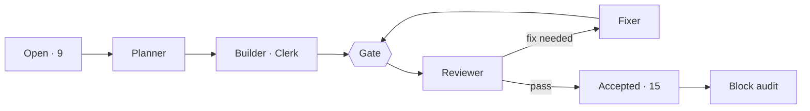

# v1.4 · Now

**Now** · [Board](board.md) · [Pipeline](pipeline.md) · [Timeline](timeline.md) · [Effort](effort.md)  
Frozen at Nov 1, 2026 12:27

### Snapshot at the block's end · Nov 1 12:27

**Last** · 12:27 · **block-D** fixer r1 → done · sonnet · 2 min · $0.26 · [record](../../work/block-D/fix-1.json)

| When | Item | Role | Result | Model | Time | Cost |
|---|---|---|---|---|---|---|
| 12:27 | block-D | fixer r1 | done | sonnet | 2 min | $0.26 |
| 12:25 | block-D | auditor r1 | pass: 2 minor · 3 nit | opus | 4 min | $1.15 |
| 10:23 | D3 | reviewer r1 | pass | sonnet | 2 min | $0.17 |
| 10:21 | D3 | builder r1 | done | sonnet | 16 min | $0.74 |
| 10:18 | D2 | builder r1 | done · gate blocked ×1 | sonnet | 40 min | $0.79 |
| 10:04 | D3 | planner r1 | planned | sonnet | 4 min | $0.72 |
| 10:00 | D2 | reviewer r1 | pass: 1 minor | sonnet | 3 min | $0.16 |
| 09:37 | D2 | planner r1 | planned | sonnet | 4 min | $0.56 |

15 of 24 items accepted · 62 agent runs · 13 h 26 min of agent time · $45.24 (API-equivalent)
