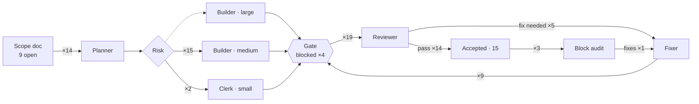

# v1.4 · Pipeline

[Now](now.md) · [Board](board.md) · **Pipeline** · [Timeline](timeline.md) · [Effort](effort.md)  
Frozen at Nov 1, 2026 12:27

Edges count agent runs this tranche (dotted: not taken yet) · ● running · ○ waiting there

**Journeys**

- [**block-D**](../../work/block-D) auditor ✓ → fixer → accepted · $1.41 · 6 min
- [**D3**](../../work/D3/packet.md) planner → builder → reviewer ✓ → accepted · $1.62 · 23 min
- [**D2**](../../work/D2/packet.md) planner → reviewer ✓ → builder → accepted · $1.52 · 46 min
- [**D1**](../../work/D1/packet.md) planner → builder → reviewer ✓ → accepted · $1.61 · 33 min
- [**block-AB**](../../work/block-AB) auditor ✗ → fixer → fixer r2 → accepted · $2.72 · 23 min
- [**block-C**](../../work/block-C) auditor ✓ → fixer → accepted · $2.67 · 9 min
- [**C3**](../../work/C3/packet.md) planner → builder → reviewer ✗ → fixer → reviewer r2 ✗ → fixer r2 → reviewer r3 ✓ → accepted · $5.10 · 1 h 24 min
- [**C4**](../../work/C4/packet.md) planner → builder → reviewer ✓ → builder → reviewer ✓ → builder → reviewer ✓ → accepted · $3.30 · 1 h 06 min
- [**block-B**](../../work/block-B) fixer → accepted · $0.57 · 29 min
- [**C2**](../../work/C2/packet.md) planner → builder → reviewer ✓ → clerk → accepted · $2.22 · 18 min
- [**B4**](../../work/B4/packet.md) planner → builder → reviewer ✓ → accepted · $4.39 · 42 min
- [**C1**](../../work/C1/packet.md) planner → builder → reviewer ✗ → accepted · $1.29 · 11 min
