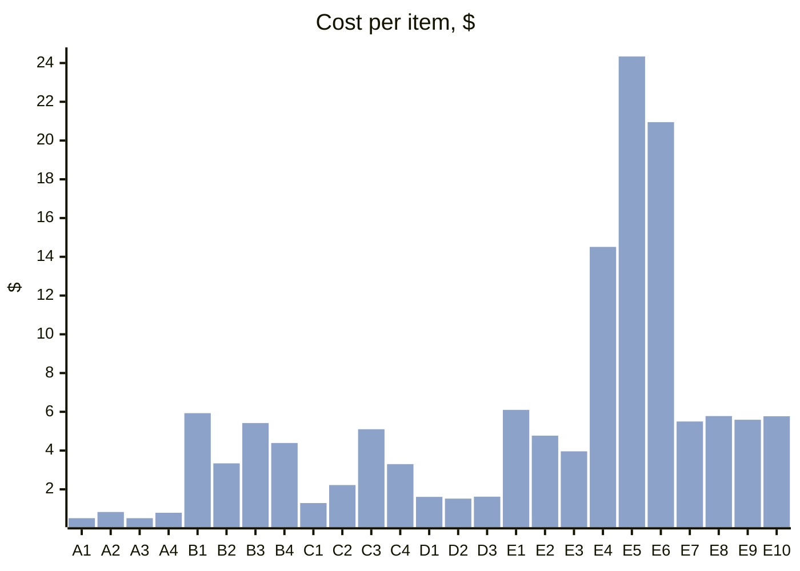
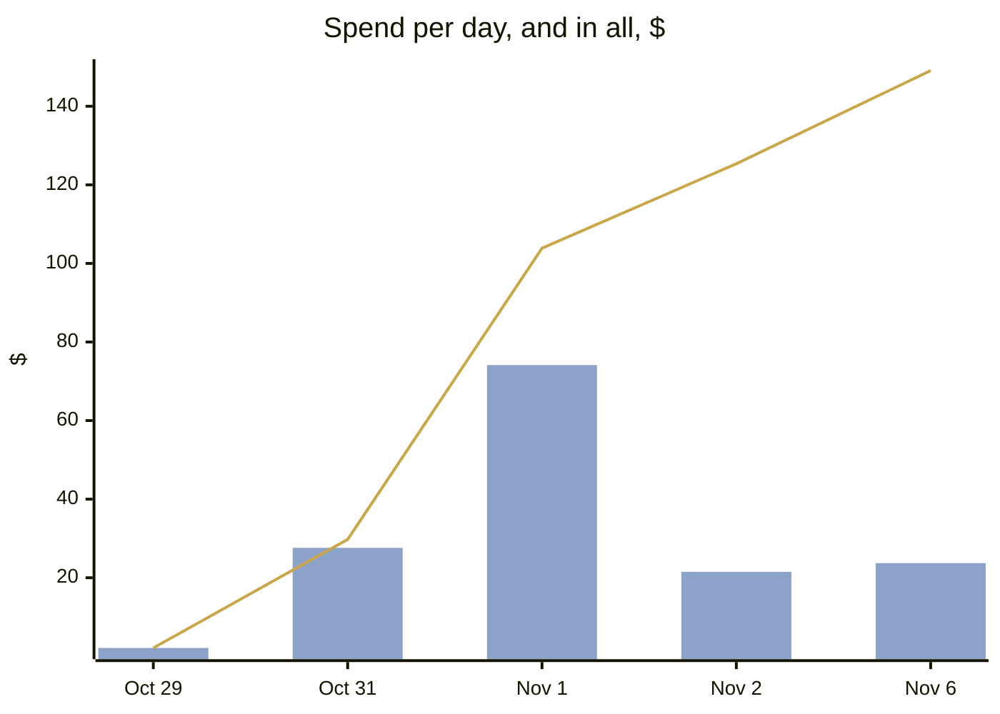
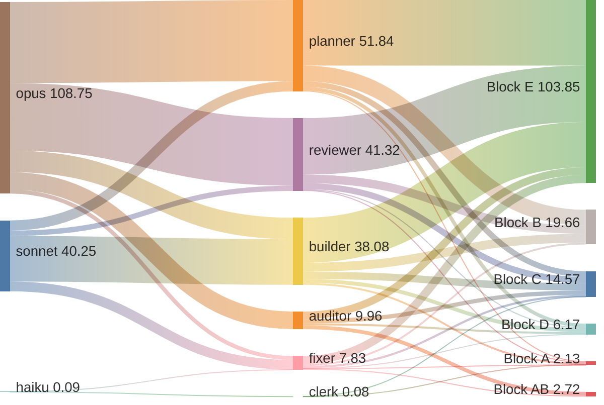
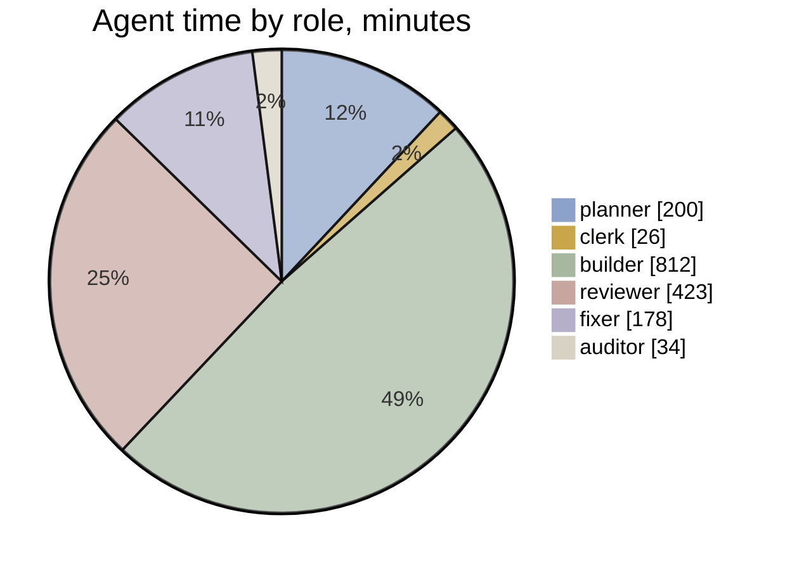

# v1.4 · Effort

[Now](now.md) · [Board](board.md) · [Pipeline](pipeline.md) · [Timeline](timeline.md) · **Effort**  
Frozen at Nov 6, 2026 19:39

**$149.08** API-equivalent · 27 h 53 min of agent time · 115 agent runs · $5.96 per accepted item (agents only; the orchestrator is in the block table)

**Where the spend went:** model → role → block

| Block | Items | Accepted | Runs | Agent time | Cost | Per item | First pass | Fix rounds |
|---|---|---|---|---|---|---|---|---|
| **A** | 4 | 4 | 10 | 1 h 47 min | $2.13 | $0.53 | 2/4 | 1 |
| **B** | 4 | 4 | 15 | 6 h 21 min | $19.65 | $4.91 | 3/4 | 1 |
| **C** | 4 | 4 | 23 | 3 h 08 min | $14.58 | $3.64 | 2/4 | 3 |
| **D** | 3 | 3 | 11 | 1 h 48 min | $6.16 | $2.05 | 3/3 | 0 |
| **E** | 10 | 10 | 53 | 14 h 27 min | $103.84 | $10.38 | 8/10 | 6 |
| **F** | 4 | 0 | 0 | – | – | – | – | 0 |
| **AB** | 0 | 0 | 3 | 23 min | $2.72 | – | – | 0 |

**Closed blocks** (the scoreboard: agents and the orchestrator)

| Block | Items | Windows | Cost | Orchestrator | First pass | Fix rounds | Findings |
|---|---|---|---|---|---|---|---|
| [A](../../block-A.md) | 3 | 0.22 | $5.85 | $3.72 (64%) | 2/3 | 0.33 mean | 1 major · 1 minor · 1 nit |
| [B](../../block-B.md) | 5 | 0.95 | $25.52 | $5.87 (23%) | 3/4 | 0.4 mean | 1 major · 4 minor · 8 nit |
| [C](../../block-C.md) | 8 | 1.17 | $31.70 | $17.12 (54%) | 4/6 | 0.5 mean | 1 blocker · 2 major · 6 minor · 13 nit |
| [D](../../block-D.md) | 4 | 0.3 | $8.04 | $1.53 (19%) | 3/3 | 0.25 mean | 2 minor · 1 nit |
| [E](../../block-E.md) | 21 | 3.98 | $107.35 | $3.51 (3%) | 13/16 | 0.33 mean | 1000 blocker · 2000 major · 21No test covers 'none is empty' after lo. Mutating maneuvers.ts:465 to step over a beat that drafts nothing still passes sweep.test.ts (26/26). A hand-built case such as [creations(2), [[]], creations(2)] -> null would pin it.002 minor · 25241 nit |

Costs are API-equivalent list prices from the ledger, not a bill.
