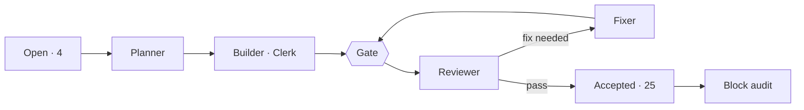

# v1.4 · Now

**Now** · [Board](board.md) · [Pipeline](pipeline.md) · [Timeline](timeline.md) · [Effort](effort.md)  
Frozen at Nov 6, 2026 19:39

### Snapshot at the block's end · Nov 6 19:39

**Last** · 19:39 · **block-E** fixer r1 → done · opus · 13 min · $2.28 · [record](../../work/block-E/fix-1.json)

| When | Item | Role | Result | Model | Time | Cost |
|---|---|---|---|---|---|---|
| 19:39 | block-E | fixer r1 | done | opus | 13 min | $2.28 |
| 19:25 | block-E | auditor r1 | fix needed: 1 major · 3 minor · 1 nit | opus | 18 min | $4.29 |
| 19:07 | E10 | reviewer r1 | pass: 2 minor · 1 nit | opus | 16 min | $1.93 |
| 18:50 | E10 | builder r1 | done | sonnet | 28 min | $1.01 |
| 18:22 | E10 | planner r1 | planned | opus | 11 min | $2.83 |
| 18:11 | E9 | reviewer r1 | pass: 4 nit | opus | 24 min | $1.82 |
| 17:50 | E9 | fixer r1 | done | sonnet | 20 min | $0.21 |
| 13:23 | E9 | builder r1 | needs-decision | sonnet | 26 min | $1.28 |

25 of 29 items accepted · 115 agent runs · 27 h 53 min of agent time · $149.08 (API-equivalent)
