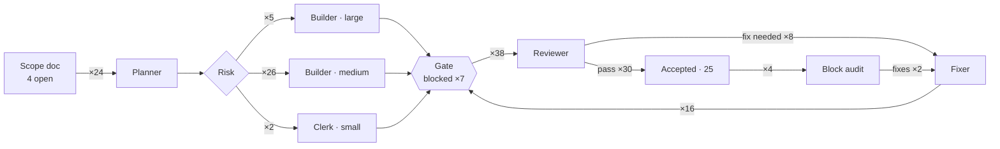

# v1.4 · Pipeline

[Now](now.md) · [Board](board.md) · **Pipeline** · [Timeline](timeline.md) · [Effort](effort.md)  
Frozen at Nov 6, 2026 19:39

Edges count agent runs this tranche (dotted: not taken yet) · ● running · ○ waiting there

**Journeys**

- [**block-E**](../../work/block-E) auditor ✗ → fixer → accepted · $6.57 · 31 min
- [**E10**](../../work/E10/packet.md) planner → builder → reviewer ✓ → accepted · $5.77 · 55 min
- [**E9**](../../work/E9/packet.md) planner → builder → fixer → reviewer ✓ → accepted · $5.59 · 1 h 17 min
- [**E8**](../../work/E8/packet.md) planner → builder → reviewer ✓ → accepted · $5.78 · 41 min
- [**E7**](../../work/E7/packet.md) planner → builder → reviewer ✓ → fixer → builder → reviewer ✓ → accepted · $5.50 · 1 h 34 min
- [**E6**](../../work/E6/packet.md) planner → builder → reviewer ✓ → builder → reviewer ✓ → accepted · $20.95 · 2 h 23 min
- [**E5**](../../work/E5/packet.md) planner → builder → reviewer ✗ → fixer → reviewer r2 ✓ → builder → reviewer ✓ → builder → reviewer ✗ → fixer → reviewer r2 ✓ → accepted · $24.34 · 3 h 36 min
- [**E4**](../../work/E4/packet.md) planner → builder → reviewer ✓ → builder → reviewer ✓ → builder → reviewer ✓ → accepted · $14.51 · 1 h 36 min
- [**E3**](../../work/E3/packet.md) planner → builder → reviewer ✓ → accepted · $3.96 · 22 min
- [**E2**](../../work/E2/packet.md) planner → builder → fixer ✗ → reviewer ✓ → accepted · $4.77 · 1 h 00 min
- [**E1**](../../work/E1/packet.md) planner → builder → reviewer ✗ → fixer → reviewer r2 ✓ → accepted · $6.10 · 31 min
- [**block-D**](../../work/block-D) auditor ✓ → fixer → accepted · $1.41 · 6 min
