# v1.4 · Timeline

[Now](now.md) · [Board](board.md) · [Pipeline](pipeline.md) · **Timeline** · [Effort](effort.md)  
Frozen at Nov 6, 2026 19:39

### Nov 6 · 17 runs · 4 h 43 min of agent time · $23.71

```mermaid
---
config:
  themeVariables:
    taskBkgColor: '#4a5d8a'
    taskBorderColor: '#34446a'
    critBkgColor: '#a4262c'
    critBorderColor: '#6e1a1e'
    activeTaskBkgColor: '#8f5f00'
    activeTaskBorderColor: '#5e3e00'
---
gantt
  dateFormat x
  axisFormat %H:%M
  todayMarker off
  section E7a
    builder r1 opus :1793982358565, 1793984881565
    reviewer r1 opus :1793984885487, 1793985657487
    fixer r1 sonnet :1793985672805, 1793985931805
  section E7b
    builder r1 opus :1793986019471, 1793986950471
    reviewer r1 opus :1793986954135, 1793987236135
  section E8
    planner r1 opus :1793995566913, 1793996177913
    builder r1 opus :1793996182652, 1793997248652
    reviewer r1 opus :1793997259027, 1793998044027
  section E9
    planner r1 opus :1793998209635, 1793998625635
    builder r1 sonnet :1793998634050, 1794000204050
    fixer r1 sonnet :1794015046680, 1794016222680
    reviewer r1 opus :1794016051065, 1794017495065
  section E10
    planner r1 opus :1794017514500, 1794018168500
    builder r1 sonnet :1794018172714, 1794019822714
    reviewer r1 opus :1794019866560, 1794020833560
  section block-E
    auditor r1 opus :crit, 1794020856307, 1794021945307
    fixer r1 opus :1794021974053, 1794022764053
```

### Nov 2 · 4 runs · 1 h 45 min of agent time · $15.99

```mermaid
---
config:
  themeVariables:
    taskBkgColor: '#4a5d8a'
    taskBorderColor: '#34446a'
    critBkgColor: '#a4262c'
    critBorderColor: '#6e1a1e'
    activeTaskBkgColor: '#8f5f00'
    activeTaskBorderColor: '#5e3e00'
---
gantt
  dateFormat x
  axisFormat %H:%M
  todayMarker off
  section E6a
    reviewer r1 opus :1793607278091, 1793608869091
  section E6b
    builder r1 opus :1793608887108, 1793611109108
    reviewer r1 opus :1793611124942, 1793612734942
  section E7
    planner r1 opus :1793612750339, 1793613641339
```

### Nov 1 · 54 runs · 11 h 28 min of agent time · $79.64

```mermaid
---
config:
  themeVariables:
    taskBkgColor: '#4a5d8a'
    taskBorderColor: '#34446a'
    critBkgColor: '#a4262c'
    critBorderColor: '#6e1a1e'
    activeTaskBkgColor: '#8f5f00'
    activeTaskBorderColor: '#5e3e00'
---
gantt
  dateFormat x
  axisFormat %H:%M
  todayMarker off
  section C3
    builder r1 sonnet :1793542555975, 1793543695975
    reviewer r1 opus :crit, 1793543702757, 1793544200757
    fixer r1 sonnet :1793544784762, 1793546180762
    reviewer r2 opus :crit, 1793546185080, 1793546877080
    fixer r2 sonnet :1793546882849, 1793547062849
    reviewer r3 opus :1793547147368, 1793547406368
  section block-AB
    auditor r1 opus :crit, 1793542999308, 1793543321308
    fixer r1 sonnet :1793547425764, 1793547640764
    fixer r2 sonnet :1793548696282, 1793549542282
  section block-C
    auditor r1 opus :1793547424388, 1793547806388
    fixer r1 sonnet :1793547821123, 1793547993123
  section D1
    planner r1 sonnet :1793552481508, 1793552919508
    builder r1 sonnet :1793552934522, 1793554272522
    reviewer r1 sonnet :1793554278123, 1793554452123
  section D2
    planner r1 sonnet :1793554463343, 1793554676343
    builder r1 sonnet :1793554683097, 1793557084097
    reviewer r1 sonnet :1793555855451, 1793556025451
  section D3
    planner r1 sonnet :1793556035897, 1793556299897
    builder r1 sonnet :1793556306558, 1793557288558
    reviewer r1 sonnet :1793557297747, 1793557409747
  section block-D
    auditor r1 opus :1793564460834, 1793564716834
    fixer r1 sonnet :1793564727736, 1793564829736
  section E1
    planner r1 opus :1793566426482, 1793567034482
    builder r1 sonnet :1793567044291, 1793567971291
    reviewer r1 opus :crit, 1793567974518, 1793568198518
    fixer r1 sonnet :1793568202385, 1793568262385
    reviewer r2 opus :1793568253518, 1793568313518
  section E2
    planner r1 opus :1793568315143, 1793568738143
    builder r1 sonnet :1793568742415, 1793569728415
    fixer r1 sonnet :1793569737142, 1793570587142
    reviewer r1 opus :1793570590910, 1793571944910
  section E3
    planner r1 opus :1793571963730, 1793572407730
    builder r1 sonnet :1793572412056, 1793572869056
    reviewer r1 opus :1793572872390, 1793573306390
  section E4
    planner r1 opus :1793573320359, 1793574369359
  section E4a
    builder r1 sonnet :1793574381413, 1793575587413
    reviewer r1 opus :1793575435898, 1793576316898
  section E4bc
    builder r1 sonnet :1793576327039, 1793577359039
    reviewer r1 opus :1793584114765, 1793584872765
  section E4d
    builder r1 sonnet :1793590370830, 1793590910830
    reviewer r1 opus :1793590919657, 1793591209657
  section E5
    planner r1 opus :1793591234873, 1793592236873
  section E5a
    builder r1 sonnet :1793592250484, 1793594095484
    reviewer r1 opus :crit, 1793593803708, 1793594967708
    fixer r1 sonnet :1793594971706, 1793595595706
    reviewer r2 opus :1793595599661, 1793596002661
  section E5b
    builder r1 sonnet :1793596023515, 1793597098515
    reviewer r1 opus :1793597172353, 1793598457353
  section E5c
    builder r1 sonnet :1793598471765, 1793599625765
    reviewer r1 opus :crit, 1793599630748, 1793600628748
    fixer r1 sonnet :1793600636782, 1793602253782
    reviewer r2 opus :1793602258666, 1793604078666
  section E6
    planner r1 opus :1793604101762, 1793605182762
  section E6a
    builder r1 opus :1793605192958, 1793607270958
```

### Oct 31 · 30 runs · 8 h 10 min of agent time · $27.61

```mermaid
---
config:
  themeVariables:
    taskBkgColor: '#4a5d8a'
    taskBorderColor: '#34446a'
    critBkgColor: '#a4262c'
    critBorderColor: '#6e1a1e'
    activeTaskBkgColor: '#8f5f00'
    activeTaskBorderColor: '#5e3e00'
---
gantt
  dateFormat x
  axisFormat %H:%M
  todayMarker off
  section B1
    planner r1 opus :1793469946215, 1793470602215
    builder r1 sonnet :1793470668715, 1793471551715
    reviewer r1 opus :crit, 1793471569099, 1793472739099
    fixer r1 sonnet :1793472752384, 1793473129384
    reviewer r2 opus :1793474019573, 1793474301573
  section B3
    planner r1 opus :1793470615563, 1793471058563
    builder r1 sonnet :1793474318116, 1793475167116
    reviewer r1 opus :1793475179302, 1793475702302
  section B4
    planner r1 opus :1793471558066, 1793472026066
    builder r1 sonnet :1793488717333, 1793490252333
    reviewer r1 sonnet :1793490017749, 1793490528749
  section B2
    planner r1 opus :1793474317773, 1793474820773
    builder r1 sonnet :1793475713079, 1793488090079
    reviewer r1 sonnet :1793488164041, 1793488652041
  section C1
    planner r1 sonnet :1793488726927, 1793488934927
    builder r1 sonnet :1793488948570, 1793489206570
    reviewer r1 sonnet :crit, 1793489212270, 1793489434270
  section C2
    planner r1 sonnet :1793489475059, 1793489832059
    builder r1 sonnet :1793489838784, 1793490310784
    reviewer r1 sonnet :1793490317083, 1793490474083
    clerk r1 haiku :1793490482169, 1793490582169
  section C4
    planner r1 sonnet :1793490498032, 1793490735032
  section block-B
    fixer r1 sonnet :1793490576786, 1793492342786
  section C4a
    builder r1 sonnet :1793490749180, 1793491672180
    reviewer r1 sonnet :1793491683316, 1793492343316
  section C4b
    builder r1 sonnet :1793492942683, 1793493339683
    reviewer r1 sonnet :1793493349766, 1793493759766
  section C4c
    builder r1 sonnet :1793493773258, 1793494351258
    reviewer r1 sonnet :1793494356720, 1793495093720
  section C3
    planner r1 sonnet :1793494374050, 1793495243050
```

### Oct 29 · 10 runs · 1 h 47 min of agent time · $2.13

```mermaid
---
config:
  themeVariables:
    taskBkgColor: '#4a5d8a'
    taskBorderColor: '#34446a'
    critBkgColor: '#a4262c'
    critBorderColor: '#6e1a1e'
    activeTaskBkgColor: '#8f5f00'
    activeTaskBorderColor: '#5e3e00'
---
gantt
  dateFormat x
  axisFormat %H:%M
  todayMarker off
  section A1-A3
    planner r1 sonnet :1793292023050, 1793292083050
    clerk r1 haiku :1793292073713, 1793293516713
    reviewer r1 sonnet :crit, 1793293102765, 1793293861765
    fixer r1 haiku :1793293873602, 1793294117602
  section A2
    planner r1 sonnet :1793292023405, 1793292083405
    builder r1 sonnet :1793292083064, 1793293840064
    reviewer r1 sonnet :1793293851017, 1793294161017
  section A4
    planner r1 sonnet :1793292026578, 1793292086578
    builder r1 sonnet :1793292086869, 1793293680869
    reviewer r1 sonnet :1793293684821, 1793293835821
```

Red: a review or audit that asked for a fix, or a gate that stayed red · highlighted: running now
