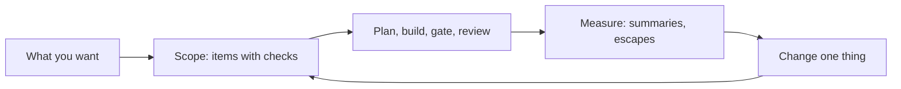
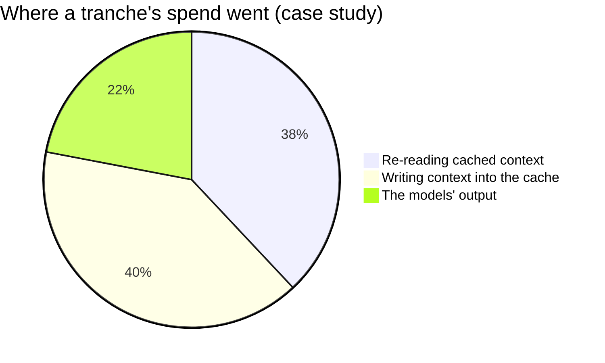
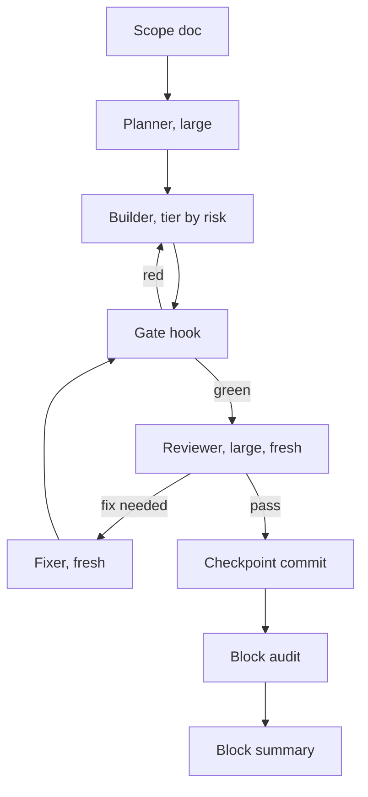

# What makes a good sluice

*A manifesto with one worked example. Not a claim that this is the best sluice for anyone; a record of what
held up while building a real app with Claude, five hours of usage at a time.*

---

An agentic sluice is the way work moves from what a person wants to code that is merged and trusted: who
plans, who builds, who checks, what each of them reads, and when the human looks. Every team that builds
with AI agents has one, whether it is written down or not.

This one was written down because it was measured. Over a month, one app went through six ways of
working with Claude Code ([evolution](docs/evolution.md)), and each was costed from its transcripts. What
follows is what survived. Every claim here is a bet that the next project may overturn. The
[design](docs/design.md) says, choice by choice, how to tell whether it has been (§15).

## The tenets

### 1. The plan is the contract, and its acceptance must be checkable
Agents do what is written. Items whose acceptance named an observable result ("WHEN 3 of 40 fail, THE
player SHALL show…") passed review the first time. Items that could be satisfied without the intended
effect came back, or shipped as no-ops. A good sluice spends its human time here, on what "done" means,
because that is the cheapest place to be right.

### 2. Design once, up front, with the strongest model
The most expensive loop in the case study was a design being settled across three review rounds.
Deciding the approach before anyone types is cheaper than discovering it in review. If the design
can't be decided, that's a question for the human, not a task for a builder.

### 3. Separate the author from the judge
A fresh reviewer that sees the criteria and the diff, but not the author's reasoning, finds what the author
and the tests can't: in the case study, a frozen chart, a file drop that replaced the app, a sync that
reported success while emptying data. That review was about 0.8% of spend each. It is the
cheapest quality in the sluice. Keep it.

### 4. Let machines check what machines can
Typecheck, lint and tests run before any model is asked for its opinion. A gate that blocks the builder
from finishing turns "remember to run the checks" into something that can't be skipped.

### 5. Context is the bill
Every call re-reads the agent's whole context. Across every stage of the case study, re-reading and
re-writing context was most of the spend; the model's own writing was the least of it. So agents start
small (a packet, not the whole plan), talk through files (not conversations), and the one long-lived
agent restarts between blocks.

### 6. Fresh beats resumed
Waking an agent whose cache has gone cold just to fix its own work re-pays its whole context first. A
new agent with the review in a file is cheaper, and isn't anchored to the mistake.

### 7. Match the model to the risk, not the role
A cheaper model that needs twice the context and three tries isn't cheaper. Route by what can go wrong:
persisted data, auth and lifecycles get the strongest builder; work a check fully decides gets the
smallest model. Score it, record it, and retune the thresholds from what happens.

### 8. Plan in windows
On a subscription, the binding limit is the usage window (five hours, and a weekly quota), not the clock
or the human. Plan blocks in windows, check the budget before every launch, and stop cleanly near the
limit, rather than letting the cap cut work in flight.

### 9. One writer at a time; more agents bring judgment, not edits
Parallel writers make conflicting decisions. Parallel agents also spend a window faster, without making
it go further. Parallelise reading and judging; serialise writing, unless the work truly doesn't touch.

### 10. Decide and record; don't stall
An unattended run that stops for every question isn't unattended. The orchestrator makes the calls it can,
writes each into the scope doc for the human to overturn, and stops only for taste, for anything
irreversible, or for the budget.

### 11. Instrument lightly, and read it
One small record per agent run, one ledger line per run, and one summary per block are enough to see
where the effort went. Telemetry nobody reads is overhead. The most important number is the one the
human records: **escapes**, the defects found at the final check.

### 12. Evolve one change at a time
After each tranche, read the summaries, pick the worst metric, change one thing, and run the next block.
Write down why. A sluice that isn't measured drifts; a sluice that changes everything at once learns nothing.

## What a good sluice is not

- **Not maximal.** More agents, more lenses and more rounds cost more and can make results worse. Start
  simple; add structure only where a measurement asks for it.
- **Not hands-off forever.** The biggest quality jumps in the case study came from the human looking at
  real results. A good sluice moves the human's attention to the scope at the start and the check at the
  end; it doesn't remove it.
- **Not permanent.** Models get cheaper and better, and harnesses gain features. Everything here that
  names a model or a setting lives in one table, so that it can change without the ideas changing.

## The worked example

This repository is one sluice that follows these tenets:

It was tuned for one person on one Claude subscription, building one app in blocks of work, and
trying to get the most finished, trusted work out of each five-hour window. Your constraints may differ.
Take the tenets that fit, measure, and keep what your own numbers support.
