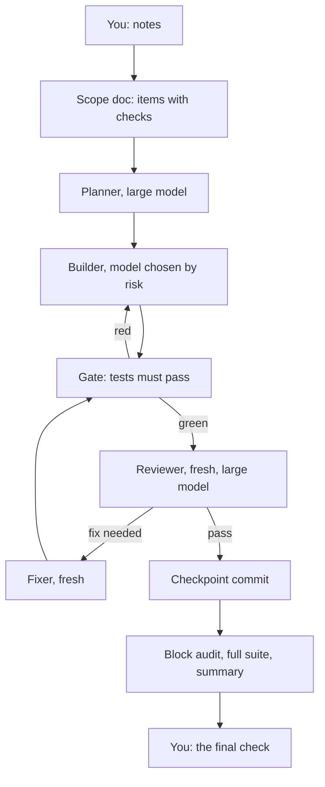
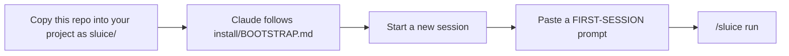
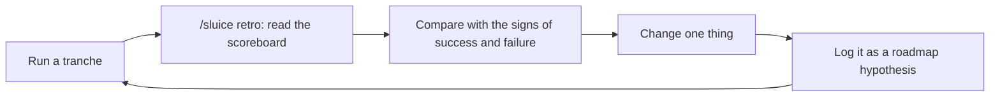

# Sluice: An Agentic Workflow for Claude to Trickle Your Changes Without Flooding Your Context

**A cost-aware way to build software with Claude Code agents:** scope it, plan it, build it, check it,
measure it, and do it again a little better. It was made to get the most finished, trusted work out of
each five-hour window of a Claude subscription.

> This is a manifesto with one worked example, not a claim to be the best sluice for everyone. It came out
> of building one real app, and it keeps changing as the measurements come in. Read
> [MANIFESTO.md](MANIFESTO.md) for the ideas; read on for how to use it.

**Version:** Canon 1 (0.1.0), 2026-10-28 · [Changelog](CHANGELOG.md)

---

## The sluice at a glance



1. **You write what you want.** The scoper turns your notes into a scope doc, asking multiple-choice
   questions until every item has a check someone can run.
2. **A large model plans each item** and makes its design decisions up front, in a short packet.
3. **The cheapest model that can be checked builds it.** A hook won't let the builder finish while
   typecheck, lint or the unit tests fail.
4. **A fresh large model reviews the diff** against the acceptance checks, without seeing the builder's
   reasoning. A fresh agent fixes what it finds. After two fix rounds, the item goes back to planning.
5. **Each block ends** with an audit across its items, the full suite, and a one-screen summary: what it
   cost, in usage windows, and how often work passed first time.
6. **You check the result,** record anything you find, and the sluice's numbers tell you what to tune next.

## Why it exists

It's the sixth way of working tried on one project, Star Chart, each one measured from its
transcripts ([how it evolved](docs/evolution.md)). The tranche before this sluice taught three things
([case study](docs/case-study.md)):

| Finding | Number | What the sluice does |
|---|---|---|
| Fresh-context review caught every serious bug that passed the author's own tests | About 0.8% of spend per review | Keeps a fresh reviewer for every item |
| Fix loops, oversized contexts and resumed agents cost about half the spend | Rework 24%; re-reading opening context 19%; cache re-writes on resume 9% | Planner first, packets, fresh fixers, a gate |
| The usage cap, not the human, was the bottleneck | Hit 5 times; 28% of the wall clock was stalls | Budgets in windows; stops cleanly near the limit |

## What's in this repository

```text
sluice/
├── README.md              you are here
├── MANIFESTO.md           what makes a good sluice: twelve tenets
├── CHANGELOG.md
├── docs/
│   ├── design.md          the full design: roles, formats, model rules, budgets, metrics, experiments
│   ├── adopting.md        install, configure, first tranche, day to day, troubleshooting
│   ├── evolution.md       six ways of working, and what each taught
│   ├── case-study.md      one tranche, measured: where the time and tokens went
│   ├── research.md        the published evidence behind the design
│   └── roadmap.md         hypotheses: the process, the deterministic layer, long-term code health
├── install/
│   ├── BOOTSTRAP.md       instructions a Claude session follows to install the sluice
│   └── FIRST-SESSION.md   prompts for your first scoping conversation
├── template/claude/       what gets installed as your project's .claude/
└── examples/              a scope doc, one item's full work folder, a ledger, a block note, a scoreboard,
                           and the views drawn from them
```

## Quick start



**1. Copy** this repository into your project, as a folder named `sluice/` at its root.

**2. Install.** Open Claude Code in your project and paste:

```text
Read sluice/install/BOOTSTRAP.md and follow it to install the sluice into this project.
```

The session surveys your project and asks a few multiple-choice questions: your test and lint commands,
where files should live, and which models your plan has. It installs the parts below, fills in the config,
adds a short section to `CLAUDE.md`, and runs the self-test.

**3. Start a new Claude Code session,** so the new agents, skills and hooks load. Accept the folder-trust
prompt if one appears.

**4. Scope your first tranche.** Paste a prompt from [install/FIRST-SESSION.md](install/FIRST-SESSION.md),
with your notes. For an existing project:

```text
Let's start a tranche of work with the sluice. Call it <name>. Here's what I want: <notes>.
Run /sluice scope, ask me multiple-choice questions until every item has acceptance checks,
then show me the scope doc and the block plan. Don't build until I say "run".
```

**5. Build:** `/sluice run <scope doc> A`. While it runs, keep `<progressDir>/<name>/views/now.md` open in a
Markdown preview (VS Code's renders the diagrams). Then read the result: `/sluice summary <name> A`.

## Where the `.claude/` parts go

The template lives in `template/claude/`, with no dot, so Claude Code doesn't load it as this
repository's own configuration. Installing copies it to your project's `.claude/`:

| In this repo | In your project | What it is |
|---|---|---|
| `template/claude/agents/` | `.claude/agents/` | Six roles: **planner**, **builder**, **clerk** (small-model mechanical work), **reviewer**, **fixer**, **auditor**. Each sets its model tier, effort and turn limit |
| `template/claude/skills/sluice/` | `.claude/skills/sluice/` | The `/sluice` playbook (scope, run, summary, retro, status, views), the file formats, the risk score, the scope template |
| `template/claude/skills/item-contract/` | `.claude/skills/item-contract/` | The rules every role preloads: what to read, what to write, how to finish |
| `template/claude/sluice/` | `.claude/sluice/` | Dependency-free Node: the gate, the ledger hook, the statusline, the budget check, the block summary, the code-health snapshot, the scoreboard, the views (`sluice-state.mjs` reads the run, `visualize.mjs` draws it), a lock, a self-test, and `config.json`, the one file of project specifics |
| `template/claude/skills/sluice/templates/project.md` | `.claude/sluice/project.md` (filled in at install) | Your project's notes for the agents: sources of truth, review lenses, how to verify. Never overwritten by an upgrade |
| `template/claude/settings.json` | `.claude/settings.json` (merged) | Wires the statusline (it records your usage window), the gate and ledger hooks, and the launch hook that keeps the views current |
| `docs/`, `install/`, `examples/` | stay in `sluice/` | The design the agents cite, the install prompts, worked examples |

## Day to day

| Command | What it does |
|---|---|
| `/sluice scope <notes or file>` | Turns notes into a scope doc, in rounds of questions |
| `/sluice run <scope doc> [block]` | Builds a block on the `sluice/<tranche>` branch, with a checkpoint commit per accepted item. Checks the usage window before every launch |
| `/sluice summary <tranche> [block]` | First-pass acceptance, fix rounds, spend by role and per item in windows, gate blocks; with the block's code health in its note |
| `/sluice retro <tranche>` | The tranche's retrospective, from the scoreboard: this tranche against every earlier one, and the one change to try next |
| `/sluice status [scope doc]` | The budget, and each item's state |
| `/sluice views [tranche]` | Draws the views and says where they are; the hooks keep them current from then on |

Everything the sluice does lands in your repository, committed: one folder per item (the plan, every
review, a record of each agent run), a ledger of time and tokens, a note per block with its code health,
and one scoreboard across every tranche. You can always see why something was built the way it was,
what it cost, and whether the sluice is getting cheaper and better.

## Watching a run

Start a block, leave, and on your return read in seconds what the sluice did last and is doing now. The
hooks redraw five Markdown files with Mermaid diagrams in `<progressDir>/<tranche>/views/` on every agent
launch and stop, at no token cost. Leave them open in a Markdown preview:

| View | Shows |
|---|---|
| `now.md` | What's running, the last result, what waits, and the pipeline with each item on its node |
| `board.md` | A row per block and a column per state, every item a link to its packet |
| `pipeline.md` | The sluice's graph with each path counted, and each item's path through it |
| `timeline.md` | A bar per agent run, per day: who ran when, for how long, and which runs asked for a fix |
| `effort.md` | Cost per item and per day, spend from model to role to block |

The live views are gitignored; each block's end freezes a committed copy into `snapshots/block-<B>/`.
For an example, see [examples/progress/v0.4/snapshots/block-A/now.md](examples/progress/v0.4/snapshots/block-A/now.md).

## How it gets better



The design's §15 lists, for every choice, an alternative, a sign that it's working and a sign that it
isn't. When a block's numbers say a choice is failing, change that one thing: a threshold, a role's
instructions, a gate command. When a review catches a class of bug, or one escapes, add the lens to your
project notes. Record the reason. Process ideas go into [docs/roadmap.md](docs/roadmap.md) as
hypotheses, with the scoreboard rows that will prove or disprove them. Make a process change in this
package's `template/claude/` and copy it into `.claude/`; the self-test names any file changed in only
one place.

## Assumptions and limits

- **Claude Code** with subagent role files, skills, hooks and the statusline. The current names of
  models, prices and settings are all in one table, the design's §14.
- **A Claude subscription** for the usage-window signal. On an API key the sluice works, but the budget
  check can't see a window.
- **Node.js 18+ and git** on the machine.
- **Tests you trust.** The gate is only as good as your checks. A project without them should build them
  as its first block, and FIRST-SESSION.md has a prompt for that.
- **What's proven at Canon 1:**
  - the hooks and scripts pass a self-test, including the code-health snapshot and the scoreboard;
  - a fresh install works in a new project;
  - in a live session, the gate passes and blocks real subagents and the ledger records them.

  **What isn't yet:** the full loop on a real block outside the project it came from. Treat your first
  block as the trial ([changelog](CHANGELOG.md)).

## Where it came from

The sluice was distilled from building **Star Chart**, a macOS app that replays a team's Azure DevOps work
as a painted space chart. It was built over a month with Claude Code, by one person reviewing the
results. Its six ways of working, with their numbers, are in [docs/evolution.md](docs/evolution.md). The
last of them is measured in detail in [docs/case-study.md](docs/case-study.md).
