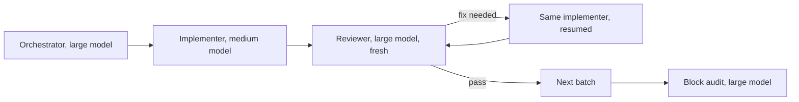
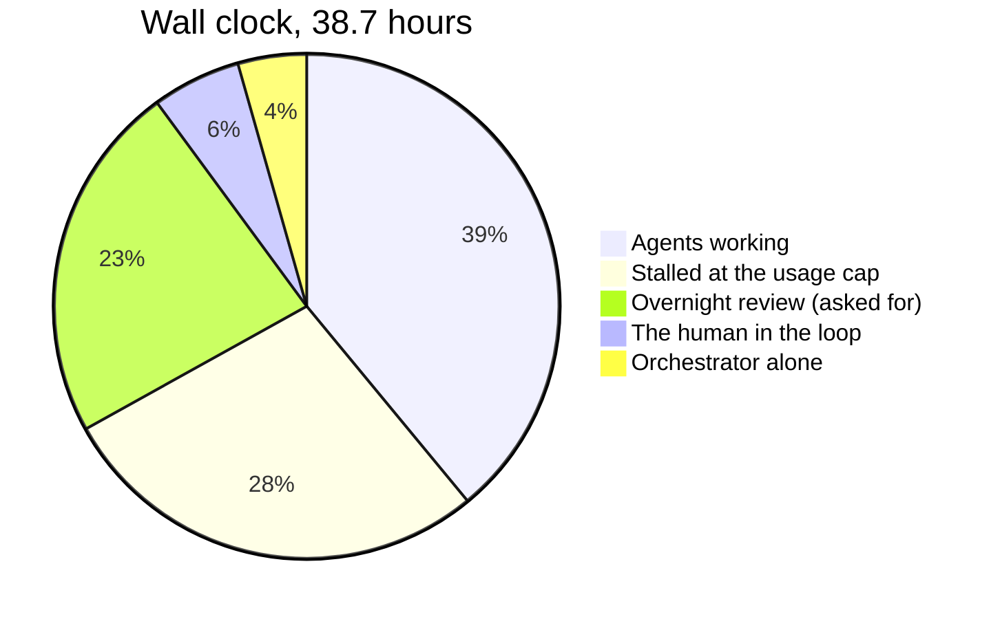
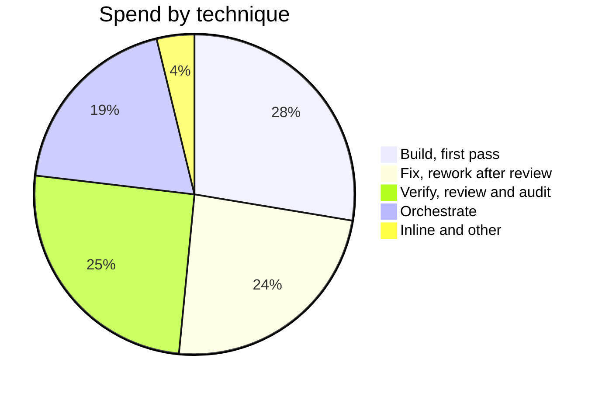
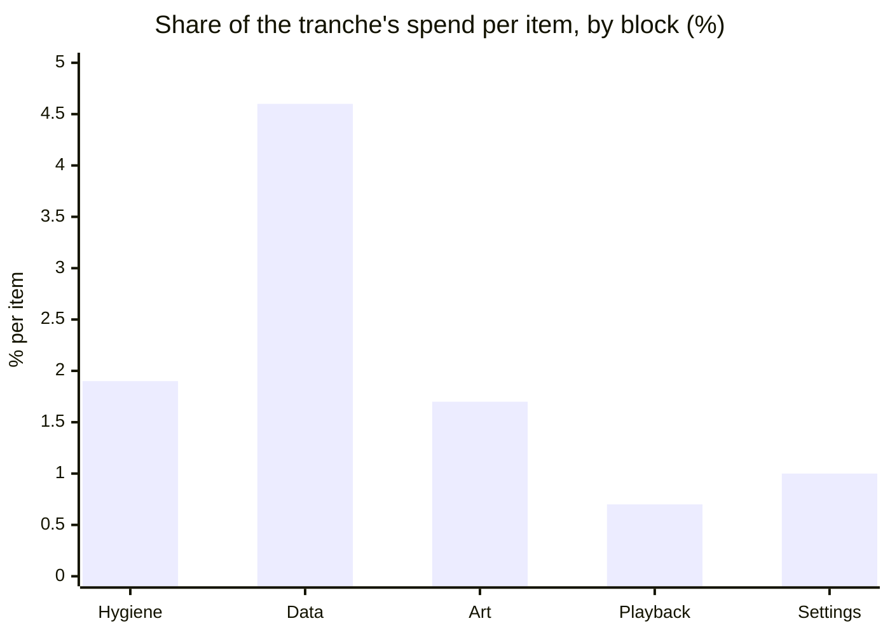

# Case study: one tranche, measured

Star Chart's v1.3 was 45 small changes to a working app: data and ingestion, scene art, playback and
settings. They were built over two days on 27–28 Oct 2026 by one orchestrating Claude Code session and
62 subagents, under a subscription's five-hour usage windows. It was the last tranche before the sluice,
and the sluice is largely its answer. Everything below was measured from the transcripts afterwards.
Spend is shown as shares, never as a bill (method at the end).

## The setup

The work came as blocks of decided items in one plan doc. Each batch went implement, review, fix by
resuming the implementer, review again. Each block ended with an audit and the full test suite.

## In numbers

| What | Amount |
|---|---|
| Calendar time | 38.7 h. Agents were working for 15.1 h of it |
| Human input | About 15 typed prompts, plus 27 rounds of multiple-choice questions in the backlog review |
| Agents | 62 subagents: 26 implementers, 24 reviewers, 6 auditors, 4 audit fixers, 2 explorers |
| API calls | 3,771 |
| Tokens | 476 M read from the cache, 18 M written to it, 2.7 M output |
| Spend by model | Large 54%, medium 46%, small under 0.1% |
| Usage windows | About six. Five ended at the cap |
| Result | 45 items; +16.5k lines (5.6k source, 7.1k tests, 2.8k docs); unit tests 1,085 → 1,411 |
| Defects found by the user | None in the first two blocks checked |

## Where the wall clock went

**Inside the agents' 15 hours, about half was spent waiting on checks:** e2e specs (4.9 h), keystone
runs (2.3 h), typecheck (187 runs at 27 s each, 1.4 h), unit tests (1.0 h).

**The usage window was the bottleneck, not the human.** Each window held a similar spend, which makes
the window a usable unit of planning:

| Window | Ended | Share of spend | What it built |
|---|---|---|---|
| 1 | At the cap | 13.8% | The backlog review; 5 hygiene items |
| 2 | At the cap | 16.7% | 5 more items; a block close |
| 3 | At the cap | 17.0% | 4 data items (one took three review rounds) |
| 4 | Stopped by request | 17.7% | 5 items, including a redesign; a block close |
| 5 | At the cap | 15.7% | 9 art and layout items, one at a time |
| 6 | At the cap, after 87 minutes | 17.5% | **16 UI and settings items, up to 5 agents at once** |

Parallel agents didn't make window 6 go further. They spent it in 87 minutes instead of four or five
hours. Window 6 built more because its items were smaller and needed one fix round each.

## Where the spend went

| Block | Items | Share of spend | Per item | Rework share |
|---|---|---|---|---|
| Hygiene and tests | 10 | 18.5% | 1.9% | 42% |
| **Data and ingestion** | 9 | **41.0%** | **4.6%** | 45% |
| Scene and art | 11 | 18.3% | 1.7% | 50% |
| Playback and packs | 6 | 4.4% | 0.7% | 30% |
| Settings and onboarding | 8 | 8.2% | 1.0% | 38% |

*Rework share* is fix spend ÷ all implementer spend. **The data block was 41% of everything,** for 9 of
45 items. It met real-world semantics: which HTTP 401 means a dead token and which a missing scope, a
reporting feed's paging, migrations of users' caches. Those were design problems, settled in review
loops. One item took three rounds and a redesign by the orchestrator, and cost 7% on its own.

## Was fresh-context review worth it?

**Yes.** Verification was 25% of spend, about 0.8% per review. Every batch passed its own checks, and the
reviewers still caught these before the human saw them:

| Severity | What would have shipped |
|---|---|
| Blocker | Closing a settings preview destroyed textures shared with the main chart, freezing it |
| Major, security | Dropping a file anywhere off the chart navigated the whole app to that file |
| Major | Quitting mid-tour left a user stuck in demo mode and lost their sign-in |
| Major | After a token refresh mid-sync, queued requests kept the old token and failed |
| Blocker | A new "all events" setting did nothing on the busy scenes it was meant for |
| Blocker | A new outline effect cost about 20 frames per second |
| Blocker | Typecheck failed (an e2e config couldn't see an image import) |
| Blocker ×2 | A capped data crawl never resumed; then its fix emptied a chart on alternate syncs while reporting success |
| Major ×4 | Interactions only the block audit could see, such as a migration plus a new reader leaving a silent gap |

**The price was the rework the reviews triggered, not the reviews themselves.**
- 17 of 21 first reviews of medium-model batches said *fix needed*. All 3 large-model batches passed, but
  those were easier items, so the comparison is confounded.
- A medium-model call cost about the same as a large-model call, 0.94× against 1.1× the average. Its
  context averaged 151k against 73k, which cancelled out the half-price rate.
- The failures had types: misreading the contract; not checking the effect on the scenes it was for;
  framework lifecycles; and design under real-world semantics.

## What was wasted

| Waste | Cost | What the sluice does instead |
|---|---|---|
| Fix rounds resumed an implementer whose 5-minute cache had expired, re-writing 150–250k of context first | 9.3% in re-writes alone | A **fresh fixer** reads the review file (a fresh fixer made 11 fixes for 1.1%) |
| Every implementer re-read its opening reading (about 12k tokens of docs, 18k of code) on every call | About 19% | A **packet** quotes only what the item needs |
| The orchestrator's context grew to 445k before it was compacted | 3× the cost per call, compared with after the compaction | **Restart or compact per block**; read verdicts, not reports |
| Every finished agent was announced twice, and both notices got a full-context reply | About 2% | Answer the duplicate with a word |
| Two audits were started 3 minutes before the cap and lost | 2.3% | A **budget check** before every launch |
| A design was settled across three review rounds | About 4 points | A **planner** decides the design up front; two rounds, then re-plan |
| Typecheck failures reached a large-model reviewer | One round trip each | A **gate hook** before review |
| The shared brief lived in a temp folder that was cleared overnight | A rebuild from the transcript | **State in repo files** |

## What worked better than before

- The main session ran on the one-hour cache, so the human's long review pauses cost four re-writes, not
  dozens.
- Compacting at a block boundary lost nothing: the next block ran from the plan doc and the notes.
- Test output stayed inside the subagents.
- The orchestrator decided about ten questions itself and recorded each one for the human to overturn,
  which kept the run moving.

## Method

- **Source:** every transcript of the two days, deduplicated by response, split into input, cache
  writes (5-minute and 1-hour), cache reads and output.
- **Prices:** list-rate ratios that reproduce Claude Code's own cost record to the cent, for both models.
  Shares hold under a uniform discount.
- **Windows:** spend between the reset times the harness reported.
- **Wall clock:** agent time is minutes with a subagent making calls less than 10 minutes apart.
- **Not visible:** currency, the human's time outside the conversation, and how much of window 6's
  thrift came from item size rather than an instruction to be economical.
