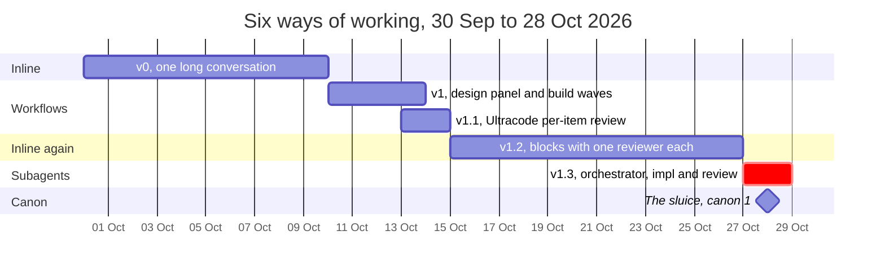
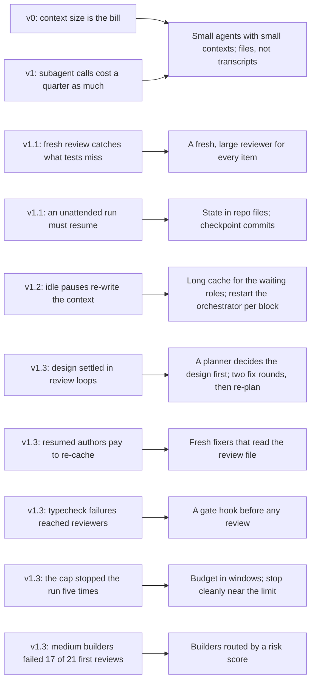
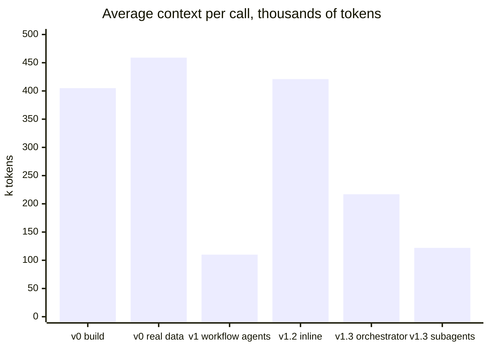

# How the sluice evolved

The sluice wasn't designed on a whiteboard. It is what was left after a month of building one real app,
**Star Chart** (a macOS Electron app that replays a team's Azure DevOps work as a painted space chart),
almost entirely with Claude Code, under a subscription's usage limits. Every way of working was measured
from its own transcripts afterwards. This page tells that story, and why each step led to the next. The
measurements of the last step before the sluice are in the [case study](case-study.md).

## The six stages

| Stage | How the work ran | What it delivered | The lesson it left |
|---|---|---|---|
| **v0** | One long inline conversation for days, from spec to slices; then the same conversation met real data | The first app; then 11 slices rebuilt against a real organisation's shape | **Context size is the bill.** Every call re-reads the whole conversation. At an average of 400–460k tokens of context, re-reading and re-caching it was about 90% of the spend; the model's own writing was about 10%. The costliest phase (31% of the whole project) was discovering what real data looked like |
| **v1** | A design panel as a workflow (scouts, three architects, a judge), then three build-wave workflows: implement, two-lens verify, fix, wave gate | The v1 architecture and most of its code | **Small agents are cheap.** A workflow subagent's call cost a quarter to a sixth of a main-conversation call, because its context was about 110k instead of 400k |
| **v1.1** | Claude Code's Ultracode: one workflow, each item implemented, adversarially reviewed by a fresh agent, then fixed | 11 items. The review set caught a regression every test had missed | **Fresh review finds what tests and authors miss.** But an overnight outage stalled the run for 6.5 hours: an unattended run has to be designed to resume |
| **v1.2** | Back to inline: the user's notes arrived in blocks, each block built in the conversation, then one fresh reviewer per block | 41 items over four blocks; each block's reviewer found 9 or 10 defects | **Blocks of notes are the right rhythm for the human**, but one long conversation brings back the context bill. Pauses longer than the cache's five minutes re-wrote the whole context: 38 points of the main-conversation spend |
| **v1.3** | The main session as orchestrator; a medium-model implementer and a large-model reviewer per batch (subagents), resumed for fixes; block audits | 45 items in about six usage windows, with no defects found by the user yet | **Review paid for itself; rework and resumes didn't.** Verification was about 25% of spend and caught every blocker. Fix rounds were 24%, and resuming implementers whose cache had expired cost 9% on its own. The usage cap stopped the run five times. See the [case study](case-study.md) |
| **Canon 1** | The sluice: a planner per item, builders by risk, a gate hook, fresh reviewers and fixers, block audits, files as the interface, budgets in windows, a ledger | — | This repository |

## How each lesson became a design choice

## What the context did to the bill

The single number that explained most of the cost at every stage was the average size of the context
each call re-read.

The sluice's answer is to keep each agent's opening context small (a packet, not the whole plan), to pass
files instead of conversations, and to restart the one long-lived agent, the orchestrator, at each block.

## What stayed constant

Some things worked at every stage. The sluice keeps them:
- **A written plan that is the contract.** Agents and reviewers judged against it, and the human could
  audit it.
- **Blocks of human feedback, answered in rounds of multiple-choice questions.** The cheapest high-value
  step in every version: v1.3's whole backlog review cost 2% of its spend.
- **Fast, mapped tests plus a full suite once per block.** Cheap to repeat, and the base of every gate.
- **The human's eye at the end.** The biggest quality jumps came from the user looking at real results.
  The sluice carries the gates to one final check, rather than removing them.

## What changed in how the human worked

Early on, the human was the bottleneck: about 97 hours of conversation against 28 hours of unattended
workflows. By v1.3, the human typed about fifteen prompts across two days, and the **usage window** became the
bottleneck. That's why the sluice plans in windows. It aims to finish more accepted work per five-hour
window, rather than per hour of the human's time.

## Measurement notes

Costs come from the transcripts' token counts priced at list-rate ratios, shown as shares of each
version's total, never as a bill. The v0–v1.2 numbers come from the project's whole-history
retrospective, and v1.3's from its own (summarised in the [case study](case-study.md)).
