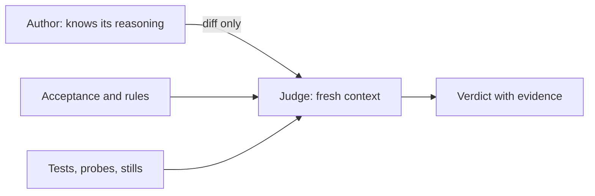

# The research behind the sluice

The sluice rests on two kinds of evidence: what one project measured ([case study](case-study.md),
[evolution](evolution.md)), and what others have published. This page collects the second kind.
Each claim cites its source. The sources were fetched and checked when the project first surveyed them
(October 2026), and two that didn't hold up were dropped. Where the evidence is thin, this page says so.

## 1. Why a separate judge works

- **Self-correction alone is weak.** Without outside feedback, models asked to check and revise their
  own reasoning got *worse* on every benchmark tested. The earlier reported gains depended on oracle
  labels saying when to stop. External feedback works: code execution, tools, search
  ([Huang et al., ICLR 2024](https://arxiv.org/abs/2310.01798); survey: [Kamoi et al., TACL 2024](https://arxiv.org/abs/2406.01297)).
- **Give the critic tools.** Critics that verify claims with tools improve output consistently
  ([CRITIC, ICLR 2024](https://arxiv.org/abs/2305.11738)). Agents that reflect on real test results reached
  91% pass@1 on HumanEval ([Reflexion, NeurIPS 2023](https://arxiv.org/abs/2303.11366)).
- **Separate the author from the judge.** Models recognise their own outputs and rate them higher
  ([Panickssery et al., NeurIPS 2024](https://arxiv.org/abs/2404.13076)). Anthropic found agents grading their
  own work "confidently prais[e] the work—even when … the quality is obviously mediocre", and called
  splitting generator from evaluator "a strong lever"
  ([harness design](https://www.anthropic.com/engineering/harness-design-long-running-apps)).
- **Dedicated critics find real bugs.** Trained critics caught more bugs than paid human reviewers, and a
  human plus a critic hallucinated less than the critic alone
  ([LLM Critics Help Catch LLM Bugs](https://arxiv.org/abs/2407.00215)).
- **Independence is an old principle:** code review by someone other than the author
  ([Google](https://google.github.io/eng-practices/review/)), and separation of duty
  ([NIST](https://csrc.nist.gov/glossary/term/separation_of_duty)).
- **Claude Code's own guidance** recommends a review step in a fresh subagent, because it "sees only the
  diff and the criteria you give it, not the reasoning that produced the change"
  ([best practices](https://code.claude.com/docs/en/best-practices)).

## 2. How to prompt a reviewer

1. **Give it the criteria, not the reasoning.** Keep the author's chain of thought out, to avoid anchoring
   ("context asymmetry"; [Refute-or-Promote](https://arxiv.org/abs/2604.19049), a single-author preprint).
2. **Ask for evidence:** a file and line, command output, a still.
3. **Set the bar, or it invents one.** "A reviewer prompted to find gaps will usually report some, even when
   the work is sound" ([best practices](https://code.claude.com/docs/en/best-practices)). Grade by severity;
   treat lows as optional. Google's standard: approve once a change "definitely improves the overall code
   health", even if it isn't perfect ([the standard of code review](https://google.github.io/eng-practices/review/reviewer/standard.html)).
4. **Ground it in tools:** let it run the tests.
5. **Use different lenses, not just more votes.** Agents in identical conditions make identical decisions:
   18 of 30 named a git branch the same thing ([Anthropic](https://www.anthropic.com/research/multiagent-systems)).
6. **Keep a real-world gate.** Unanimous reviewers can still be wrong: ten endorsed a security bug that
   didn't exist, and only a test refuted it (Refute-or-Promote).
7. **Know the judge's biases:** position, length and self-preference
  ([MT-Bench](https://arxiv.org/abs/2306.05685); [Wang et al.](https://arxiv.org/abs/2305.17926)).
8. **Calibrate by reading its transcripts.** Anthropic's evaluator found real issues and then "talk[ed]
   itself into deciding they weren't a big deal"; the fix was to tighten the prompt with examples
   (harness design, above).

**Review agents in the wild are noisy.** Developers rejected 56% of one agentic reviewer's comments
([CodeRabbit study](https://arxiv.org/abs/2607.03316)), and PR closure time rose in an industrial study
([Automated Code Review in Practice](https://arxiv.org/abs/2412.18531)). Hence the sluice's severity bar,
and the **reviewer precision** metric.

## 3. When multiple agents help, and what they cost

- **Tokens.** Agents use about 4× the tokens of chat, and multi-agent systems about 15×
  ([multi-agent research system](https://www.anthropic.com/engineering/multi-agent-research-system)).
- **Coding parallelises less than research.** "Most coding tasks involve fewer truly parallelizable tasks
  than research" (same source).
- **Parallel writers make conflicting decisions.** "Actions carry implicit decisions, and conflicting
  decisions carry bad results" ([Cognition](https://cognition.com/blog/dont-build-multi-agents)). What
  works: "writes stay single-threaded and the additional agents contribute intelligence", such as a
  reviewer with no shared context ([follow-up](https://cognition.com/blog/multi-agents-working)).
- **How multi-agent systems fail.** In 200+ traces: specification problems 42%, misalignment between
  agents 37%, verification 21% ([MAST](https://arxiv.org/html/2503.13657v2)). The sluice's answer: a written
  scope, clear roles, and verification at more than one level.
- **Start simple.** "Find the simplest solution possible, and only increase complexity when needed"
  ([Building effective agents](https://www.anthropic.com/engineering/building-effective-agents)).

| Pattern | Shape | In the sluice |
|---|---|---|
| Prompt chaining | Fixed steps, each consuming the last | plan → build → gate → review |
| Routing | Classify, then send to a specialist | The risk score picks the builder's tier |
| Evaluator–optimizer | Generate, evaluate, revise | Review → fix, at most twice |
| Perspective-diverse verify | Each verifier gets a different lens | Item review, then the block audit |
| Orchestrator–workers | A lead splits work as it goes | The orchestrator, per block |

## 4. Formats: is there a best way to write a spec?

**No format has been shown best for agents in general.**
- One study found prompt format changed results by up to 40% for a small model, with larger models much
  more robust, and the best format varying by task
  ([Does prompt formatting have any impact on LLM performance?](https://arxiv.org/abs/2411.10541)).
- Another found output-format swings of 2–46 points depending on model and dataset
  ([Format Matters, LREC 2026](https://aclanthology.org/2026.lrec-1.593/)).
- Spec-driven development (GitHub Spec Kit; Kiro's EARS-style "WHEN … THE SYSTEM SHALL …" criteria) is
  well described ([practitioner guide](https://ssojet.com/blog/prd-spec-templates-ai-agents)), but no
  independent evaluation was found.

The sluice's design rules follow from that:
- **Be rigid where small models read.** Packets and fix lists use fixed labels.
- **Make acceptance observable.** That is the case study's strongest finding on this front.

## 5. Facts about the harness that shaped the implementation

These hold for Claude Code as of late October 2026 (the design's §14 tracks them):

| Fact | Consequence for the sluice |
|---|---|
| A subagent starts with its own role file, the task, the project's instructions file, git status and preloaded skills, **not** the main session's system prompt or history | The role file plus the packet *is* the agent's context, and its size is under our control |
| A `SubagentStop` hook in settings can block a subagent from finishing (exit code 2), with feedback. (Verified live in a fresh session, blocking included. The docs also allow hooks in a role file's frontmatter, but in a first live test they didn't fire, and plugin agents ignore them) | The gate can be enforced, not just requested; it lives in settings and filters by role |
| Subagents default to a 5-minute cache; a per-agent or global setting allows 1 hour | The long cache only for roles that wait |
| The statusline receives the five-hour and weekly usage percentages on subscription plans | The orchestrator can see its budget, through a file |
| In telemetry, custom agent names all appear as one label; transcripts are an internal format | The sluice writes its own small records (a ledger and per-run JSON) |
| Skills nested in any `.claude/` folder are discovered | The template ships as `template/claude/`, not `.claude/` |

Docs: [subagents](https://code.claude.com/docs/en/sub-agents.md) · [hooks](https://code.claude.com/docs/en/hooks.md) ·
[prompt caching](https://code.claude.com/docs/en/prompt-caching.md) · [statusline](https://code.claude.com/docs/en/statusline.md) ·
[workflows](https://code.claude.com/docs/en/workflows.md) · [plugins](https://code.claude.com/docs/en/plugins/components.md) ·
[monitoring](https://code.claude.com/docs/en/monitoring-usage.md)

## 6. Code health, fitness functions, and what AI does to a codebase over time

The sluice's own measurements cover cost and correctness per tranche. The longer question, whether a
codebase built by agents stays easy to change, has its own evidence. It is mostly early, and some of it
comes from vendors.

**Code health and agent cost (CodeScene).**
- **The cost claim.** In a pre-registered study of 465 agent-authored pull requests from 246 open-source
  repositories, an agentic review-and-fix pipeline used 22–35% fewer tokens on healthy code (Code Health
  9.7) than on unhealthy code (2.8). That is 3.5–6.1% fewer per Code Health point, depending on the
  model, and Claude Sonnet showed the smallest effect, with a confidence interval just above zero
  ([blog](https://codescene.com/blog/does-code-quality-affect-ai-token-costs); [paper](https://arxiv.org/abs/2610.21914)).
- **Size mattered more.** PR size was the strongest cost driver. Complex methods and complex
  conditionals predicted the cost; duplication didn't.
- **A fix pass didn't help.** It left the median health score unchanged, and where it moved, drops
  outnumbered gains. The authors recommend planned refactoring as separate work, and a gate that stops
  changes from lowering the health of the files they touch.
- **Related studies by the same group:**
  - LLM refactoring broke behaviour 15–30% less often on healthy code (5,000 Python files;
    [FORGE 2026](https://arxiv.org/abs/2601.02200)).
  - Unhealthy files needed more input tokens for test generation ([arXiv 2608.18645](https://arxiv.org/abs/2608.18645)).
  - A vendor case study had agents raise a 300k-line C codebase's score from 5.6 to 10.0, using the
    metric as a signal and replay traces for correctness ([InfoQ](https://infoq.com/news/2026/09/agentic-refactoring-case-study)).
- **Caveats:**
  - The work is observational: an association, not causation.
  - The authors build and sell the metric.
  - The sample is open-source pull requests written by agents.

**What AI-era code looks like at scale.**
- **Duplication and churn (GitClear).** Across 211 million changed lines (2020–2024), duplicated blocks
  rose sharply, and copy-pasted lines overtook moved (refactored) lines for the first time. The figures
  come from secondary write-ups of the report and vary by source
  ([summary](https://leaddev.com/technical-direction/how-ai-generated-code-accelerates-technical-debt)).
- **Delivery stability (DORA).** In 2024, more AI adoption went with lower delivery stability. In 2025,
  throughput turned positive but instability remained. DORA frames AI as an *amplifier*: teams with
  strong tests and version-control practice turn the extra change into speed, and others turn it into
  instability ([2024](https://www.infoq.com/news/2024/11/2024-dora-report/);
  [2025](https://rdel.substack.com/p/rdel-112-whats-ais-impact-on-software)).
- **The perception gap (METR).** In a randomized trial, experienced developers on their own repositories
  were 19% slower with early-2025 tools, while believing they were 20% faster
  ([METR](https://metr.org/blog/2025-07-10-early-2025-ai-experienced-os-dev-study/)). The lesson for a
  sluice is to measure, not to trust impressions.
- **Security (Veracode, a vendor).** Generated code introduced a vulnerability in 45% of 80 benchmark
  tasks, across 100+ models, with no improvement as models got better at syntax
  ([report](https://www.veracode.com/press-release/ai-generated-code-poses-major-security-risks-in-nearly-half-of-all-development-tasks-veracode-research-reveals/)).

**Tests that test.** Coverage says what ran, not what would be caught. One study reports suites with
100% coverage but a 4% mutation score. Feeding mutation results back into test generation raised the
mutation score above plain prompting ([MutGen](https://arxiv.org/html/2506.02954v6)). Agents write tests
that pass, and mutation testing asks whether those tests would fail if the code were wrong.

**Fitness functions (Building Evolutionary Architectures).** Ford, Parsons and Kua define an
architectural fitness function as any objective, automated check of an architectural property:
dependency direction, layering, cycles, size and complexity budgets, performance budgets, or the public
API surface. Fitness functions turn architecture from a vision to defend into properties to keep. They
let many decentralised decisions over years stay inside agreed bounds, and they are guided changes, not
a fixed design ([book](https://oreilly.com/library/view/building-evolutionary-architectures/9781492097532);
[InfoQ](https://www.infoq.com/articles/fitness-functions-architecture/)). Common tools include ArchUnit
(Java), dependency-cruiser (JS/TS), import-linter (Python), and complexity and duplication linters.

**An old law.** Lehman's laws of software evolution (1970s–80s) hold that a system in use must keep
changing, and that its complexity rises unless work is done to reduce it. Agents change code faster, so
by this law they also add complexity faster, unless the sluice does the reducing work.
