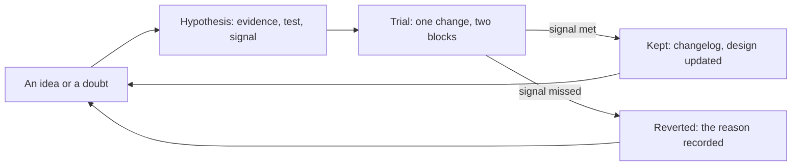
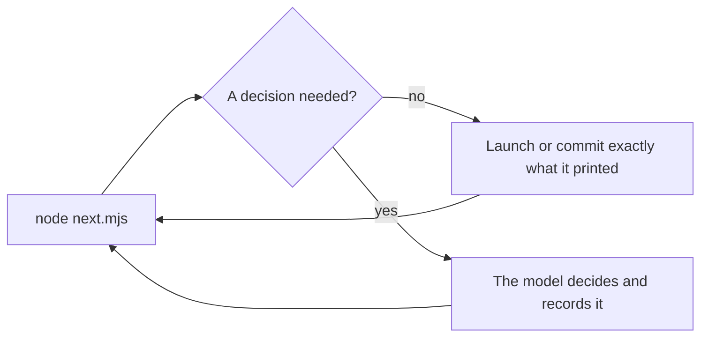
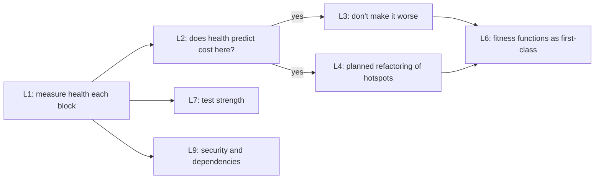

# Roadmap: hypotheses and planned improvements

The sluice changes by experiment, not by opinion. This is the list of what might make it better: each
idea written as a **hypothesis**, with the evidence so far, how to test it, and what would count as
proof either way. When a trial ends, the entry moves to *Settled*, and the change (if kept) goes into
the [changelog](../CHANGELOG.md).

**Rules for a trial** (from the design's evolve loop, §10):
- **One change at a time.** Run it for at least two blocks, and judge it from the block summaries, never
  from one item.
- **Project or process?** A trial that changes the *process* (roles, thresholds, scripts) runs in one
  project, and is marked in that tranche's block notes as `trial: H<n>`. If kept, it's proposed
  upstream with its summaries. Project knowledge (the project notes) needs no trial: add the lens when
  the evidence appears.
- **Write the signal down before the trial,** so the result can't move the goalposts.

**Statuses:**
- *open*: not yet tried;
- *on trial*: running, with the project and the blocks named;
- *kept* or *reverted*: settled.

---

## Hypotheses

### H1. The planner pays for itself
- **Conjecture:** a large-model planning run per item costs less than the rework it prevents.
- **Evidence so far:** the costliest loop in the case study (7% of a tranche) was a design settled across
  three review rounds. Nothing yet shows that a planner prevents it.
- **Test:** compare rework share (fix ÷ build plus fix) against the case study's 45%, with the planner's
  own spend added to the cost side. Then try skipping the planner for low-risk items.
- **Signal:** rework share falls by more than the planner's share of spend.
- **v1.4 A–C ([Star Chart doc 28](../../docs/28-v1.4-sluice-retrospective.md)):** rework fell from 46% to
  19% of build-and-fix spend, while planners took 22.7% of all spend. On this hypothesis's test that is
  met, narrowly. In spend terms, fix fell 18.7 points and planning added 22.7. Opus planners on medium
  items cost more than the builders they briefed (2.2 against 1.25 units); Sonnet planners cost 0.82,
  with no worse first-pass rate or rework.
- **Status:** on trial. Proposed: the planner on the medium tier by default, as in v1.4's lean blocks.
  Sub-trial in H12: score ≤ 2 skips the planner.

### H2. Medium builders with packets are reliable enough
- **Conjecture:** with a packet and a gate, medium-tier builders reach 60% first-pass acceptance on
  medium-risk items.
- **Evidence so far:** without packets or a gate, medium implementers failed 17 of 21 first reviews.
- **Test:** first-pass acceptance by tier, from the block summaries. For a firm answer, a replay trial:
  the same 2–3 items built at both tiers in separate worktrees.
- **Signal:** 60% or more → keep; under 40% → route more items to large.
- **v1.4 A–C ([Star Chart doc 28](../../docs/28-v1.4-sluice-retrospective.md)):** first-pass 9 of 13 (69%),
  all on medium builders. But Sonnet reviewers passed 8 of 10 first reviews and Opus reviewers 1 of 3, so
  the rate measures the reviewer as much as the builder.
- **Status:** open: hold the reviewer at large for every score ≥ 4 item, then judge.

### H3. The risk score's thresholds are about right
- **Conjecture:** the five-factor score (0–2 small, 3–5 medium, 6+ large) sends items to a tier that
  passes first time.
- **Evidence so far:** reasoned, not measured.
- **Test:** after a tranche, look at failures by score. Do the medium items that failed cluster at 4–5?
- **Signal:** a clear boundary in the failures → move the threshold to it.
- **v1.4 A–C ([Star Chart doc 28](../../docs/28-v1.4-sluice-retrospective.md)):** every item scored ≥ 5
  except one (C4) had a fix round or an escape (B1 at 6, B2 and C3 at 5); 2 of 7 at ≤ 4 did. B1 scored
  large but was built on medium, against the rule.
- **Status:** proposed trial for v1.4 D on: large at 5 or more (a large builder and a large reviewer).

### H5. The gate's cost stays small
- **Conjecture:** the gate adds under about 10% to agent time.
- **Evidence so far:** typecheck alone averaged 27 s in the case study; a full gate took about 40 s.
- **Test:** gate time per finish, against agent time per item.
- **Signal:** over 10% → move slow checks to the block's full suite.
- **v1.4 A–C ([Star Chart doc 28](../../docs/28-v1.4-sluice-retrospective.md)):** not measurable: the gate
  records no time. It blocked 3 finishes in 16 items.
- **Status:** open: log each check's seconds into the ledger line first.

### H6. Project notes sharpen reviews
- **Conjecture:** a short file of project lenses, read by every judge, raises reviewer precision and
  stops escapes of known classes.
- **Evidence so far:** the case study's sharpest catches came from project knowledge (a reference-table
  rule, a shared-texture lifecycle, a 401 behaviour).
- **Test:** count findings that cite a lens; record escapes by class.
- **Signal:** lens-citing findings appear and known-class escapes stop → keep; reviews quote lenses that
  don't fit → trim the notes.
- **v1.4 A–C ([Star Chart doc 28](../../docs/28-v1.4-sluice-retrospective.md)):** 1 of 18 reviews and
  audits names a lens (C3: "the effect where it's meant"). The one escape (B2) was a user-visible state
  that the item's tests reached only by an unnatural path, a class the notes don't name.
- **Status:** on trial, but unmeasurable until findings carry a `lens` field. Add the lens *reach the
  state the way the user does*.

### H7. A workflow script beats the main-session orchestrator
- **Conjecture:** once the loop is stable, a scripted per-item pipeline (with a decider agent for
  escalations) cuts orchestration from about 10–19% of spend to near zero, without losing decisions.
- **Evidence so far:** in earlier stages, workflow subagents' calls cost a quarter to a sixth of
  main-conversation calls. But scripts can't take input mid-run, or see the budget.
- **Test:** one block run as a workflow, against one run by the orchestrator.
- **Signal:** lower spend per item, and the same number of escapes.
- **v1.4 A–C ([Star Chart doc 28](../../docs/28-v1.4-sluice-retrospective.md)):** the orchestrator was
  22.7% of spend at about 15 main-session calls per item (the case study's was 7). Of 120 Bash calls, 88
  read files and state. See D1.
- **Status:** open; D1 first.

### H8. Worktrees make parallel builders worth it
- **Conjecture:** builders in separate worktrees (no shared build folder) finish more items per wall-clock
  hour without more rework.
- **Evidence so far:** parallel agents spent a window in 87 minutes rather than making it go further;
  the shared build folder serialised their tests.
- **Test:** only when windows end with budget left over and work waiting.
- **Signal:** more accepted items per window, with merge conflicts rare.
- **Status:** open, and low priority while the window is the bottleneck.

### H9. A refutation pass improves reviewer precision
- **Conjecture:** a second, cheap agent that tries to refute each major or blocker before the fixer sees
  it removes false positives.
- **Evidence so far:** field studies show high false-positive rates for review agents; reviewer precision
  in this sluice isn't measured yet.
- **Test:** first measure reviewer precision (findings acted on ÷ raised). Trial this only if it's under
  70%.
- **v1.4 A–C ([Star Chart doc 28](../../docs/28-v1.4-sluice-retrospective.md)):** the failure seen was the
  opposite of a false positive: a real defect graded Minor (B2). See H13.
- **Status:** open, not justified by the data so far.

### H10. The window's capacity can be calibrated
- **Conjecture:** spend per window is stable enough to plan in windows (each of the case study's windows held
  about a sixth of the tranche, a list-price equivalent of $23 to $30).
- **Test:** log the statusline's percentage at each block's start and end beside the ledger's spend.
- **Signal:** a stable ratio → set `windowCapacityUsd` from it; unstable → report percentages only.
- **v1.4 A–C ([Star Chart doc 28](../../docs/28-v1.4-sluice-retrospective.md)):** $27 per window still
  reproduces both v1.3's and v1.4's totals. But the **weekly** allowance stopped v1.4 for 48.5 of its
  72.8 calendar hours, after about 8 windows of use that week.
- **Status:** open, widened: calibrate the week as well as the window, and have `budget.mjs` plan in both.

### H11. Glanceable views make unattended runs trusted
- **Conjecture:** views redrawn by the hooks (now, board, timeline: Markdown with Mermaid, left open in a
  preview) let the human leave a run and, on return, know within seconds what it did last and is doing
  now, without reading JSON or asking the orchestrator (which costs tokens).
- **Evidence so far:** the origin project's human watched `work/` files change and found the JSON
  unreadable at a glance (v1.4, block C).
- **Test:** keep the views open through a block; note each time the human still asks the orchestrator
  "where are we?", or opens a run record to find out.
- **Signal:** those questions stop → keep, and consider a live HTML page on the same snapshot; layout
  jumps or stale views → fix the redraw triggers first.
- **v1.4 block E:** the human asked for the board after a split item (E4) showed accepted on one part's
  pass, so the view was trusted less than a hand-drawn one; fixed in `sluice-state.mjs` (CHANGELOG).
- **Status:** on trial from Star Chart v1.4, block D.

### H12. Small items skip the planner
- **Conjecture:** at a risk score of 2 or less, the scope doc's acceptance is a good enough brief. The
  orchestrator (or D1's script) writes the packet from it, and the planner run is saved.
- **Evidence so far:** [Star Chart doc 28](../../docs/28-v1.4-sluice-retrospective.md): v1.4's small block cost 0.042 windows per item, the same as the case study's
  UI-local blocks that ran with no planner (0.043). Orchestration was 53% of that block.
- **Test:** one block's score ≤ 2 items without a planner.
- **Signal:** first-pass acceptance holds, and windows per small item fall below 0.035.
- **Status:** open.

### H13. Verification never goes lean
- **Conjecture:** a "lean" run may downgrade planners and builders, but not reviewers on items scored 4
  or more, and it never skips the block audit. A reviewer that grades a user-visible behaviour Minor
  says why the user won't meet it.
- **Evidence so far:** [Star Chart doc 28](../../docs/28-v1.4-sluice-retrospective.md): v1.4's one escape (B2) was seen by a Sonnet reviewer and graded Minor, in a
  block whose audit was skipped. The late audit graded it Major.
- **Test:** the next two blocks, lean or not.
- **Signal:** no escapes past item review at score ≥ 4.
- **Status:** open.

### H14. The sluice's own work runs in sluice-sized sessions
- **Conjecture:** meta-work (designing, documenting and packaging the sluice) split across fresh or
  compacted sessions, each under about 200k context, costs far less per feature than one long session.
- **Evidence so far:** [Star Chart doc 28](../../docs/28-v1.4-sluice-retrospective.md): the sluice's first build ran 196 calls at an average 369k context (peak 635k),
  1.08 windows.
- **Signal:** the next sluice feature costs under half a window.
- **Status:** open.

### H15. A distinctive control word triggers reliably
- **Conjecture:** a name used nowhere else in a codebase makes the skill trigger on plain requests ("sluice
  the scope for v1.5", "run the sluice for block B", "give me the sluice visualization") and keeps searches
  clean. The old name, "flow", collided with prose, with code (a shader's `flow` variable, motes that
  flow) and with "workflow", so neither the model nor `grep` could tell the process from the word.
- **Evidence so far:** renamed in the origin project at Star Chart v1.4, block E.
- **Test:** v1.5, scoped and run from plain requests as well as `/sluice`.
- **Signal:** plain requests start the skill without a slash, and `\bsluice\b` matches only the process.
- **Status:** on trial from Star Chart v1.4, block E.

---

## The deterministic layer: what else could be code

The design's rule (P11): if the same input always gives the same correct answer, it's code, not a model
call. Today the scripts do the checks, the accounting, the budget and the summaries (design §12). Much
of the **orchestrator's** work is still deterministic, but it is done by a large model re-reading a large
context.

In the case study, the orchestrator made 326 model calls to dispatch 97 agent launches and fix messages:
about 3.4 calls per dispatch, or 7 per item, and 19% of the tranche's spend. Most of those calls decided
something a few lines of code could decide: what comes next, which agent at which tier, what header,
which files to commit. The aim is to make each orchestrator turn one command and one launch, and to save
the model's tokens for the decisions only it can make.

**Today,** the model works it out on every turn:

**The target:** code works it out, and the model acts, deciding only when asked:

### D1. The loop's state machine as code (`next.mjs`)
- **Conjecture:** a script that reads the scope doc's State lines, the run records and the budget can
  print the next action. That is either a ready launch (agent, model, header, paths), a commit, a block
  close, or `DECIDE: <question>`. The orchestrator then only executes it, and decides when asked.
- **Evidence:** the loop in design §4 is a fixed state machine: plan → build → review → (fix ≤2 → review) →
  re-plan → commit. Only escalations need judgment. A duplicate completion notice would cost one short
  turn ("run next") instead of a reasoning turn.
- **Test:** orchestrator calls per item and its share of spend, from the summary, against the case
  study's 7 calls and 19%.
- **Signal:** under 3 calls per item and under 8% of spend, with the same escapes.
- **v1.4 A–C ([Star Chart doc 28](../../docs/28-v1.4-sluice-retrospective.md)):** orchestration was 22.7%
  of v1.4 A–C, about 15 calls per item, and its Bash calls were mostly reads of records and state that a
  script could summarise.
- **Status:** open. The highest-value item here, now with a second tranche of evidence.

### D2. A scope-doc linter (`scope-lint.mjs`)
- **Conjecture:** checking the scope doc's format before any run catches unbuildable items for free:
  every label present, at least one acceptance line naming a test or command, ids unique, dependencies
  acyclic. Run it from `/sluice run`, or as a hook when a file in `scopeDir` is written.
- **Evidence:** unclear acceptance was the main cause of rework and no-ops. Today a large-model planner
  finds it, by spending a run and returning `needs: rescope`.
- **Signal:** planner rescopes fall to near zero.
- **Status:** open.

### D3. Run records and packets checked in the gate
- **Conjecture:** validating each record against its schema (fields, verdict values) and each packet's
  structure (sections, the 2,000-word limit) when an agent finishes keeps the metrics trustworthy, at no
  token cost.
- **Evidence:** the summary trusts the records. A malformed record silently drops an item from the
  first-pass rate.
- **Signal:** no summary ever misses or misreads a record.
- **Status:** open.

### D4. Mapped tests chosen by code (`affected.mjs`)
- **Conjecture:** a map in `config.json` from file patterns to test names lets a script list the tests for
  a diff. Builders, fixers, reviewers and the gate run exactly those, instead of each working it out.
- **Evidence:** in the case study, agents ran 215 mapped-spec runs and 94 keystone runs, after reading a
  prose guide to decide which specs mattered.
- **Signal:** fewer test-selection calls per agent, and no mapped spec missed in review.
- **Status:** open.

### D5. Checkpoints and block closes as code (`checkpoint.mjs`, `block-close.mjs`)
- **Conjecture:** a script that, on a pass, sets the item's State line, stages exactly the item's files and
  work folder, and commits with a fixed message is cheaper and safer than a model doing it. Likewise for
  closing a block: run the full suite, write the summary, commit.
- **Evidence:** today the playbook says `git add -A`, which would stage anything else in the tree.
- **Signal:** commits contain only the item's files; no orchestrator tokens spent on git.
- **Status:** open.

### D6. Test output compressed before a model reads it (`run-checks.mjs`)
- **Conjecture:** a wrapper that runs a test command and prints only the counts and the failures keeps raw
  logs out of agents' contexts, where every later call re-reads them.
- **Evidence:** in the case study, agents' test output came to about 650k characters (e2e specs 255k, unit
  275k, typecheck 124k). Context size was the largest driver of cost at every stage.
- **Test:** builders' cache-read per call, from the ledger, with and without the wrapper.
- **Signal:** a clear fall in context per call, with no rise in missed failures.
- **Status:** open.

### D7. Item scaffolding (`item.mjs`)
- **Conjecture:** one command that extracts an item's block from the scope doc, creates its work folder,
  records the start commit and prints the launch header replaces several model steps in every launch.
  (It may fold into D1.)
- **Signal:** launch messages never malformed; the ledger never misses an agent for a bad header.
- **Status:** open.

### D8. A forecast before a block (`estimate.mjs`)
- **Conjecture:** the ledger's history of spend per item by risk tier predicts a block's cost in windows
  well enough to plan stop points and audits ("Block C ≈ 1.4 windows").
- **Evidence:** windows were the bottleneck. Spend per item varied six-fold by block, mostly by risk.
- **Signal:** forecasts within about 25% of actual. Ties to H10.
- **Status:** open, after a few blocks of ledger data.

### D9. The end state: a workflow runs the state machine
- **Conjecture:** once D1–D7 exist, the per-item loop can run as a Claude Code workflow script that calls
  `next.mjs` logic directly and launches agents itself. A model is involved only for scoping, escalations
  and block-end decisions. This is H7 made concrete.
- **Signal:** orchestration near zero, the same escapes, and a run that resumes cleanly after a stop.
- **Status:** open, after D1.

**Order:** D1 and D5 first (orchestration is the largest deterministic cost), then D6 (context), then
D2–D4, and D7 and D8, with D9 last. Each one is small, testable code, and gets checks in the self-test.

## Long-term health: keeping the codebase fit for agents

Everything above makes one tranche cheaper and more correct. This section asks the longer question:
**does the codebase stay easy for agents (and people) to change, tranche after tranche?** Lehman's laws
say complexity rises unless work is done to reduce it. The industry data says AI tends to amplify
whatever practices a team already has, good or bad: more duplication, less refactoring, less stable
delivery without strong tests. The evidence is in [research.md](research.md) §6.

None of this changes the workflow yet. The order is: **measure first, then decide.**

### What the origin project already shows

A first look at Star Chart's history (computed for this roadmap from git and ESLint; the current values
are now reproduced by `health.mjs`, L1):

| Signal | Value |
|---|---|
| TypeScript files in `src` | 66 → 335 in four weeks; 57.3k lines |
| Files over 800 lines | 2 → 9 by mid-October, then flat through two more versions |
| Functions with cyclomatic complexity over 15 | 136; the worst is a label-placement function at **209** |
| Functions over 80 lines | 38 |
| Change frequency | The file holding that function was changed in 15 of 29 commits; the median file, in 2 |

The most complex function is in one of the most-changed files: what CodeScene calls a *hotspot*. Label
placement needed rework in each recent version. That's a correlation from one project, not proof, but
it is exactly the pattern the hypotheses below would test.

The project also already runs **fitness functions without the name:**
- lint rules that fence the engine, pack and theme layers;
- a test that keeps every reference-table value in step with its doc;
- a frame-time budget on the densest scene;
- a fixture-coverage guard;
- an invariant ("drawn count = true count") checked across every fixture.

### L1. Measure code health every block, at no token cost
- **Conjecture:** a deterministic health snapshot in each block summary makes long-term drift visible.
  The snapshot would cover:
  - complexity over a threshold, long functions and very large files;
  - duplication;
  - hotspots (complexity × change frequency), and the touched files' before-and-after values;
  - test count and known flakes;
  - the dependency count.
- **How:** a `health.mjs` script, with tools named per stack in `config.json` (for example ESLint's
  complexity rules and jscpd for JS/TS, or radon and ruff for Python). It belongs to the deterministic
  layer (P11).
- **Signal:** after three tranches, a trend that can be read. Whatever it says, it informs L2–L4.
- **Status:** *built*, on trial from the origin project's next tranche (v1.4). `health.mjs` measures
  files and lines, files over a size limit, hotspots (changes in recent commits × lines, size standing in
  for complexity), dependencies, and one line from each project measure in `health.commands` (Star
  Chart's: complexity over 15 and functions over 80 lines, from ESLint, in about 2 s). `summary.mjs
  --write` puts it in every block note and the scoreboard. Not yet measured: duplication, the touched
  files' before-and-after values, and flaky tests.

### L2. Health predicts this project's agent cost
- **Conjecture:** items touching unhealthy files cost more tokens and more fix rounds, as CodeScene
  reports for agentic review (22–35% more tokens on unhealthy code; observational, from the metric's
  vendor).
- **Test:** join the ledger's spend and rounds per item with L1's health of the files each item touched.
  Control for diff size, the strongest cost driver in that study.
- **Signal:** a relationship that survives size → L3 and L4 pay for themselves here. None → don't spend
  on health for cost reasons.
- **Status:** open, after L1 has two or three tranches of data.

### L3. A ratchet: changes don't make touched files worse
- **Conjecture:** a fitness function in the gate or at the block's end fails when an item lowers the
  health of the files it touches: a function's complexity goes up past the budget, or a new 800-line
  file appears. It holds the line without a refactoring programme.
- **Evidence:** CodeScene recommends exactly this gate. DORA's "amplifier" finding says guardrails decide
  whether AI speed becomes stability.
- **Risk:** noise and blocked work. Start it as a warning in the summary; promote it to the gate only if
  warnings track rework.
- **Signal:** the health trend in L1 stops falling, without more gate red-outs.
- **v1.4 A–C ([Star Chart doc 28](../../docs/28-v1.4-sluice-retrospective.md)):** the worst function in the
  known hotspot (`labels.ts` position) rose in complexity from 209 to 225 across v1.4's blocks A–C.
- **Status:** open: start as a warning in the summary for touched files whose worst complexity rises.

### L4. Planned refactoring of hotspots, as scoped items
- **Conjecture:** refactoring the top hotspot as its own item lowers the cost and fix rounds of later items
  that touch it. The item's acceptance is a metric target plus unchanged behaviour (existing tests and
  goldens pass).
- **Evidence:** in CodeScene's study, a batch fix pass didn't raise health, but planned refactoring did.
  Here, the label-placement hotspot is the obvious first candidate.
- **Test:** compare the ledger's spend and rounds for items touching the refactored file, before and after.
- **Signal:** a clear drop → make "one hotspot per tranche" a habit of scoping.
- **Status:** open.

### L5. A health steward role, or not
- **Conjecture:** a block-end role that reads L1's snapshot and proposes refactoring items for the next
  scope (never editing code) keeps health in view without the human tracking it.
- **Counter-hypothesis (preferred first):** the deterministic snapshot plus the scoper's existing
  questions do the same at no extra model cost. Add a role only if hotspots keep being left out of
  scopes.
- **Status:** open, after L1 and L4.

### L6. Fitness functions as first-class
- **Conjecture:** naming the project's fitness functions, and running them in a known place, keeps
  architecture changeable as decisions pile up across many components over years:
  - fast ones in the gate;
  - slow ones at the block's end;
  - each architectural decision in a scope's Decisions table getting a fitness function wherever one can
    be written.
- **How:** a `fitness` list in `config.json` (name, command, fast or slow), and a lens in the project notes
  that asks reviewers: "does this decision need a fitness function?"
- **Evidence:** Ford, Parsons and Kua; and the origin project's five unnamed ones caught real regressions.
- **Signal:** architectural escapes (layering, coupling, budgets) stop reaching the human gate.
- **Status:** open.

### L7. Test strength, not just test count
- **Conjecture:** agents write tests that pass, not necessarily tests that catch. Mutation testing,
  sampled on the files a block changed, measures whether the new tests would fail if the code were wrong.
- **How:** at the block's end only (it's slow), with a per-stack tool (for example Stryker for JS/TS,
  mutmut for Python). Report the score in the summary.
- **Evidence:** suites with 100% coverage and a 4% mutation score have been reported; mutation feedback
  improves generated tests.
- **Signal:** a mutation score for new tests that holds or rises. If low, add "kills mutants" to builders'
  acceptance for risky items.
- **Status:** open.

### L8. Churn as a rework signal beyond fix rounds
- **Conjecture:** lines rewritten within a few blocks of being written are rework the sluice doesn't see
  today. Fix rounds count rework *inside* an item; churn counts it *across* items.
- **How:** from git, in L1's script: the share of each block's lines changed again within the next two
  blocks.
- **Evidence:** GitClear's rising-churn finding in AI-era code (secondary sources).
- **Status:** open.

### L9. Security and dependencies as fitness functions
- **Conjecture:** a static security scan and a dependency audit at each block's end, plus new
  dependencies flagged for the human, catch what reviewers miss, at little cost.
- **Evidence:** a vendor benchmark found vulnerabilities in 45% of generated solutions, flat across model
  generations. In the case study, a security-focused review found a real hole (a file drop navigating the
  app).
- **Signal:** findings caught at the block's end that item reviews missed.
- **Status:** open.

### L10. Delivery metrics in DORA's terms
- **Conjecture:** mapping the sluice's numbers onto DORA's four keys makes them comparable with industry
  baselines and with other teams:
  - lead time per item, from the ledger;
  - deployment frequency, as accepted items per window;
  - change failure rate, as escapes per item;
  - time to restore, as fix-round time.
- **Status:** open. Cheap now that P2 (the scoreboard) exists.

### Other practices worth a hypothesis later
- **Small batches.** Size was the strongest cost driver in CodeScene's study, and DORA has long tied
  small batches to stability. A per-item diff-size budget could become a planner rule ("split above N
  lines").
- **Architecture decision records.** The scope doc's Decisions table is a lightweight ADR log. Linking
  each to its fitness function (L6) and its reason keeps decentralised decisions coherent over years.
- **Docs freshness as a fitness function.** The reference-table test generalises: a script that checks
  that every code symbol a doc names still exists. The block audits found doc drift in every block.
- **A flake budget.** Flaky tests cost real time in the case study. Track them in L1, and quarantine
  above a budget.
- **The human's understanding.** METR's perception gap is a warning: people misjudge AI's effect on
  their own work. A periodic "explain this module" check, by the human or by a reviewer quizzing the
  human, might catch comprehension drift. The evidence for it is thin, so it's a conjecture only.

## Planned improvements

Not hypotheses, but work the sluice needs in order to evolve cleanly.

| # | Improvement | Why | Status |
|---|---|---|---|
| P1 | **An upgrade mode for the bootstrap:** a version stamp in the installed `.claude/sluice/`, a manifest of the files the sluice owns, and an upgrade that overwrites only those files, never `config.json` or the project notes, and reports any local edits to sluice-owned files | So a project takes upstream changes as a pull, not a merge, and local process edits become visible | partly: the self-test's drift check names any file that differs from the package's template, and any `config.json` key missing |
| P2 | **A metrics script across tranches:** first-pass acceptance, rework share, spend per item and escapes, trended across every block in `progressDir` | The evolve loop compares against a baseline; today that means reading summaries by hand | *built*: `scoreboard.jsonl`, written by `summary.mjs --write`, and `scoreboard.mjs`; `/sluice retro` writes each tranche's `retro.md` from it. **Fixed after v1.4 C:** the orchestrator was priced from every main session in a block's span ±30 minutes, which charged unrelated sessions and double-counted blocks that overlapped (spend overstated 14%). It is now priced from the sessions that launched the block's agents, ±10 minutes, with shared turns split. Agents killed at a cap are recovered from their transcripts. Rework share is still to add |
| P3 | **Escapes as a record:** a small `escapes.jsonl` per tranche (item, class, found where), which the summary reads | Escapes are the most important metric, and they're free text today | partly: the scoreboard counts the block notes' `- <ID>: <defect>` lines; the class and where it was found are still free text. v1.4's one escape (B2) passed item review and was caught by the block audit; only prose says so. Next: `found_by: review / audit / human` |
| P4 | **Packaging as a plugin** once the design is stable (gate and ledger hooks in the plugin's hooks file) | One-command install and upgrade | open, after P1 |
| P5 | **Vendoring by subtree:** projects keep the package at `sluice/` as a git subtree, so upgrades and upstream proposals are a pull and a push | One copy of the design per project, linked to upstream | open, once the package has its own repository |

---

## Settled

| # | Hypothesis | Result | When |
|---|---|---|---|
| S1 | The gate can live in each writer role's own frontmatter | **Reverted:** that hook didn't fire in its first live test. One settings-level `SubagentStop` hook, filtered by role, did, including blocking and giving up red | Canon 1 release testing |
| S2 | The ledger hook can learn the gate's result by reading its state file | **Reverted:** the two hooks run side by side, so the ledger wrote first. The gate now patches its result into the ledger line | Canon 1 release testing |
| S3 | H4: the long cache pays for builders | **Reverted:** 13 builders never paused between 5 and 60 minutes, so the premium (15% of builder spend) prevented no re-writes. Every subagent role is on the short cache | Star Chart v1.4, blocks A–C ([Star Chart doc 28](../../docs/28-v1.4-sluice-retrospective.md)) |
