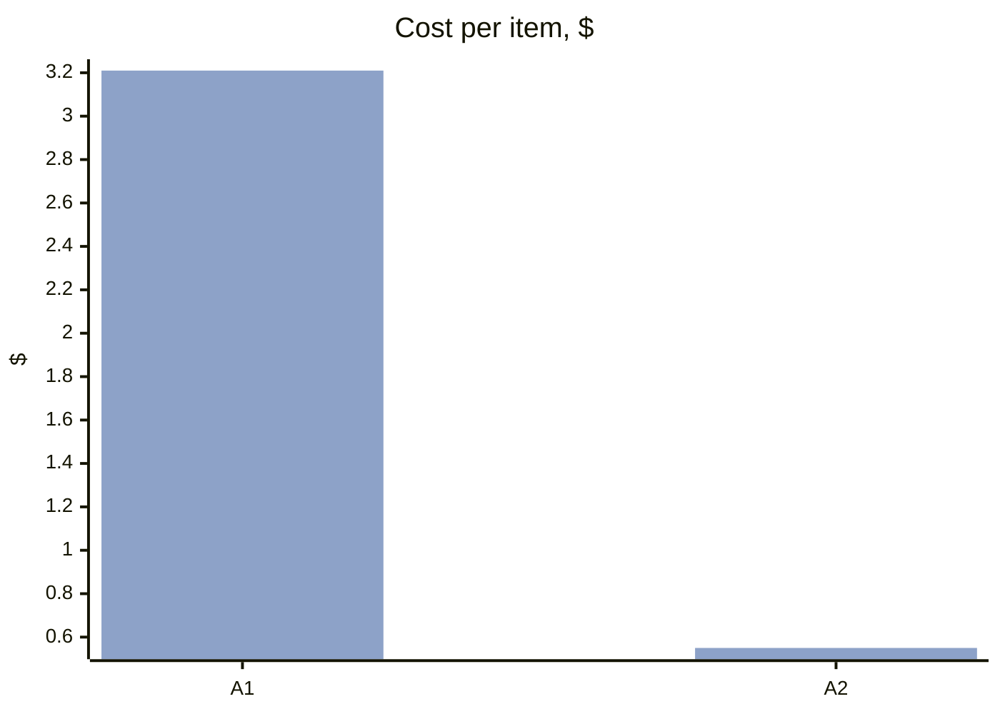
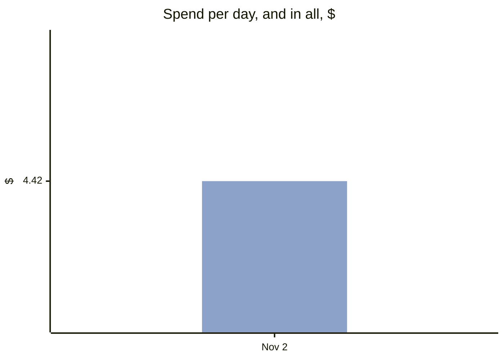
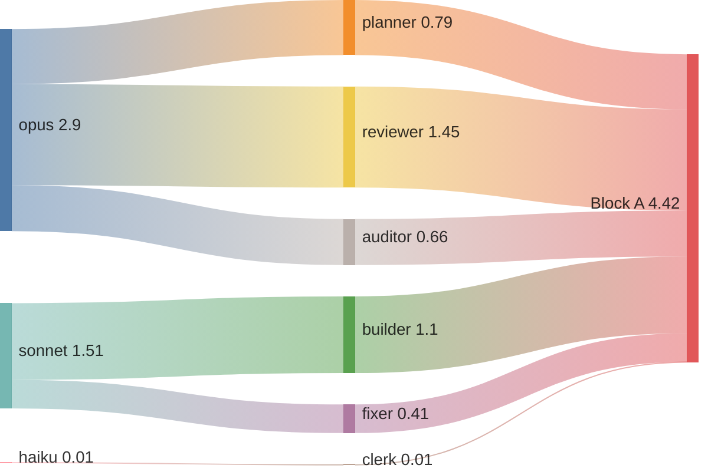
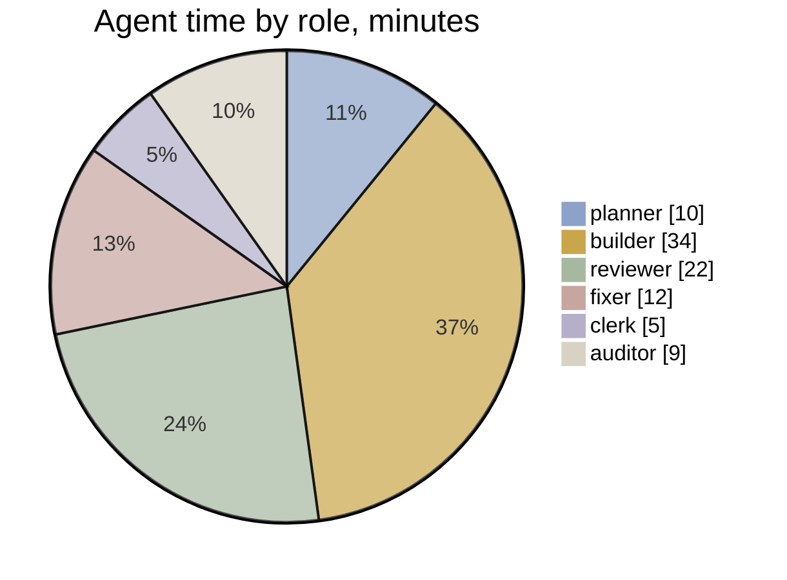

# v0.4 · Effort

[Now](now.md) · [Board](board.md) · [Pipeline](pipeline.md) · [Timeline](timeline.md) · **Effort**  
Frozen at Nov 2, 2026 08:02

**$4.42** API-equivalent · 1 h 31 min of agent time · 9 agent runs · $2.21 per accepted item (agents only; the orchestrator is in the block table)

**Where the spend went:** model → role → block

| Block | Items | Accepted | Runs | Agent time | Cost | Per item | First pass | Fix rounds |
|---|---|---|---|---|---|---|---|---|
| **A** | 2 | 2 | 9 | 1 h 31 min | $4.42 | $2.21 | 1/2 | 1 |
| **B** | 1 | 0 | 0 | – | – | – | – | 0 |

**Closed blocks** (the scoreboard: agents and the orchestrator)

| Block | Items | Windows | Cost | Orchestrator | First pass | Fix rounds | Findings |
|---|---|---|---|---|---|---|---|
| [A](../../block-A.md) | 2 | 0.16 | $4.42 | – | 1/2 | 0.5 mean | 1 major · 1 minor · 2 nit |

Costs are API-equivalent list prices from the ledger, not a bill.
