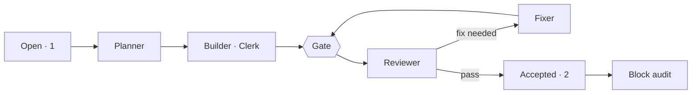

# v0.4 · Now

**Now** · [Board](board.md) · [Pipeline](pipeline.md) · [Timeline](timeline.md) · [Effort](effort.md)  
Frozen at Nov 2, 2026 08:02

### Snapshot at the block's end · Nov 2 08:02

**Last** · 08:02 · **block-A** auditor r1 → done · opus · 9 min · $0.66

| When | Item | Role | Result | Model | Time | Cost |
|---|---|---|---|---|---|---|
| 08:02 | block-A | auditor r1 | done | opus | 9 min | $0.66 |
| 07:38 | A2 | reviewer r1 | pass | opus | 5 min | $0.27 |
| 07:30 | A2 | clerk r1 | done | haiku | 5 min | $0.01 |
| 07:24 | A2 | planner r1 | planned | opus | 4 min | $0.27 |
| 07:12 | A1 | reviewer r2 | pass: 1 nit | opus | 7 min | $0.39 |
| 07:05 | A1 | fixer r1 | done | sonnet | 12 min | $0.41 |
| 06:52 | A1 | reviewer r1 | fix needed: 1 major · 1 minor · 1 nit | opus | 10 min | $0.79 |
| 06:41 | A1 | builder r1 | done · gate blocked ×1 | sonnet | 34 min | $1.10 |

2 of 3 items accepted · 9 agent runs · 1 h 31 min of agent time · $4.42 (API-equivalent)
