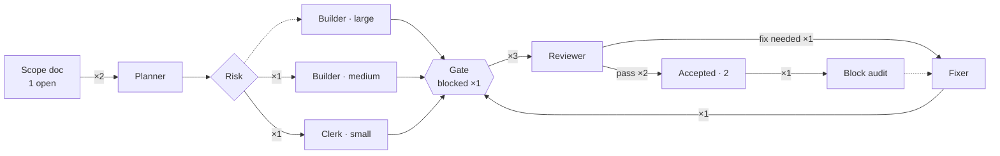

# v0.4 · Pipeline

[Now](now.md) · [Board](board.md) · **Pipeline** · [Timeline](timeline.md) · [Effort](effort.md)  
Frozen at Nov 2, 2026 08:02

Edges count agent runs this tranche (dotted: not taken yet) · ● running · ○ waiting there

**Journeys**

- **block-A** auditor → accepted · $0.66 · 9 min
- [**A2**](../../../../scope-v0.4.md#a2-ingestion-doc-the-retry-rules) planner → clerk → reviewer ✓ → accepted · $0.55 · 14 min
- [**A1**](../../work/A1/packet.md) planner → builder → reviewer ✗ → fixer → reviewer r2 ✓ → accepted · $3.21 · 1 h 08 min
