# v0.4 · Timeline

[Now](now.md) · [Board](board.md) · [Pipeline](pipeline.md) · **Timeline** · [Effort](effort.md)  
Frozen at Nov 2, 2026 08:02

### Nov 2 · 9 runs · 1 h 31 min of agent time · $4.42

```mermaid
---
config:
  themeVariables:
    taskBkgColor: '#4a5d8a'
    taskBorderColor: '#34446a'
    critBkgColor: '#a4262c'
    critBorderColor: '#6e1a1e'
    activeTaskBkgColor: '#8f5f00'
    activeTaskBorderColor: '#5e3e00'
---
gantt
  dateFormat x
  axisFormat %H:%M
  todayMarker off
  section A1
    planner r1 opus :1793628030000, 1793628370000
    builder r1 sonnet :1793628505000, 1793630515000
    reviewer r1 opus :crit, 1793630540000, 1793631150000
    fixer r1 sonnet :1793631202000, 1793631902000
    reviewer r2 opus :1793631940000, 1793632360000
  section A2
    planner r1 opus :1793632810000, 1793633070000
    clerk r1 haiku :1793633130000, 1793633420000
    reviewer r1 opus :1793633580000, 1793633880000
  section block-A
    auditor r1 opus :1793634780000, 1793635320000
```

Red: a review or audit that asked for a fix, or a gate that stayed red · highlighted: running now
