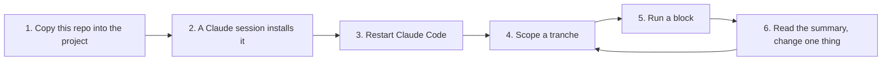

# Adopting the sluice in a project



## What you need

| Need | Why |
|---|---|
| Claude Code, recent enough for subagent role files, skills, hooks and the statusline | The sluice is built from those parts (see the design's §14) |
| A Claude subscription (Pro or Max) | The usage-window percentages that drive the budget come from the statusline on subscription plans. On an API key the sluice still works, but the budget check reports `UNKNOWN` |
| Node.js 18 or later on the machine | The hooks and scripts are dependency-free Node |
| git | Checkpoint commits on a work branch |
| Fast checks you trust: typecheck, lint, unit tests | The gate is only as good as they are. A project without them should make them its first block |

Which models your plan can use differs by plan and changes over time. The bootstrap asks, and maps the
three tiers (small, medium, large) onto what you have.

## Install with Claude (recommended)

1. Copy this repository into the project, as a folder named `sluice/` at the project's root. Keep it
   there: it holds the design doc the agents refer to, and the template for upgrades.
2. Open Claude Code in the project and paste:

   ```text
   Read sluice/install/BOOTSTRAP.md and follow it to install the sluice into this project.
   ```

   The session surveys the project, asks you a few multiple-choice questions, installs
   `sluice/template/claude/` as `.claude/` (merging anything already there), fills in
   `.claude/sluice/config.json` for your stack, adds a short section to `CLAUDE.md`, and runs the
   self-test.
3. **Start a new Claude Code session**, so the new agents, skills and hooks load. Accept the folder-trust
   prompt if one appears; project hooks need it.
4. Paste the first-session prompt from [install/FIRST-SESSION.md](../install/FIRST-SESSION.md).

## Install by hand

```sh
cp -R sluice/template/claude/. .claude/          # merge by hand if .claude/ already exists
echo ".claude/state/" >> .gitignore
$EDITOR .claude/sluice/config.json               # gate commands, fullSuite, paths (table below)
node .claude/sluice/selftest.mjs --real-gate     # must end "All … checks passed."
```

Then add the `CLAUDE.md` section from BOOTSTRAP.md (step 7), and start a new session.

## Where everything goes

| From this repo | To the project | What it is |
|---|---|---|
| `template/claude/agents/*.md` | `.claude/agents/` | The six roles: planner, builder, clerk, reviewer, fixer, auditor |
| `template/claude/skills/sluice/` | `.claude/skills/sluice/` | The `/sluice` playbook, its formats, the risk score, the scope template |
| `template/claude/skills/item-contract/` | `.claude/skills/item-contract/` | The rules every role preloads |
| `template/claude/sluice/` | `.claude/sluice/` | Hooks and scripts: gate, ledger, budget, statusline, summary, health, scoreboard, tier, the views (`sluice-state.mjs`, `visualize.mjs`), lock, self-test, `config.json` |
| `template/claude/skills/sluice/templates/project.md` | `.claude/sluice/project.md` (filled in) | The project's notes for the agents. Written at install, grown from evidence, never overwritten by an upgrade |
| `template/claude/settings.json` | `.claude/settings.json` (merged) | Wires the statusline, the gate and ledger hooks, and the launch hook for the views |
| `docs/`, `install/`, `examples/` | stay in `sluice/` | The design the agents cite (`designDoc`), the install prompts, worked examples |

## The settings in `config.json`

| Key | Meaning | Example |
|---|---|---|
| `designDoc` | Where the agents find the design | `sluice/docs/design.md` |
| `scopeDir` | Where new scope docs go | `docs/scopes` |
| `progressDir` | Where each tranche's work files, ledger and block notes go (committed) | `docs/sluice` |
| `projectNotes` | The project's notes for the agents: sources of truth, review lenses, how to verify (under about 800 words) | `.claude/sluice/project.md` |
| `workBranchPrefix` | The orchestrator's branch per tranche | `sluice/` |
| `gate` | The fast checks, in order; each runs in a shell at the root | see below |
| `gateMaxBlocks` | Gate failures in a row before an agent may stop marked red | `3` |
| `fullSuite` | The slow, whole suite, run once per block | `npm run e2e` |
| `mappedTestsGuide` | How an agent finds the tests for the files it touched | `tests/README.md maps areas to specs` |
| `lockedCommands` | Commands that share a build folder or port, so parallel agents must take turns | `["npm run build"]` |
| `budget` | Window percentage to hold at; week percentage to stop at | `85`, `80` |
| `health` | The code-health snapshot in each block note and the scoreboard: source `extensions`, `include` and `exclude` (path prefixes; an empty `include` means everything tracked, and the template excludes `sluice/` and `.claude/`), `largeFileLines`, `hotspotCommits`, and `commands`, the project's own measures, each printing one line. `"off"` skips it | `{"name": "Complexity", "cmd": "node scripts/health-complexity.mjs"}` |
| `views` | Where the views go inside each tranche's folder (`dir`), or `"off"` to skip them. Gitignore `<progressDir>/*/<dir>/` | `{"dir": "views"}` |
| `prices`, `windowCapacityUsd` | For converting spend into windows in the summaries | update with the design's §14 |

### Gate examples

| Stack | `gate` |
|---|---|
| TypeScript (npm) | `npm run -s typecheck` · `npm run -s lint` · `npm test --silent` |
| Python | `ruff check .` · `mypy src` · `pytest -q -x` |
| Go | `go vet ./...` · `go test ./... -short` |
| Rust | `cargo clippy -q -- -D warnings` · `cargo test -q` |
| .NET | `dotnet build -warnaserror` · `dotnet test --no-build` |

Keep the whole gate under about a minute: it runs every time a builder, fixer or clerk tries to finish.

### Health measures

The snapshot's built-in part (size, large files, hotspots, dependencies) needs only git. A project
measure is any command that prints one line; it runs once per block, so a few seconds is fine. Good
first measures: functions over a complexity limit, from the linter (ESLint's `complexity` rule, ruff's
`C901`, gocyclo, clippy's `cognitive_complexity`), and duplicated lines, from a tool such as jscpd.
If the project's linter checks the `.claude/` folder, give `.claude/sluice/*.mjs` Node's globals, or
exclude the folder.

## Your first tranche

- **An existing project with tests:** scope your next batch of work. Start with small, low-risk items
  for the first block, so the plumbing proves itself on cheap work.
- **A project without tests, or a new one:** make the first block *the gate itself*: a test runner, a
  linter, a typecheck, and a smoke test. Until it exists, the gate passes everything, and the reviewers
  carry all the weight.

## Day to day

| You want to | Do |
|---|---|
| Plan new work | `/sluice scope <notes or a file>` |
| Build a block | `/sluice run <scope doc> [block]` |
| See the budget and item states | `/sluice status <scope doc>` |
| Watch a run | Open `<progressDir>/<tranche>/views/now.md` (and `board.md`, `pipeline.md`, `timeline.md`, `effort.md`) in a Markdown preview; `/sluice views` draws them the first time |
| Keep the views fresh between agent runs too | `node .claude/sluice/visualize.mjs --watch` in a terminal (catches scope-doc edits and ticks the clocks) |
| Read a block's results | `/sluice summary <tranche> <block>`, or open `<progressDir>/<tranche>/block-<B>.md` |
| See the trend across tranches | `node .claude/sluice/scoreboard.mjs` |
| Close a tranche | `/sluice retro <tranche>`, after the human gate has recorded its escapes |
| Accept the work | Check the stills and items in the block note, then merge `sluice/<tranche>` |
| Record a defect you found | Add it under *Escapes* in the block note: that's the sluice's most important metric |

## Feeding back: the evolve loop

At the end of each tranche, run `/sluice retro <tranche>`. It writes `retro.md` from the scoreboard and
the block notes, and does steps 1–3 for you:
1. Read the scoreboard: this tranche against every earlier one.
2. Compare it with the signs of success and failure in the design's §15.
3. Pick the **one** metric furthest from its target.
4. Change **one** thing:
   - a lens in the project notes, when a review caught a class of bug or one escaped (project knowledge:
     it stays in your project);
   - a threshold in `skills/sluice/heuristics.md`, a role's instructions in `agents/`, a gate command, or a
     budget limit (process: propose it upstream).
5. Record the change and the reason: a process change goes into [roadmap.md](roadmap.md) as a hypothesis
   on trial, and into `CHANGELOG.md` once the numbers keep it.

**To share an improvement back,** open a change to this repository with the scoreboard rows that
justified it.

## Changing the process, and upgrading

Make a process change in the package's `template/claude/` first, then copy the changed files into
`.claude/`. With the package in your repository, the self-test checks that the two still match (apart
from `config.json`'s values and `project.md`) and names any file changed in only one place. To upgrade,
replace the package folder with the new version, copy `template/claude/` over `.claude/` except
`sluice/config.json` and `settings.json`, merge any new keys and hook entries into those two by hand (the
self-test lists what's missing), and run the self-test.

## When models or the harness change

1. Update the design's §14 (the only place that names models and prices).
2. Update `prices` in `config.json`, and the `model:` lines in `.claude/agents/`.
3. Re-run `node .claude/sluice/selftest.mjs`.
4. Watch the first block's first-pass acceptance by tier, since the risk score's thresholds may need
   retuning for the new models.

## Troubleshooting

| Symptom | Likely cause | Fix |
|---|---|---|
| The ledger stays empty | Agents were launched without the `sluice:` header line, or the hook didn't load | Read `.claude/state/sluice-errors.log`; start a new session; check `.claude/settings.json` has the `SubagentStop` hook |
| The gate never runs | Project hooks need folder trust; the session started before the hooks were installed; or the agent wasn't launched with a `sluice:` header naming a writer role | Accept the trust prompt; start a new session; check the header |
| `budget.mjs` says `UNKNOWN` | The statusline hasn't run yet, or the plan doesn't report usage | Interact once in the session; on an API key, treat it as advisory |
| Agents loop on the gate | A check fails for reasons outside the item | The gate gives up after `gateMaxBlocks`; fix the tree, or trim the gate |
| The gate is slow | Typecheck or tests take minutes | Move slow checks to `fullSuite`; keep the gate fast |
| A hook change has no effect | Hooks are read when a session starts | Start a new session after editing `.claude/settings.json` |
| `/sluice run` refuses to start | The tree has uncommitted changes the sluice didn't make | Commit or stash them first |
| The views show nothing running while an agent works | The session started before the launch hook was installed, or the agent was launched without a `sluice:` header | Start a new session; check `.claude/settings.json` has the `PreToolUse` hook on `Agent\|Task` |
| The views show code, not diagrams | The preview doesn't render Mermaid | Use VS Code 1.121 or later (built in), or a Mermaid extension; GitHub renders them too |
| `views/` shows up in `git status` | It isn't gitignored, and `/sluice run` will refuse a dirty tree | Add `<progressDir>/*/views/` to `.gitignore` |
| Duplicate skills named `sluice/template:…` | A `.claude/` folder inside the copied repo | Keep the template as `template/claude/` (no dot) |

## Uninstall

Remove `.claude/agents/{planner,builder,clerk,reviewer,fixer,auditor}.md`, `.claude/skills/sluice/`,
`.claude/skills/item-contract/`, `.claude/sluice/` (including the project notes), the sluice's entries in `.claude/settings.json`, and the
`CLAUDE.md` section. The work files in `progressDir` stay, as the project's history.
