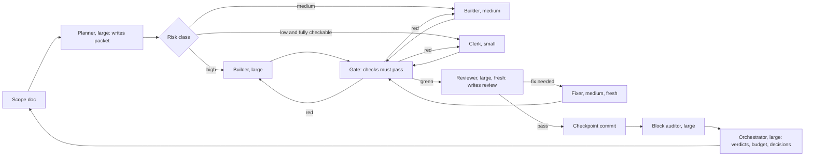
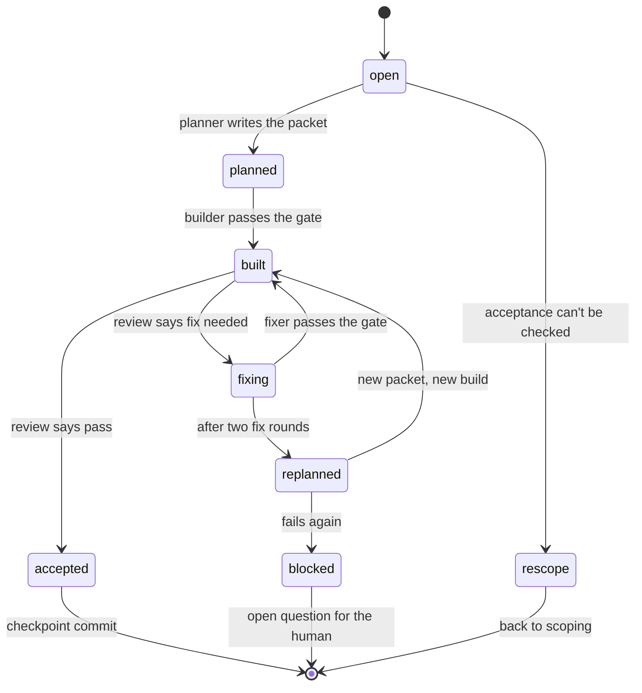
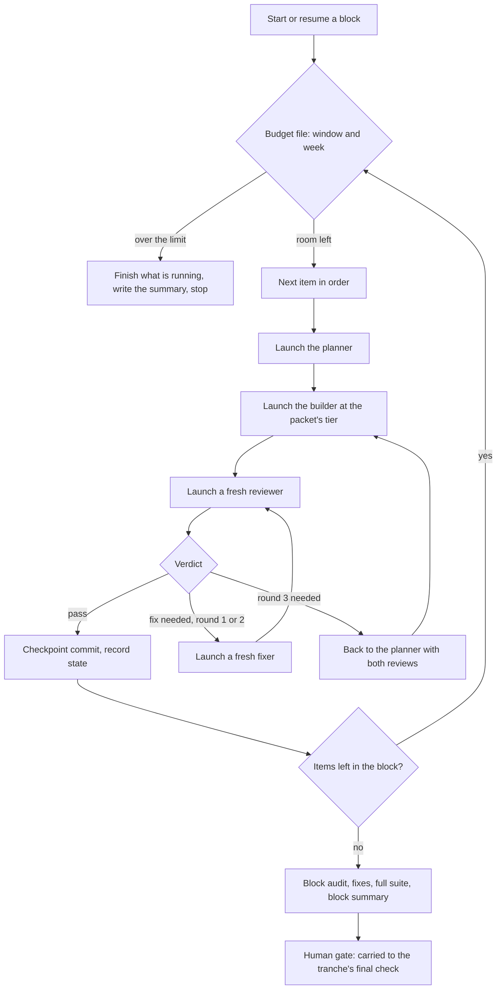
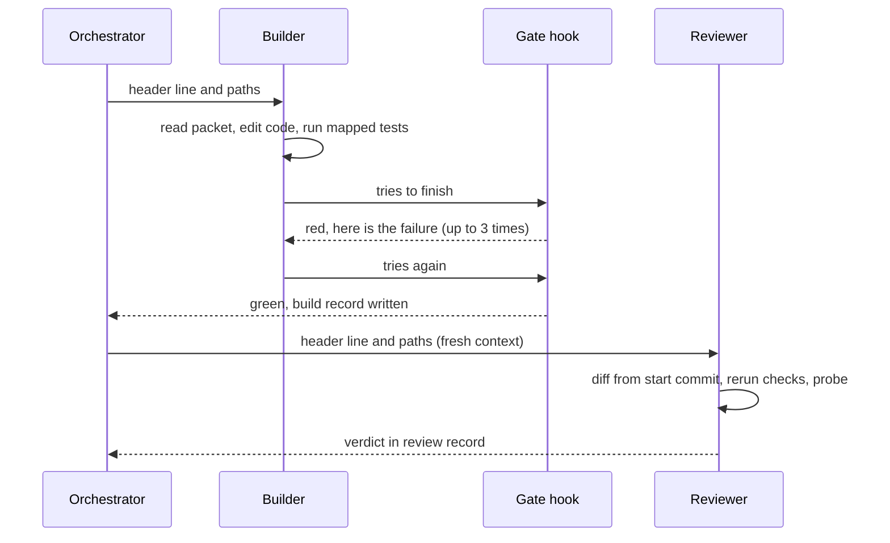
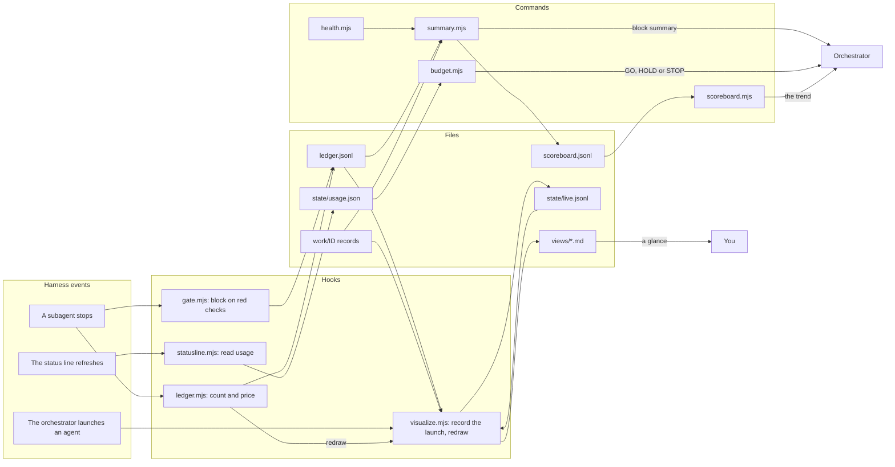

# The sluice: design

**Canon 1 · v0.1 · 2026-10-28.** This is the design of the sluice: its roles, its file formats, its rules for
models, budgets and context, its instrumentation, and how to tell whether each choice is working (§15). It
came from measuring one real project, Star Chart, through six ways of working ([evolution](evolution.md),
[case study](case-study.md)), and from published research ([research](research.md)).

It is a set of bets that keeps evolving, not a claim to be the best sluice for everyone. Everything tied to
today's models and harness is in one table, §14; the rest names models only by tier (small, medium,
large).

The design is intended to prioritize getting the most out of 5 hour blocks on a Claude Pro subscription (the lowest tier of paid Claude Code subscription available as of October 2026), on the firm belief that the organization and prioritization of work can make your dollars go further. It's likely that the broad structure is useful in higher tiers, but all evidence contributing to this design was gathered honoring a certain dedication to tokenMINing that may not be a factor in your workflow. If you want to balance throughput and economics for your own project, keep evolving this self-improving process based on your own metrics - the power is yours!

---

## 1. What this is, and how to adopt it

A way to build a planned batch of software changes with AI agents, unattended for hours at a time, that
is **correct enough that the human's final check finds little**, and **cheap enough to fit a usage
allowance** (a subscription's rolling windows and weekly quota, or an API budget).

It splits the work into roles. A large model plans and judges. The cheapest model that can be checked
does the typing. A machine gate catches what machines can catch. Small files carry the work between
roles, so no agent has to hold the whole history. A minimal set of records shows where the effort
went, so the workflow can keep improving.

**To adopt it in a project,** follow [adopting.md](adopting.md). In short:
1. Copy this repository into the project.
2. Ask a Claude Code session to follow `install/BOOTSTRAP.md`. It installs `template/claude/` as the
   project's `.claude/`, and fills in the check commands for your stack.
3. In a fresh session, scope your next batch of work (§5) and run one block.
4. Read its block summary (§10), and change one thing at a time, guided by the metrics.

---

## 2. Foundations: what the design rests on

Each principle has evidence, from published research (sources in §16) or from the case study. The case
study is a 45-item tranche built by an orchestrator and 62 subagents; its measurements are in
[case study](case-study.md).

| # | Principle | Evidence |
|---|---|---|
| P1 | **Separate the author from the judge.** A fresh reviewer that sees the criteria and the diff, but not the author's reasoning, finds what the author can't | Models rate their own output higher; self-correction without outside feedback makes results worse; dedicated critics catch real bugs (Panickssery; Huang; OpenAI critics). In the case study, reviews were about 0.8% of spend each and caught every blocker: a frozen chart, a file drop that replaced the app, a sync that reported success while emptying the chart. All of them passed the author's own tests |
| P2 | **Ground every judgment in tools.** Reviewers rerun the checks; findings need evidence | Critics with tools improve consistently; agents that reflect on real test results do best (CRITIC; Reflexion) |
| P3 | **Context is the cost.** Every call re-reads the agent's whole context, so the size of what an agent carries sets the bill, more than the price of its model | In the case study, re-reading and re-writing the context was about 80% of spend. A medium-model call cost about as much as a large-model one, because medium-model builders carried twice the context |
| P4 | **Design before you build.** If an item needs a design decision, make it once, up front, with a large model | The costliest loop in the case study (7% of the tranche) ended only when the orchestrator dictated a simpler design after two failed fix rounds. Specification problems are the largest class of multi-agent failures (42%, MAST study) |
| P5 | **Acceptance must be observable.** "Done" is a check anyone can run, not a description | Items whose plan named an observable result passed review in one round. Items whose wording could be met without the intended effect needed rework or turned out to be no-ops |
| P6 | **Machines check what machines can.** Typecheck, lint and tests run before any model reviews | A typecheck failure reached a large-model reviewer as a "blocker" |
| P7 | **Fresh beats resumed for fixes.** A new agent given the findings is cheaper than waking the author, whose cache has gone cold | Resuming expired authors cost 9% of the tranche in cache re-writes alone. A fresh fixer made 11 fixes for about 1% |
| P8 | **The budget window is the bottleneck.** Plan in windows, and see the budget before spending it | The tranche hit its usage cap five times, and 28% of wall-clock time was stalls. Two audits were lost when they were started three minutes before a cap |
| P9 | **One writer at a time; more agents contribute judgment, not edits** | Parallel writers make conflicting implicit decisions (Cognition); coding parallelises less well than research (Anthropic) |
| P10 | **Start simple; add structure only where measurement says so** | Anthropic's guidance on agents; and this doc's own §10 loop |
| P11 | **Deterministic work runs as code, not tokens.** Anything with one right answer (accounting, budgets, checks, summaries) is a script; models keep judgment | A script costs no tokens and runs in about 30 ms. In the case study, orchestration was 19% of spend, and much of it was routine relaying and bookkeeping (§12, *The deterministic layer*) |

---

## 3. The sluice



| Role | Tier | Reads | Writes | Ends when |
|---|---|---|---|---|
| **Scoper** (the main session, with the human) | Large | The human's notes, the code, earlier docs | The scope doc: items, acceptance checks, decisions, open questions | Every item has observable acceptance, and every open question has an answer or a recommendation |
| **Orchestrator** (the main session, autonomous) | Large | The scope doc, verdict lines, the budget file, block summaries | Launch messages, decision records, checkpoint commits, the block summary | The block is accepted, or the budget rule stops it |
| **Planner** | Large, high effort | One item (or batch) from the scope doc, the code it touches, the docs it names | `packet.md`: approach, files, excerpts, acceptance, risk class | The packet passes its own checklist (§6) |
| **Builder** | Large or medium, by risk | `packet.md`, the code | Code, tests, doc changes; `build-<n>.json` | The gate is green |
| **Clerk** | Small | `packet.md` or a fix list | Mechanical edits, summaries, metrics; `clerk-<n>.json` | The gate is green |
| **Gate** | No model: a hook | The working tree | Pass, or the failing output fed back to the agent | All checks pass |
| **Reviewer** | Large, high effort, fresh | `packet.md`, the item's diff, the checks' output | `review-<n>.md` and `review-<n>.json` (the verdict) | Verdict given, with evidence for each finding |
| **Fixer** | Medium, fresh | `packet.md`, the latest `review-<n>.md`, the diff | Code fixes; `fix-<n>.json` | The gate is green |
| **Block auditor** | Large, fresh | The block's diffs, packets and results | `audit.md`: problems across items | Verdict given |

**The fix loop has a ceiling.** After two fix rounds, the item goes back to the Planner with both
reviews: three rounds means the design is wrong, not the typing.

An item's life, as its State line in the scope doc records it:



---

## 4. Inside the nodes

### The orchestrator's loop



The orchestrator reads **verdict lines and counts**, not full reports. A reviewer's findings go
straight to the fixer through `review.md`. The orchestrator decides only what needs deciding: design
conflicts, rule conflicts, escalations. It writes each decision into the scope doc's decision log, with
a note that the human can overturn it. It restarts or compacts at every block boundary, because the
files and the scope doc carry everything it needs.

### The builder and the gate



The builder works from the packet alone. When it tries to finish, a hook runs the project's fast checks
(typecheck, lint, unit tests, and the tests mapped to the files it touched). If any fail, the hook blocks
the finish and hands the failure back. The builder can't report green when the tree isn't. Slow,
whole-suite checks run once per block, not per item.

### The reviewer

The reviewer gets the packet's *acceptance* and *rules*, plus the diff from the item's start commit. It
doesn't see the builder's reasoning. It reruns the checks, may write throwaway probes in a scratch
area, and grades each finding:

| Severity | Meaning | Action |
|---|---|---|
| Blocker | Breaks acceptance, a hard rule, or something that already worked | Must fix |
| Major | Wrong in a way a user or a real environment would hit | Must fix |
| Minor | Correct but fragile, unclear or incomplete | Fix if cheap |
| Nit | Taste | Optional, never a reason for another round |

A finding without evidence (a file and line, command output, a still) isn't a finding.

### The block auditor

It reads across the block's items, looking for interactions no single-item review can see: a migration
plus a new reader leaving a gap, two items changing one rule two ways, the docs drifting from the code.
Its fixes go to one fresh fixer, then the full suite runs.

---

## 5. The scope doc

One markdown file per tranche: the *contract*. Humans read it to know what was agreed. Agents extract
only their own item from it. Its format is rigid where agents read it (fixed labels, one heading per
item) and free where people write (the *Asked* text).

### Outline

```text
# <Tranche name>: scope
Status line: dates, state, links to earlier scopes.

## Goal                      (3–5 lines: what "done" means for the whole tranche)
## Rules                     (standing rules by id, or links to where they live)
## Order and blocks          (blocks in order, the reason for the order, gate per block)
## Items
### <ID> <short title>
- Asked:       the human's words, near verbatim
- Today:       what the code does now (filled in during scoping, with file references)
- Decided:     what will be built, in one paragraph
- Acceptance:  observable checks, one per line (a test or command, and the expected result)
- Risk:        hints for the planner (data, auth, lifecycle, concurrency, none)
- Touches:     files, modules and docs expected to change
- Depends on:  item ids, or none
- State:       open / planned / built / accepted / closed: <why>; plus links to its work files
## Open questions            (id, question, recommendation)
## Decisions                 (date, decision, who decided: human or orchestrator)
```

### Example (simplified)

```markdown
### B7 Partial-history notice
- Asked:       "If some items fail to load history, tell me, and let me retry just those."
- Today:       per-item history failures are swallowed; the player shows Ready
               (src/history/load.ts:212).
- Decided:     the player shows `History partial · N missing · Retry`; Retry refetches only the
               missing items.
- Acceptance:
  - WHEN 3 of 40 items return 503, THE player SHALL show "History partial · 3 missing · Retry"
    (e2e: partial-history.spec, case "three fail").
  - WHEN Retry is pressed and the items now succeed, THE notice SHALL disappear and exactly
    3 requests SHALL be made (unit: retryMissing.test).
  - Items that loaded are never refetched (same unit test).
- Risk:        network failure semantics (medium).
- Touches:     src/history/load.ts, src/panels/Player.tsx, docs/ingestion.md §6.
- Depends on:  none
- State:       accepted; work/B7/
```

### Bundling

- Batch items that **share files**, so that one builder holds them once.
- Keep each batch at **one risk class**, so that one model choice fits.
- Keep a batch to what one builder can finish in well under its context budget (§8). If a packet needs more
  than about 10 files, split it.
- Put items that **make decisions others depend on** first, with their own review. A data migration or a
  shared rule belongs here.

### Is this format proven?

No format has been shown best for agents in general. Studies find that format changes results by up to
40% for small models and much less for large ones, and that the best format varies by model and task
(§16). The design rule that follows is to **be rigid where small models read**: packets and fix lists
use fixed labels and checklists. The case-study evidence is stronger on one point: observable
acceptance cut rework. The `WHEN … SHALL …` phrasing (EARS) is optional; any observable check will do.

---

## 6. The work files

Each item gets a folder, committed with its block: `<progress>/<tranche>/work/<ID>/`. These files
are how the roles talk to each other, and how anyone audits the work later.

### `packet.md` (written by the planner)

```markdown
# Packet B7: Partial-history notice
Risk: medium (network failure semantics) · Builder tier: medium · Effort: medium
Start commit: 3f2a91c

## Acceptance                 (copied from the scope doc, unchanged)
- …

## Approach                   (≤ 15 lines; the design decision, made here, not by the builder)
Collect failed ids in ScopeHistory.missing; the player reads missing.length …

## Files                      (with line ranges to read first)
- src/history/load.ts:180-260   (where failures are swallowed)
- src/panels/Player.tsx:40-95   (the status line)

## Excerpts                   (only the rules and values this item needs, quoted)
- ingestion.md §6: "A 5xx on one item never fails a sync."

## Checks                     (the gate's mapped tests, plus anything new to write)
- unit: retryMissing.test (new) · e2e: partial-history.spec (new) · e2e: player.spec

## Out of scope
- Retrying automatically; changing the sync's own error banner.
```

**The planner's checklist:** acceptance is observable; the approach makes every design decision; files
are listed with line ranges; excerpts quote rather than link; the risk class is justified in one line;
the packet is under about 2,000 words.

### `<role>-<n>.json` (one small record per agent run)

Every agent writes its own record and never edits another's: `plan-1.json`, `build-1.json`,
`review-1.json`, `fix-1.json`, `review-2.json`, and so on. The rounds, the verdicts and first-pass
acceptance can all be read from the file names and their `verdict` fields.

```json
{
  "item": "B7", "role": "builder", "model_tier": "medium", "effort": "medium",
  "verdict": null, "round": 1,
  "findings": {"blocker": 0, "major": 0, "minor": 0, "nit": 0},
  "checks": [{"cmd": "unit", "pass": true, "count": "1316/1316"}],
  "files": ["src/history/load.ts", "src/panels/Player.tsx"],
  "summary": "Missing ids collected; Retry refetches only those; two new tests."
}
```

### `review-<n>.md` (written by the reviewer)

```markdown
# Review B7, round 1 · Verdict: fix needed
1. Major — Retry refetches loaded items when the scope reloads mid-retry.
   Evidence: probe work/B7/probe-reload.test.ts fails: 40 requests, expected 3.
   Acceptance line: "Items that loaded are never refetched."
2. Minor — The notice overlaps the error banner at 900 px wide. Evidence: still work/B7/overlap.png.
Not findings: none of the three nits block.
```

### `ledger.jsonl` (one line per agent run, written by a hook)

The hook knows which item an agent served because every launch message starts with one header line,
`sluice: tranche=<name> item=<ID> role=<role> tier=<tier> round=<n>`. Agents launched without it are
not recorded.

```json
{"t":"2026-11-02T14:05:11Z","item":"B7","role":"reviewer","tier":"large","effort":"high","agent_id":"a1b2","secs":412,"in":3100,"cache_read":1840000,"cache_write":61000,"out":9200}
```

### Above the tranche: `block-<B>.md`, `scoreboard.jsonl` and `retro.md`

Each block gets a note (its summary, its code-health snapshot, what to look at, the orchestrator's
decisions, and the escapes found at the human gate). One `<progress>/scoreboard.jsonl` spans every
tranche, one line per block, so a project can see whether the sluice is getting cheaper and better
without re-reading anything. Each tranche ends with a one-screen `retro.md` written from it. The
formats are in the playbook's `formats.md`.

Beside them, `views/` holds the run drawn as pictures (§10, *The views*): redrawn by the hooks, never
written by hand, and gitignored. Each block's end freezes a copy into `snapshots/block-<B>/`, committed.

---

## 7. Choosing model, effort and context

### Tiers

| Tier | Use it for | Never for |
|---|---|---|
| **Large** | Scoping, planning, reviewing, auditing, orchestrating; building high-risk items | Mechanical edits, log reading |
| **Medium** | Building medium-risk items; fixing from a review | Design decisions; reviews of large-tier work |
| **Small** | Edits an automatic check fully decides (applying a decided fix list, table and link updates, fixture regeneration with a coverage test); read-only work (summarising logs, metrics, searching) | Anything whose correctness a check can't fully decide |

### The risk score (the planner fills it in, in the packet)

Score each factor 0, 1 or 2:

| Factor | 0 | 1 | 2 |
|---|---|---|---|
| **Blast radius** | Docs, copy, isolated UI | Shared code or behaviour inside the app | Persisted data, auth, security, network semantics, concurrency, shared-resource lifecycles |
| **Verifiability** | An automatic check fully decides correctness | Checks cover most of it | Correctness needs judgment or a real environment |
| **Design openness** | Approach fully settled in the packet | Small choices left | Real alternatives remain *(re-plan first)* |
| **Acceptance clarity** | Every line is an executable check | Some lines need a look | Mostly descriptive *(re-scope first)* |
| **Track record** | This item class passed first time at this tier recently | Mixed | Failed first review at this tier recently |

**Tier:** 0–2 → small; 3–5 → medium; 6 or more → large. **Overrides:**
- A blast radius of 2 always means a large builder.
- Small is allowed only with a verifiability of 0.
- A design openness or acceptance clarity of 2 sends the item back before anyone builds it.

The scores are judgment; the sum and the overrides are arithmetic, so `tier.mjs` applies them (P11). The
planner writes the five scores and runs it. In the origin project's v1.4, 1 of 31 plans picked by hand
had broken an override: a small tier with a verifiability of 1.

### Effort

| Role | Effort | Why |
|---|---|---|
| Scoper, planner, reviewer, auditor | High | Judgment is the product |
| Orchestrator | Medium | Mostly routing; raise it for a decision |
| Builder | Medium | The packet holds the design |
| Fixer | Medium; low for doc-only fixes | The review holds the diagnosis |
| Clerk | Low | Mechanical, and gated |

Record effort in the ledger. Only measurement should change these defaults.

### Context budgets

- **Keep orientation small.** An agent's opening context (role file, packet, rules) is re-read on
  every call it makes. The packet's excerpts exist so builders don't read whole docs: in the case
  study, re-reading the opening context was 19% of the tranche.
- **Set an automatic compaction window per role as a safety net** (§14), not as a design tool. A builder
  that approaches it is a sign that the item should have been split.
- **Cap turns** per role, as a guard against runaways.
- **Don't hand agents the conversation.** Pass files, not transcripts.

---

## 8. Cache and idle rules

A cache read costs a tenth of a fresh write. When a cached context expires, the next call re-writes all
of it. Two cache lifetimes are usually offered (§14): short (minutes) and long (an hour), with the long
one costing more per write (about 1.6× the short).

- One re-write of an agent's whole context costs about as much as everything it has written so far. So
  **give the long cache only to a role the ledger shows sitting idle past the short lifetime**. No
  subagent role qualifies yet: in the origin project's first three sluice blocks, 13 builders never paused
  between 5 and 60 minutes, and the long cache's premium was 15% of builder spend for nothing (roadmap
  S3). **Every subagent role is on the short cache.**
- **Never resume an agent whose cache has expired** just to make a small change. Start a fresh one with
  the files (P7).
- **The orchestrator should be on the long cache.** It waits for agents and for the human.
- **Compact or restart the orchestrator at each block boundary.**
- **Ignore duplicate completion notices.** If the harness announces a finished agent twice, the
  second notice needs no reply. In the case study, replying to them cost 2%.

---

## 9. Budgeting in windows

Plan and report in **windows**: the usage allowance's rolling period (§14). In the case study, one
window held about a sixth of the tranche, and bought 4 to 16 items depending on their risk.

- A statusline script writes the current window's and week's used percentage to a state file. The
  orchestrator reads that file before every launch.
- **Above 85% of the window,** start nothing expensive (planner, reviewer, auditor). Finish what is
  running, keep the tree green, and write the summary.
- **Start block audits early in a fresh window.**
- **Above 80% of the weekly quota,** finish the current block, then stop for the human.
- **Estimate in windows:** after one block, the block summary gives spend per item by risk class. Use it
  to size the next block ("Block D ≈ 1.5 windows").
- **Parallel agents spend a window faster; they don't make it go further.** Run them in parallel only for
  independent low-risk items, and only when wall-clock time matters more than the window.

---

## 10. Instrumentation and the evolve loop

Six layers, each one cheap, and all but the first written by scripts:

| Layer | Written by | What it holds | Why it exists |
|---|---|---|---|
| `<role>-<n>.json` per agent run | The agent | Verdict, findings by severity, checks, files, tier, effort, a one-line summary | Semantics that transcripts don't record |
| `ledger.jsonl` | A hook when any agent stops | Time, role, item, tier, tokens by kind | Cost and time without parsing logs later |
| Block summary | A script, at the block's end | The table below, added to the block's note | One screen to judge the block |
| Health snapshot | The same script | Size, very large files, hotspots, dependencies, and the project's own measures (such as a complexity count) | Whether the codebase is getting harder for agents to work in (roadmap L1) |
| Scoreboard | The same script, one line per block | The block's numbers and its health, across every tranche | The trend, which is what an experiment is judged on |
| Views | Hooks, on every launch and stop | The layers above drawn as pictures: now, board, pipeline, timeline, effort | A human can leave a run and know within seconds, on return, what it did and is doing, without asking the orchestrator (roadmap H11) |

### The block summary

```text
Block B · 9 items · 2.4 windows · 6.0 h with agents · stalls 0.4 h
First-pass acceptance   6/9      Fix rounds   1.0 mean, max 2   Re-plans   1 (B5)
Spend by role           build 31% · fix 18% · review 21% · audit 7% · orchestrate 9% · clerk 1%
Spend per item          high 0.40 win · medium 0.18 win · low 0.03 win
Gate blocks             7 (typecheck 4, unit 3)       Escapes (found at the human gate)   —
Largest item            B5: 0.6 win, 3 reviews
```

### The views

Records and ledgers are complete but hard to read at a glance, and asking the orchestrator "where are
we?" costs tokens and interrupts it. So a script draws the run as five Markdown files with Mermaid
diagrams, in `<progressDir>/<tranche>/views/`, for a preview left open beside the run (VS Code's
built-in Markdown preview renders Mermaid, and redraws when a file changes):

| View | Answers | Drawn as |
|---|---|---|
| `now.md` | What is it doing, and what did it do last? | Two lines (`● C3 · fixer r1 · 6 min`; `Last · 14:43 · C3 reviewer r1 → fix needed: 1 blocker`), what waits for which role, the pipeline with each item on its node, the last runs |
| `board.md` | Where does every item stand? | A table, a row per block and a column per state, every item a link to its packet; then what's in flight; then each item's runs, reviews, time and cost |
| `pipeline.md` | Which paths does the work take? | The §3 graph, each edge counted from the ledger (dotted: never taken), and each item's path (`planner → builder → reviewer ✗ → fixer → reviewer ✓`) |
| `timeline.md` | When did each agent run, and how long? | A gantt per day, a bar per agent run: idle gaps, parallel runs, the runs that asked for a fix |
| `effort.md` | What did it cost, and where did it go? | Cost per item and per day, spend from model to role to block, agent time by role, and the block table |

How they stay true and cheap:
- **One snapshot, many views.** `sluice-state.mjs` reads the scope doc's State lines, the run records,
  the ledger and the launches into one snapshot; `visualize.mjs` draws every view from it. When a file
  format changes, the parser changes, and the views follow.
- **Redrawn by the hooks, not by a model.** A `PreToolUse` hook on the Agent tool records each sluice
  launch's header line in `.claude/state/live.jsonl` (no file is written when an agent *starts*, so
  without it a running agent is invisible) and redraws; the ledger hook redraws when an agent stops.
  `--watch` adds scope-doc edits and a once-a-minute refresh of the clocks. No tokens are spent.
- **Live, then frozen.** `views/` changes on every launch, so it's gitignored: the orchestrator commits
  with `git add -A`, and a dirty tree stops `/sluice run`. At a block's end, `--freeze <B>` writes the
  same views, dated by the block's last run, to `snapshots/block-<B>/`, committed with the block. The
  package's `examples/progress/v0.4/snapshots/block-A/` shows one.
- **Calm by design.** The key picture comes first and any text after it is supporting; a stable graph
  whose labels change, rather than one that re-lays itself out; one accent colour for *running*, a
  dashed outline for *waiting*, and bar colours (slate, crimson, ochre) dark enough for white labels (WCAG AA).

Markdown with Mermaid was chosen over a web page, an editor extension and a hosted board (such as a
GitHub Project) because it needs no server, dependency or account, lives beside the record it draws,
and renders in the editor and on GitHub alike. A live HTML page could later read the same snapshot.

### The metrics, and what each one steers

| Metric | Steers |
|---|---|
| **First-pass acceptance** by tier and item class | The risk score's thresholds, and the builder tier |
| **Fix rounds; re-plans** | Planner quality; whether design happens early enough |
| **Rework share** (fix spend ÷ build and fix spend) | Packet and acceptance quality |
| **Reviewer precision** (findings acted on ÷ findings raised) | The reviewer's severity bar |
| **Gate blocks** by check | What the gate catches that review shouldn't have to |
| **Spend per item in windows**, by risk class | Block sizing, and the next windows' plan |
| **Escapes**: defects the human finds at the final check | **The pipeline's real quality: the number that matters most** |

### The evolve loop

At the end of each tranche, `/sluice retro` writes the tranche's `retro.md` from the scoreboard and the
block notes:
1. Read the scoreboard: this tranche's blocks against every earlier tranche.
2. Pick **one** metric that is worst against its target (§15) or its baseline.
3. Change **one** thing (a threshold, a tier, a prompt line, a check), logged as a roadmap hypothesis
   with the signal that will settle it.
4. Run the next tranche, and compare.

One tranche is one sample. The scoreboard makes the trend visible; it can't make a small difference
mean something.

For a decision that matters, such as moving a role to a cheaper tier, run a **replay trial**. Build the
same two or three items both ways in separate worktrees, and compare first-pass acceptance and spend.

---

## 11. Guardrails

They guide; they don't script every step.

- **One writer per file at a time.** Reviewers and auditors never edit.
- **Stay inside the item.** Note neighbouring problems under *Known limitations*; don't fix them.
- **Evidence or it isn't a finding.** Nits never trigger a round.
- **Two fix rounds, then re-plan.**
- **Decide and record, don't stall.** The orchestrator decides what it can and writes each decision into
  the scope doc for the human to overturn. It stops only for taste, for anything irreversible, or for
  the budget.
- **The gate is not negotiable.** No agent reports green when the gate is red, and no blanket
  snapshot or golden updates.
- **State lives in the repo,** never in temporary folders.
- **Checkpoint commits** on a work branch after each accepted item. The human squashes or merges per
  block.
- **The human gate sits at the end of a tranche** (or of a block, if the human asks). The orchestrator
  carries gates forward rather than stopping at each one.
- **Hard project rules** (secrets, real data, what the app may never do) live in the project's
  always-loaded instructions, and are repeated in the reviewer's checklist.

---

## 12. Implementing it in Claude Code

### Options considered

| Option | Chosen? | Why |
|---|---|---|
| **The main session as orchestrator, a role file per agent, a playbook skill** | **Yes** | It can talk to the human, read the budget, and make design calls mid-run; its cost stays low with verdict-only reading and a restart per block |
| A workflow script per block | Not now | No orchestrator tokens, but no mid-run input, no sight of the budget, and design calls need a "decider" agent. Worth a trial once the sluice is stable |
| A packaged plugin | Later | Portable, but plugin agents ignore hooks and permission settings, so the hooks move to the plugin's own file; harder to change while the design is young |

### Files

```text
.claude/
  agents/
    planner.md        large · effort high  · read-only plus writes its packet
    builder.md        tier chosen per launch · effort medium · gated
    clerk.md          small · effort low   · gated
    reviewer.md       large · effort high  · read-only tools (writes only its review)
    fixer.md          medium · effort medium · gated
    auditor.md        large · effort high  · read-only tools
  skills/
    sluice/             the orchestrator's playbook: the loop, budget rules, file formats
      SKILL.md
      formats.md      templates for packet, result, review, summary
      heuristics.md   the risk score and tiers
    item-contract/    preloaded into every role: hard rules, output format, the work-file paths
      SKILL.md
  sluice/
    config.json       the project's specifics: work-file folder, gate commands, budget limits, prices
    project.md        the project's notes for the agents: sources of truth, review lenses, how to verify
    gate.mjs          SubagentStop hook; acts on the writer roles only: runs the fast checks; exit 2 with the tail
    ledger.mjs        SubagentStop hook: one ledger line per agent run (replaces its earlier line)
    statusline.mjs    writes the window and week percentages to .claude/state/usage.json
    budget.mjs        prints go, hold or stop against the budget limits; the orchestrator runs it
    summary.mjs       turns the ledger and the run records into a block summary; records the scoreboard
    sluice-state.mjs    the sluice's state as one snapshot: scope-doc items, run records, ledger, launches
    visualize.mjs     the views: Markdown + Mermaid (now, board, pipeline, timeline, effort), redrawn by the hooks
    health.mjs        the code-health snapshot: size, large files, hotspots, project measures
    scoreboard.mjs    every block of every tranche, and the totals per tranche
    tier.mjs          the builder's tier from the planner's risk score: the sum and the overrides
    with-lock.sh      serialises commands that share a build folder, when agents run in parallel
    selftest.mjs      checks every hook and script on synthetic data, and the install against the package
  state/              gitignored: usage.json, gate counters
  settings.json       the statusline and the ledger hook
```

### A role file (the builder, as implemented)

```markdown
---
name: builder
description: Sluice role. Builds one item or batch from its packet.md (code, tests, the docs the packet names) and writes build-<n>.json. Launched by the sluice orchestrator after the planner; the orchestrator passes model "opus" for large-tier items.
model: sonnet
effort: medium
maxTurns: 200
autoCompactWindow: 200000
disallowedTools: Agent
skills: [item-contract]
---
You build one item from its packet. The packet's Approach is decided: follow it. If it can't work as
written, stop, set the verdict to `blocked`, and say exactly why in your record. Don't redesign.

Write the code, the tests the packet's Checks name, and the doc changes it lists, including any value
that has a row in a reference table (change the row in the same edit). Run the packet's mapped tests.
Write `build-<round>.json` with the checks you ran and their results, the files you changed, and any
deviation or limitation.
```

The orchestrator passes `model: "opus"` when it launches a builder for a large-tier item. The other role files are
the same shape: the planner, reviewer and auditor run on the large tier at high effort; the fixer runs on the medium tier,
and the clerk on the small tier at low effort. The gate applies to the builder, fixer and clerk.

### The gate

`gate.mjs` runs the commands listed under `gate` in `config.json` (typically typecheck, lint, unit tests). If one
fails, it exits 2 with the last 40 lines, which blocks the agent's finish and hands it the failure.
After three blocks in a row for the same agent, it lets the agent stop, but records the gate as red, and
the orchestrator treats the item as failed. A gate that can block forever costs more than it saves.

### The deterministic layer: scripts and hooks

**The rule: if the same input always gives the same correct answer, it's code, not a model call.**
Counting tokens, deciding whether the window has room, running the checks, writing a ledger line and
adding up a block's numbers have exactly one right answer each. A model asked to do them spends tokens
re-reading its whole context, may get them subtly wrong, and can be talked out of a rule it should
enforce. A script costs no tokens, runs in about 30 ms, gives the same answer every time, can't be argued
with, and is tested by the self-test.

The models keep what needs judgment: scoping with the human, designing, building, reviewing, deciding
conflicts. The scripts keep the arithmetic, the bookkeeping and the rules.



**How it works.** Scripts run in two ways:
- **Hooks,** which the harness runs on its own events. Each receives the event as JSON on stdin (the
  agent's id, its type, and the path to its transcript). The gate's exit code is the harness's signal:
  2 blocks the agent and hands it the failure.
- **Commands,** which the orchestrator (or a person) runs, reading one line of output.

Hooks and commands talk to each other only through files: the state folder, the ledger and the run
records. Every script reads its project specifics from `config.json`. Transcript parsing lives in one
function in `lib.mjs`, because the transcript format belongs to the harness and may change.

| Script | Kind | Run by | Purpose | Example |
|---|---|---|---|---|
| `gate.mjs` | Hook (`SubagentStop`) | The harness, when any subagent stops | For sluice agents in the writer roles (`gateRoles`), runs the fast checks in `gate`. On a failure, exits 2 with the last 40 lines, so the agent can't finish red. Gives up after `gateMaxBlocks`, marked red. Writes its result into the agent's ledger line | Automatic. By hand: `node .claude/sluice/gate.mjs --run` runs the checks once (exit 0 green, 1 red) |
| `ledger.mjs` | Hook (`SubagentStop`) | The harness, when any subagent stops | For agents launched with a `sluice:` header, sums the transcript's usage (each streamed response counted once), prices it, and writes one line to `<progressDir>/<tranche>/ledger.jsonl`. A later stop of the same agent replaces its line | Automatic. Inspect: `tail -1 docs/sluice/v0.4/ledger.jsonl` |
| `statusline.mjs` | Statusline command | The harness, when the status line refreshes | Prints the model and the 5-hour and weekly usage, and records them in `.claude/state/usage.json` for the budget check | Automatic: shows `Opus · 5h 42% · wk 18%` |
| `budget.mjs` | Command | The orchestrator, before every launch | Compares the recorded usage with `budget` and prints one word: `GO`, `HOLD` (the window is nearly spent: start nothing expensive), `STOP` (the week is nearly spent: finish the block) or `UNKNOWN` | `node .claude/sluice/budget.mjs` → `GO window 42% (resets 8:06 AM), week 18%, data 0 min old` |
| `summary.mjs` | Command | The orchestrator at a block's end, or a person | Reads the ledger and the run records, and prints the block summary (§10): first-pass acceptance, fix rounds, findings, spend by role and per item in windows, gate blocks. Adds the orchestrator's approximate spend from the session transcripts. With `--write`, also puts the summary and the health snapshot in the block note, and the block's line in the scoreboard | `node .claude/sluice/summary.mjs v0.4 --block A --write` |
| `health.mjs` | Command | `summary.mjs --write`, or a person | The code-health snapshot (roadmap L1), from git and the file tree: files and lines, files over `largeFileLines`, hotspots (changes in the last `hotspotCommits` commits × lines), dependencies, and one line from each of the project's `health.commands` | `node .claude/sluice/health.mjs` → `Hotspots  GraphScene.ts 16/29 commits (1,831 lines) · …` |
| `scoreboard.mjs` | Command | `/sluice retro`, or a person | Prints every recorded block, with escapes counted from the block notes, then the totals per tranche: windows per item, first-pass acceptance, fix rounds, escapes per item. `--md` for a markdown table | `node .claude/sluice/scoreboard.mjs --md` |
| `tier.mjs` | Command | The planner, after scoring | Reads `plan-<n>.json`'s five risk scores and applies §7's sum and overrides. With `--write`, puts `score.sum` and `tier` in the file, and `needs` when it's still empty. Exits 1 on a missing or out-of-range score | `node .claude/sluice/tier.mjs docs/sluice/v0.4/work/A1/plan-1.json --write` → `medium sum=3 (sum 3)` |
| `with-lock.sh` | Command wrapper | Agents running in parallel | Runs a command while holding a lock, for commands that share a build folder or port (`lockedCommands`). Clears a lock whose holder has died | `.claude/sluice/with-lock.sh npm run e2e` |
| `selftest.mjs` | Command | A person, after installing or changing the sluice | Runs every script against synthetic transcripts and a small synthetic git repository in a temporary folder (36 checks; the drift check and `--real-gate` add one each). When the package sits in the same repository, also checks that `.claude/` still matches its `template/claude/`, apart from the project's own values (its keys must match). With `--real-gate`, also runs this project's gate once on the real tree | `node .claude/sluice/selftest.mjs --real-gate` → `All 38 checks passed.` |
| `visualize.mjs` | Hook (`PreToolUse` on Agent) and command | The harness, when the orchestrator launches an agent; the ledger hook, when one stops; a person | Records a sluice launch (its header line) in `.claude/state/live.jsonl`, then redraws `<progressDir>/<t>/views/`: **now** (what's running, what finished last, what waits, the pipeline with each item on it), **board** (a table: a row per block, a column per state, every item a link to its packet; then what's in flight, and each item's runs, reviews and cost), **pipeline** (the §3 graph, each edge counted from the ledger, each item on its node, and each item's path), **timeline** (a gantt per day, one bar per agent run), **effort** (cost per item and per day, spend from model to role to block, agent time by role, the block table and the scoreboard). The views read only `sluice-state.mjs`'s snapshot, so a format change touches one parser. Never blocks a launch | Automatic. By hand: `node .claude/sluice/visualize.mjs <t> --watch` (redraws on any change); `--freeze <B>` at a block's end |
| `lib.mjs` | Library | The other scripts | Shared helpers: config, paths, reading the launch header, finding a subagent's transcript, summing usage, pricing, patching the ledger | — |
| `config.json` | Data | Every script | The project's specifics: paths, gate commands, budget limits, health measures, prices, the window's capacity | — |

**What it buys, in the case study's terms:**
- **The gate** turns "remember to run the checks" into a rule an agent can't skip. In the case study, a
  typecheck failure reached a large-model reviewer as a blocker.
- **The budget check** gives the orchestrator a sense it didn't have. In the case study, two audits were
  started three minutes before the cap and lost.
- **The ledger, the summary and the scoreboard** replace a hand-made retrospective. The case study's
  numbers were assembled from transcripts after the fact; the sluice writes them as it goes, at no token
  cost, and keeps them across tranches.
- **The health snapshot** measures what the case study could only guess at: whether the code the agents
  work in is getting larger, more tangled and more often rewritten.
- **The views** let a human leave a run and read it on return in seconds, from pictures redrawn by
  hooks, instead of reading JSON or spending orchestrator tokens on "where are we?".
- **The drift check** keeps the installed copy honest. Process changes are made in the package and
  copied in; the self-test names any file that was changed in one place only.

What is still done by a model but could be code, and what that might save, is tracked in
[roadmap.md](roadmap.md) (*The deterministic layer*).

### Process and project: two kinds of knowledge

The sluice keeps two kinds of knowledge apart, so that the process can evolve upstream while each project
keeps what makes its reviews sharp:

| Kind | Lives in | Changed by | Upgraded by |
|---|---|---|---|
| **Process**: roles, formats, thresholds, scripts | `agents/`, `skills/`, `sluice/*.mjs` | Proposing it upstream, as a hypothesis (roadmap.md) | Re-installing from the package |
| **Project**: commands, paths, rules, review lenses | `config.json`, `project.md`, CLAUDE.md, the scope doc | The project, whenever a review or an escape teaches something | Never touched by an upgrade |

In the case study, the reviews' sharpest catches came from project knowledge: a reference-table rule, a
shared-texture lifecycle, how an API's 401s behave. The project notes give that knowledge one place
that every planner, reviewer and auditor reads, at a fixed cost of under about 800 words per call.

### How to invoke it

| Command | What it does |
|---|---|
| `/sluice scope <notes or a file>` | The scoper: turns notes into a scope doc in §5's format, in rounds of questions |
| `/sluice run <scope doc> [block]` | The orchestrator: runs the loop in §4 over a block, or the next open block |
| `/sluice summary <tranche> [block]` | The block summary (§10), from the ledger and the run records |
| `/sluice retro <tranche>` | The tranche's retrospective (§10), from the scoreboard and the block notes |
| `/sluice status` | The budget and the state of each item |
| `/sluice views [tranche]` | Draws the views (§10) and says where they are; the hooks keep them current after that |

### Settings

```json
{
  "statusLine": { "type": "command", "command": "node \"${CLAUDE_PROJECT_DIR:-.}/.claude/sluice/statusline.mjs\"" },
  "hooks": {
    "PreToolUse": [ { "matcher": "Agent|Task", "hooks": [
      { "type": "command", "command": "node \"$CLAUDE_PROJECT_DIR/.claude/sluice/visualize.mjs\" --hook-start", "timeout": 15 } ] } ],
    "SubagentStop": [ { "hooks": [
      { "type": "command", "command": "node \"$CLAUDE_PROJECT_DIR/.claude/sluice/gate.mjs\"", "timeout": 900 },
      { "type": "command", "command": "node \"$CLAUDE_PROJECT_DIR/.claude/sluice/ledger.mjs\"", "timeout": 30 } ] } ]
  }
}
```

**Why the gate lives in settings, not in the role files.** The first design put it in the writer roles'
own frontmatter as a `Stop` hook, and in its first live test that hook didn't fire. The settings-level
`SubagentStop` hook did fire, in a fresh session: it passed a clean tree, and on a broken test it blocked
the agent three times, handed it the failure each time, then let it stop marked red. Plugin agents ignore
frontmatter hooks anyway. So the gate is one settings-level hook that acts only on sluice agents in the
writer roles (`gateRoles` in `config.json`). Hooks are read when a session starts: after changing them,
start a new session.

**The launch hook never blocks.** It matches the Agent tool (named `Task` in older harness versions),
acts only on prompts that start with a `sluice:` header, always exits 0, and writes nothing to stdout, so
a fault in the views can't stop a launch.

The project's linter must accept the scripts, which are plain Node. In the case study that meant giving
`.claude/sluice/**/*.mjs` Node's globals in the ESLint config, which the gate caught on its first run.

In this repository the parts live in `template/claude/` (no dot, so Claude Code doesn't load them as
the package's own configuration). Installing copies them to the project's `.claude/`.

---

## 13. Glossary

| Term | Meaning here |
|---|---|
| **Tranche** | A planned body of work with one scope doc and one final human check (a version, a milestone) |
| **Block** | A group of items inside a tranche, built and audited together |
| **Item** | One change with its own acceptance; **batch**: items built together because they share files and risk |
| **Scope doc** | The tranche's contract: items, acceptance, decisions, open questions (§5) |
| **Packet** | The planner's per-item brief: approach, files, excerpts, acceptance, risk (§6) |
| **Acceptance check** | An observable test of "done": a command or test and its expected result |
| **Risk class / tier** | The planner's score (§7), and the model size it selects: small, medium, large |
| **Gate** | The machine check that must pass before an agent may finish |
| **Verdict** | A reviewer's *pass* or *fix needed*; **finding**: one graded problem, with evidence |
| **Fix round** | One fixer pass after a *fix needed* verdict; **re-plan**: the item returns to the planner |
| **First-pass acceptance** | The share of items whose first review says *pass* |
| **Rework share** | Fix spend ÷ (build spend + fix spend) |
| **Escape** | A defect the human finds at the final check |
| **Window** | The usage allowance's rolling period; the unit for planning and reporting spend |
| **Orientation context** | What an agent reads before it starts working; re-read on every later call |
| **Idle re-write** | A cache expiry while an agent waits, forcing its whole context to be written again |
| **Deterministic layer** | The scripts and hooks that do everything with one right answer (checks, accounting, budgets, summaries), so no model spends tokens on it (§12) |
| **Ledger** | One line per agent run: role, tier, time, tokens |
| **Project notes** | The project's own knowledge for the agents: sources of truth, review lenses, ways to verify. Process knowledge stays in the sluice |
| **Block summary** | The one-screen report at a block's end (§10) |
| **Decision record** | A line in the scope doc's decision log: the date, the decision, and who made it |
| **Checkpoint commit** | A commit per accepted item on a work branch, squashed or merged by the human |

---

## 14. The current moment

**Update this table when models, prices or the harness change. Nothing else in this doc should need
to.** As of 2026-10-28:

| Concept | Today |
|---|---|
| Large tier | Claude Opus 5.5 (`opus`): $4 in / $20 out per million tokens; cache read $0.20 |
| Medium tier | Claude Sonnet 5.5 (`sonnet`): $2 / $10; cache read $0.10 |
| Small tier | Claude Haiku 5.5 (`haiku`): $0.10 / $0.50 for prompts up to 100K tokens ($0.50 / $2.50 beyond) |
| Context windows | 1M tokens on all three |
| Harness | Claude Code 2.1.3xx |
| Role knobs (agent frontmatter) | `model`, `effort` (low–max), `maxTurns`, `autoCompactWindow` (100,000–1,000,000), `skills` (preloads the full skill), `tools` / `disallowedTools`, `omitClaudeMd`, `isolation: worktree`, `experimental.cacheTtl` |
| Model per launch | The Agent tool's `model` (aliases only) overrides the role file |
| Gate mechanism | A settings-level `SubagentStop` hook; exit code 2 blocks the finish and returns stderr. Verified live, including blocking and giving up red. Hooks load when a session starts |
| Cache lifetimes | Short 5 min (subagent default), long 1 h (main-session default on a subscription). Settings `promptCacheTtl`, `subagentPromptCacheTtl`, or per agent. A long-cache write is 2× the input price against 1.25× for a short one |
| Budget signal | The statusline input's `rate_limits.five_hour` and `rate_limits.seven_day` used percentages (subscription plans) |
| Usage allowance | Rolling 5-hour windows, plus a weekly quota |
| A subagent's starting context | Its role file, the launch message, CLAUDE.md (unless omitted), git status, preloaded skills. **Not** the main session's system prompt or history |
| Telemetry | Optional OpenTelemetry (`CLAUDE_CODE_ENABLE_TELEMETRY`). Custom agent names show as `custom`, so the ledger is the attribution |

---

## 15. Experiments: how to tell whether each choice is right

Every choice in this doc is a bet made from one case study. This section is the place to come back to
when one of them starts to look wrong. Judge from block summaries (§10), never from one item, and give a
change two blocks before deciding.

### The whole sluice, against its baseline

The baseline is the case study's last tranche, built with a medium-tier implementer, a large-tier
reviewer per batch, a resumed implementer for fixes, and an orchestrator that relayed full reports
([case study](case-study.md)).

| Metric | Baseline | Working if | Failing if |
|---|---|---|---|
| First-pass acceptance | 7 of 24 batches (29%); medium-tier builders 4 of 21 | 60% or more | Under 40% after two blocks |
| Rework share | About 45% of implementer spend | 25% or less | Over 35% |
| Orchestration share | 19% of spend | 10% or less | Over 15% |
| Work cut off at the cap | 4 agents killed, 2 audits lost | None | Any lost run |
| Spend per medium-risk item | About 0.1 window (0.27 in the riskiest block) | Under 0.08 window | Over the baseline |
| Escapes at the human gate | None found in the first two blocks | At most one per tranche | Two or more |

**If three or more rows fail after two blocks,** go back to the baseline sluice and re-examine the
choices below one at a time, rather than all at once.

### Each choice

| Choice | Alternative to try | Working if | Failing if | To switch |
|---|---|---|---|---|
| **Main-session orchestrator** | A workflow script per block, with a decider agent for escalations | Orchestration under 10%; each orchestrator turn either launches, decides or reports | Over 15%, or most turns only relay | Script the per-item loop; keep the main session for scoping, decisions and block ends |
| **A planner before every build** | Plan only medium and high risk; or let a large builder plan for itself | Re-plans under one per block; builders rarely say "the approach can't work" | Planner spend exceeds the rework it removes; packets restate the scope without deciding anything | Skip the planner for low risk first, then measure |
| **Builders routed by risk** | All large; or all medium (the baseline) | Medium-tier first-pass 60% or more, at a lower spend per item than large | Medium-tier first-pass under 40%, or fix rounds above 1.5 on medium items | Lower the large threshold in §7, or reweight the factors |
| **A small-tier clerk** | Medium for everything | Clerk work passes the gate first time 80% of the time; reviews find no majors in it | Repeated gate loops, or majors in clerk work | Narrow the clerk to read-only work |
| **A blocking gate hook** | The checks as an instruction only (the baseline) | Gate blocks happen, and reviews stop reporting typecheck-class failures | Agents loop on the gate (three blocks), or the gate dominates agent time | Trim it to typecheck and unit tests; move lint to the block's end |
| **Fresh fixers** | Resume the builder (the baseline), but only while its cache is warm | Fix spend per finding falls; findings don't return in round 2 | The same finding returns after a fix (the fixer misread it) | Resume the builder when its last call was under five minutes ago |
| **A large, fresh reviewer for every item** | A medium reviewer for low-risk items | Escapes stay near zero; reviewer precision 70% or more | Precision under 50% (noise), or escapes appear | Tighten the severity bar; add a refutation pass for majors |
| **Two fix rounds, then re-plan** | Three rounds | Re-planned items pass within one round | More than one item in five re-planned | Raise the planner's effort; require more executable acceptance |
| **Heading blocks with executable acceptance** | Table rows (the baseline) | Items with executable acceptance pass first time; agents read only their item | Acceptance lines no one can check; reviewers argue about intent | Require one named test per acceptance line at scoping |
| **Short cache for every subagent role** (reverted from the long cache for builders; roadmap S3) | The long cache for roles that idle | Idle re-writes stay near zero | The ledger shows gaps of 5–60 minutes between a role's calls | Put that role on the long cache |
| **Checkpoint commits on a work branch** | Leave everything uncommitted for the human (the baseline) | Each review sees exactly one item's diff; rollbacks are one command | The branch is noisy to merge, or commits capture half-done work | Squash per item, or commit only at block ends |
| **Budget limits of 85% (window) and 80% (week)** | Run to the cap (the baseline) | No run is cut off | Blocks end with much of the window unused | Raise to 90%, or exempt clerk runs |
| **Committed work files** | Gitignore the packets and reviews, keep the records | Metrics can be recomputed from git; the files stay small | The history is noisy, or the work folders grow past a few hundred KB per block | Gitignore `packet.md` and `review-*.md`, and keep the JSON |
| **Project notes read by every judge** | Only CLAUDE.md and the scope doc carry project knowledge | Reviews cite project lenses in their findings; escapes of a known class stop | Notes grow past about 800 words, or reviews quote lenses that don't fit the item | Trim to the lenses with recent catches; move long material to docs and point to it |
| **Serial builders in one tree** | Parallel builders in separate worktrees | The window, not the clock, is what ends each run | Windows end with budget left over and work waiting | Use worktrees for independent low-risk items |

### Open doubts

The calls this design is least sure of (whether the planner pays for itself, whether medium builders with
packets are reliable, the risk score's thresholds, the gate's cost) are
tracked as hypotheses in [roadmap.md](roadmap.md), with how each will be tested and what would settle it.

---

## 16. Rollout

**In a new project:** see [adopting.md](adopting.md). It covers the bootstrap, the first session's prompt,
and what to do before the first block (for a project without tests, make the gate real first).

**Open questions to settle by measurement** live in [roadmap.md](roadmap.md), so there is one list to
grow and settle.

---

## 17. Sources

- Self-correction and critics: Huang et al., *LLMs cannot self-correct reasoning yet*, ICLR 2024,
  https://arxiv.org/abs/2310.01798 · CRITIC, https://arxiv.org/abs/2305.11738 · Reflexion,
  https://arxiv.org/abs/2303.11366 · Panickssery et al., *LLM evaluators recognize and favor their own
  generations*, https://arxiv.org/abs/2404.13076 · *LLM Critics Help Catch LLM Bugs*,
  https://arxiv.org/abs/2407.00215
- Multi-agent design and cost: Anthropic, *Building effective agents*,
  https://www.anthropic.com/engineering/building-effective-agents · *How we built our multi-agent research
  system*, https://www.anthropic.com/engineering/multi-agent-research-system · *Harness design for
  long-running apps*, https://www.anthropic.com/engineering/harness-design-long-running-apps · Cognition,
  *Don't build multi-agents*, https://cognition.com/blog/dont-build-multi-agents · MAST, *Why do
  multi-agent LLM systems fail?*, https://arxiv.org/html/2503.13657v2
- Formats: *Does prompt formatting have any impact on LLM performance?*, https://arxiv.org/abs/2411.10541 ·
  *Format Matters* (LREC 2026), https://aclanthology.org/2026.lrec-1.593/ · on spec-driven development and
  EARS (practitioner guides; no independent evaluation found), https://ssojet.com/blog/prd-spec-templates-ai-agents
- Claude Code: subagents https://code.claude.com/docs/en/sub-agents.md · hooks
  https://code.claude.com/docs/en/hooks.md · prompt caching https://code.claude.com/docs/en/prompt-caching.md ·
  statusline https://code.claude.com/docs/en/statusline.md · workflows https://code.claude.com/docs/en/workflows.md ·
  plugins https://code.claude.com/docs/en/plugins/components.md · monitoring
  https://code.claude.com/docs/en/monitoring-usage.md
- The case study: [evolution](evolution.md), [case study](case-study.md), and the longer research survey in
  [research](research.md).

**Update when:** a tranche's evolve loop changes a default; or models or the harness change (§14 only); or when §15's signs say a choice has failed.
