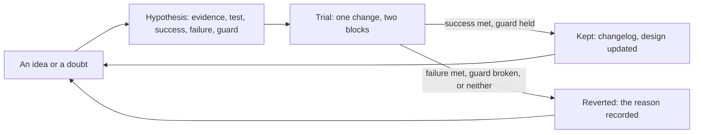
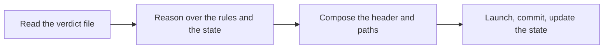
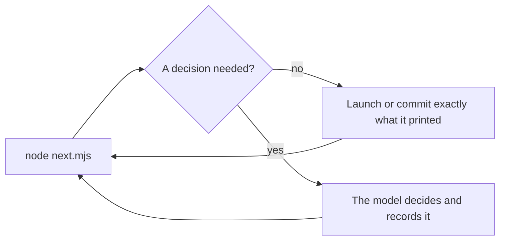
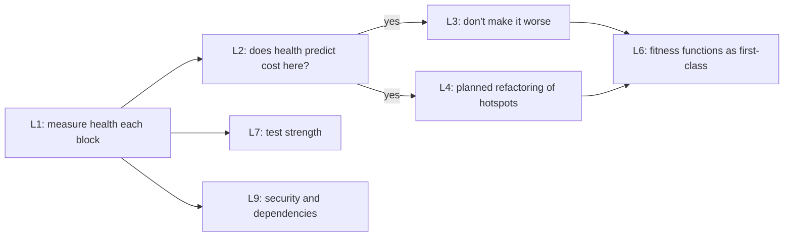

# Roadmap: hypotheses and planned improvements

The sluice changes by experiment, not by opinion. This is the list of what might make it better: each
idea written as a **hypothesis**, with the evidence so far, how to test it, and what would count as
proof either way. When a trial ends, the entry moves to *Settled*, and the change (if kept) goes into
the [changelog](../CHANGELOG.md).

**Rules for a trial** (from the design's evolve loop, §10):
- **One change at a time.** Run it for at least two blocks, and judge it from the block summaries, never
  from one item.
- **Project or process?** A trial that changes the *process* (roles, thresholds, scripts) runs in one
  project, and is marked in that tranche's block notes as `trial: H<n>`. If kept, it's proposed
  upstream with its summaries. Project knowledge (the project notes) needs no trial: add the lens when
  the evidence appears.
- **Write the signals down before the trial,** so the result can't move the goalposts. No entry goes on
  trial until it has all three (below).

## How an improvement is judged

Every entry carries three signals, each a number or an event you can find in the ledger, the run
records, the block notes or git:
- **Success (keep):** what must happen for the change to stay.
- **Failure (revert):** what, if it happens, ends the trial early or reverts the change, even if the
  success line was also met.
- **Guard:** the quality the change must not cost. A change that saves tokens and breaks its guard has
  failed. Most entries use the standard guard below; an entry names its own when it needs one.

**The standard guard.** A trial that cuts cost fails if any of these happen:
- an escape past item review, at the block audit, the final check or a human gate, of a kind the old
  process would have caught;
- Blockers and Majors found per review fall while the reviewer's tier also changed. First-pass
  acceptance only counts as better when the reviewer stayed the same; doc 28 showed a cheaper reviewer
  says yes more often;
- the full suite at the block's end goes red on something an item's checks passed.

**Noise.** Blocks hold 3 to 21 items, and spend per item varied six-fold by block, mostly with risk:
- judge rates over at least 10 reviewed items, usually two blocks; a difference of one or two items is
  noise;
- compare spend per item within a risk band (score ≤ 2, 3–4, 5 or more), not across block totals; a change
  under about 20% per item is noise;
- write down the comparison block before the trial starts.

**Inconclusive.** If neither success nor failure is met by the end of the trial, revert. The default is
no change. The exception: deterministic code with no token cost and no quality risk stays as a tool,
and is marked unproven.

**What can't be measured yet.** Some signals need an instrument that doesn't exist. Each entry's *Needs*
names it, and the instrument is built before the trial, not during it.

### Baselines: Star Chart v1.4, as of 2026-11-07

From `scoreboard.jsonl` and the tranche's ledger. *Rework* is fix ÷ (build + fix) spend (H1's measure).
F is mid-block: 5 items accepted, F4b waiting on its second review, and no block note written yet.

| Block | Items | $ per item | Windows per item | First-pass | Fix rounds (mean) | Rework | Planner | Reviewer | Orchestrator | Blockers + Majors |
|---|---|---|---|---|---|---|---|---|---|---|
| A | 3 | 1.95 | 0.072 | 2/3 | 0.33 | 1% | 8% | 9% | 64%¹ | 1 |
| B | 5 | 5.10 | 0.189 | 3/4 | 0.4 | 8% | 35% | 19% | 23%¹ | 1 |
| C | 8 | 3.96 | 0.147 | 4/6 | 0.5 | 18% | 10% | 11% | 54%¹ | 3 |
| D | 4 | 2.01 | 0.074 | 3/3 | 0.25 | 0% | 26% | 6% | 19% | 0 |
| E | 21 | 5.11 | 0.189 | 13/16 | 0.33 | 9% | 35% | 30% | 3% | 3 |
| F (mid) | 5 accepted | ≈21 (≈17 agents only) | ≈0.8 | 2/6 | 0.9 | 29% | 23% | 22% | 19% | 6 |

¹ A–C's rows hold the orchestrator figures from before P2's fix, which overstated them (doc 28 §6).

- **Escapes:** 1 (B2) through block C, found by the late A/B audit. D–F's are recorded at the final check.
- **Price per call** (builders and fixers, from the ledger): Sonnet about $0.021 and Opus $0.041–0.053,
  roughly flat from 20 to 230 calls.

## Return on investment: how entries are ranked

Each entry's **Impact** line is an expected dollar saving per block, built from measured spend wherever
the ledger or the transcripts have it. The ranking below orders entries by what they would return over
the next 10 blocks, net of what they cost to build and to trial.

### The method
- **Impact ($ a block) = pool × r × p − added cost**:
  - **Pool:** the measured spend per block that the change acts on, in a reference block (below).
  - **r:** the share of that pool removed if the change works, from evidence where there is some (a price
    ratio, a count of avoidable runs), otherwise a stated estimate.
  - **p:** the chance it works without breaking its guard, from the evidence class:
    - **A** (0.7–0.8): the cost is measured here and the mechanism is deterministic;
    - **B** (0.5–0.6): measured here, but a model's behaviour has to change, or the data is confounded;
    - **C** (0.3–0.4): one or two examples here, or only a plausible mechanism;
    - **D** (0.2): outside evidence only, or speculative.
  - **Added cost:** any new spend per block that the change brings (for example, a planner doing more work).
- **Build ($):** the one-off cost to make the change:
  - a rule or prompt change, about $1–3;
  - a small script with self-test checks, $5–8;
  - a medium script, $12–15;
  - a large piece such as a workflow, about $30.

  For scale: the sluice's first build cost about $29 (1.08 windows), and H14's target for a sluice
  feature is under half a window ($13).
- **Net over 10 blocks = 10 × Impact − Build − 2 × (1 − p) × Downside.** The last term is the expected
  cost of a trial that fails: two blocks of its downside (for example, extra fix rounds) before it's
  reverted.
- **Pays back in:** Build ÷ Impact, in blocks. It doesn't depend on the horizon, so read it alongside
  the net value if you plan further ahead than 10 blocks.
- **Ranked by** net over 10 blocks. An entry another one depends on is built just before it, whatever
  its own rank.

### The reference block
The mean of v1.4 blocks E and F: **$106** in total, about 14 items. Of that, $91 is agent spend and
$12 is the orchestrator. E is a typical block and F a hard one, so the mean sits between them.

| Pool | $ a block | Source |
|---|---|---|
| Planners | 30.4 | ledger, E and F |
| Planners on items scored ≤ 4 | 4.6 | ledger and plan scores: E and F scored almost every item 5 or 6 |
| Reviewers | 27.3 | ledger |
| Builders | 26.4 | ledger |
| Builders and fixers on Opus | 19.3 | ledger (E6a, E6b, E8, F3a, F4a, F4b) |
| Orchestrator | 11.8 | summary: E 3.5, F about 20 |
| Fixers | 7.9 | ledger |
| Rework (fixers, and every run in round 2 or later) | 15.0 | ledger: E 6.0, F 24.0 |
| Rework from limits colliding | 11.1 | E5c (label rule) 3.78; F3a rounds 2–4 and re-plan (R14) 11.91; F4b's three fixes (R14, 60 s, load floor) 6.48 |
| Turns spent running tests (all roles) | about 27 | F's transcripts: 30% of agent spend. E's transcripts are gone, so F's share is applied to both |
| Reviewer turns spent on tests | 9 | F's transcripts: 33% of reviewer spend |
| Test output held in context | 2.6 | F's transcripts: about 3% of agent spend |
| Reading shared docs (packet, scope, reference, notes) | about 11 | F's transcripts: 12% of agent spend |

**What the transcripts changed.** Context cost in F came mostly from *reading code and docs*: file reads
were 50% of builder spend, 29% of planner spend and 19% of reviewer spend. Test output was small, because
agents already run tests quietly. What tests cost is the *turns*: each run, poll and re-run is a call
that re-reads the whole context. This moves D6 down the ranking, and D10 and H17 up.

**What this doesn't price.** Quality. The standard guard protects against escapes, and an escape's
token cost is small (a late fix and review round, about $4–5 at F's prices). Its real cost is a defect
in front of the user. So guards and instruments (H13, P3, D3, the `lens` and `cause` fields) aren't
ranked by dollars. They're listed under *Not ranked* with what they protect or unlock. The cost-cutting
entries ranked above them should only be trialled with those in place.

### The ranking

| Rank | Entry | Impact ($ a block) | Share of a block | Build ($) | Pays back in (blocks) | Net over 10 blocks ($) | p | Least certain input | Needs first |
|---|---|---|---|---|---|---|---|---|---|
| 1 | D1 `next.mjs` | 4.25 | 4.0% | 15 | 3.5 | +25 | B 0.6 | r: the dispatch share of the orchestrator's turns (A–C: 88 of 120 Bash calls) | D3 |
| 2 | H14 sluice-sized sessions | 2.50 | 2.4% | 0 | – | +25 | B 0.5 | pool: meta-work is estimated at $10 a block | pricing the main sessions that aren't sluice runs |
| 3 | H3 Sonnet builders at score ≥ 5 | 2.90 | 2.7% | 1 | 0.3 | +21 | C 0.3 | p: F's evidence is mixed | H13 in place |
| 4 | H17 reviewers reuse green checks | 2.70 | 2.5% | 2 | 0.7 | +20 | B 0.5 | r: how much of a review's testing is a re-run | D10 |
| — | *D10 + H17, built together* | *4.05* | *3.8%* | *14* | *3.5* | *+17* | | | |
| 5 | H16 budget arithmetic in the packet | 2.27 | 2.1% | 3 | 1.3 | +18 | B 0.5 | r: which collisions arithmetic can find | a `cause` on fix records, or a hand sort |
| 6 | H1 Sonnet planners at score ≤ 4 | 1.61 | 1.5% | 2 | 1.2 | +8 | B 0.5 | pool: small, because few items score ≤ 4 | H13 in place |
| 7 | H18 collisions to a decision | 0.88 | 0.8% | 1 | 1.1 | +7 | B 0.6 | pool: one case in F | |
| 8 | D6 compressed test output | 1.27 | 1.2% | 6 | 4.7 | +6 | A 0.7 | — (measured) | |
| 9 | H21 one test runner at a time | 0.56 | 0.5% | 1 | 1.8 | +5 | C 0.4 | pool: load re-runs aren't counted | the overlap check |
| 10 | H20 keep planner probes | 0.75 | 0.7% | 2 | 2.7 | +5 | B 0.5 | pool: re-measuring turns, estimated | |
| 11 | D7 `item.mjs` | 0.98 | 0.9% | 5 | 5.1 | +4 | A 0.7 | — (measured) | |
| 12 | H11 views (built) | 0.34 | 0.3% | 0 | – | +3 | B 0.6 | pool: status questions, estimated | |
| 13 | H19 split for reviewability | 0.18 | 0.2% | 1 | 5.6 | +1 | D 0.2 | everything; the ledger analysis decides it | |
| 14 | H6 trim the project notes | 0.21 | 0.2% | 3 | 14 | −1 | C 0.3 | its value is in escapes, unpriced | the `lens` field |
| 15 | D5 checkpoints as code | 0.77 | 0.7% | 8 | 10 | −1 | A 0.8 | its value is safety, unpriced | |
| 16 | H12 small items skip the planner | 0.18 | 0.2% | 2 | 11 | −2 | B 0.6 | pool: depends on how many small items a block has | |
| 17 | D4 `affected.mjs` | 0.69 | 0.7% | 8 | 12 | −2 | B 0.5 | r: the share of collisions a golden rule catches | |
| 18 | D10 tree-hash check cache (alone) | 1.35 | 1.3% | 12 | 8.9 | −4 | B 0.5 | r: the share of test turns on an unchanged tree | |
| 19 | H22 sluice against a workflow | 0.27 | 0.3% | 7 | 26 | −4 | C 0.3 | pool: few low-risk items | |
| 20 | L3 complexity ratchet | 0.22 | 0.2% | 5 | 23 | −4 | D 0.2 | r and p | L2 |
| 21 | H7 workflow orchestrator | 2.83 | 2.7% | 30 | 11 | −7 | C 0.3 | p | D1 |
| 22 | L4 refactor a hotspot | 1.08 | 1.0% | 15 | 14 | −8 | C 0.3 | r: rework a cleaner file would avoid | L2 |
| 23 | H9 refutation pass | −1.50 | — | 5 | never | −20 | B | — (F's findings were all real) | precision under 70% |
| 24 | D9 workflow end state | 0.99 | 0.9% | 30 | 30 | −26 | C 0.3 | p | D1–D7 |

**Not ranked** (no saving in tokens; ordered by what they protect or unlock):
- **Instruments to build first:**
  - D3, record checks (about $5): every trial is judged from the records;
  - P3, escapes as a record (about $4): the standard guard counts escapes;
  - a `cause` on fix records (about $1): H16's signal;
  - a `lens` on findings (about $1): H6's signal;
  - gate seconds (about $2): H5's signal.
- **Guards:** H13 (Opus reviewers at score ≥ 4, never skipping the audit), L6, L7, L9.
- **Decisions and planning:** H2 (feeds H3), H10, D8, L2 (decides L3 and L4), H5.
- **No saving here:** H8, H15, D2 (no rescopes in v1.4), L1 (built), L5, L8, L10, P1, P2 (built), P4, P5.

### Reading the ranking
- **How firm it is.** Treat the top five as a set to choose from, not an order. Halving any one input
  (pool, r or p) of any of them keeps it net positive over 10 blocks. But D1, H3, H16 or H17 would then
  fall to rank 7–12, and only H14 holds its place. Below rank 8, entries differ by a few dollars over 10
  blocks, so their order is a guess. Each row's *Least certain input* names what to measure first to firm
  it up.
- **The horizon.** At 20 blocks, D5, D4, D10 and L4 turn positive. They pay back in 9–14 blocks, so they
  are long bets rather than bad ones.
- **Cheap rules come first.** Five of the top seven cost $3 or less to make, because they're rules in the
  agents' instructions, not code. Their risk sits in the guard, which is why H13, D3 and P3 come first.
- **When to re-rank:** at each tranche's retro, from new pools. One block like F moves the collision
  pool, and so H16 and H18, more than anything else.

**Statuses:**
- *open*: not yet tried;
- *on trial*: running, with the project and the blocks named;
- *kept* or *reverted*: settled.

---

## Hypotheses

### H1. The planner pays for itself
- **Conjecture:** a large-model planning run per item costs less than the rework it prevents.
- **Evidence so far:** the costliest loop in the case study (7% of a tranche) was a design settled across
  three review rounds. Nothing yet shows that a planner prevents it.
- **v1.4 A–C ([Star Chart doc 28](../../docs/28-v1.4-sluice-retrospective.md)):** rework fell from 46% to
  19% of build-and-fix spend, while planners took 22.7% of all spend. On this hypothesis's test that is
  met, narrowly. In spend terms, fix fell 18.7 points and planning added 22.7. Opus planners on medium
  items cost more than the builders they briefed (2.2 against 1.25 units); Sonnet planners cost 0.82,
  with no worse first-pass rate or rework.
- **v1.4 E and F ([Star Chart doc 29](../../docs/29-block-f-spend.md) and the 2026-11-07 brainstorm):**
  planners went back to Opus under the "full sluice" run size, and kept growing. Context per call rose
  from 17k (A, Sonnet) to 187k (F4), and output from 5k to 110k tokens. A run cost $3.9–6.8, and planners
  took 35% of E and 23% of F. F's first-pass was 2 of 6, while C and D's Sonnet planners ($0.56–1.15) reached
  7 of 9. The items differ, so this is confounded, but the Opus planner's payoff isn't showing.
- **Test:** rework share against the case study's 45%, with the planner's own spend added to the cost
  side. Sub-trial (from F): Sonnet planners at score ≤ 4, Opus at 5 or more, for two blocks, against E and
  F's Opus-planned items in the same score band.
- **Success (keep):** planner spend per item at score ≤ 4 falls by half or more; first-pass at ≤ 4 stays
  within noise of the Opus-planned baseline; rework at ≤ 4 stays at or under 15%.
- **Failure (revert to Opus):** first-pass at score ≤ 4 falls by more than two items over 10 or more; or
  rework at ≤ 4 rises above 15%; or a re-plan traces to a gap the packet should have closed.
- **Guard:** the standard guard, with the reviewer held at large for score ≥ 4 (H13), so first-pass still
  measures the build.
- **Impact:** the Sonnet planner sub-trial: **$1.61 a block**. The pool is E and F's planner spend on items
  scored ≤ 4 ($4.6 a block); r 0.7, since C and D's Sonnet planners cost about a quarter of E and F's Opus
  ones; p 0.5. Build $2; pays back in 1.2 blocks; net +$8 over 10 blocks; rank 6. It's small because E and F
  scored almost every item 5 or 6. At ≤ 5 the pool would be about $30 a block, and so would the risk: F3a
  scored 5 and failed three reviews.
- **Status:** on trial (the main hypothesis). The Sonnet planner sub-trial is open. Sub-trial in H12:
  score ≤ 2 skips the planner.

### H2. Medium builders with packets are reliable enough
- **Conjecture:** with a packet and a gate, medium-tier builders reach 60% first-pass acceptance on
  medium-risk items.
- **Evidence so far:** without packets or a gate, medium implementers failed 17 of 21 first reviews.
- **v1.4 A–C ([Star Chart doc 28](../../docs/28-v1.4-sluice-retrospective.md)):** first-pass 9 of 13 (69%),
  all on medium builders. But Sonnet reviewers passed 8 of 10 first reviews and Opus reviewers 1 of 3, so
  the rate measures the reviewer as much as the builder.
- **v1.4 F:** Sonnet builders under Opus reviewers passed 2 of 4 first reviews (F1, F2 passed; F3a, F3b
  didn't).
- **Test:** first-pass by builder tier, with the reviewer held at large for every score ≥ 4 item. For a
  firm answer, a replay trial: the same 2–3 items built at both tiers in separate worktrees.
- **Success (keep):** 60% or more over 10 or more medium-built items under large reviewers.
- **Failure (route more to large):** under 40% on the same basis.
- **Guard:** the reviewer's tier is fixed for the whole sample, or the result doesn't count.
- **Impact:** none directly. It decides the builder's tier, which H3 prices. Not ranked.
- **Status:** open. D–F, under large reviewers, are its first fair sample.

### H3. The risk score's thresholds are about right
- **Conjecture:** the five-factor score (0–2 small, 3–5 medium, 6+ large) sends items to a tier that
  passes first time.
- **Evidence so far:** reasoned, not measured.
- **v1.4 A–C ([Star Chart doc 28](../../docs/28-v1.4-sluice-retrospective.md)):** every item scored ≥ 5
  except one (C4) had a fix round or an escape (B1 at 6, B2 and C3 at 5); 2 of 7 at ≤ 4 did. B1 scored
  large but was built on medium, against the rule.
- **v1.4 F:** the large tier's Opus builders (F4a $6.16, F4b $10.61) still needed four fix runs between
  them. F3a's Opus rebuild passed first time at $1.30. The catches came from the reviewers.
  Inconclusive.
- **Test:** after a tranche, failures by score. Do medium items that failed cluster at 4–5? Separately,
  at score ≥ 5: fix rounds for Opus builds against Sonnet builds.
- **Success (keep or move the threshold):** failures cluster at a boundary; once the threshold moves to
  it, items above it pass first time at least as often as items below. For the builder tier: Opus builds at
  ≥ 5 need fewer fix rounds, enough to pay for their roughly 2× price per call.
- **Failure (simplify):** failures spread evenly across scores, so the score doesn't predict risk. Replace
  it with named triggers (for example "touches the schedule, labels or goldens → large"). For the
  builder tier: equal fix rounds means a Sonnet builder with an Opus reviewer.
- **Guard:** the standard guard.
- **Impact:** Sonnet builders at score ≥ 5: **$2.90 a block**. The pool is Opus builders and fixers in E and F
  ($19.3 a block); r 0.5, since Sonnet's price per call is half Opus's (ledger); p 0.3, as F's evidence is
  mixed; downside $5 a block in extra fix rounds. Build $1; pays back in 0.3 blocks; net +$21; rank 3.
- **Status:** on trial since v1.4 D: large at 5 or more (a large builder and a large reviewer).

### H5. The gate's cost stays small
- **Conjecture:** the gate adds under about 10% to agent time.
- **Evidence so far:** typecheck alone averaged 27 s in the case study; a full gate took about 40 s.
- **v1.4 A–C ([Star Chart doc 28](../../docs/28-v1.4-sluice-retrospective.md)):** not measurable: the gate
  records no time. It blocked 3 finishes in 16 items. **v1.4 to F:** 21 blocks across the tranche, 14 of
  them in F.
- **Test:** gate seconds per finish against agent seconds per item.
- **Needs:** each check's seconds in the ledger line.
- **Success (keep as is):** the gate is 10% of agent time or less.
- **Failure (move slow checks to the block's full suite):** over 10%. Before moving one, see whether that
  check is the one doing the blocking.
- **Guard:** gate blocks per item don't fall after a check moves; if they do, it was catching real work.
- **Impact:** none in tokens: the gate is a hook, not a model call. Its instrument (seconds per check, about
  $2) is worth building with D3. Not ranked.
- **Status:** open.

### H6. Project notes sharpen reviews
- **Conjecture:** a short file of project lenses, read by every judge, raises reviewer precision and
  stops escapes of known classes.
- **Evidence so far:** the case study's sharpest catches came from project knowledge (a reference-table
  rule, a shared-texture lifecycle, a 401 behaviour).
- **v1.4 A–C ([Star Chart doc 28](../../docs/28-v1.4-sluice-retrospective.md)):** 1 of 18 reviews and
  audits names a lens (C3: "the effect where it's meant"). The one escape (B2) was a user-visible state
  that the item's tests reached only by an unnatural path, a class the notes don't name.
- **Cost:** about 616 words, re-read on every call by planners, reviewers, fixers and auditors.
- **Test:** findings that cite a lens; escapes by class.
- **Needs:** a `lens` field on each finding, and a class on each escape (P3).
- **Success (keep):** 1 in 4 or more Blockers and Majors cite a lens, and no escape repeats a class a lens
  names.
- **Failure (trim to what's cited):** under 1 in 10 cite a lens after two blocks with the field; or
  reviews quote lenses that don't fit the item.
- **Guard:** the standard guard.
- **Impact:** **$0.21 a block** from trimming. The pool is the notes' own reading cost, $1.37 in F (26 reads
  by 24 agents, from the transcripts); r 0.5, p 0.3. Build $3 (the `lens` field); net −$1; rank 14. Its value
  is in escapes, which aren't priced, so judge it by its guard, not by dollars.
- **v1.4 final check (2026-11-08):** 4 escapes in the tranche. Three share one class, a state the reviews
  never reached the way the user does (B2's selection, Pulsar's labels at 1024×640, F5's scrollbar against the
  zoom buttons). No lens named it.
- **Status:** on trial, judged from v1.5's reviews. Built 2026-11-08: the `lens` field (a `lenses` list on
  review and audit records, and a *Lens:* line per finding), and two lenses in Star Chart's notes: *reach the
  state the way the user does* and *the smallest window, looked at*.

### H7. A workflow script beats the main-session orchestrator
- **Conjecture:** once the loop is stable, a scripted per-item pipeline (with a decider agent for
  escalations) cuts orchestration from about 10–19% of spend to near zero, without losing decisions.
- **Evidence so far:** in earlier stages, workflow subagents' calls cost a quarter to a sixth of
  main-conversation calls. But scripts can't take input mid-run, or see the budget.
- **v1.4 A–C ([Star Chart doc 28](../../docs/28-v1.4-sluice-retrospective.md)):** the orchestrator was
  22.7% of spend at about 15 main-session calls per item (the case study's was 7). Of 120 Bash calls, 88
  read files and state. **E and F:** 3% of E, but 19% of F, where most turns were escalations. See D1.
- **Test:** one block run as a workflow, against one run by the orchestrator at a similar risk mix.
- **Success (keep):** orchestration under 8% of spend, lower spend per item, and the same escapes.
- **Failure (revert):** an escalation decided wrongly or not raised; a run that can't resume after a stop;
  or no fall in spend because decisions, not dispatch, were the cost (then H18 is the lever).
- **Guard:** the standard guard, plus every decision still recorded in the block note.
- **Impact:** **$2.83 a block**. The pool is the orchestrator ($11.8); r 0.8, p 0.3. Build about $30; net −$7
  over 10 blocks; rank 21. It turns positive only once D1 has proved the state machine (then see D9).
- **Status:** open; D1 first.

### H8. Worktrees make parallel builders worth it
- **Conjecture:** builders in separate worktrees (no shared build folder) finish more items per wall-clock
  hour without more rework.
- **Evidence so far:** parallel agents spent a window in 87 minutes rather than making it go further;
  the shared build folder serialised their tests.
- **Test:** only when windows end with budget left over and work waiting.
- **Success (keep):** accepted items per window rise by a quarter or more, fix rounds don't rise, and
  merge conflicts stay at one per block or fewer.
- **Failure (revert):** fix rounds rise, a load flake costs a round (see H21), or conflicts cost more
  agent time than the parallelism saves.
- **Guard:** the standard guard.
- **Impact:** none in tokens: it buys wall-clock time, which isn't the constraint. Not ranked.
- **Status:** open, and low priority. Spend, not wall-clock time, is the constraint.

### H9. A refutation pass improves reviewer precision
- **Conjecture:** a second, cheap agent that tries to refute each major or blocker before the fixer sees
  it removes false positives.
- **Evidence so far:** field studies show high false-positive rates for review agents; reviewer precision
  in this sluice isn't measured yet.
- **v1.4 A–C ([Star Chart doc 28](../../docs/28-v1.4-sluice-retrospective.md)):** the failure seen was the
  opposite of a false positive: a real defect graded Minor (B2). See H13. **v1.4 F:** every Blocker
  raised was real, and each one was fixed.
- **Test:** first measure precision (findings acted on ÷ raised). Trial this only if it's under 70%.
- **Needs:** an `action` on each fix record's findings (fixed, declined, not real), which fixers
  already mostly write.
- **Success (keep):** precision rises to 85% or more, and fix rounds spent on non-findings fall.
- **Failure (revert):** a finding refuted away turns out real (an escape), or precision is already 70% or
  more, in which case there's nothing to trial.
- **Guard:** no Blocker is ever dropped by the refuter alone; the human or the orchestrator confirms.
- **Impact:** **−$1.50 a block**: a refuter adds spend, and F's findings were all real. Net −$20; rank 23.
- **Status:** open, not justified by the data so far.

### H10. The window's capacity can be calibrated
- **Conjecture:** spend per window is stable enough to plan in windows (each of the case study's windows held
  about a sixth of the tranche, a list-price equivalent of $23 to $30).
- **v1.4 A–C ([Star Chart doc 28](../../docs/28-v1.4-sluice-retrospective.md)):** $27 per window still
  reproduces both v1.3's and v1.4's totals. But the **weekly** allowance stopped v1.4 for 48.5 of its
  72.8 calendar hours, after about 8 windows of use that week.
- **Test:** the statusline's percentage at each block's start and end beside the ledger's spend, for the
  window and the week.
- **Success (keep, set `windowCapacityUsd` from it):** dollars per window within ±15% across blocks, and
  the same for the week.
- **Failure (report percentages only):** it varies by more than that, for example with the model mix.
- **Guard:** none; this is accounting.
- **Impact:** none in tokens; it improves planning. Not ranked.
- **Status:** open, widened: calibrate the week as well as the window, and have `budget.mjs` plan in both.

### H11. Glanceable views make unattended runs trusted
- **Conjecture:** views redrawn by the hooks (now, board, timeline: Markdown with Mermaid, left open in a
  preview) let the human leave a run and, on return, know within seconds what it did last and is doing
  now, without reading JSON or asking the orchestrator (which costs tokens).
- **Evidence so far:** the origin project's human watched `work/` files change and found the JSON
  unreadable at a glance (v1.4, block C).
- **v1.4 block E:** the human asked for the board after a split item (E4) showed accepted on one part's
  pass, so the view was trusted less than a hand-drawn one; fixed in `sluice-state.mjs` (CHANGELOG).
  **F:** the views printed a finding's text where its count belonged; fixed with `findingCounts`.
- **Test:** keep the views open through a block, and note each time the human still asks the orchestrator
  "where are we?", or opens a run record to find out.
- **Success (keep, and consider a live HTML page on the same snapshot):** no such question in a block.
- **Failure (fix the redraw first, then judge again):** two or more a block, or any view showing a wrong
  state.
- **Guard:** no orchestrator tokens spent on drawing; the views stay hook-only.
- **Impact:** **$0.34 a block**. The pool is orchestrator turns spent answering "where are we?" (estimated at
  $0.8); r 0.7, p 0.6. Already built, so no build cost; net +$3; rank 12.
- **v1.4 final check (2026-11-08): failed once.** The board showed F5 as "waits for a builder" while its plan
  said `needs: human`, and the human asked about it, which is this trial's failure line. Fixed: a plan with
  `needs` `human` or `rescope`, or a scope State starting "needs the user", goes in a *Waiting on you* column
  (`sluice-state.mjs`, `visualize.mjs`; a self-test check).
- **Status:** on trial from Star Chart v1.4, block D; the redraw is fixed, so judge it again over v1.5's first
  two blocks.

### H12. Small items skip the planner
- **Conjecture:** at a risk score of 2 or less, the scope doc's acceptance is a good enough brief. The
  orchestrator (or D1's script) writes the packet from it, and the planner run is saved.
- **Evidence so far:** [Star Chart doc 28](../../docs/28-v1.4-sluice-retrospective.md): v1.4's small block
  cost 0.042 windows per item, the same as the case study's UI-local blocks that ran with no planner
  (0.043). Orchestration was 53% of that block.
- **Test:** one block's score ≤ 2 items without a planner. v1.4 had few small items, so this needs a
  block with six or more.
- **Success (keep):** first-pass at ≤ 2 holds, and windows per small item fall below 0.035.
- **Failure (revert):** a small item fails review over a gap a packet would have filled; or first-pass
  at ≤ 2 falls by more than one item over six; or the orchestrator's packet-writing costs what the planner
  did.
- **Guard:** the standard guard.
- **Impact:** **$0.18 a block**. The pool is planners on items scored ≤ 2: none in E or F, $0.48 in A. Build
  $2; net −$2; rank 16. It's worth trialling only in a block that's mostly small items.
- **Status:** open.

### H13. Verification never goes lean
- **Conjecture:** a "lean" run may downgrade planners and builders, but not reviewers on items scored 4
  or more, and it never skips the block audit. A reviewer that grades a user-visible behaviour Minor
  says why the user won't meet it.
- **Evidence so far:** [Star Chart doc 28](../../docs/28-v1.4-sluice-retrospective.md): v1.4's one escape
  (B2) was seen by a Sonnet reviewer and graded Minor, in a block whose audit was skipped. The late audit
  graded it Major.
- **v1.4 F:** the Opus reviewers were the best value in F. F4b's reviewer found by a drive probe that
  the load mute drops 21 of Meteor's 37 volley strands, which no test caught, and F3a's reviews caught three
  real regressions.
- **Test:** D, E and F, run at the full sluice, are its trial; judge it at the final check.
- **Success (keep as a standing rule):** no escape past item review at score ≥ 4 over two blocks.
- **Failure (strengthen, don't relax):** an escape at score ≥ 4 that a large reviewer missed. Then the
  rule isn't enough: add a probe requirement to the review, or audit the item early.
- **Guard:** this hypothesis *is* the guard for H1, H12 and every "lean" run.
- **Impact:** a guard, not ranked by dollars. Its price: Opus reviewers cost about half of reviewer spend over
  Sonnet, roughly $13 a block. What it bought in F: defects no test caught (F3b's invisible summoner, F4a's
  dropped runs, F4b's muted volley, and F3a's label regressions). Each would have cost a fix and review round
  later (about $4–5 at F's prices) had it been found at all, plus the risk of reaching the user.
- **v1.4 final check (2026-11-08): failed, so strengthened.** Two escapes at score ≥ 4 got past large reviewers:
  Pulsar's planet labels against the acting plates at 1024×640 (D1/D2), and a page's scrollbar against the zoom
  buttons (F5, score 6). F5 also came after block F's audit, so no audit saw it.
- **Strengthened (2026-11-08):**
  - A reviewer of an item that changes what the user sees reaches the changed state the user's way, shoots a
    still at the smallest window, looks at it, and writes what it checked (`reviewer.md` step 3, a *Looked at:*
    line in `review-<n>.md`).
  - An item accepted after its block's audit gets its own audit before the block closes again (the skill).
- **Status:** a standing rule, strengthened; judged again at v1.5's final check. Success: no escape at score
  ≥ 4 past item review over v1.5. Failure: one more such escape, which would make an early audit for every
  drawn item the next step.

### H14. The sluice's own work runs in sluice-sized sessions
- **Conjecture:** meta-work (designing, documenting and packaging the sluice) split across fresh or
  compacted sessions, each under about 200k context, costs far less per feature than one long session.
- **Evidence so far:** [Star Chart doc 28](../../docs/28-v1.4-sluice-retrospective.md): the sluice's
  first build ran 196 calls at an average 369k context (peak 635k), 1.08 windows.
- **Test:** the next sluice feature, its sessions' context and spend from the transcripts.
- **Success (keep):** under half a window, with no session averaging over 200k context.
- **Failure (revert):** a window or more, or the split sessions repeat work, re-reading the same files to
  rebuild context.
- **Guard:** the self-test and the drift check pass at the end.
- **Impact:** **$2.50 a block**. The pool is meta-work on the sluice, *estimated* at $10 a block: the sluice's
  first build cost about $29, in one session averaging 369k context. r 0.5, p 0.5. No build cost, as it's a
  habit; net +$25; rank 2. Pricing the main sessions that aren't sluice runs would replace the estimate with a
  measure.
- **Status:** open.

### H15. A distinctive control word triggers reliably
- **Conjecture:** a name used nowhere else in a codebase makes the skill trigger on plain requests ("sluice
  the scope for v1.5", "run the sluice for block B", "give me the sluice visualization") and keeps searches
  clean. The old name, "flow", collided with prose, with code (a shader's `flow` variable, motes that
  flow) and with "workflow", so neither the model nor `grep` could tell the process from the word.
- **Evidence so far:** renamed in the origin project at Star Chart v1.4, block E.
- **Test:** v1.5, scoped and run from plain requests as well as `/sluice`.
- **Success (keep):** 4 of 5 plain requests start the skill without a slash, and `\bsluice\b` matches
  only the process.
- **Failure (look at the description, not the name):** plain requests still miss, so the skill's
  description is what triggers it, not its name.
- **Guard:** none; a naming change.
- **Impact:** none in tokens. Not ranked.
- **Status:** on trial from Star Chart v1.4, block E.

### From Star Chart v1.4 block F (brainstorm, 2026-11-07)

Block F, mid-block: $84.52 of agent spend (orchestrator excluded) over 30 runs for 6 items, with F4b
waiting on its second review. Block E: $97 for 21 items. First-pass acceptance was 2 of 6 (E: 13 of 16),
and rework 29% (E: 9%). Most of the rework came from rules colliding, not from bad code:
- F3a failed three reviews on R14's label budget;
- F4b's build broke R14 (200 ms plates);
- its fix-1 hit F4's "a run under 60 s" (37 notes × 1800 ms is 66.6 s before anything else);
- its review found the load mute dropping most of the volley.

[Star Chart doc 29](../../docs/29-block-f-spend.md) has the numbers. The aim of H16–H22 is spend per
accepted item, at the cost of wall-clock time if need be, never of review quality. None is on trial yet.

### H16. The packet does the budget arithmetic, as failing tests
- **Conjecture:** a packet section, *Rules this must keep*, lists every numeric limit the change touches
  (label budgets, length caps, acceptance limits, load floors, frame budgets). For each, it gives the value
  the plan predicts and a test the builder writes first, failing. The planner finds the collisions
  instead of a review round.
- **Evidence:** F3's packet was about 3,000 words and named none of the label rules it touched. F4b's
  three blocks (R14, the 60 s acceptance, the load mute) were each checkable before the build, the second
  by arithmetic alone.
- **Test:** the next two blocks with the section required, against F's rework (29%) and E's (9%). Sort
  each fix round's cause as *limit*, *bug*, *flake* or *spec*.
- **Needs:** a `cause` on each fix record; until then, sort them by hand from the records.
- **Success (keep):** no fix round whose cause is a limit the packet could have listed, and rework at or
  under 15%.
- **Failure (revert):** limit collisions still cause fix rounds, so the table isn't finding them; or
  planner spend per item rises by more than rework falls.
- **Guard:** the standard guard; the builder's failing-first tests are reviewed as tests, not taken on
  trust.
- **Impact:** **$2.27 a block**. The pool is rework from limits colliding, $11.1 a block (E5c $3.78; F3a's
  rounds 2–4 and re-plan $11.91; F4b's three fixes $6.48). r 0.5: two of F4b's three were checkable by
  arithmetic, but the load floor needed a probe. p 0.5, less $0.5 a block of extra planner work. Build $3;
  pays back in 1.3 blocks; net +$18; rank 5.
- **Status:** open. Needs no code: a planner rule and a section in `formats.md`.

### H17. Reviewers don't re-run green checks
- **Conjecture:** a reviewer that takes the gate's and the builder's recorded results for an unchanged
  tree (D10), and spends its calls on probes, the real-environment walk and the lenses, finds as much at a
  lower cost.
- **Evidence:** the reviewer's step 2 says "re-run the checks that matter yourself". F4b's reviewer
  re-ran typecheck, lint, `npm test`, six specs and the keystone, plus one spec three times over. Its
  blocker came from a drive probe. F's 11 reviews cost $22.5 (about $2.05 each) and found 6 Blockers and
  Majors.
- **Test:** reviewer spend per review and Blockers plus Majors per review, over two blocks, against F.
- **Success (keep):** reviewer spend per review falls by a quarter or more, and Blockers plus Majors per
  review don't fall.
- **Failure (revert):** any escape that a re-run on the reviewed tree would have caught, or Blockers plus
  Majors per review fall.
- **Guard:** the standard guard; a reviewer still runs anything whose recorded result is missing, red,
  or for another tree.
- **Impact:** **$2.70 a block**. The pool is reviewer turns spent on tests, 33% of F's reviewer spend
  (transcripts), $9 a block. r 0.6, since reviewers keep their probes and any spec the builder didn't run; p
  0.5; downside $5 a block (a late fix). Build $2; net +$20; rank 4. Needs D10. Built together, the pair is
  $4.05 a block, $14 to build and +$17 net.
- **Status:** open, after D10.

### H18. Collisions go to a decision, not a fix round
- **Conjecture:** an agent may block on a conflict between two rules, or a blocker may touch a standing
  rule. Either way, the next step is a recorded decision (by the orchestrator or the human), then a
  re-plan or a fixer told what to apply. A fixer is never left to resolve it.
- **Evidence:** F3a's second-round blocker (5 labels in a volley, over R14's 4) went to a fix round
  (about $4–5 and 45 minutes), which found a new blocker. F4b's fix-1 blocked with the numbers, the
  orchestrator decided, and fix-2 settled it for $1.07. This is doc 29's trial (a).
- **Test:** two blocks; count fix rounds per rule per item, and decisions later reversed.
- **Success (keep):** no item takes more than one fix round on the same rule.
- **Failure (revert):** a decision taken at the block is reversed later (by the audit, the final check or
  the human), or the human is asked more than once a block for what a re-plan could have decided.
- **Guard:** every decision recorded in the block note with its numbers; the normative docs (02, 03)
  updated in the same change when a decision departs from them.
- **Impact:** **$0.88 a block**. The pool is second and later fix rounds on the same rule (F3a's fix-2 and
  review-3, $4.25 in F; none in E), $2.1 a block; r 0.7, p 0.6. Build $1; net +$7; rank 7. Small in dollars,
  but that loop also cost 45 minutes.
- **Status:** open.

### H19. Split for reviewability, not for token price
- **Conjecture (restated from the brainstorm):** the brainstorm guessed that a long build's cost grows
  faster than its length. The ledger says otherwise. A builder's price per call is flat: Sonnet
  $0.020–0.022 per call from 20 to 120 calls, while context rose from 55k to 100k; Opus $0.041–0.053. So
  splitting saves tokens only if the parts take fewer calls or fewer fix rounds in total. The open
  question is whether big builds fail review more often, having more surface for a reviewer to find.
- **Evidence:** F4b's builder took 228 calls and $10.61 and needed three fixers. One item is not a
  trend.
- **Test:** from the existing ledger, first-pass and fix rounds against builder calls across v1.4 (no new
  runs needed). Only if there's a relationship, one block with a split rule at that length.
- **Success (keep a split rule):** builds under the threshold pass first time clearly more often, and the
  parts cost no more in total than the whole did.
- **Failure (drop it):** no relationship, so split for coherence (the planner's ~10-file rule) only.
- **Guard:** each part still commits as working code on its own, as F4a's did.
- **Impact:** **$0.18 a block**. The pool is the share of non-collision rework that size might explain, about
  $3; r 0.3, p 0.2, since the ledger already shows no price-per-call effect. Build $1, the ledger analysis
  that decides it; net +$1; rank 13.
- **Status:** open. Check the ledger first.

### H20. Planner probes are kept
- **Conjecture:** a planner's measurements, saved as a script in the work folder that prints the
  numbers, are reused by the builder and reviewer instead of measured again.
- **Evidence:** F4's planner measured all seven pods, deleted the probe, and recorded only prose; the
  build and the review measured again.
- **Test:** two blocks; count builder and reviewer calls spent re-measuring what the packet states.
- **Success (keep):** those calls fall to near zero, and every number in a packet reproduces by one
  command.
- **Failure (revert):** a probe goes stale, the code under it moves, and a decision follows its old
  numbers.
- **Guard:** the reviewer runs the probe on the *built* tree and judges from that output, never from the
  planner's recorded numbers. Independence is the point of the review.
- **Impact:** **$0.75 a block**. The pool is builder and reviewer turns spent re-measuring (probe and script
  turns were about 7% of F's builder spend), about $3; r 0.5, p 0.5. Build $2; net +$5; rank 10.
- **Status:** open.

### H21. One test runner at a time
- **Conjecture:** running test-heavy agents (or their e2e) one at a time costs wall-clock time but saves
  rounds lost to load flakes. Any failure off the pinned list is real.
- **Evidence:**
  - in F, montage-names timed out under load in F4b's review and passed alone;
  - a real regression (`solar-dense:907`) was filed as the known `:295` flake;
  - C1's determinism test timed out under the reviewer's parallel load.

  The lock (`with-lock.sh`) applies only when the launch header says `parallel=yes`. Whether
  `npm run e2e:spec` counts as `npm run e2e` is left to the agent. F's ledger also shows runs that
  overlap in time (F1's builder and reviewer; F3a's). Before anything else, check whether that was real
  concurrency or a gate-blocked builder's late stop.
- **Test:** two blocks with e2e-running agents serialised, against F's re-runs.
- **Success (keep):** no re-run whose cause is load, and no regression filed as a flake.
- **Failure (revert, and fix the tests instead):** wall-clock time rises with load-caused re-runs
  unchanged, so the flakes aren't load.
- **Guard:** the pinned flake list stays short and dated; an entry with no recent failure is dropped.
- **Impact:** **$0.56 a block**. The pool is re-runs caused by load (F: montage-names in F4b's review, and
  solar-dense run again alone), about $2; r 0.7, p 0.4. Build $1; net +$5; rank 9. Its larger value isn't
  priced: a regression filed as a flake.
- **Status:** open.

### H22. The sluice against a workflow, on a matched item
- **Conjecture:** for items that touch the schedule, the director, labels, goldens or seek-versus-play,
  the sluice's fresh reviews buy their cost; for low-risk work, one agent with the gate or a workflow is
  cheaper for the same escapes.
- **Evidence:** per accepted item the two were close (doc 29); the sluice caught three real regressions
  in F before commit.
- **Test:** doc 29's trial (b): one comparable item built by an Ultracode workflow, compared on cost and
  escapes at the final check. One item is a probe, not a verdict; a decision needs three or more per
  side.
- **Success (route low-risk work to the workflow):** the workflow costs a quarter less or more per item,
  with equal escapes.
- **Failure (stay with the sluice):** more escapes, or no saving.
- **Guard:** the workflow's items go through the same final check and human gates.
- **Impact:** **$0.27 a block**. The pool is the sluice's overhead on low-risk items (E and F had three items
  at score 4), about $3; r 0.3, p 0.3. The comparison item costs about $7 extra; net −$4; rank 19.
- **Status:** open.

### H23. Prompts written for the current models, not older ones
- **Conjecture:** the role and skill text works better without leftovers from older, wordier models.
  Line caps on output are one example: now that agents write their details to files, a stated purpose
  ("only the verdict, the path and the decisions") is enough.
- **Change (2026-11-08, a prompt audit against Claude Opus 5.5):**
  - The item contract's "at most 8 lines" for an agent's final message, and the summary mode's "at most
    three lines", are now the content they must hold.
  - The duplicate-notice rule carries its reason.
  - The tier arithmetic moved to `tier.mjs` (D11).
- **Test:** the length of agents' final messages and the orchestrator's spend per item, from the ledger
  and the summary, over the next two blocks, against v1.4 E and F.
- **Success (keep):** final messages stay at about their old length (verdict, path, decisions), and the
  orchestrator's spend per item doesn't rise.
- **Failure (revert):** final messages carry reports (findings, logs, diffs), or the orchestrator's spend
  per item rises by more than the noise (about 20%).
- **Guard:** the standard guard.
- **Impact:** small and unmeasured: a few lines of context per launch. A fit-to-model change, not a
  cost-cutting trial. Not ranked.
- **Status:** on trial, from v1.4's next block. Re-audit the prompts at each model release.

---
### Asked at v1.4's retro (2026-11-08): sessions, roles and strategies

The human asked, at v1.4's retro, for three things. First, the orchestration tuned to how items move between
model sessions and how those sessions are set (the themes of D1, H14 and H3). Second, each role's model,
effort, context and session length revisited. Third, a live comparison of whole strategies, replaying a scope
that's already done. H24–H27 are those, in build order: the bench (H26) is the instrument the others are judged on.

### H24. Each role's model, effort and turn cap, measured, not assumed
- **Conjecture:** effort and turn caps move cost as much as the model does. A lower-effort Opus can do a role's
  work in fewer turns and fewer thinking tokens than a high-effort Sonnet, at the same quality, and the reverse
  may hold for builders.
- **Evidence (v1.4, ledger and records):**
  - Today: planner, reviewer and auditor run Opus at high effort; builder and fixer Sonnet at medium (Opus
    by override at large); clerk Haiku at low.
  - Planners were the largest role, at 27% of the tranche ($83 of $266). On F2 the planner cost $5.30 and the
    builder it briefed $1.50; on F1, $3.90 and $2.60. Planner output grew from 5k to 110k tokens a run, and
    output is the dearest token ($20 a million on Opus).
  - F5's planner hit its 80-turn cap mid-plan and had to be resumed.
  - Price per call: Sonnet about $0.021, Opus $0.041–0.053 (Baselines). Cache reads dominate input, so turns,
    not price per call, are the lever.
- **Test:** on the bench (H26), one role at a time, with every other role held at today's setting. For the
  planner: Opus at low, medium and high, and Sonnet at high, each on the same three items, twice each.
  Measure $ and calls per run, the packet's outcome (the builder's first pass under a fixed Opus reviewer),
  and the seeded defects caught. Then the reviewer, then builders.
- **Success (keep the cheaper setting):** spend per run falls 30% or more, and first pass and seeded catches
  stay within noise. For the reviewer, seeded catches must not fall at all.
- **Failure (keep today's):** a cheaper setting misses a seeded defect the current one catches, or its first
  pass drops by two items or more over six runs.
- **Guard:** the standard guard; H13 (the reviewer is the last thing to cheapen).
- **Impact:** the planner pool is $30.4 a block; at r 0.4 and p 0.5, about **$6 a block**. The trial costs
  roughly $60–90 on the bench (8 settings × 3 items × about $3 a planning run).
- **Status:** open, after H26.

### H25. Sessions shaped by state, not by length
- **Conjecture:** every role, and the orchestrator, works better and cheaper with a context budget and a
  written hand-off. When an agent nears its turn cap or about 150k context, it writes a resumable state into
  its work folder and a fresh agent continues; it isn't resumed with its whole context. The orchestrator
  restarts at each block from the repo (D1's `next.mjs` prints where it stands). This joins D1 (a fresh
  orchestrator is cheap only if the state machine is code), H14 (meta-work in sized sessions) and H3 (the
  tier from risk; the session shape is chosen the same way).
- **Evidence (v1.4):**
  - Planner context per call rose from 17k (A) to 187k (F4).
  - The F5 planner stopped at its turn cap with its packet written and its record not.
  - Builders and fixers in F often ended "waiting on background work", so the orchestrator had to tell a
    paused agent from a finished one.
  - The orchestrator's share went from 3% in E to 21% in F, and this retro ran in a session that also did F5
    and the final check.
  - The sluice's first build averaged 369k context (H14).
- **Test:** v1.5's first two blocks with context hand-offs on, against E and F. Measure mean context per call
  by role, $ per item within a score band, re-reads of the same file across a hand-off, and lost or repeated
  work.
- **Success (keep):** mean context per call falls a third or more, and $ per item falls 20% or more within a
  band, with no work repeated across a hand-off.
- **Failure (revert):** hand-offs repeat work (the same probes re-run, the same files re-read in full), or
  first pass drops.
- **Guard:** the standard guard; every hand-off is a file in the work folder, so it's auditable.
- **Needs:** context per call by role in the summary (from the ledger's cache fields), and D1 for the orchestrator.
- **Impact:** the pool is reading shared docs and code ($11 a block) plus long-context turns. At r 0.3 and
  p 0.5, about **$3–4 a block**. Build about $5 (a contract rule and a summary field) plus D1.
- **Status:** open, after D1.

### H26. A replay bench from a finished scope (an instrument)
- **Conjecture:** a scope that's already been built, reviewed and gated is a test set. Replaying its items from
  their start commits, with known outcomes, judges a process change in days and dollars instead of two blocks
  of live work. It doesn't save tokens itself, but it lets H24, H27 and H1 be settled on matched work.
- **What it holds (Star Chart v1.4, block F):**
  - each item's start commit and scope text;
  - its accepted commit, and the behaviour tests added for it (hidden acceptance: e2e and unit specs that
    test behaviour, not the item's own test hooks);
  - **seeded defects**: each real defect a review or audit caught, as a probe that fails if it's present.
    F3b's invisible summoner, F4a's dropped runs, F4b's muted volley strands, block F audit's tempo Major and
    F5's camera-hold race;
  - **known escapes**, as probes: F5's scrollbar against the zoom buttons.
- **How a replay runs:** a fresh clone at the start commit, with no later refs and no `docs/progress/` answers
  for the item. The strategy under test builds the item, then the bench scores it: hidden tests pass, seeded
  defects absent (or found by the strategy's own review), escape probes clean, $ and wall clock from the
  transcripts.
- **Limits:** one sample per cell is noise, so run each cell twice; the hidden tests must test behaviour, or a
  different but right design fails them; F is one project's hard block, so hold out one E item as a check
  against fitting to F.
- **Success (keep the bench):** a replay of F2 under today's sluice lands within 30% of F2's real cost and
  reproduces its outcome; and the bench settles one trial (H24 or H27) that live blocks hadn't.
- **Failure (drop it):** replays of the same item and strategy differ by more than 2× in cost or flip outcome,
  so the bench can't separate strategies.
- **Guard:** fixture data only (INV-18); replays run in their own clones, never this tree.
- **Impact:** an instrument, not ranked. Build about $15–25: a script that clones and scores, and the probes,
  mostly the accepted commits' own tests.
- **Status:** open. Build first of H24–H27.

### H27. Whole strategies on matched items (extends H22)
- **Conjecture:** the sluice's fresh planner and reviews buy their cost on high-risk items; on medium ones, a
  simpler strategy gets the same result for less. One way to find out is to run every strategy on the same
  items.
- **The arms**, each on the same 3 bench items (F2 medium, F4a large engine, F5 layout and camera), twice:
  1. **The sluice** as it is (the control).
  2. **One conversation:** one Opus session builds the item from the scope with the gate hook, with no
     planner or reviewer agents.
  3. **An Ultracode workflow:** a scripted per-item pipeline (doc 29's trial b, H7, H22).
  4. **Tests first, then hill-climb:** a planner writes the acceptance as failing tests (H16), a builder
     iterates to green, and one review follows. Hill-climbing the *process* settings (H24) on the bench's score
     is the other meaning of eval-and-hill-climb, and belongs to H24, scored on the held-out item.
- **Measured:** the bench's score (hidden tests, seeded defects, escape probes), $, calls, wall clock, and the
  human's minutes (escalations).
- **Success (route by risk):** an arm matches the sluice's score on an item class at 25% less or more, over both
  runs. Then that class goes to it.
- **Failure (stay with the sluice):** every cheaper arm misses a seeded defect the sluice catches, or saves
  under 20%.
- **Guard:** no arm's output reaches main; the bench is only a test.
- **Impact:** a decision about the whole process, so not ranked by dollars. It costs about 3 items × 4 arms × 2
  runs × $5–20, so **$150–300 (6–11 windows)**. A smaller first cut is F2 alone across the four arms, about $40.
- **Status:** open, after H26. The human asked for it at v1.4's retro.

---

## The deterministic layer: what else could be code

The design's rule (P11): if the same input always gives the same correct answer, it's code, not a model
call. Today the scripts do the checks, the accounting, the budget and the summaries (design §12). Much
of the **orchestrator's** work is still deterministic, but it is done by a large model re-reading a large
context.

In the case study, the orchestrator made 326 model calls to dispatch 97 agent launches and fix messages:
about 3.4 calls per dispatch, or 7 per item, and 19% of the tranche's spend. Most of those calls decided
something a few lines of code could decide: what comes next, which agent at which tier, what header,
which files to commit. The aim is to make each orchestrator turn one command and one launch, and to save
the model's tokens for the decisions only it can make.

Code has a cost of its own: it can be wrong silently. So each D entry's failure line is about the script
deciding something wrongly, not just about spend.

**Today,** the model works it out on every turn:

**The target:** code works it out, and the model acts, deciding only when asked:

### D1. The loop's state machine as code (`next.mjs`)
- **Conjecture:** a script that reads the scope doc's State lines, the run records and the budget can
  print the next action. That is either a ready launch (agent, model, header, paths), a commit, a block
  close, or `DECIDE: <question>`. The orchestrator then only executes it, and decides when asked.
- **Evidence:** the loop in design §4 is a fixed state machine: plan → build → review → (fix ≤2 → review) →
  re-plan → commit. Only escalations need judgment. A duplicate completion notice would cost one short
  turn ("run next") instead of a reasoning turn.
- **v1.4 A–C ([Star Chart doc 28](../../docs/28-v1.4-sluice-retrospective.md)):** orchestration was 22.7%
  of v1.4 A–C, about 15 calls per item, and its Bash calls were mostly reads of records and state that a
  script could summarise. **F:** 19% of F's spend, about $20 of the block so far, mostly escalations.
- **Test:** orchestrator calls per item and its share of spend, from the summary, against the case
  study's 7 calls and 19%, and F's 19%.
- **Success (keep):** under 3 calls per item and under 8% of spend.
- **Failure (revert):** a wrong launch (tier, model, header or paths) or a `DECIDE` that should have been
  raised and wasn't; or the share doesn't fall because decisions, not dispatch, were the cost (then
  H18).
- **Guard:** the standard guard; the self-test covers each state transition.
- **Impact:** **$4.25 a block**. The pool is the orchestrator, $11.8 a block (E $3.5, F about $20). r 0.6: in
  A–C, 88 of 120 orchestrator Bash calls read files and state. p 0.6; downside $3 (a wrong launch). Build $15;
  pays back in 3.5 blocks; net +$25; rank 1, the highest of any entry that needs code. Needs D3.
- **Status:** open. The highest-value item here, now with a second tranche of evidence.

### D2. A scope-doc linter (`scope-lint.mjs`)
- **Conjecture:** checking the scope doc's format before any run catches unbuildable items for free:
  every label present, at least one acceptance line naming a test or command, ids unique, dependencies
  acyclic. Run it from `/sluice run`, or as a hook when a file in `scopeDir` is written.
- **Evidence:** unclear acceptance was the main cause of rework and no-ops in the case study. Today a
  large-model planner finds it, by spending a run and returning `needs: rescope`. v1.4 had no rescopes,
  so there is little to save here now.
- **Success (keep):** planner rescopes stay at or near zero as scopes get looser.
- **Failure (revert):** the lint passes items that planners still rescope, because it checks form, not
  substance; or it blocks scope docs on style.
- **Guard:** none beyond its own self-test; it reads, never edits.
- **Impact:** none: v1.4 had no rescopes. Not ranked.
- **Status:** open, low priority.

### D3. Run records and packets checked in the gate
- **Conjecture:** validating each record against its schema (fields, verdict values) and each packet's
  structure (sections, the 2,000-word limit) when an agent finishes keeps the metrics trustworthy, at no
  token cost.
- **Evidence:** the summary trusts the records. A malformed record silently drops an item from the
  first-pass rate.
- **v1.4 F:** findings came in three shapes: counts; a list per severity (F4b); one list tagged by
  severity (A2, A4, D3). The summary printed F4b's blocker *text* in place of its count. Re-plans read 0
  although F3a was re-planned: a split part's `plan-2.json` sits alone in its folder (plan-1 is its
  parent's). Both are fixed in `summary.mjs` and the views (`findingCounts` in `lib.mjs`, self-test
  checks), but only when the records are read. The records themselves still aren't checked when an agent
  finishes. Every F packet (1,925–4,226 words) was over the 2,000-word guide.
- **Success (keep):** a hand recount of a block agrees with its summary, and malformed records are caught
  at the agent's stop.
- **Failure (warn, don't block):** the gate blocks agents for format alone more than once a block, and
  each re-try costs a turn.
- **Guard:** the check rejects only what the summary would misread; prose fields stay free.
- **Impact:** none directly. It's an instrument: every trial is judged from the records it would check. Build
  it (about $5) before trialling anything in the ranking. Not ranked.
- **Status:** open.

### D4. Mapped tests chosen by code (`affected.mjs`)
- **Conjecture:** a map in `config.json` from file patterns to test names lets a script list the tests for
  a diff. Builders, fixers, reviewers and the gate run exactly those, instead of each working it out.
- **Evidence:** in the case study, agents ran 215 mapped-spec runs and 94 keystone runs, after reading a
  prose guide to decide which specs mattered. **F:** every builder, fixer and reviewer of F4b ran the same
  six specs, the keystone and `npm test`. One more mapping rule, from doc 29: a change to the director's
  golden also runs the label and attention specs. (Pulsar's golden move was accepted on its numbers, and
  caused F3a's label blocker.)
- **Success (keep):** fewer test-selection calls per agent; no mapped spec missed in review; a golden
  change's knock-on is caught before acceptance.
- **Failure (revert):** a spec missed because the map lacked it. The map then needs its own test, such as
  every spec mapped from at least one pattern.
- **Guard:** the full suite still runs at each block's end.
- **Impact:** **$0.69 a block**. The pool is about $2.3 a block: test-selection reading ($0.53 of
  `tests/README.md` reads in F), plus the 15% of collision rework a golden-change rule might catch. r 0.6, p
  0.5. Build $8; pays back in 12 blocks; net −$2; rank 17.
- **Status:** open.

### D5. Checkpoints and block closes as code (`checkpoint.mjs`, `block-close.mjs`)
- **Conjecture:** a script that, on a pass, sets the item's State line, stages exactly the item's files and
  work folder, and commits with a fixed message is cheaper and safer than a model doing it. Likewise for
  closing a block: run the full suite, write the summary, commit.
- **Evidence:** today the playbook says `git add -A`, which would stage anything else in the tree.
- **Success (keep):** each commit holds only its item's files (checked against the build record's file
  list); no orchestrator tokens spent on git.
- **Failure (revert):** a commit misses a file its item needed, and the next item's gate or the next
  checkout breaks.
- **Guard:** the script refuses to commit with unexplained files in the tree, and says which.
- **Impact:** **$0.77 a block**. The pool is orchestrator turns on git, about 10% of it, $1.2; r 0.8, p 0.8.
  Build $8; pays back in 10 blocks; net −$1; rank 15. Its main value is safety (no stray files committed),
  which isn't priced.
- **Status:** open.

### D6. Test output compressed before a model reads it (`run-checks.mjs`)
- **Conjecture:** a wrapper that runs a test command and prints only the counts and the failures keeps raw
  logs out of agents' contexts, where every later call re-reads them.
- **Evidence:** in the case study, agents' test output came to about 650k characters (e2e specs 255k, unit
  275k, typecheck 124k). Context size was the largest driver of cost at every stage. **F:** spend was 39%
  cache reads, 32% cache writes and 29% output. But F's transcripts show that test output was only about
  3% of agent spend: agents already run tests quietly. The large cache writes came from reading code and
  docs (50% of builder spend). So this entry's pool is small here; the cost of tests is in the turns
  (D10).
- **Test:** cache writes and reads per builder call, from the ledger, against F.
- **Success (keep):** cache writes per builder call fall by a quarter or more.
- **Failure (revert):** an agent misses a failure the summary hid, or agents re-run commands raw to see
  details, so calls rise.
- **Guard:** the raw log is always written to the work folder, and the summary gives its path.
- **Impact:** **$1.27 a block**. The pool is test output held in context, only 3% of F's agent spend ($2.6 a
  block, transcripts); r 0.7, p 0.7. Build $6; pays back in 4.7 blocks; net +$6; rank 8.
- **Status:** open. Build with D10.

### D7. Item scaffolding (`item.mjs`)
- **Conjecture:** one command that extracts an item's block from the scope doc, creates its work folder,
  records the start commit and prints the launch header replaces several model steps in every launch.
  (It may fold into D1.)
- **Success (keep):** launch messages are never malformed, and the ledger never misses an agent for a bad
  header.
- **Failure (revert):** the script extracts the wrong block or start commit, and an agent works from the
  wrong brief.
- **Guard:** the self-test covers split items and re-plans (the F3a case).
- **Impact:** **$0.98 a block**. The pool is about $2: agents reading the whole scope doc ($1.42 in F, 42
  reads by 17 agents of a 103k-character file), plus composing launches. r 0.7, p 0.7. Build $5; net +$4; rank
  11.
- **Status:** open.

### D8. A forecast before a block (`estimate.mjs`)
- **Conjecture:** the ledger's history of spend per item by risk tier predicts a block's cost in windows
  well enough to plan stop points and audits ("Block C ≈ 1.4 windows").
- **Evidence:** windows were the bottleneck. Spend per item varied six-fold by block, mostly by risk; F
  ran about 3× E per item.
- **Success (plan by it):** forecasts within about 25% of actual for two blocks running.
- **Failure (report history only):** more than 50% off on two blocks.
- **Guard:** none; it advises, never decides. Ties to H10.
- **Impact:** none in tokens; it improves planning. Not ranked.
- **Status:** open, after a few blocks of ledger data.

### D9. The end state: a workflow runs the state machine
- **Conjecture:** once D1–D7 exist, the per-item loop can run as a Claude Code workflow script that calls
  `next.mjs` logic directly and launches agents itself. A model is involved only for scoping, escalations
  and block-end decisions. This is H7 made concrete.
- **Success (keep):** orchestration near zero, the same escapes, and a run that resumes cleanly after a
  stop.
- **Failure (revert):** a decision taken by the script needed judgment, or a run can't resume.
- **Guard:** the standard guard.
- **Impact:** **$0.99 a block**. The pool is what's left of the orchestrator after D1, about $4.7; r 0.7, p
  0.3. Build about $30; net −$26; rank 24.
- **Status:** open, after D1.

### D10. Check results cached by tree (`run-checks.mjs`, with D6)
- **Conjecture:** a check runner that records each command's counts and failures against a hash of the
  working tree lets any later role read a result instead of re-running it on the same tree. It also keeps
  the raw log out of every context (D6).
- **Evidence:** in F's transcripts, turns spent running and polling tests were 30% of agent spend (39%
  of fixers', 33% of reviewers', about 30% of builders'). Each turn re-reads the whole context. F4b's
  builder, fixers and reviewer each ran the same suites, often on a tree that had already been checked.
  H17 depends on this.
- **Risk:** a stale pass. `git write-tree` covers only the index, so the hash must include unstaged and
  untracked files, plus anything outside git that tests read (built output, regenerated fixtures).
- **Success (keep):** test runs per item fall, and no failure is missed.
- **Failure (revert):** any cached pass that a fresh run would have failed.
- **Guard:** the full suite at the block's end never reads the cache.
- **Impact:** **$1.35 a block** alone. The pool is builder and fixer turns on tests (30% and 39% of their
  spend in F), about $10.8 a block. r 0.25, an *estimate* of the share run on an unchanged tree; p 0.5;
  downside $5 (a stale pass). Build $12; net −$4 over 10 blocks; rank 18. With H17 the pair nets +$17.
- **Status:** open. Build with D6.

### D11. The tier from the risk score as code (`tier.mjs`)
- **Conjecture:** the planner's five scores are judgment, but the sum, the thresholds and the overrides
  have exactly one right answer (P11). A script that applies them makes the same scores always give the
  same tier.
- **Evidence:** in v1.4, 1 of 31 plans picked by hand had broken an override: A1–A3's plan was scored
  sum 1 with a verifiability of 1, and given small. The override allows small only with a verifiability
  of 0.
- **Success (keep):** no plan's tier disagrees with its scores. As deterministic code with no token cost,
  it stays even if the count of caught errors stays at zero.
- **Failure (revert):** the script assigns a tier the design (§7) doesn't, or a planner's own `needs` is
  overwritten.
- **Guard:** four checks in the self-test (the thresholds, the two tier overrides, `needs` and its
  precedence, a bad score).
- **Impact:** small in tokens. Its value is a tier that can't drift from the rules. Not ranked.
- **Status:** *built* (2026-11-08). The planner runs `tier.mjs --write` after scoring.

### D12. The tree guard (`guard.mjs`)
- **Conjecture:** agents share one working tree with each other and the human, so a git command that rewrites
  the tree, index or history destroys work that isn't theirs. The contract already forbids commits and branch
  changes; a hook makes that code (P11).
- **Evidence:** in v1.4 F5, round 2's fixer ran `git checkout tests/e2e/solar.spec.ts` to drop its own debug
  lines and wiped the builder's uncommitted spec (+182 lines). It was rebuilt from Playwright's cached source map.
- **What it does:** a PreToolUse hook on Bash refuses, for sluice agents only, `git` checkout, switch, restore,
  stash, reset, clean, commit, push, rebase, merge, cherry-pick and revert. It names the read-only way instead
  (`git show <commit>:<path>`, `git diff`). The main session and other agents pass.
- **Success (keep):** no agent loses another's work; as deterministic code with no token cost, it stays.
- **Failure (revise):** a refusal blocks work an item legitimately needs. Then add that form to the allowed list.
- **Guard:** three self-test checks (refused for a sluice agent, reads pass, never the main session).
- **Status:** *built* (2026-11-08).

**Order:** D1 and D5 first (orchestration is the largest deterministic cost), then D6 (context), then
D2–D4, and D7 and D8, with D9 last. **After block F,** the ranking (*Return on investment*, above) gives:
D3 first (an instrument), then D1, D10 with H17, D6 and D7. D5, D4 and D9 come later: they pay back only
over 10 or more blocks. Each one is small, testable code, and gets checks in the self-test.

## Long-term health: keeping the codebase fit for agents

Everything above makes one tranche cheaper and more correct. This section asks the longer question:
**does the codebase stay easy for agents (and people) to change, tranche after tranche?** Lehman's laws
say complexity rises unless work is done to reduce it. The industry data says AI tends to amplify
whatever practices a team already has, good or bad: more duplication, less refactoring, less stable
delivery without strong tests. The evidence is in [research.md](research.md) §6.

None of this changes the workflow yet. The order is: **measure first, then decide.**

### What the origin project already shows

A first look at Star Chart's history (computed for this roadmap from git and ESLint; the current values
are now reproduced by `health.mjs`, L1):

| Signal | Value |
|---|---|
| TypeScript files in `src` | 66 → 335 in four weeks; 57.3k lines |
| Files over 800 lines | 2 → 9 by mid-October, then flat through two more versions |
| Functions with cyclomatic complexity over 15 | 136; the worst is a label-placement function at **209** |
| Functions over 80 lines | 38 |
| Change frequency | The file holding that function was changed in 15 of 29 commits; the median file, in 2 |

The most complex function is in one of the most-changed files: what CodeScene calls a *hotspot*. Label
placement needed rework in each recent version. That's a correlation from one project, not proof, but
it is exactly the pattern the hypotheses below would test.

The project also already runs **fitness functions without the name:**
- lint rules that fence the engine, pack and theme layers;
- a test that keeps every reference-table value in step with its doc;
- a frame-time budget on the densest scene;
- a fixture-coverage guard;
- an invariant ("drawn count = true count") checked across every fixture.

### L1. Measure code health every block, at no token cost
- **Conjecture:** a deterministic health snapshot in each block summary makes long-term drift visible.
  The snapshot would cover:
  - complexity over a threshold, long functions and very large files;
  - duplication;
  - hotspots (complexity × change frequency), and the touched files' before-and-after values;
  - test count and known flakes;
  - the dependency count.
- **How:** a `health.mjs` script, with tools named per stack in `config.json` (for example ESLint's
  complexity rules and jscpd for JS/TS, or radon and ruff for Python). It belongs to the deterministic
  layer (P11).
- **Success (keep):** after three tranches, a trend that can be read, and at least one scoping decision
  that cites it (as L4 would).
- **Failure (stop extending it):** three tranches with no decision citing it. It's free, so it stays, but
  gets no more measures.
- **Guard:** it stays under a few seconds and costs no tokens.
- **Impact:** built; no further cost. Not ranked.
- **Status:** *built*, on trial from the origin project's next tranche (v1.4). `health.mjs` measures:
  - files and lines, and files over a size limit;
  - hotspots (changes in recent commits × lines, size standing in for complexity);
  - dependencies;
  - one line from each project measure in `health.commands`. Star Chart's are complexity over 15 and
    functions over 80 lines, from ESLint, in about 2 s.

  `summary.mjs --write` puts it in every block note and the scoreboard. Not yet measured: duplication, the
  touched files' before-and-after values, and flaky tests.

### L2. Health predicts this project's agent cost
- **Conjecture:** items touching unhealthy files cost more tokens and more fix rounds, as CodeScene
  reports for agentic review (22–35% more tokens on unhealthy code; observational, from the metric's
  vendor).
- **Test:** join the ledger's spend and rounds per item with L1's health of the files each item touched.
  Control for diff size, the strongest cost driver in that study.
- **Success (L3 and L4 pay for themselves here):** a relationship that survives controlling for size.
- **Failure (don't spend on health for cost reasons):** none after size is controlled.
- **Guard:** none; this is analysis.
- **Impact:** none directly. It's an analysis (about $3) that decides whether L3 and L4 are worth their cost.
  Not ranked.
- **Status:** open, after L1 has two or three tranches of data.

### L3. A ratchet: changes don't make touched files worse
- **Conjecture:** a fitness function in the gate or at the block's end fails when an item lowers the
  health of the files it touches: a function's complexity goes up past the budget, or a new 800-line
  file appears. It holds the line without a refactoring programme.
- **Evidence:** CodeScene recommends exactly this gate. DORA's "amplifier" finding says guardrails decide
  whether AI speed becomes stability.
- **v1.4 A–C ([Star Chart doc 28](../../docs/28-v1.4-sluice-retrospective.md)):** the worst function in the
  known hotspot (`labels.ts` position) rose in complexity from 209 to 225 across v1.4's blocks A–C.
- **Risk:** noise and blocked work. Start it as a warning in the summary, and promote it to the gate only
  if warnings track rework.
- **Success (promote to the gate):** while it's a warning, items it flags have more fix rounds than items
  it doesn't. As a gate, the touched hotspots' worst complexity stops rising.
- **Failure (leave it as a warning, or drop it):** flags don't track rework, or as a gate it blocks more
  than once a block on noise.
- **Guard:** H5's 10% gate-time budget.
- **Impact:** **$0.22 a block**. The pool is the collision rework, all on two hotspot files, $11.1; r 0.1, p
  0.2. Build $5; net −$4; rank 20.
- **Status:** open: start as a warning in the summary for touched files whose worst complexity rises.

### L4. Planned refactoring of hotspots, as scoped items
- **Conjecture:** refactoring the top hotspot as its own item lowers the cost and fix rounds of later items
  that touch it. The item's acceptance is a metric target plus unchanged behaviour (existing tests and
  goldens pass).
- **Evidence:** in CodeScene's study, a batch fix pass didn't raise health, but planned refactoring did.
  Here, the label-placement hotspot is the obvious first candidate. **v1.4 F:** F's rework landed on the
  label budget (`labels.ts`, F3a's three reviews) and on the volley timing in `engine/maneuvers.ts`, the
  two top hotspots of block E's snapshot.
- **Test:** the ledger's spend and rounds for items touching the refactored file, before and after.
- **Success (make "one hotspot per tranche" a scoping habit):** a clear drop in fix rounds for items
  touching the file, and the refactor's own cost recovered within two tranches.
- **Failure (revert):** the refactor breaks behaviour (a golden or a still changes), or later items
  touching the file cost no less.
- **Guard:** goldens, stills and the full suite unchanged by the refactor item.
- **Impact:** **$1.08 a block**. The pool is the collision rework plus reading the hotspot files, about $12; r
  0.3, p 0.3. Build about $15 (a large item); net −$8 over 10 blocks; rank 22. It pays back in about 14
  blocks, so it's a longer bet.
- **Status:** open.

### L5. A health steward role, or not
- **Conjecture:** a block-end role that reads L1's snapshot and proposes refactoring items for the next
  scope (never editing code) keeps health in view without the human tracking it.
- **Counter-hypothesis (preferred first):** the deterministic snapshot plus the scoper's existing
  questions do the same at no extra model cost. Add a role only if hotspots keep being left out of
  scopes.
- **Success (for the counter-hypothesis):** each tranche's scope considers the top hotspot.
- **Failure (add the role):** two tranches running leave the top hotspot out of the scope while it keeps
  drawing rework.
- **Impact:** none in tokens. Not ranked.
- **Status:** open, after L1 and L4.

### L6. Fitness functions as first-class
- **Conjecture:** naming the project's fitness functions, and running them in a known place, keeps
  architecture changeable as decisions pile up across many components over years:
  - fast ones in the gate;
  - slow ones at the block's end;
  - each architectural decision in a scope's Decisions table getting a fitness function wherever one can
    be written.
- **How:** a `fitness` list in `config.json` (name, command, fast or slow), and a lens in the project notes
  that asks reviewers: "does this decision need a fitness function?"
- **Evidence:** Ford, Parsons and Kua; and the origin project's five unnamed ones caught real regressions.
- **Success (keep):** architectural escapes (layering, coupling, budgets) stop reaching the human gate.
- **Failure (revert):** fitness functions go red on noise, or push the gate past H5's budget.
- **Guard:** H5.
- **Impact:** a guard; not priced in tokens. Not ranked.
- **Status:** open.

### L7. Test strength, not just test count
- **Conjecture:** agents write tests that pass, not necessarily tests that catch. Mutation testing,
  sampled on the files a block changed, measures whether the new tests would fail if the code were wrong.
- **How:** at the block's end only (it's slow), with a per-stack tool (for example Stryker for JS/TS,
  mutmut for Python). Report the score in the summary.
- **Evidence:** suites with 100% coverage and a 4% mutation score have been reported; mutation feedback
  improves generated tests. F4b's builder already recorded hand mutations (the old spacing and the old
  rule both fail its new tests), so the habit exists without the tool.
- **Success (keep, and add "kills mutants" for risky items):** a low score predicts escapes or fix
  rounds; a rising score follows the rule.
- **Failure (drop it):** the score doesn't relate to escapes, or a block-end run costs more than its
  findings save.
- **Guard:** it runs outside the gate.
- **Impact:** a guard; not priced in tokens. Not ranked.
- **Status:** open.

### L8. Churn as a rework signal beyond fix rounds
- **Conjecture:** lines rewritten within a few blocks of being written are rework the sluice doesn't see
  today. Fix rounds count rework *inside* an item; churn counts it *across* items.
- **How:** from git, in L1's script: the share of each block's lines changed again within the next two
  blocks.
- **Evidence:** GitClear's rising-churn finding in AI-era code (secondary sources).
- **Success (keep):** churn picks out rework that fix rounds miss, and lines up with hotspots or escapes.
- **Failure (drop it):** it's mostly planned iteration (this project retunes pacing on purpose), so it's
  noise.
- **Impact:** none in tokens. Not ranked.
- **Status:** open.

### L9. Security and dependencies as fitness functions
- **Conjecture:** a static security scan and a dependency audit at each block's end, plus new
  dependencies flagged for the human, catch what reviewers miss, at little cost.
- **Evidence:** a vendor benchmark found vulnerabilities in 45% of generated solutions, flat across model
  generations. In the case study, a security-focused review found a real hole (a file drop navigating the
  app).
- **Success (keep):** a block-end scan finds a real issue that item reviews missed.
- **Failure (move it to once a tranche):** two tranches of false positives only.
- **Impact:** a guard; not priced in tokens. Not ranked.
- **Status:** open.

### L10. Delivery metrics in DORA's terms
- **Conjecture:** mapping the sluice's numbers onto DORA's four keys makes them comparable with industry
  baselines and with other teams:
  - lead time per item, from the ledger;
  - deployment frequency, as accepted items per window;
  - change failure rate, as escapes per item;
  - time to restore, as fix-round time.
- **Success (keep):** the four are computed by the scoreboard, and a retro uses them to make a decision.
- **Failure (drop it):** two retros with no decision using them.
- **Impact:** none in tokens. Not ranked.
- **Status:** open. Cheap now that P2 (the scoreboard) exists.

### Other practices worth a hypothesis later
These have no signals yet. Each needs success, failure and a guard before it becomes a hypothesis.
- **Small batches.** Size was the strongest cost driver in CodeScene's study, and DORA has long tied
  small batches to stability. A per-item diff-size budget could become a planner rule ("split above N
  lines"). See H19: here, price per call is flat, so any gain would come from fewer fix rounds.
- **Architecture decision records.** The scope doc's Decisions table is a lightweight ADR log. Linking
  each to its fitness function (L6) and its reason keeps decentralised decisions coherent over years.
- **Docs freshness as a fitness function.** The reference-table test generalises: a script that checks
  that every code symbol a doc names still exists. The block audits found doc drift in every block.
- **A flake budget.** Flaky tests cost real time in the case study. Track them in L1, and quarantine
  above a budget. See H21.
- **The human's understanding.** METR's perception gap is a warning: people misjudge AI's effect on
  their own work. A periodic "explain this module" check, by the human or by a reviewer quizzing the
  human, might catch comprehension drift. The evidence for it is thin, so it's a conjecture only.

## Planned improvements

Not hypotheses, but work the sluice needs in order to evolve cleanly. They still say how they'll be
judged.

| # | Improvement | Why | Success looks like | Failure looks like | Impact | Status |
|---|---|---|---|---|---|---|
| P1 | **An upgrade mode for the bootstrap:** a version stamp in the installed `.claude/sluice/`, a manifest of the files the sluice owns, and an upgrade that overwrites only those files, never `config.json` or the project notes, and reports any local edits to sluice-owned files | So a project takes upstream changes as a pull, not a merge, and local process edits become visible | An upstream release lands in a project with one command and no hand merge; every local edit to a sluice-owned file is named before it's overwritten | An upgrade overwrites `config.json` or the project notes, or a local edit is lost without being named | None in tokens here, where the package is vendored and edited in place; its value is for other projects. Not ranked | partly: the self-test's drift check names any file that differs from the package's template, and any `config.json` key missing |
| P2 | **A metrics script across tranches:** first-pass acceptance, rework share, spend per item and escapes, trended across every block in `progressDir` | The evolve loop compares against a baseline; without it, that means reading summaries by hand | A retro is written from the scoreboard alone, and a hand recount of any block agrees within 5% (doc 28: 1.99 against 1.98 windows after the fix) | A hand recount disagrees, as it did before the fix (+14%) and in F (0 re-plans for 1; finding text in place of counts) | Built. An instrument: every Impact line on this page is computed from it | *built*: `scoreboard.jsonl`, written by `summary.mjs --write`, and `scoreboard.mjs`; `/sluice retro` writes each tranche's `retro.md` from it. **Fixed after v1.4 C:** the orchestrator is priced from the sessions that launched the block's agents, ±10 minutes, with shared turns split (it was every main session ±30 minutes, overstating spend by 14%); agents killed at a cap are recovered from their transcripts. **Fixed in F:** findings in every shape, and split parts' re-plans. Still to add: a rework share column, and A–C's rows re-written on the corrected orchestrator figures |
| P3 | **Escapes as a record:** a small `escapes.jsonl` per tranche (item, class, found where), which the summary reads | Escapes are the most important metric (the standard guard rests on them), and they're free text today | Every escape has a class and `found_by` (review, audit, final check, human), and the summary counts them by where they were found | Escapes still turn up only in prose at the retro, or a class can't be assigned | None in tokens. An instrument the standard guard depends on; about $4. Build before any cost-cutting trial | partly: the scoreboard counts the block notes' `- <ID>: <defect>` lines; the class and where it was found are still free text. v1.4's one escape (B2) passed item review and was caught by the block audit; only prose says so |
| P4 | **Packaging as a plugin** once the design is stable (gate and ledger hooks in the plugin's hooks file) | One-command install and upgrade | Install and upgrade in one command, and the plugin's gate and ledger hooks fire exactly as the settings-level ones do (the self-test's real gate passes) | A hook that doesn't fire from the plugin (as S1's frontmatter hook didn't), or a project that needs a hand edit after install | None in tokens. Not ranked | open, after P1 |
| P5 | **Vendoring by subtree:** projects keep the package at `sluice/` as a git subtree, so upgrades and upstream proposals are a pull and a push | One copy of the design per project, linked to upstream | Upstream pulls and proposal pushes go through with no conflicts on sluice-owned files | Subtree merges conflict with project files more often than today's copy-and-drift-check does | None in tokens. Not ranked | open, once the package has its own repository |

---

## Settled

| # | Hypothesis | Result | When |
|---|---|---|---|
| S1 | The gate can live in each writer role's own frontmatter | **Reverted:** that hook didn't fire in its first live test. One settings-level `SubagentStop` hook, filtered by role, did, including blocking and giving up red | Canon 1 release testing |
| S2 | The ledger hook can learn the gate's result by reading its state file | **Reverted:** the two hooks run side by side, so the ledger wrote first. The gate now patches its result into the ledger line | Canon 1 release testing |
| S3 | H4: the long cache pays for builders | **Reverted:** 13 builders never paused between 5 and 60 minutes, so the premium (15% of builder spend) prevented no re-writes. Every subagent role is on the short cache | Star Chart v1.4, blocks A–C ([Star Chart doc 28](../../docs/28-v1.4-sluice-retrospective.md)) |
