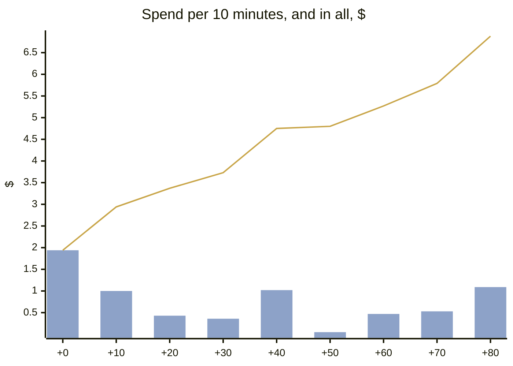
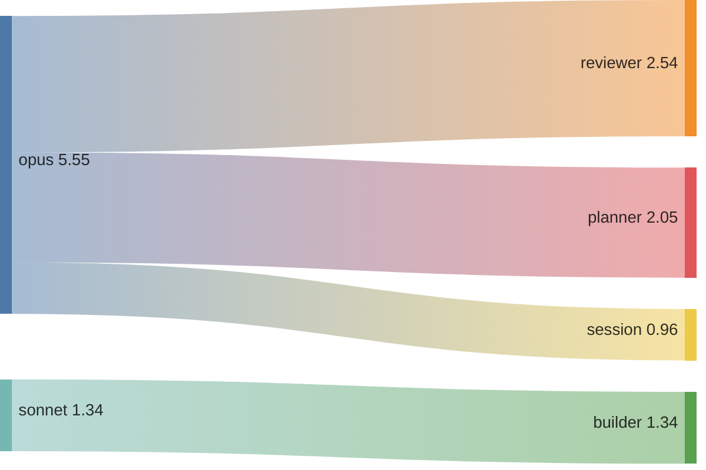
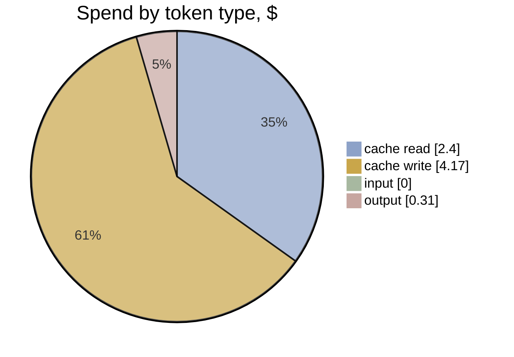

# F2 · A1-1 · F's sluice: effort and timeline

[Summary](../health-summary.md) · Item **F2** (Summon on the fly) · start `61e4958` · head `7cbaa6d`  
Built 2026-11-11 20:55 UTC from the run's transcripts (list-price equivalent, as the ledger prices)

**$6.88** · 170 model calls · 4 transcripts (3 agents) · wall clock 1 h 25 min, **1 h 25 min to the commit** · agent time 1 h 22 min · 0.25 windows

**Outcome:** gates **fail** (lint) · acceptance 40/40 (P1 met, P2 met, P3 met, P4 met) · regressions 20/20 · rules 8/10 before the judge · judge (checked): 0 Blocker, 0 Major, 6 Minor, 0 Nit

## Timeline

Each bar is one transcript (the session, or an agent). Red bars are reviews; the **Long commands** section is every tool call of 60 s or more (tests, builds, e2e), which is where waiting time goes. The milestones are the run's commits.

```mermaid
---
config:
  themeVariables:
    taskBkgColor: '#4a5d8a'
    taskBorderColor: '#34446a'
    critBkgColor: '#a4262c'
    critBorderColor: '#6e1a1e'
    activeTaskBkgColor: '#8f5f00'
    activeTaskBorderColor: '#5e3e00'
---
gantt
  dateFormat x
  axisFormat %H:%M
  todayMarker off
  section Session
    session opus :active, 1794248338087, 1794253429955
  section Agents
    planner r1 opus :1794248360147, 1794249018305
    builder r1 sonnet :1794249030529, 1794250871571
    reviewer r1 opus :crit, 1794250996290, 1794253407691
  section Long commands
    builder r1 · unit pacingBuilt :1794249323664, 1794249416966
    builder r1 · unit sweep :1794249420960, 1794249514607
    builder r1 · unit sweep :1794249519449, 1794249610527
    builder r1 · e2e gallery-assets :1794249658584, 1794249771170
    builder r1 · unit :1794249779398, 1794249886245
    builder r1 · e2e keystone :1794249780030, 1794250128634
    builder r1 · e2e solar-dense :1794250159225, 1794250685328
    builder r1 · e2e suite :1794250698711, 1794250791285
    reviewer r1 · unit :1794251068424, 1794251177642
    reviewer r1 · git diff 61e4958 :1794251069877, 1794251177858
    reviewer r1 · e2e suite :1794251302695, 1794251432941
    reviewer r1 · e2e suite :1794251443424, 1794252045132
    reviewer r1 · wait (sleep) :1794252058006, 1794252299229
    reviewer r1 · wait (sleep) :1794252307617, 1794252728951
    reviewer r1 · e2e solar-dense :1794252736966, 1794252803890
    reviewer r1 · e2e solar-dense solar-dense :1794252810745, 1794253062705
  section Commits
    sluice(F2) Summon on the fly :milestone, 1794253419000, 0d
```

| # | Transcript | Model | Start | Length | Calls | Cost | Output | Context per call (mean · peak) | Tools |
|---|---|---|---|---|---|---|---|---|---|
| 1 | **session** | opus | +0 min | 1 h 25 min | 10 | $0.96 | 4k | 40k · 47k | Bash 6, Agent 3 |
| 2 | planner r1 | opus | +0 min | 11 min | 56 | $2.05 | 6k | 96k · 178k | Bash 56, Write 1, SubagentHandback 1 |
| 3 | builder r1 | sonnet | +12 min | 31 min | 45 | $1.34 | 993 | 89k · 138k | Bash 45, Edit 1, Read 1, SubagentHandback 1 |
| 4 | reviewer r1 | opus | +44 min | 40 min | 59 | $2.54 | 5k | 86k · 126k | Bash 55, Read 3, Write 2, SubagentHandback 1 |

**Time split** (to the commit; bench/timesplit.mjs): e2e wait 37.3 min · other build and check wait 22.9 · waiting (unattributed) 0 · other tools 0.1 · **flow time 24.4 min** · wall less e2e 47.3 min (e2e 44% of the wall clock)

**The run's own records** (its work folder):

- `build-1.json`: done · Summon on the fly built to the packet: PaceRule.passes on facility.enter (gather 715 + act 1200 = 1915 ms), crewTimes/passesPlay/heldMs/releaseOf for passes, a 
- `plan-1.json`: planned · Summons pass through: a PaceRule.passes flag shrinks facility.enter to gather 715 + act 1200 (1915 ms, from 4835 with the crew hold), a pass-through Sortie (two
- `review-1.json`: pass · findings {"blocker":0,"major":0,"minor":3,"nit":1} · Acceptance met: gallery jump-in cell full+reduced with no errors, summonPass unit test (no hold through the spot, blip at the act's instant), 15 §7 row 1915 wit

**Commits:** `7cbaa6d` sluice(F2): Summon on the fly (+1 h 25 min)

**Waiting on long commands:** 57 min in all · e2e 36 min · wait 11 min · unit 8 min · git 2 min

## Effort

**Where the spend went:** model → role

| Role | Transcripts | Calls | Time | Cost | Share | Output | Context per call (mean · p95 · peak) |
|---|---|---|---|---|---|---|---|
| reviewer | 1 | 59 | 40 min | $2.54 | 37% | 5k | 86k · 123k · 126k |
| planner | 1 | 56 | 11 min | $2.05 | 30% | 6k | 96k · 171k · 178k |
| builder | 1 | 45 | 31 min | $1.34 | 19% | 993 | 89k · 132k · 138k |
| session | 1 | 10 | 1 h 25 min | $0.96 | 14% | 4k | 40k · 47k · 47k |
| **All** | 4 | 170 | 2 h 47 min | **$6.88** | 100% | 16k | |

**Token mix:** cache reads $2.40 (35%) · cache writes $4.17 (61%) · output $0.31 (5%) · fresh input $0.00. Long contexts show up as cache reads: every call re-reads what the transcript holds.

## Change health (recorded, not scored)

Lines +402 / −82 over 19 files (src +130, tests +214) · unit tests +7 · e2e +1 · complexity +36 (new over 15: 2) · coverage of touched src 74.61% lines · `any` +0

