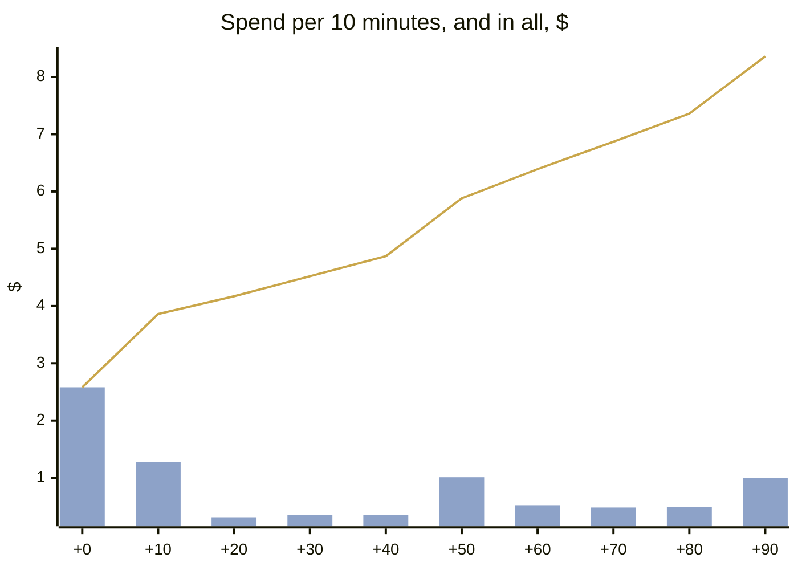
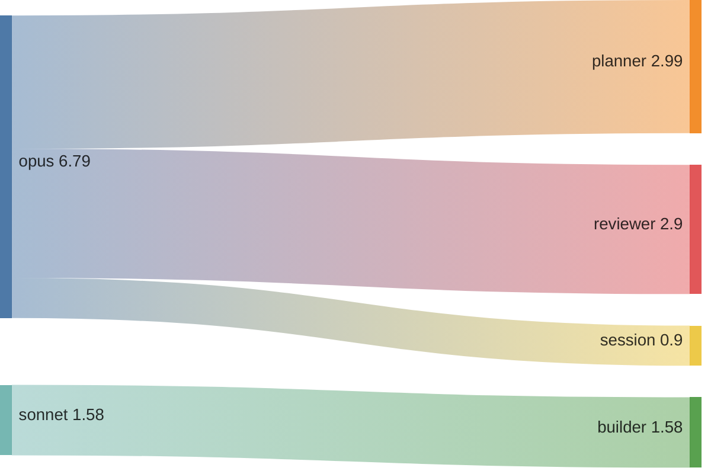
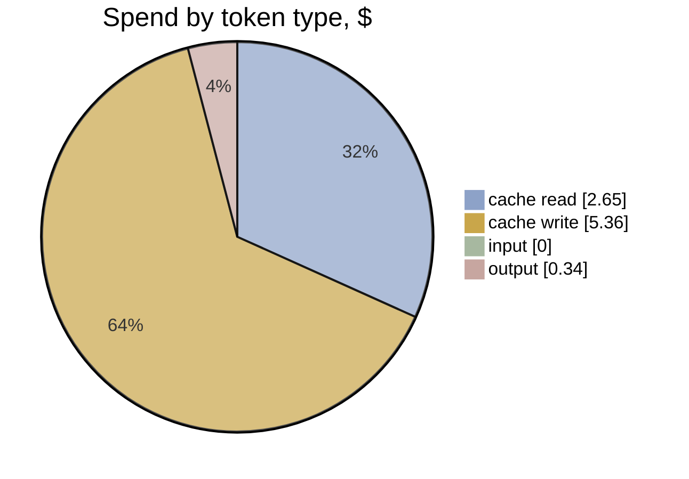

# F2 · A1-2 · F's sluice: effort and timeline

[Summary](../health-summary.md) · Item **F2** (Summon on the fly) · start `61e4958` · head `089e98b`  
Built 2026-11-11 20:55 UTC from the run's transcripts (list-price equivalent, as the ledger prices)

**$8.36** · 166 model calls · 4 transcripts (3 agents) · wall clock 1 h 34 min, **1 h 34 min to the commit** · agent time 1 h 32 min · 0.31 windows

**Outcome:** gates **fail** (lint) · acceptance 40/40 (P1 met, P2 met, P3 met, P4 met) · regressions 20/20 · rules 10/10 before the judge · judge (checked): 0 Blocker, 0 Major, 3 Minor, 0 Nit

## Timeline

Each bar is one transcript (the session, or an agent). Red bars are reviews; the **Long commands** section is every tool call of 60 s or more (tests, builds, e2e), which is where waiting time goes. The milestones are the run's commits.

```mermaid
---
config:
  themeVariables:
    taskBkgColor: '#4a5d8a'
    taskBorderColor: '#34446a'
    critBkgColor: '#a4262c'
    critBorderColor: '#6e1a1e'
    activeTaskBkgColor: '#8f5f00'
    activeTaskBorderColor: '#5e3e00'
---
gantt
  dateFormat x
  axisFormat %H:%M
  todayMarker off
  section Session
    session opus :active, 1794306441381, 1794312108909
  section Agents
    planner r1 opus :1794306460837, 1794307278149
    builder r1 sonnet :1794307287559, 1794309535166
    reviewer r1 opus :crit, 1794309644809, 1794312078085
  section Long commands
    builder r1 · unit :1794307608565, 1794307701546
    builder r1 · unit literalFence sweep :1794307705484, 1794307795950
    builder r1 · unit commands :1794307906591, 1794308014713
    builder r1 · wait (sleep) :1794308031661, 1794308452707
    builder r1 · e2e solar-dense solar-dense :1794308504921, 1794309106076
    builder r1 · wait (sleep) :1794309111148, 1794309352254
    builder r1 · e2e suite :1794309354880, 1794309461842
    reviewer r1 · unit :1794309679863, 1794309786650
    reviewer r1 · sed -n 265 400p :1794309680460, 1794309786780
    reviewer r1 · wait (sleep) :1794309962256, 1794310383581
    reviewer r1 · e2e suite :1794310399677, 1794310926969
    reviewer r1 · e2e suite :1794310933913, 1794311466459
    reviewer r1 · e2e suite :1794311474158, 1794311999106
  section Commits
    sluice(F2) Summon on the fly :milestone, 1794312096000, 0d
```

| # | Transcript | Model | Start | Length | Calls | Cost | Output | Context per call (mean · peak) | Tools |
|---|---|---|---|---|---|---|---|---|---|
| 1 | **session** | opus | +0 min | 1 h 34 min | 9 | $0.90 | 4k | 38k · 43k | Bash 5, Agent 3 |
| 2 | planner r1 | opus | +0 min | 14 min | 66 | $2.99 | 7k | 132k · 231k | Bash 66, Write 2, Read 1, SubagentHandback 1 |
| 3 | builder r1 | sonnet | +14 min | 37 min | 57 | $1.58 | 4k | 98k · 142k | Bash 56, Read 3, SubagentHandback 1 |
| 4 | reviewer r1 | opus | +53 min | 41 min | 34 | $2.90 | 4k | 74k · 107k | Bash 33, Read 2, Write 2, SubagentHandback 1 |

**Time split** (to the commit; bench/timesplit.mjs): e2e wait 46.3 min · other build and check wait 22.3 · waiting (unattributed) 0 · other tools 0.6 · **flow time 25 min** · wall less e2e 47.9 min (e2e 49% of the wall clock)

**The run's own records** (its work folder):

- `build-1.json`: done · Summons pass through the spot: facility.enter is gather/act/land (2515 ms, was 2815; held turn 4835 -> 2515), PaceRule.passes + passTimes/crewTimesOf, Sortie pa
- `plan-1.json`: planned · Summons pass through: facility.enter drops its tell (2515 ms), a new PaceRule.passes gives the crew passTimes (named from the act for NOTE_MIN_MS, no held turn)
- `review-1.json`: pass · findings {"blocker":0,"major":0,"minor":2,"nit":2} · Acceptance met. The summon passes, its blip and the arrival share hue and shape at the act's start, 2515 ms with docs and goldens matching, and the ledger has F

**Commits:** `089e98b` sluice(F2): Summon on the fly (+1 h 34 min)

**Waiting on long commands:** 1 h 05 min in all · e2e 38 min · wait 18 min · unit 7 min · sed 2 min

## Effort

**Where the spend went:** model → role

| Role | Transcripts | Calls | Time | Cost | Share | Output | Context per call (mean · p95 · peak) |
|---|---|---|---|---|---|---|---|
| planner | 1 | 66 | 14 min | $2.99 | 36% | 7k | 132k · 223k · 231k |
| reviewer | 1 | 34 | 41 min | $2.90 | 35% | 4k | 74k · 104k · 107k |
| builder | 1 | 57 | 37 min | $1.58 | 19% | 4k | 98k · 139k · 142k |
| session | 1 | 9 | 1 h 34 min | $0.90 | 11% | 4k | 38k · 43k · 43k |
| **All** | 4 | 166 | 3 h 06 min | **$8.36** | 100% | 19k | |

**Token mix:** cache reads $2.65 (32%) · cache writes $5.36 (64%) · output $0.34 (4%) · fresh input $0.00. Long contexts show up as cache reads: every call re-reads what the transcript holds.

## Change health (recorded, not scored)

Lines +413 / −81 over 22 files (src +135, tests +207) · unit tests +7 · e2e +1 · complexity +43 (new over 15: 0) · coverage of touched src 63.41% lines · `any` +0

