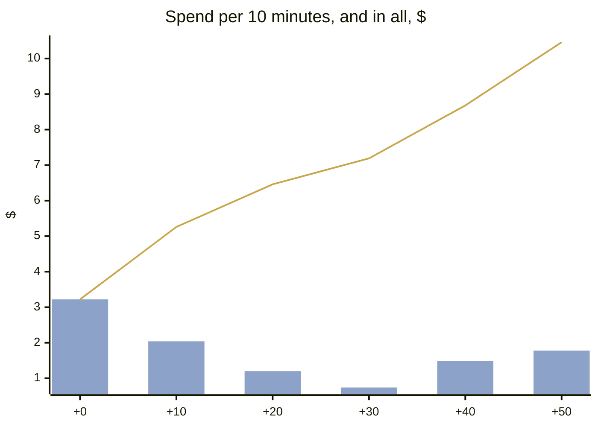
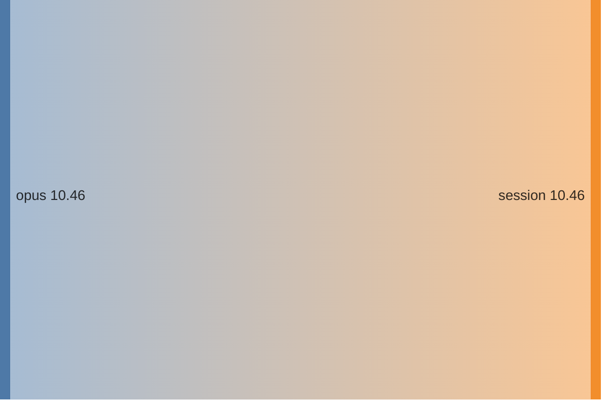
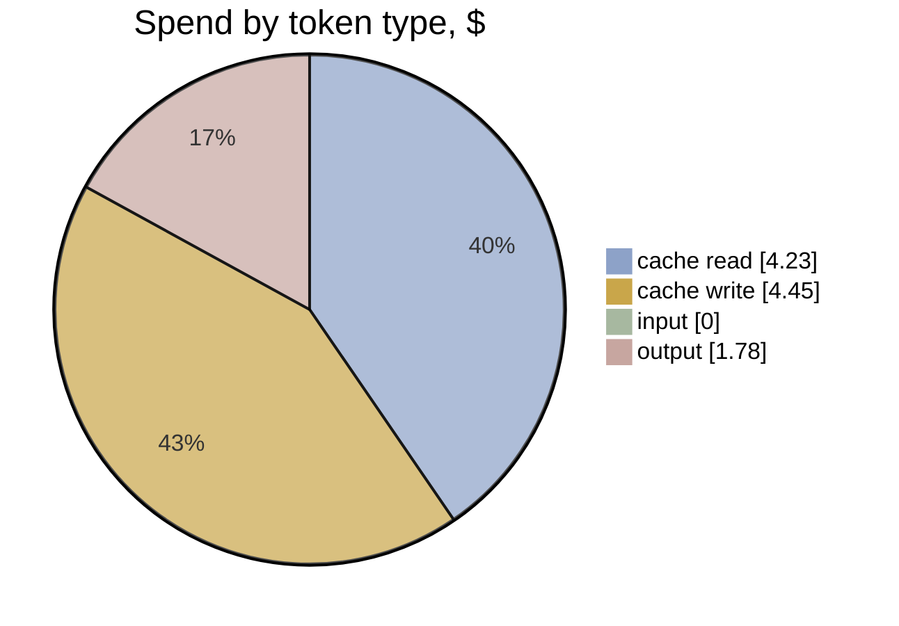

# F2 · A2-1 · One conversation: effort and timeline

[Summary](../health-summary.md) · Item **F2** (Summon on the fly) · start `61e4958` · head `982de53`  
Built 2026-11-11 20:55 UTC from the run's transcripts (list-price equivalent, as the ledger prices)

**$10.46** · 108 model calls · 1 transcript (0 agents) · wall clock 57 min, **56 min to the commit** · agent time 0 min · 0.39 windows

**Outcome:** gates pass · acceptance 40/40 (P1 met, P2 met, P3 met, P4 met) · regressions 20/20 · rules 10/10 before the judge · judge (checked): 0 Blocker, 1 Major, 4 Minor, 0 Nit

## Timeline

Each bar is one transcript (the session, or an agent). Red bars are reviews; the **Long commands** section is every tool call of 60 s or more (tests, builds, e2e), which is where waiting time goes. The milestones are the run's commits.

```mermaid
---
config:
  themeVariables:
    taskBkgColor: '#4a5d8a'
    taskBorderColor: '#34446a'
    critBkgColor: '#a4262c'
    critBorderColor: '#6e1a1e'
    activeTaskBkgColor: '#8f5f00'
    activeTaskBorderColor: '#5e3e00'
---
gantt
  dateFormat x
  axisFormat %H:%M
  todayMarker off
  section Session
    session opus :active, 1794254377183, 1794257771091
  section Long commands
    session · unit :1794254978581, 1794255073114
    session · unit :1794255267066, 1794255357618
    session · unit :1794255571299, 1794255679111
    session · e2e suite :1794255718540, 1794255892574
    session · unit director :1794255980765, 1794256102142
    session · e2e suite :1794256143492, 1794256313562
    session · e2e suite :1794256428982, 1794256592355
    session · e2e solar-dense solar-dense :1794256603314, 1794257124833
    session · e2e suite :1794257135688, 1794257659520
  section Commits
    sluice(F2) Summon on the fly :milestone, 1794257754000, 0d
```

| # | Transcript | Model | Start | Length | Calls | Cost | Output | Context per call (mean · peak) | Tools |
|---|---|---|---|---|---|---|---|---|---|
| 1 | **session** | opus | +0 min | 57 min | 108 | $10.46 | 89k | 204k · 300k | Bash 110, Write 2 |

**Time split** (to the commit; bench/timesplit.mjs): e2e wait 27.4 min · other build and check wait 11.6 · waiting (unattributed) 0 · other tools 0.1 · **flow time 17.3 min** · wall less e2e 28.9 min (e2e 49% of the wall clock)

**The run's own records** (its work folder):

- `build-1.json`: done · Summons on the fly: facility.enter is a pass (PaceRule.pass; gather 715 + act 1200 = 1915 ms). The summoner flies through its spot with no hold or fly-back (a P

**Commits:** `982de53` sluice(F2): Summon on the fly (+56 min)

**Waiting on long commands:** 33 min in all · e2e 26 min · unit 7 min

## Effort

**Where the spend went:** model → role

| Role | Transcripts | Calls | Time | Cost | Share | Output | Context per call (mean · p95 · peak) |
|---|---|---|---|---|---|---|---|
| session | 1 | 108 | 57 min | $10.46 | 100% | 89k | 204k · 295k · 300k |
| **All** | 1 | 108 | 57 min | **$10.46** | 100% | 89k | |

**Token mix:** cache reads $4.23 (40%) · cache writes $4.45 (43%) · output $1.78 (17%) · fresh input $0.00. Long contexts show up as cache reads: every call re-reads what the transcript holds.

## Change health (recorded, not scored)

Lines +453 / −108 over 21 files (src +247, tests +131) · unit tests +4 · e2e +0 · complexity +76 (new over 15: 1) · coverage of touched src 65.09% lines · `any` +0

