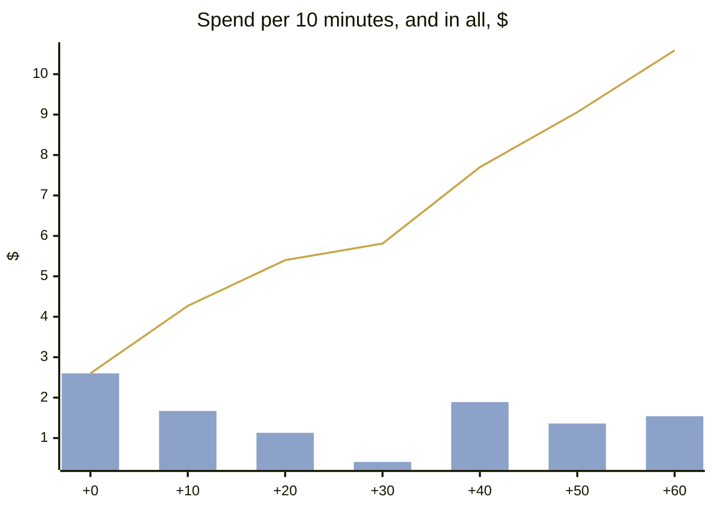
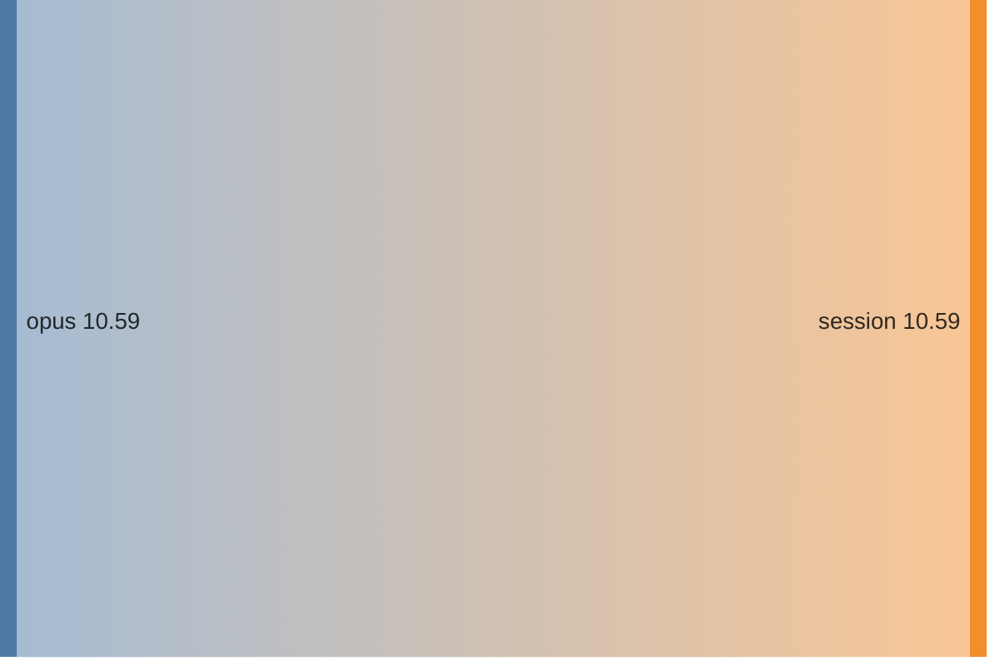
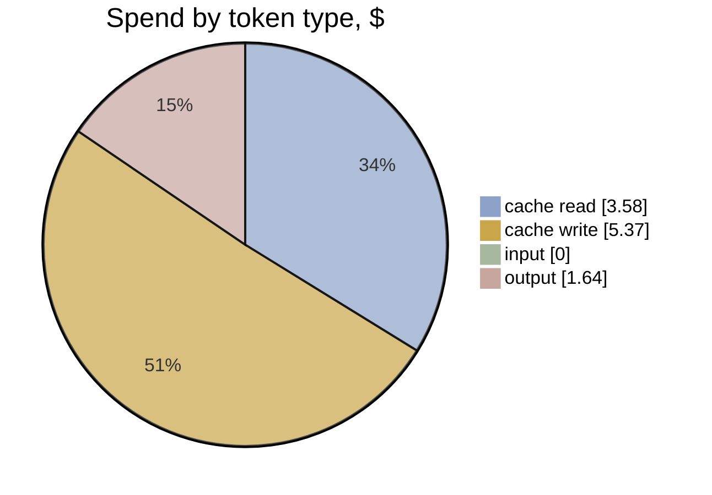

# F2 · A2-2 · One conversation: effort and timeline

[Summary](../health-summary.md) · Item **F2** (Summon on the fly) · start `61e4958` · head `cc978af`  
Built 2026-11-11 20:55 UTC from the run's transcripts (list-price equivalent, as the ledger prices)

**$10.59** · 103 model calls · 1 transcript (0 agents) · wall clock 1 h 04 min, **1 h 03 min to the commit** · agent time 0 min · 0.39 windows

**Outcome:** gates pass · acceptance 40/40 (P1 met, P2 met, P3 met, P4 met) · regressions 20/20 · rules 8/10 before the judge · judge (checked): 0 Blocker, 1 Major, 2 Minor, 0 Nit

## Timeline

Each bar is one transcript (the session, or an agent). Red bars are reviews; the **Long commands** section is every tool call of 60 s or more (tests, builds, e2e), which is where waiting time goes. The milestones are the run's commits.

```mermaid
---
config:
  themeVariables:
    taskBkgColor: '#4a5d8a'
    taskBorderColor: '#34446a'
    critBkgColor: '#a4262c'
    critBorderColor: '#6e1a1e'
    activeTaskBkgColor: '#8f5f00'
    activeTaskBorderColor: '#5e3e00'
---
gantt
  dateFormat x
  axisFormat %H:%M
  todayMarker off
  section Session
    session opus :active, 1794301654038, 1794305483112
  section Long commands
    session · wait (sleep) :1794301939586, 1794302001501
    session · unit :1794302200114, 1794302294432
    session · unit :1794302756100, 1794302861811
    session · e2e suite :1794302923800, 1794303098781
    session · e2e suite :1794303236450, 1794303409642
    session · unit director :1794303558492, 1794303700229
    session · e2e suite :1794303715199, 1794304249397
    session · wait (sleep) :1794304406849, 1794304808069
    session · wait (sleep) :1794304816286, 1794305407875
  section Commits
    sluice(F2) Summon on the fly :milestone, 1794305464000, 0d
```

| # | Transcript | Model | Start | Length | Calls | Cost | Output | Context per call (mean · peak) | Tools |
|---|---|---|---|---|---|---|---|---|---|
| 1 | **session** | opus | +0 min | 1 h 04 min | 103 | $10.59 | 82k | 184k · 274k | Bash 103, Write 2 |

**Time split** (to the commit; bench/timesplit.mjs): e2e wait 36 min · other build and check wait 11.3 · waiting (unattributed) 0 · other tools 0.1 · **flow time 16.1 min** · wall less e2e 27.5 min (e2e 57% of the wall clock)

**Commits:** `cc978af` sluice(F2): Summon on the fly (+1 h 03 min)

**Waiting on long commands:** 38 min in all · wait 18 min · e2e 15 min · unit 6 min

## Effort

**Where the spend went:** model → role

| Role | Transcripts | Calls | Time | Cost | Share | Output | Context per call (mean · p95 · peak) |
|---|---|---|---|---|---|---|---|
| session | 1 | 103 | 1 h 04 min | $10.59 | 100% | 82k | 184k · 267k · 274k |
| **All** | 1 | 103 | 1 h 04 min | **$10.59** | 100% | 82k | |

**Token mix:** cache reads $3.58 (34%) · cache writes $5.37 (51%) · output $1.64 (15%) · fresh input $0.00. Long contexts show up as cache reads: every call re-reads what the transcript holds.

## Change health (recorded, not scored)

Lines +397 / −105 over 18 files (src +197, tests +142) · unit tests +5 · e2e +0 · complexity +55 (new over 15: 1) · coverage of touched src 53.74% lines · `any` +0

