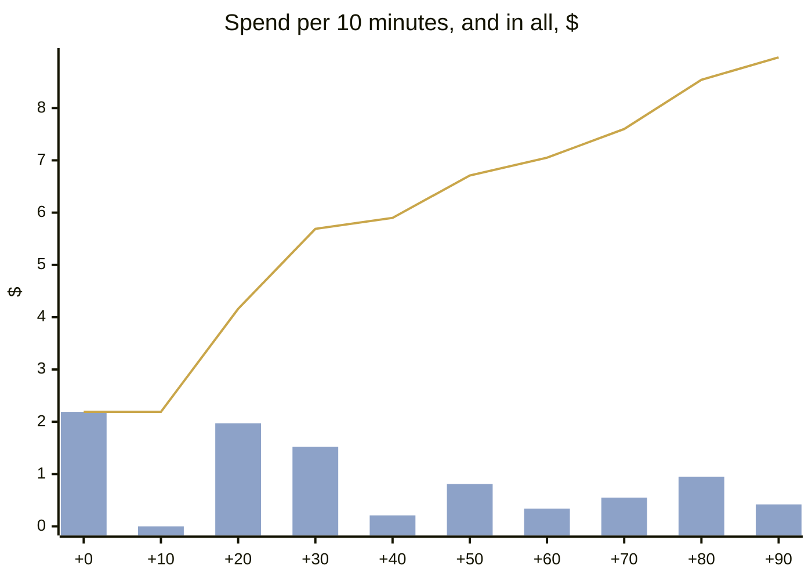
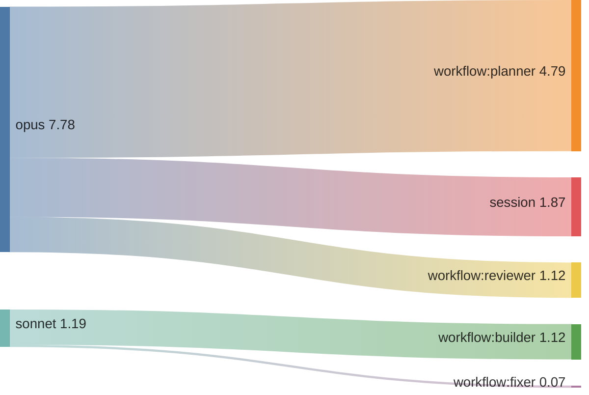
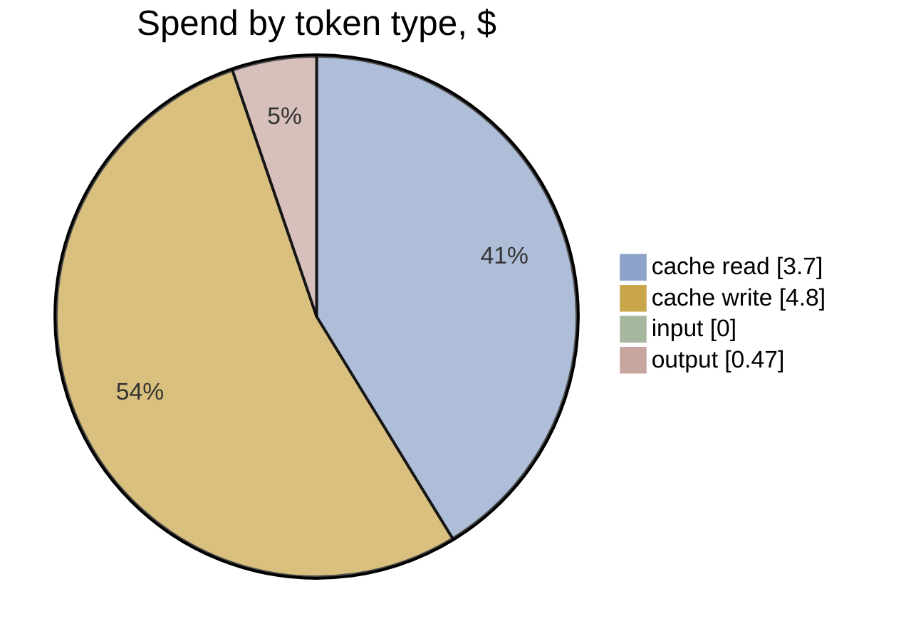

# F2 · A3-1 · Ultracode workflow: effort and timeline

[Summary](../health-summary.md) · Item **F2** (Summon on the fly) · start `61e4958` · head `6e69535`  
Built 2026-11-11 20:55 UTC from the run's transcripts (list-price equivalent, as the ledger prices)

**$8.97** · 214 model calls · 8 transcripts (7 agents) · wall clock 1 h 38 min, **1 h 38 min to the commit** · agent time 1 h 24 min · 0.33 windows

**Outcome:** gates pass · acceptance 40/40 (P1 met, P2 met, P3 met, P4 met) · regressions 20/20 · rules 8/10 before the judge · judge (checked): 0 Blocker, 0 Major, 5 Minor, 1 Nit

## Timeline

Each bar is one transcript (the session, or an agent). Red bars are reviews; the **Long commands** section is every tool call of 60 s or more (tests, builds, e2e), which is where waiting time goes. The milestones are the run's commits.

```mermaid
---
config:
  themeVariables:
    taskBkgColor: '#4a5d8a'
    taskBorderColor: '#34446a'
    critBkgColor: '#a4262c'
    critBorderColor: '#6e1a1e'
    activeTaskBkgColor: '#8f5f00'
    activeTaskBorderColor: '#5e3e00'
---
gantt
  dateFormat x
  axisFormat %H:%M
  todayMarker off
  section Session
    session opus :active, 1794263027363, 1794268930391
  section Agents
    planner opus :1794263056428, 1794265260632
    builder sonnet :1794265262160, 1794265286747
    reviewer opus :crit, 1794265288728, 1794265820135
    fixer sonnet :1794265822284, 1794265858588
    reviewer opus :crit, 1794265860352, 1794266155839
    builder sonnet :1794266184841, 1794267777280
    reviewer opus :crit, 1794267779038, 1794268129036
  section Long commands
    session · unit :1794263070605, 1794263194835
    planner · unit :1794264311320, 1794264404367
    planner · unit :1794264770076, 1794264861112
    planner · unit :1794265141526, 1794265250795
    reviewer · unit :1794265319466, 1794265600599
    reviewer · unit :1794265604047, 1794265700468
    reviewer · unit :1794265703558, 1794265793995
    reviewer · unit :1794265885665, 1794265975256
    reviewer · e2e keystone :1794265979348, 1794266133949
    builder · unit :1794266386957, 1794266492262
    builder · unit :1794266495892, 1794266610506
    builder · unit :1794266798557, 1794266916267
    builder · e2e gallery-assets :1794266944351, 1794267043815
    builder · e2e suite :1794267046638, 1794267211478
    builder · e2e keystone :1794267268247, 1794267497773
    builder · unit :1794267620736, 1794267737078
    reviewer · wait (sleep) :1794267925894, 1794267987241
    session · unit :1794268165851, 1794268285320
    session · e2e gallery-assets solar-dense :1794268288693, 1794268889039
  section Commits
    sluice(F2) Summon on the fly :milestone, 1794268917000, 0d
```

| # | Transcript | Model | Start | Length | Calls | Cost | Output | Context per call (mean · peak) | Tools |
|---|---|---|---|---|---|---|---|---|---|
| 1 | **session** | opus | +0 min | 1 h 38 min | 22 | $1.87 | 15k | 51k · 69k | Bash 16, Workflow 2, Skill 1 |
| 2 | planner | opus | +0 min | 37 min | 80 | $4.79 | 996 | 166k · 259k | Bash 80, Read 1 |
| 3 | builder | sonnet | +37 min | 0 min | 6 | $0.10 | 316 | 29k · 35k | Bash 5 |
| 4 | reviewer | opus | +38 min | 9 min | 9 | $0.18 | 714 | 20k · 28k | Bash 8, StructuredOutput 1 |
| 5 | fixer | sonnet | +47 min | 1 min | 5 | $0.07 | 359 | 22k · 24k | Bash 4 |
| 6 | reviewer | opus | +47 min | 5 min | 8 | $0.15 | 2k | 15k · 20k | Bash 8, StructuredOutput 1 |
| 7 | builder | sonnet | +53 min | 27 min | 60 | $1.02 | 2k | 106k · 153k | Bash 61 |
| 8 | reviewer | opus | +1 h 19 min | 6 min | 24 | $0.79 | 4k | 61k · 86k | Bash 24, Write 2, Read 1, StructuredOutput 1 |

**Time split** (to the commit; bench/timesplit.mjs): e2e wait 23.6 min · other build and check wait 36 · waiting (unattributed) 0 · other tools 0.2 · **flow time 38.3 min** · wall less e2e 74.5 min (e2e 24% of the wall clock)

**The run's own records** (its work folder):

- `build-1.json`: blocked · No packet. docs/progress/v1.4/work/F2/packet.md and plan-1.json do not exist; the folder holds only probe-engine.diff (an unexplained planner probe patching scr
- `build-2.json`: built · Summon on the fly: facility.enter is gather 715 + act 1200 (1915 ms, was 2815) with a passes flag; the summoner's pursue passes through the spot (Sortie pass: n
- `fix-1.json`: blocked · findings [{"id":"B1","severity":"blocker","title":"Nothing for F2 was built","action":"not fixed","detail":"This is a full build (renderer, pursue pass-through, pace.ts phases, ledger entry, 15 section 7 row, goldens, tests), not a fix to existing work. It depends on a packet that does not exist."},{"id":"B2","severity":"blocker","title":"No packet.md / plan-1.json","action":"not fixed","detail":"Planning is the planner's role. Orchestrator should run the planner for F2, then the builder (probe-engine.diff is usable as planner input)."},{"id":"m1","severity":"minor","title":"probe-engine.diff covers engine and ledger only","action":"none","detail":"Informational; confirmed it is not a build. Left untouched."},{"id":"m2","severity":"minor","title":"Baseline npm test flake under load","action":"none","detail":"Reviewer's rerun passed 1719 tests; outside F2."}] · Review verdict is replan: F2 has no packet.md or plan-1.json and nothing is built. Planner must run first; a fixer cannot invent the Approach or goldens.
- `plan-2.json`: planned · Pass-through summon: facility.enter shrinks to gather 715 + act 1200 with a passes flag; Sortie pass flight; one call blip with the arrival; ledger F2/F2+ rows;
- `review-1.json`: fix needed · findings {"blocker":2,"major":0,"minor":1,"nit":0} · Nothing built: the tree equals HEAD and there is no packet.md or plan-1.json, so no F2 acceptance line is met. Needs a re-plan (run the planner for F2), then a 
- `review-2.json`: replan · findings {"blocker":2,"major":0,"minor":1,"nit":0} · Fix-1 changed nothing (blocked: no packet). The tree still equals HEAD; both round-1 Blockers stand: nothing for F2 is built and there is no packet.md/plan-1.js
- `review-3.json`: pass · findings {"blocker":0,"major":0,"minor":3,"nit":2} · F2 meets every acceptance line. The jump-in gallery cell passes in full and reduced motion with no console errors. The commands.test pursue has pass and holdS 0

**Commits:** `6e69535` sluice(F2): Summon on the fly (+1 h 38 min)

**Waiting on long commands:** 48 min in all · unit 26 min · e2e 21 min · wait 1 min

## Effort

**Where the spend went:** model → role

| Role | Transcripts | Calls | Time | Cost | Share | Output | Context per call (mean · p95 · peak) |
|---|---|---|---|---|---|---|---|
| workflow:planner | 1 | 80 | 37 min | $4.79 | 53% | 996 | 166k · 254k · 259k |
| session | 1 | 22 | 1 h 38 min | $1.87 | 21% | 15k | 51k · 67k · 69k |
| workflow:builder | 2 | 66 | 27 min | $1.12 | 12% | 2k | 99k · 147k · 153k |
| workflow:reviewer | 3 | 41 | 20 min | $1.12 | 12% | 7k | 43k · 81k · 86k |
| workflow:fixer | 1 | 5 | 1 min | $0.07 | 1% | 359 | 22k · 24k · 24k |
| **All** | 8 | 214 | 3 h 02 min | **$8.97** | 100% | 25k | |

**Token mix:** cache reads $3.70 (41%) · cache writes $4.80 (53%) · output $0.47 (5%) · fresh input $0.00. Long contexts show up as cache reads: every call re-reads what the transcript holds.

## Change health (recorded, not scored)

Lines +203 / −90 over 20 files (src +93, tests +66) · unit tests +3 · e2e +0 · complexity +22 (new over 15: 0) · coverage of touched src 67.85% lines · `any` +0

