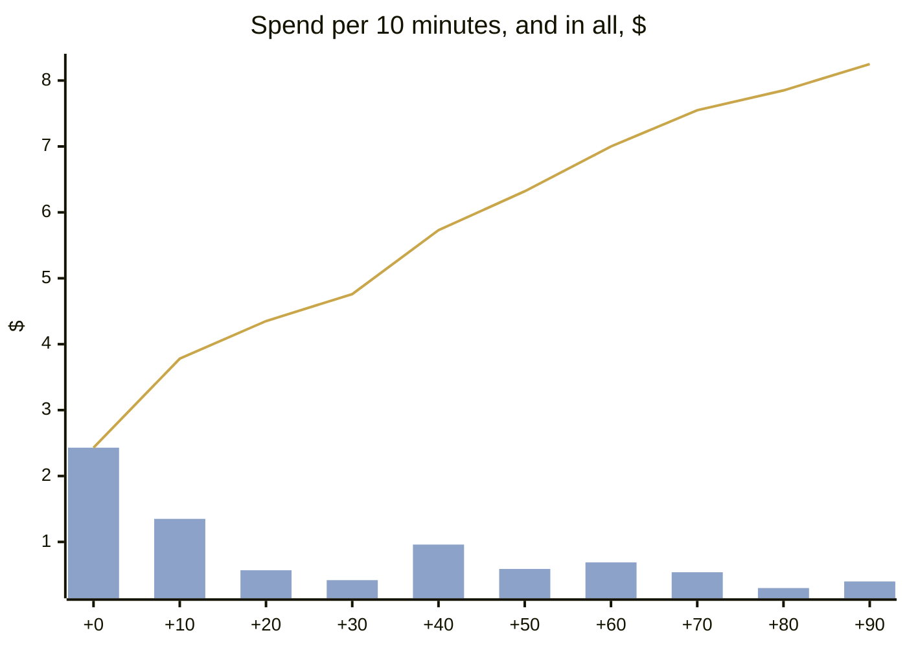
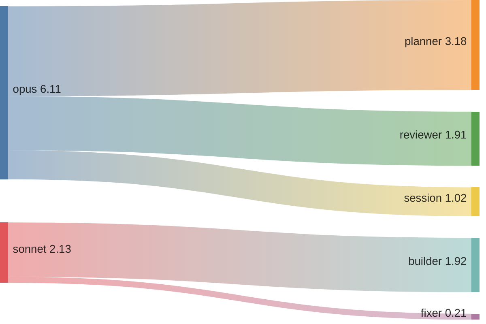
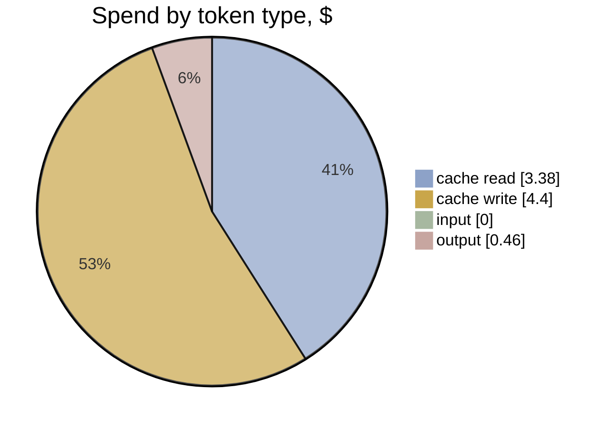

# F2 · A3-2 · Ultracode workflow: effort and timeline

[Summary](../health-summary.md) · Item **F2** (Summon on the fly) · start `61e4958` · head `fe49e20`  
Built 2026-11-11 20:55 UTC from the run's transcripts (list-price equivalent, as the ledger prices)

**$8.25** · 209 model calls · 5 transcripts (4 agents) · wall clock 1 h 34 min, **1 h 33 min to the commit** · agent time 1 h 21 min · 0.31 windows

**Outcome:** gates pass · acceptance 40/40 (P1 met, P2 met, P3 met, P4 met) · regressions 20/20 · rules 10/10 before the judge · judge (checked): 0 Blocker, 0 Major, 4 Minor, 1 Nit

## Timeline

Each bar is one transcript (the session, or an agent). Red bars are reviews; the **Long commands** section is every tool call of 60 s or more (tests, builds, e2e), which is where waiting time goes. The milestones are the run's commits.

```mermaid
---
config:
  themeVariables:
    taskBkgColor: '#4a5d8a'
    taskBorderColor: '#34446a'
    critBkgColor: '#a4262c'
    critBorderColor: '#6e1a1e'
    activeTaskBkgColor: '#8f5f00'
    activeTaskBorderColor: '#5e3e00'
---
gantt
  dateFormat x
  axisFormat %H:%M
  todayMarker off
  section Session
    session opus :active, 1794295077459, 1794300699230
  section Agents
    planner r1 opus :1794295116239, 1794296004974
    builder r1 sonnet :1794296007412, 1794298038305
    reviewer r1 opus :crit, 1794298040479, 1794299430400
    fixer r1 sonnet :1794299432169, 1794299956996
  section Long commands
    builder r1 · unit :1794296116078, 1794296223266
    builder r1 · unit :1794296226145, 1794296321559
    builder r1 · unit :1794296597985, 1794296691517
    builder r1 · wait (sleep) :1794296722543, 1794297123661
    builder r1 · e2e suite :1794297185959, 1794297713757
    builder r1 · e2e keystone :1794297725322, 1794297820287
    builder r1 · unit :1794297923819, 1794298013499
    reviewer r1 · unit :1794298073314, 1794298174329
    reviewer r1 · wait (sleep) :1794298352425, 1794298593720
    reviewer r1 · e2e suite :1794298610829, 1794299144153
    reviewer r1 · e2e keystone :1794299216706, 1794299292065
    fixer r1 · e2e zz-f2-stills :1794299673214, 1794299942183
    session · unit :1794299967320, 1794300075434
    session · e2e suite :1794299968608, 1794300607057
  section Commits
    sluice(F2) Summon on the fly :milestone, 1794300684000, 0d
```

| # | Transcript | Model | Start | Length | Calls | Cost | Output | Context per call (mean · peak) | Tools |
|---|---|---|---|---|---|---|---|---|---|
| 1 | **session** | opus | +0 min | 1 h 34 min | 13 | $1.02 | 6k | 49k · 60k | Bash 9, ScheduleWakeup 2, Skill 1, Workflow 1 |
| 2 | planner r1 | opus | +1 min | 15 min | 62 | $3.18 | 10k | 147k · 241k | Bash 61, Write 2, Read 1 |
| 3 | builder r1 | sonnet | +15 min | 34 min | 70 | $1.92 | 1k | 112k · 177k | Bash 69, Read 1 |
| 4 | reviewer r1 | opus | +49 min | 23 min | 46 | $1.91 | 6k | 81k · 120k | Bash 41, Read 3, Write 2, StructuredOutput 1 |
| 5 | fixer r1 | sonnet | +1 h 13 min | 9 min | 18 | $0.21 | 780 | 41k · 53k | Bash 17, Read 1 |

**Time split** (to the commit; bench/timesplit.mjs): e2e wait 45 min · other build and check wait 20.5 · waiting (unattributed) 0 · other tools 0.1 · **flow time 27.9 min** · wall less e2e 48.5 min (e2e 48% of the wall clock)

**The run's own records** (its work folder):

- `build-1.json`: done · Summon on the fly built as packeted: facility.enter is a pass (gather 715 + act 1200 = 1915 ms), Sortie pass mode (two C1 Hermite legs), call blip in the act, p
- `fix-1.json`: done · findings [{"n":1,"severity":"Minor","action":"fixed","detail":"Took f2-jumpin-full.png and f2-jumpin-reduced.png (the Station jump-in gallery cell in play) with a throwaway spec, since deleted; saved in this folder."},{"n":2,"severity":"Minor","action":"fixed","detail":"BuiltItem gained an optional `note`; renderBuilt prints it under the table. F2's note says Meteor's directed wall time is fitted to 300 s, so the freed room is spent, and that the undirected saving is 13.9 s (Quasar 21.3, Pulsar 24.3). pacing-ledger.md regenerated; pacing-ledger.json, pacing-built.json and pacing-candidates.json unchanged byte for byte."},{"n":3,"severity":"Minor","action":"fixed","detail":"The F2 test now computes each pod's undirected totalMs with and without the pass (PRE_PASS vs live PACE_RULES), so later items cannot move it; the typed TOTAL_BEFORE_F2 is removed. Isolated, Meteor's F2 saving is 13.9 s, not the largest (Quasar 21.3, Pulsar 24.3); the old 'Meteor saves most' claim came from mixing in other changes since 61e4958. The assertion is now: all seven pods save, Meteor saves more than 10 s."},{"n":4,"severity":"Minor (gate)","action":"skipped","detail":"Follows the director's designed lever order (HG-C); it is not an F2 bug. Left for the human gate."},{"n":5,"severity":"Nit","action":"skipped","detail":"Left; (b) and (d) already prove no hold."},{"n":6,"severity":"Nit","action":"skipped","detail":"Left."}] · Review verdict was pass with Minors and Nits only. Fixed the three Minors that were cheap (stills, ledger note, fragile test); left finding 4 for the gate and t
- `plan-1.json`: planned · A pass. facility.enter gets PaceRule.pass and shrinks to gather 715 + act 1200 (1915 ms; tell, fold and land rings cut). crewTimes(phases, true) releases the sh
- `review-1.json`: pass · findings {"blocker":0,"major":0,"minor":4,"nit":2} · Acceptance met: pass mover with no hold, blip and jump in one tick (a real 50 ms test, full and reduced), 15 §7 and docTables green, only director.json moved, F

**Commits:** `fe49e20` sluice(F2): Summon on the fly (+1 h 33 min)

**Waiting on long commands:** 56 min in all · e2e 36 min · wait 11 min · unit 10 min

## Effort

**Where the spend went:** model → role

| Role | Transcripts | Calls | Time | Cost | Share | Output | Context per call (mean · p95 · peak) |
|---|---|---|---|---|---|---|---|
| planner | 1 | 62 | 15 min | $3.18 | 39% | 10k | 147k · 231k · 241k |
| builder | 1 | 70 | 34 min | $1.92 | 23% | 1k | 112k · 172k · 177k |
| reviewer | 1 | 46 | 23 min | $1.91 | 23% | 6k | 81k · 116k · 120k |
| session | 1 | 13 | 1 h 34 min | $1.02 | 12% | 6k | 49k · 60k · 60k |
| fixer | 1 | 18 | 9 min | $0.21 | 3% | 780 | 41k · 53k · 53k |
| **All** | 5 | 209 | 2 h 54 min | **$8.25** | 100% | 24k | |

**Token mix:** cache reads $3.38 (41%) · cache writes $4.40 (53%) · output $0.46 (6%) · fresh input $0.00. Long contexts show up as cache reads: every call re-reads what the transcript holds.

## Change health (recorded, not scored)

Lines +416 / −92 over 24 files (src +128, tests +235) · unit tests +7 · e2e +0 · complexity +42 (new over 15: 2) · coverage of touched src 48.64% lines · `any` +0

