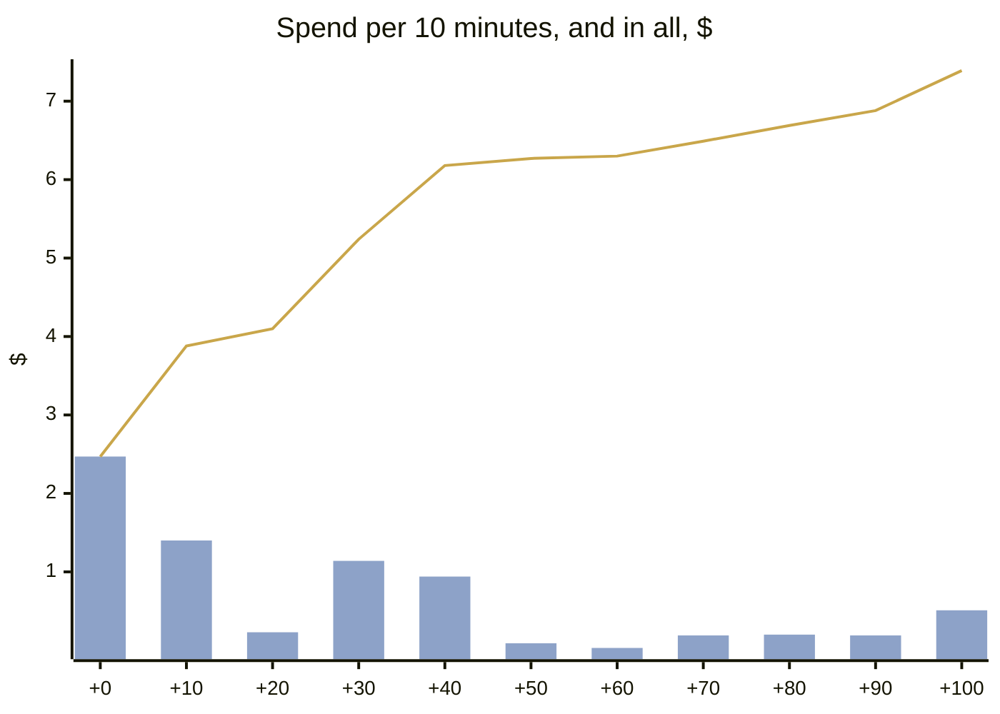
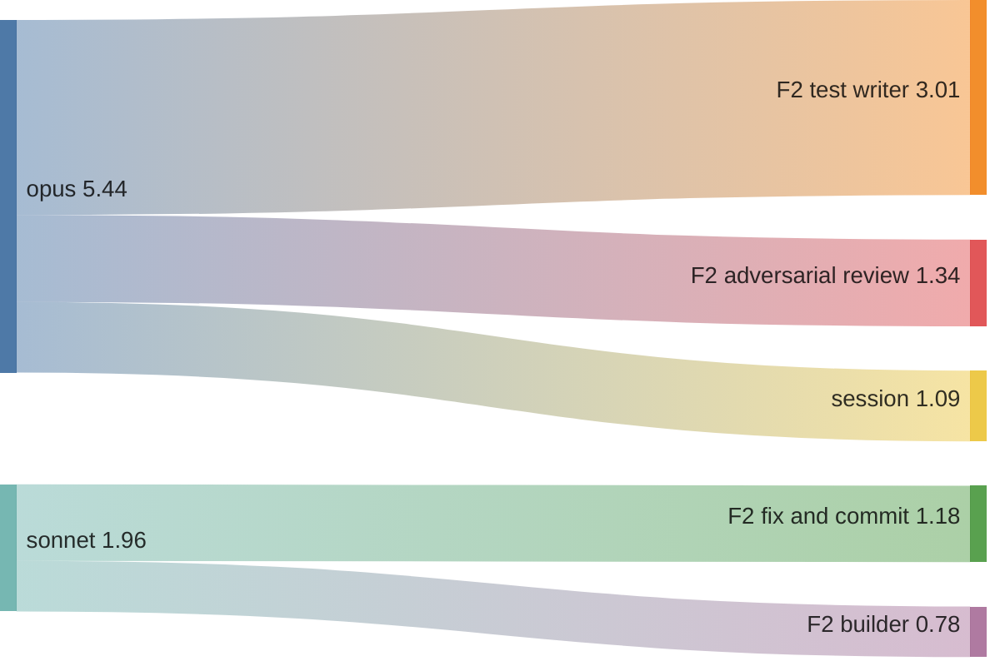
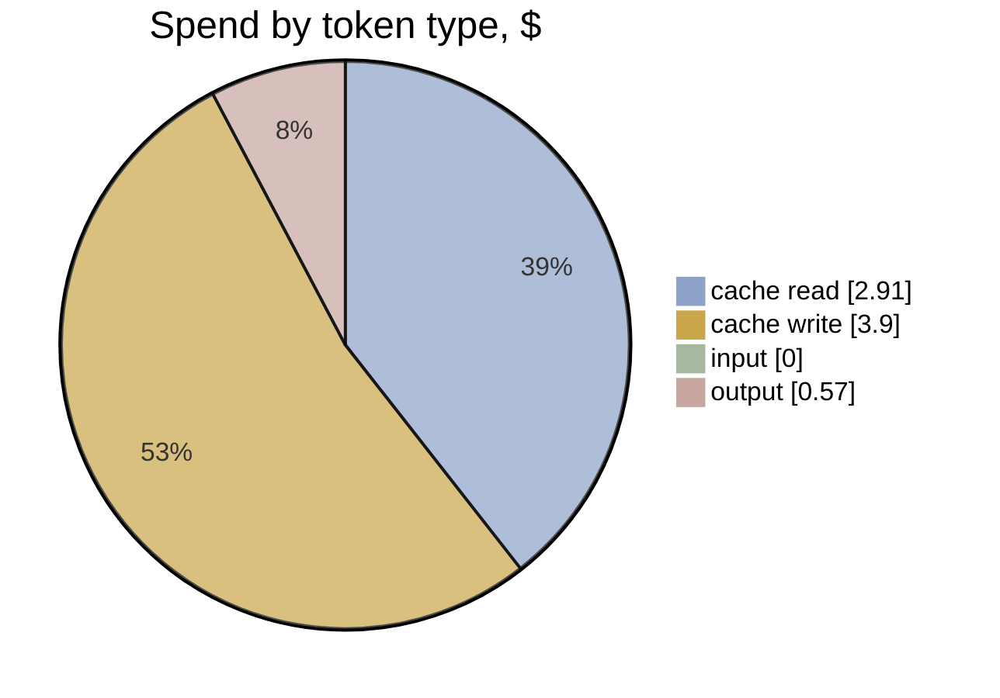

# F2 · A4-1 · Tests first, then hill-climb: effort and timeline

[Summary](../health-summary.md) · Item **F2** (Summon on the fly) · start `61e4958` · head `b6ac778`  
Built 2026-11-11 20:55 UTC from the run's transcripts (list-price equivalent, as the ledger prices)

**$7.39** · 189 model calls · 5 transcripts (4 agents) · wall clock 1 h 47 min, **1 h 47 min to the commit** · agent time 1 h 46 min · 0.27 windows

**Outcome:** gates pass · acceptance 40/40 (P1 met, P2 met, P3 met, P4 met) · regressions 20/20 · rules 8/10 before the judge · judge (checked): 0 Blocker, 0 Major, 5 Minor, 0 Nit

## Timeline

Each bar is one transcript (the session, or an agent). Red bars are reviews; the **Long commands** section is every tool call of 60 s or more (tests, builds, e2e), which is where waiting time goes. The milestones are the run's commits.

```mermaid
---
config:
  themeVariables:
    taskBkgColor: '#4a5d8a'
    taskBorderColor: '#34446a'
    critBkgColor: '#a4262c'
    critBorderColor: '#6e1a1e'
    activeTaskBkgColor: '#8f5f00'
    activeTaskBorderColor: '#5e3e00'
---
gantt
  dateFormat x
  axisFormat %H:%M
  todayMarker off
  section Session
    session opus :active, 1794270336936, 1794276766918
  section Agents
    F2 test writer opus :1794270358322, 1794271194856
    F2 builder sonnet :1794271207743, 1794272314764
    F2 adversarial review opus :crit, 1794272326333, 1794272995731
    F2 fix and commit sonnet :1794273014147, 1794276747427
  section Long commands
    F2 test writer · unit :1794271007208, 1794271099776
    F2 builder · unit :1794271384149, 1794271479476
    F2 builder · unit :1794271572913, 1794271672497
    F2 builder · unit :1794271790135, 1794271911440
    F2 builder · wait (sleep) :1794271914727, 1794272015976
    F2 builder · e2e keystone :1794272056824, 1794272204252
    F2 builder · e2e suite :1794272207264, 1794272285870
    F2 adversarial review · wait (sleep) :1794272595480, 1794272656657
    F2 fix and commit · unit :1794273146471, 1794273240624
    F2 fix and commit · unit :1794273242422, 1794273338868
    F2 fix and commit · e2e suite :1794273348742, 1794273509084
    F2 fix and commit · unit :1794273656182, 1794273766120
    F2 fix and commit · e2e solar-dense solar-dense :1794273768756, 1794273908608
    F2 fix and commit · e2e suite :1794273949556, 1794274018509
    F2 fix and commit · wait (sleep) :1794274027035, 1794274607959
    F2 fix and commit · wait (sleep) :1794274611490, 1794275202467
    F2 fix and commit · wait (sleep) :1794275208541, 1794275804491
    F2 fix and commit · wait (sleep) :1794275807763, 1794276406774
    F2 fix and commit · e2e suite :1794276465351, 1794276691150
  section Commits
    bench tests :milestone, 1794271174000, 0d
    sluice(F2) Summon on the fly :milestone, 1794276734000, 0d
```

| # | Transcript | Model | Start | Length | Calls | Cost | Output | Context per call (mean · peak) | Tools |
|---|---|---|---|---|---|---|---|---|---|
| 1 | **session** | opus | +0 min | 1 h 47 min | 7 | $1.09 | 7k | 37k · 44k | Agent 4, Bash 2 |
| 2 | F2 test writer | opus | +0 min | 14 min | 64 | $3.01 | 15k | 133k · 211k | Bash 63, Write 3, SubagentHandback 1 |
| 3 | F2 builder | sonnet | +15 min | 18 min | 41 | $0.78 | 487 | 101k · 148k | Bash 41, SubagentHandback 1 |
| 4 | F2 adversarial review | opus | +33 min | 11 min | 38 | $1.34 | 6k | 86k · 117k | Bash 37, Edit 3, Write 1, SubagentHandback 1 |
| 5 | F2 fix and commit | sonnet | +45 min | 1 h 02 min | 39 | $1.18 | 697 | 62k · 81k | Bash 38, SubagentHandback 1 |

**Time split** (to the commit; bench/timesplit.mjs): e2e wait 63.5 min · other build and check wait 16.8 · waiting (unattributed) 1.7 · other tools 0.7 · **flow time 23.9 min** · wall less e2e 43.1 min (e2e 60% of the wall clock)

**Commits:** `a985a15` bench: tests (+14 min) · `b6ac778` sluice(F2): Summon on the fly (+1 h 47 min)

**Waiting on long commands:** 1 h 08 min in all · wait 42 min · e2e 14 min · unit 12 min

## Effort

**Where the spend went:** model → role

| Role | Transcripts | Calls | Time | Cost | Share | Output | Context per call (mean · p95 · peak) |
|---|---|---|---|---|---|---|---|
| F2 test writer | 1 | 64 | 14 min | $3.01 | 41% | 15k | 133k · 206k · 211k |
| F2 adversarial review | 1 | 38 | 11 min | $1.34 | 18% | 6k | 86k · 116k · 117k |
| F2 fix and commit | 1 | 39 | 1 h 02 min | $1.18 | 16% | 697 | 62k · 80k · 81k |
| session | 1 | 7 | 1 h 47 min | $1.09 | 15% | 7k | 37k · 44k · 44k |
| F2 builder | 1 | 41 | 18 min | $0.78 | 11% | 487 | 101k · 145k · 148k |
| **All** | 5 | 189 | 3 h 33 min | **$7.39** | 100% | 29k | |

**Token mix:** cache reads $2.91 (39%) · cache writes $3.90 (53%) · output $0.57 (8%) · fresh input $0.00. Long contexts show up as cache reads: every call re-reads what the transcript holds.

## Change health (recorded, not scored)

Lines +588 / −71 over 19 files (src +114, tests +411) · unit tests +10 · e2e +1 · complexity +43 (new over 15: 0) · coverage of touched src 64.56% lines · `any` +0

