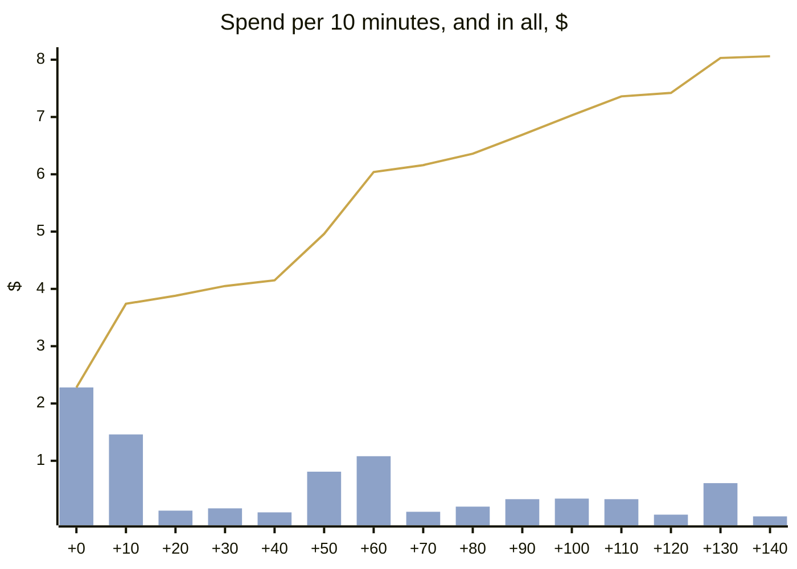
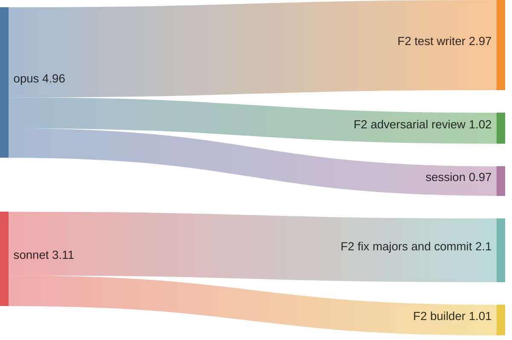
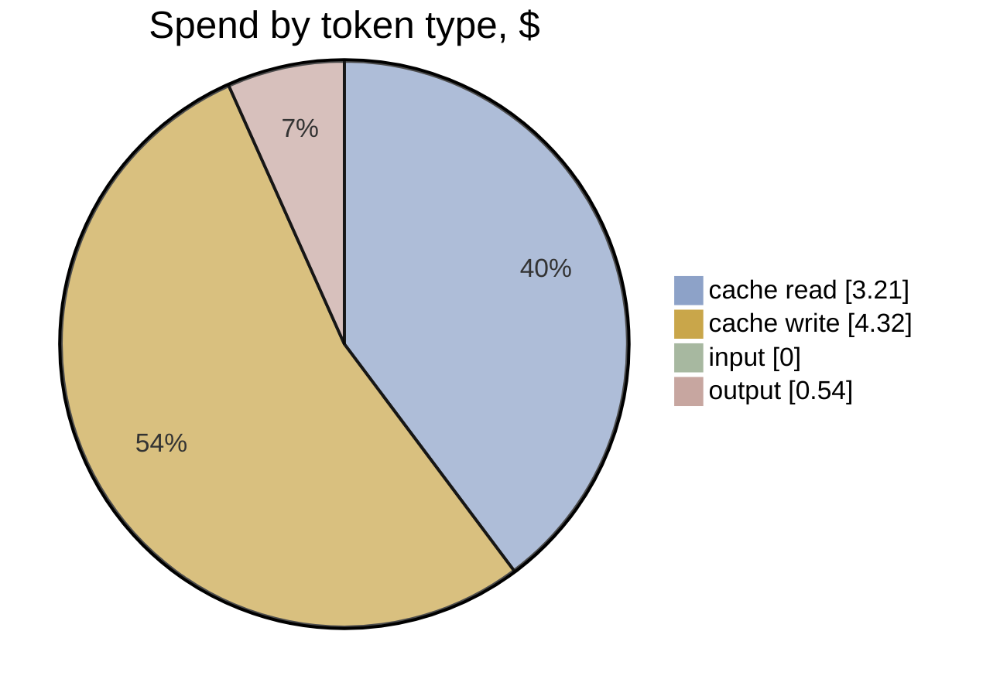

# F2 · A4-2 · Tests first, then hill-climb: effort and timeline

[Summary](../health-summary.md) · Item **F2** (Summon on the fly) · start `61e4958` · head `6ae2058`  
Built 2026-11-11 20:55 UTC from the run's transcripts (list-price equivalent, as the ledger prices)

**$8.06** · 224 model calls · 5 transcripts (4 agents) · wall clock 2 h 20 min, **2 h 20 min to the commit** · agent time 2 h 19 min · 0.30 windows

**Outcome:** gates pass · acceptance 35/40 (P1 met, P2 met, P3 met, P4 partial) · regressions 20/20 · rules 10/10 before the judge · judge (checked): 0 Blocker, 0 Major, 4 Minor, 1 Nit

## Timeline

Each bar is one transcript (the session, or an agent). Red bars are reviews; the **Long commands** section is every tool call of 60 s or more (tests, builds, e2e), which is where waiting time goes. The milestones are the run's commits.

```mermaid
---
config:
  themeVariables:
    taskBkgColor: '#4a5d8a'
    taskBorderColor: '#34446a'
    critBkgColor: '#a4262c'
    critBorderColor: '#6e1a1e'
    activeTaskBkgColor: '#8f5f00'
    activeTaskBorderColor: '#5e3e00'
---
gantt
  dateFormat x
  axisFormat %H:%M
  todayMarker off
  section Session
    session opus :active, 1794285268065, 1794293676152
  section Agents
    F2 test writer opus :1794285280920, 1794286202687
    F2 builder sonnet :1794286213803, 1794288758334
    F2 adversarial review opus :crit, 1794288769286, 1794289217855
    F2 fix majors and commit sonnet :1794289229111, 1794293658851
  section Long commands
    F2 builder · unit :1794286500157, 1794286598331
    F2 builder · unit :1794286650863, 1794286772729
    F2 builder · wait (sleep) :1794286774675, 1794286875708
    F2 builder · unit :1794286956818, 1794287061251
    F2 builder · e2e summon-on-the-fly gallery-asset :1794287065107, 1794287171216
    F2 builder · e2e summon-on-the-fly gallery-asset :1794287176691, 1794287285137
    F2 builder · e2e solar solar-play solar-dense :1794287287592, 1794287549661
    F2 builder · e2e solar-dense solar-dense summon- :1794287688997, 1794287861763
    F2 builder · e2e solar-dense summon-on-the-fly s :1794287905481, 1794287992616
    F2 builder · e2e solar-dense solar-play montage- :1794288033066, 1794288258204
    F2 builder · e2e solar-dense solar-dense :1794288421864, 1794288518984
    F2 builder · unit :1794288617663, 1794288726599
    F2 adversarial review · wait (sleep) :1794289001648, 1794289152863
    F2 fix majors and commit · unit summonOnTheFlyFi :1794289401086, 1794289513979
    F2 fix majors and commit · unit :1794289587308, 1794289690781
    F2 fix majors and commit · e2e summon-on-the-fly :1794289701958, 1794289843199
    F2 fix majors and commit · e2e solar solar-dense :1794289845355, 1794290079413
    F2 fix majors and commit · e2e solar-dense solar :1794290385682, 1794290919282
    F2 fix majors and commit · e2e keystone :1794290925074, 1794291144753
    F2 fix majors and commit · pacing ledger :1794291150623, 1794291571909
    F2 fix majors and commit · e2e solar-dense :1794291594486, 1794291795746
    F2 fix majors and commit · wait (sleep) :1794291803007, 1794292384043
    F2 fix majors and commit · e2e demo solar-dense  :1794292392283, 1794292471761
    F2 fix majors and commit · e2e demo :1794292479033, 1794292584457
    F2 fix majors and commit · wait (sleep) :1794292591890, 1794293183072
    F2 fix majors and commit · wait (sleep) :1794293187459, 1794293428606
    F2 fix majors and commit · e2e perf :1794293433373, 1794293561502
    F2 fix majors and commit · e2e perf perf :1794293565038, 1794293636932
  section Commits
    bench tests :milestone, 1794286183000, 0d
    sluice(F2) Summon on the fly :milestone, 1794293646000, 0d
```

| # | Transcript | Model | Start | Length | Calls | Cost | Output | Context per call (mean · peak) | Tools |
|---|---|---|---|---|---|---|---|---|---|
| 1 | **session** | opus | +0 min | 2 h 20 min | 6 | $0.97 | 5k | 35k · 41k | Agent 4, Bash 1 |
| 2 | F2 test writer | opus | +0 min | 15 min | 68 | $2.97 | 16k | 124k · 200k | Bash 66, Write 3, SubagentHandback 1 |
| 3 | F2 builder | sonnet | +16 min | 42 min | 63 | $1.01 | 833 | 103k · 149k | Bash 63, bash 1, SubagentHandback 1 |
| 4 | F2 adversarial review | opus | +58 min | 7 min | 29 | $1.02 | 5k | 74k · 103k | Bash 27, Read 2, Write 1, SubagentHandback 1 |
| 5 | F2 fix majors and commit | sonnet | +1 h 06 min | 1 h 14 min | 58 | $2.10 | 657 | 100k · 135k | Bash 59, SubagentHandback 1 |

**Time split** (to the commit; bench/timesplit.mjs): e2e wait 57.3 min · other build and check wait 55 · waiting (unattributed) 0 · other tools 0.1 · **flow time 27.2 min** · wall less e2e 82.3 min (e2e 41% of the wall clock)

**Commits:** `5946400` bench: tests (+15 min) · `6ae2058` sluice(F2): Summon on the fly (+2 h 20 min)

**Waiting on long commands:** 1 h 32 min in all · e2e 46 min · wait 28 min · unit 11 min · pacing 7 min

## Effort

**Where the spend went:** model → role

| Role | Transcripts | Calls | Time | Cost | Share | Output | Context per call (mean · p95 · peak) |
|---|---|---|---|---|---|---|---|
| F2 test writer | 1 | 68 | 15 min | $2.97 | 37% | 16k | 124k · 196k · 200k |
| F2 fix majors and commit | 1 | 58 | 1 h 14 min | $2.10 | 26% | 657 | 100k · 133k · 135k |
| F2 adversarial review | 1 | 29 | 7 min | $1.02 | 13% | 5k | 74k · 98k · 103k |
| F2 builder | 1 | 63 | 42 min | $1.01 | 13% | 833 | 103k · 144k · 149k |
| session | 1 | 6 | 2 h 20 min | $0.97 | 12% | 5k | 35k · 41k · 41k |
| **All** | 5 | 224 | 4 h 39 min | **$8.06** | 100% | 28k | |

**Token mix:** cache reads $3.21 (40%) · cache writes $4.32 (54%) · output $0.54 (7%) · fresh input $0.00. Long contexts show up as cache reads: every call re-reads what the transcript holds.

## Change health (recorded, not scored)

Lines +825 / −67 over 22 files (src +173, tests +593) · unit tests +16 · e2e +3 · complexity +61 (new over 15: 3) · coverage of touched src 49.8% lines · `any` +2

