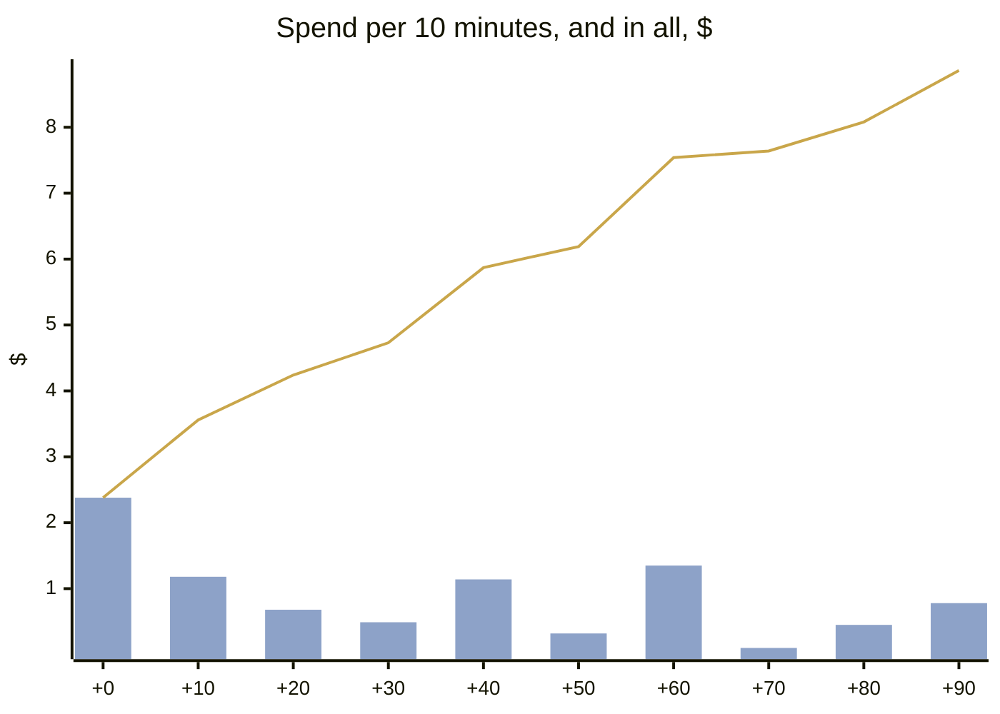
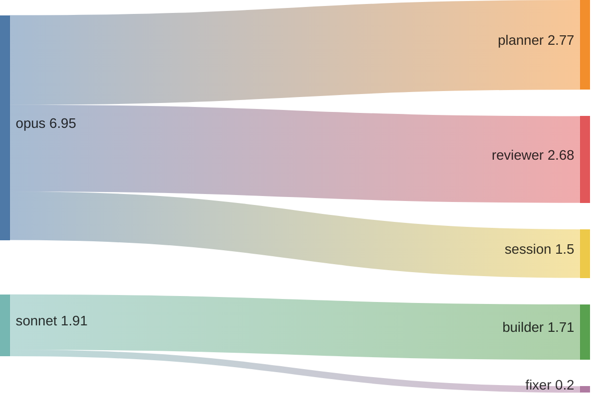
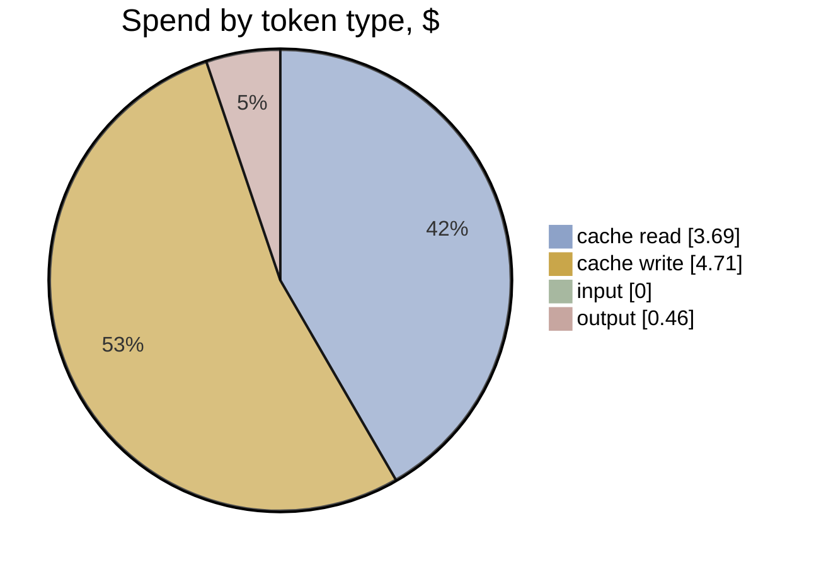

# F2 · A5-1 · Today's sluice: effort and timeline

[Summary](../health-summary.md) · Item **F2** (Summon on the fly) · start `61e4958` · head `00620c1`  
Built 2026-11-11 20:55 UTC from the run's transcripts (list-price equivalent, as the ledger prices)

**$8.86** · 226 model calls · 6 transcripts (5 agents) · wall clock 1 h 37 min, **1 h 37 min to the commit** · agent time 1 h 32 min · 0.33 windows

**Outcome:** gates pass · acceptance 40/40 (P1 met, P2 met, P3 met, P4 met) · regressions 20/20 · rules 10/10 before the judge · judge (checked): 0 Blocker, 0 Major, 3 Minor, 2 Nit

## Timeline

Each bar is one transcript (the session, or an agent). Red bars are reviews; the **Long commands** section is every tool call of 60 s or more (tests, builds, e2e), which is where waiting time goes. The milestones are the run's commits.

```mermaid
---
config:
  themeVariables:
    taskBkgColor: '#4a5d8a'
    taskBorderColor: '#34446a'
    critBkgColor: '#a4262c'
    critBorderColor: '#6e1a1e'
    activeTaskBkgColor: '#8f5f00'
    activeTaskBorderColor: '#5e3e00'
---
gantt
  dateFormat x
  axisFormat %H:%M
  todayMarker off
  section Session
    session opus :active, 1794278069398, 1794283897549
  section Agents
    planner r1 opus :1794278085723, 1794278828051
    builder r1 sonnet :1794278838972, 1794280731562
    reviewer r1 opus :crit, 1794280856521, 1794282152570
    fixer r1 sonnet :1794282158546, 1794282836506
    reviewer r2 opus :crit, 1794282945881, 1794283861760
  section Long commands
    builder r1 · unit :1794279002689, 1794279104319
    builder r1 · unit :1794279106252, 1794279199311
    builder r1 · e2e gallery-assets gallery-assets :1794279536466, 1794279646715
    builder r1 · e2e suite :1794279685538, 1794279850069
    builder r1 · e2e suite :1794279933945, 1794280460508
    builder r1 · unit :1794280483051, 1794280593260
    builder r1 · e2e keystone :1794280595977, 1794280666087
    reviewer r1 · wait (sleep) :1794281122778, 1794281363952
    reviewer r1 · wait (sleep) :1794281390068, 1794281511327
    reviewer r1 · wait (sleep) :1794281517686, 1794281578974
    reviewer r1 · for i in :1794281583351, 1794281674938
    reviewer r1 · e2e suite :1794281730253, 1794281831008
    reviewer r1 · e2e probe :1794281855367, 1794281921125
    fixer r1 · unit :1794282192763, 1794282301091
    fixer r1 · e2e suite :1794282303075, 1794282826528
    reviewer r2 · unit :1794282971410, 1794283073878
    reviewer r2 · e2e suite :1794283078278, 1794283604392
    reviewer r2 · e2e keystone :1794283609653, 1794283714939
  section Commits
    bench today's sluice (.claude/ and sluice/ from  :milestone, 1794278067000, 0d
    sluice(F2) Summon on the fly :milestone, 1794283885000, 0d
```

| # | Transcript | Model | Start | Length | Calls | Cost | Output | Context per call (mean · peak) | Tools |
|---|---|---|---|---|---|---|---|---|---|
| 1 | **session** | opus | +0 min | 1 h 37 min | 13 | $1.50 | 5k | 43k · 53k | Bash 7, Agent 5 |
| 2 | planner r1 | opus | +0 min | 12 min | 59 | $2.77 | 7k | 133k · 220k | Bash 62, Write 2, SubagentHandback 1 |
| 3 | builder r1 | sonnet | +13 min | 32 min | 72 | $1.71 | 1k | 119k · 181k | Bash 72, Read 4, SubagentHandback 1 |
| 4 | reviewer r1 | opus | +46 min | 22 min | 57 | $2.05 | 7k | 104k · 153k | Bash 47, Read 14, Write 2, SubagentHandback 1 |
| 5 | fixer r1 | sonnet | +1 h 08 min | 11 min | 7 | $0.20 | 97 | 31k · 38k | Bash 8, SubagentHandback 1 |
| 6 | reviewer r2 | opus | +1 h 21 min | 15 min | 18 | $0.63 | 3k | 37k · 55k | Bash 15, Read 4, Write 2, SubagentHandback 1 |

**Time split** (to the commit; bench/timesplit.mjs): e2e wait 45.9 min · other build and check wait 16.7 · waiting (unattributed) 0 · other tools 0.3 · **flow time 34 min** · wall less e2e 51 min (e2e 47% of the wall clock)

**The run's own records** (its work folder):

- `build-1.json`: done · Summon on the fly built per packet: facility.enter is gather 715, act 1200, land 600 (2515 ms) with PaceRule.passes; the sequencer, PlannedManeuver.passes, Sort
- `fix-1.json`: done · findings [{"n":1,"severity":"Major","action":"fixed","detail":"Dropped git show/execSync; hard-coded the seven start-commit wallMs values as START_WALL_MS."},{"n":2,"severity":"Minor","action":"fixed","detail":"22 B9 now samples facility nodes; riding episodes are capped at the number of stations that appeared during the sample, besides the 2.2 s limit."},{"n":3,"severity":"Minor","action":"fixed","detail":"Gallery spec leaves play, then waits for a fresh play before each still (full and reduced). The stills were not re-shot by hand; the spec ran and passed."},{"n":4,"severity":"Nit","action":"skipped","detail":"Accepted by the reviewer; design question."},{"n":5,"severity":"Nit","action":"fixed","detail":"Comment naming the E6+ Quasar -1880 precedent at the -2000 bound."},{"n":6,"severity":"Nit","action":"fixed","detail":"spotOf now returns its point p; the guest path uses it, so no non-null assertion."},{"n":7,"severity":"Nit","action":"skipped","detail":"Left as a nit."}] · Fixed the Major (CI-safe start ledger constants) and Minors 2 and 3, plus Nits 5 and 6; left Nits 4 and 7.
- `plan-1.json`: planned · The summon no longer stops. facility.enter drops its tell (gather 715, act 1200, land 600: 2515 ms) and gains a new PaceRule.passes flag. The sequencer gives a 
- `review-1.json`: fix needed · findings {"blocker":0,"major":1,"minor":2,"nit":4} · The build meets acceptance and the effect is visible in the gallery and at 1024x640. One Major: the new pacingBuilt F2 test runs `git show 2b33931`, which fails
- `review-2.json`: pass · findings {"blocker":0,"major":0,"minor":1,"nit":0} · Review 1's Major (git show in CI) and Minor 2 (the B9 exemption) are settled; Nits 5 and 6 are fixed. Minor 3 remains: the gallery spec's stills still miss the 

**Commits:** `2b33931` bench: today's sluice (.claude/ and sluice/ from 2515124) (+0 min) · `00620c1` sluice(F2): Summon on the fly (+1 h 37 min)

**Waiting on long commands:** 54 min in all · e2e 37 min · unit 9 min · wait 7 min · for 2 min

## Effort

**Where the spend went:** model → role

| Role | Transcripts | Calls | Time | Cost | Share | Output | Context per call (mean · p95 · peak) |
|---|---|---|---|---|---|---|---|
| planner | 1 | 59 | 12 min | $2.77 | 31% | 7k | 133k · 214k · 220k |
| reviewer | 2 | 75 | 37 min | $2.68 | 30% | 10k | 88k · 147k · 153k |
| builder | 1 | 72 | 32 min | $1.71 | 19% | 1k | 119k · 173k · 181k |
| session | 1 | 13 | 1 h 37 min | $1.50 | 17% | 5k | 43k · 53k · 53k |
| fixer | 1 | 7 | 11 min | $0.20 | 2% | 97 | 31k · 38k · 38k |
| **All** | 6 | 226 | 3 h 09 min | **$8.86** | 100% | 24k | |

**Token mix:** cache reads $3.69 (42%) · cache writes $4.71 (53%) · output $0.46 (5%) · fresh input $0.00. Long contexts show up as cache reads: every call re-reads what the transcript holds.

## Change health (recorded, not scored)

Lines +423 / −81 over 22 files (src +160, tests +199) · unit tests +5 · e2e +1 · complexity +49 (new over 15: 1) · coverage of touched src 75.04% lines · `any` +0

